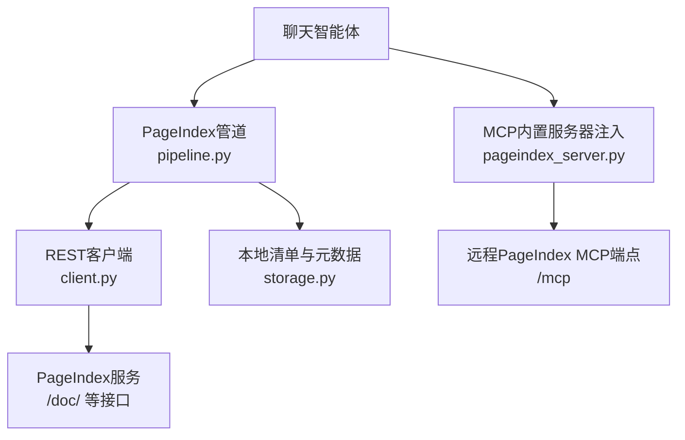
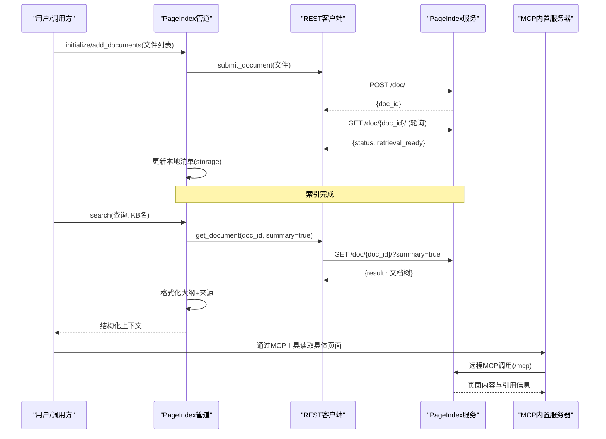
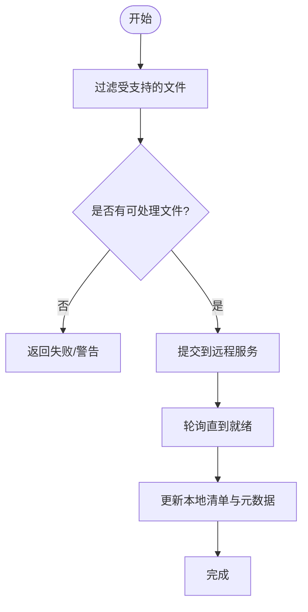
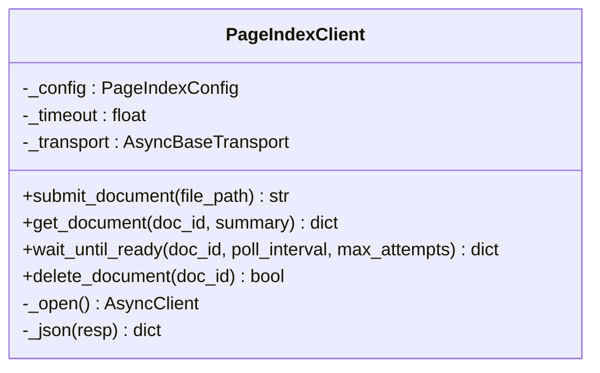
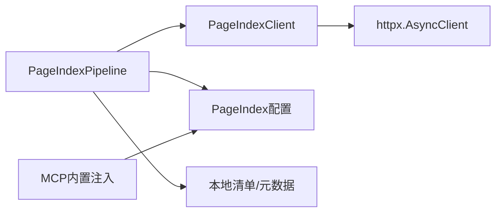

# PageIndex管道

<cite>
**本文引用的文件**
- [pageindex_server.py](file://deeptutor/services/mcp/pageindex_server.py)
- [pipeline.py](file://deeptutor/services/rag/pipelines/pageindex/pipeline.py)
- [client.py](file://deeptutor/services/rag/pipelines/pageindex/client.py)
- [config.py](file://deeptutor/services/rag/pipelines/pageindex/config.py)
- [storage.py](file://deeptutor/services/rag/pipelines/pageindex/storage.py)
- [test_pageindex_pipeline.py](file://tests/services/rag/test_pageindex_pipeline.py)
- [test_pageindex_settings.py](file://tests/services/config/test_pageindex_settings.py)
- [test_pageindex_server.py](file://tests/services/mcp/test_pageindex_server.py)
</cite>

## 目录
1. [简介](#简介)
2. [项目结构](#项目结构)
3. [核心组件](#核心组件)
4. [架构总览](#架构总览)
5. [详细组件分析](#详细组件分析)
6. [依赖关系分析](#依赖关系分析)
7. [性能与可靠性](#性能与可靠性)
8. [故障诊断指南](#故障诊断指南)
9. [结论](#结论)
10. [附录：配置示例与部署运维建议](#附录：配置示例与部署运维建议)

## 简介
PageIndex管道为DeepTutor提供“托管推理检索”能力。它通过远程PageIndex服务完成文档索引与结构化树（标题、页码、摘要）的获取，并以“代理式工具调用”的方式让聊天智能体在对话中按需读取文档内容，实现页面级引用与上下文恢复。本地仅维护轻量清单（文件到云端doc_id的映射），不存储向量或嵌入。

## 项目结构
- 管道编排：负责初始化、增量添加、搜索返回文档大纲、删除KB等生命周期操作。
- 客户端：封装对PageIndex REST API的上传、轮询状态、获取文档树、删除等操作。
- 配置：从运行时设置加载API Key与Base URL，并提供可用性检查。
- 存储：以JSON清单记录每个文件的云端doc_id，并写入元数据使版本系统认为该KB已就绪。
- MCP内置服务器：当配置了API Key时，自动注入一个保留名称的MCP服务器条目，供聊天智能体通过工具访问远程PageIndex能力；同时屏蔽危险工具（如删除云端文档）。

图表来源
- [pipeline.py:57-154](file://deeptutor/services/rag/pipelines/pageindex/pipeline.py#L57-L154)
- [client.py:36-133](file://deeptutor/services/rag/pipelines/pageindex/client.py#L36-L133)
- [pageindex_server.py:20-47](file://deeptutor/services/mcp/pageindex_server.py#L20-L47)
- [storage.py:23-74](file://deeptutor/services/rag/pipelines/pageindex/storage.py#L23-L74)

章节来源
- [pipeline.py:1-328](file://deeptutor/services/rag/pipelines/pageindex/pipeline.py#L1-L328)
- [client.py:1-133](file://deeptutor/services/rag/pipelines/pageindex/client.py#L1-L133)
- [config.py:1-60](file://deeptutor/services/rag/pipelines/pageindex/config.py#L1-L60)
- [storage.py:1-115](file://deeptutor/services/rag/pipelines/pageindex/storage.py#L1-L115)
- [pageindex_server.py:1-51](file://deeptutor/services/mcp/pageindex_server.py#L1-L51)

## 核心组件
- PageIndexPipeline：编排文档提交、等待处理完成、读取文档树、生成结构化上下文、清理资源。
- PageIndexClient：基于httpx的异步HTTP客户端，封装上传、轮询、查询、删除等接口。
- 配置模块：加载API Key与Base URL，未配置时抛出明确错误以便快速定位问题。
- 存储模块：维护轻量清单与元数据，保证版本系统识别KB就绪。
- MCP内置服务器：按条件注入远程MCP连接，屏蔽危险工具，支持热重载凭据。

章节来源
- [pipeline.py:57-154](file://deeptutor/services/rag/pipelines/pageindex/pipeline.py#L57-L154)
- [client.py:36-133](file://deeptutor/services/rag/pipelines/pageindex/client.py#L36-L133)
- [config.py:15-42](file://deeptutor/services/rag/pipelines/pageindex/config.py#L15-L42)
- [storage.py:28-74](file://deeptutor/services/rag/pipelines/pageindex/storage.py#L28-L74)
- [pageindex_server.py:20-47](file://deeptutor/services/mcp/pageindex_server.py#L20-L47)

## 架构总览
PageIndex采用“托管索引 + 代理式检索”的混合模式：
- 索引阶段：本地将文件提交至远程服务，等待处理完成，并将doc_id写入本地清单。
- 检索阶段：聊天智能体通过MCP工具直接读取远程文档内容；程序化调用search()则返回文档的结构化大纲作为浅层上下文。

图表来源
- [pipeline.py:79-154](file://deeptutor/services/rag/pipelines/pageindex/pipeline.py#L79-L154)
- [pipeline.py:162-231](file://deeptutor/services/rag/pipelines/pageindex/pipeline.py#L162-L231)
- [client.py:77-133](file://deeptutor/services/rag/pipelines/pageindex/client.py#L77-L133)
- [pageindex_server.py:20-47](file://deeptutor/services/mcp/pageindex_server.py#L20-L47)

## 详细组件分析

### 管道编排（PageIndexPipeline）
- 初始化与增量添加：过滤受支持的文件类型，逐个提交到远程服务，等待处理完成，更新本地清单与元数据。失败时清理临时版本目录。
- 搜索：并发获取所有文档的树形大纲（可包含摘要），格式化为缩进文本与来源列表；若无文档或未配置，返回明确的降级响应。
- 删除：尽力删除云端文档并移除本地KB目录。

图表来源
- [pipeline.py:79-154](file://deeptutor/services/rag/pipelines/pageindex/pipeline.py#L79-L154)
- [pipeline.py:292-324](file://deeptutor/services/rag/pipelines/pageindex/pipeline.py#L292-L324)

章节来源
- [pipeline.py:57-154](file://deeptutor/services/rag/pipelines/pageindex/pipeline.py#L57-L154)
- [pipeline.py:162-231](file://deeptutor/services/rag/pipelines/pageindex/pipeline.py#L162-L231)
- [pipeline.py:292-324](file://deeptutor/services/rag/pipelines/pageindex/pipeline.py#L292-L324)

### 客户端（PageIndexClient）
- 上传：POST /doc/ 提交文件，返回doc_id。
- 轮询：GET /doc/{doc_id}/ 直至达到终止状态或超时。
- 查询：GET /doc/{doc_id}/?summary=true 获取文档树与摘要。
- 删除：DELETE /doc/{doc_id}/ 尽力删除云端文档。
- 错误处理：统一包装为API错误，便于上层捕获与提示。

图表来源
- [client.py:36-133](file://deeptutor/services/rag/pipelines/pageindex/client.py#L36-L133)

章节来源
- [client.py:1-133](file://deeptutor/services/rag/pipelines/pageindex/client.py#L1-L133)

### 配置与认证（config.py）
- 从运行时设置加载API Key与Base URL，默认Base URL指向官方服务。
- 若需要Key但未配置，抛出明确异常，避免下游出现模糊401。
- 提供is_pageindex_configured用于UI快速判断可用性。

章节来源
- [config.py:1-60](file://deeptutor/services/rag/pipelines/pageindex/config.py#L1-L60)
- [test_pageindex_settings.py:10-38](file://tests/services/config/test_pageindex_settings.py#L10-L38)

### 本地存储（storage.py）
- 清单：记录文件名到doc_id的映射，以及提交时间、文件大小等元信息。
- 元数据：写入meta.json使版本系统认为该KB已就绪（signature使用提供者标识）。
- 读写：原子写入，容错读取，缺失或损坏时回退为空清单。

章节来源
- [storage.py:1-115](file://deeptutor/services/rag/pipelines/pageindex/storage.py#L1-L115)

### MCP内置服务器注入（pageindex_server.py）
- 当存在API Key时，自动注入名为“pageindex”的MCP服务器条目，类型为streamableHttp，URL为api_base_url + “/mcp”，并携带Authorization头。
- 禁用危险工具（如remove_document），其他工具透传。
- 用户自定义同名条目优先，覆盖内置注入。

章节来源
- [pageindex_server.py:1-51](file://deeptutor/services/mcp/pageindex_server.py#L1-L51)
- [test_pageindex_server.py:30-69](file://tests/services/mcp/test_pageindex_server.py#L30-L69)

## 依赖关系分析
- 管道依赖客户端与配置，客户端依赖httpx进行网络通信。
- 管道通过storage维护本地清单，配合版本系统识别KB就绪。
- MCP注入依赖配置，动态向MCP配置叠加内置条目。

图表来源
- [pipeline.py:57-154](file://deeptutor/services/rag/pipelines/pageindex/pipeline.py#L57-L154)
- [client.py:36-61](file://deeptutor/services/rag/pipelines/pageindex/client.py#L36-L61)
- [config.py:25-42](file://deeptutor/services/rag/pipelines/pageindex/config.py#L25-L42)
- [pageindex_server.py:20-47](file://deeptutor/services/mcp/pageindex_server.py#L20-L47)

章节来源
- [pipeline.py:57-154](file://deeptutor/services/rag/pipelines/pageindex/pipeline.py#L57-L154)
- [client.py:36-61](file://deeptutor/services/rag/pipelines/pageindex/client.py#L36-L61)
- [config.py:25-42](file://deeptutor/services/rag/pipelines/pageindex/config.py#L25-L42)
- [pageindex_server.py:20-47](file://deeptutor/services/mcp/pageindex_server.py#L20-L47)

## 性能与可靠性
- 并发拉取：search中对多个文档树并发请求，提升整体吞吐。
- 轮询策略：可配置轮询间隔与最大尝试次数，避免长时间阻塞。
- 超时控制：客户端默认超时，防止网络抖动导致挂起。
- 降级机制：无文档或未配置时返回明确提示，避免静默失败。
- 安全限制：MCP层禁用删除云端文档的工具，降低误删风险。

[本节为通用指导，无需特定文件来源]

## 故障诊断指南
- 未配置API Key：会抛出明确异常，提示在“知识库 → RAG管道设置”中添加Key。
- 上传失败：检查文件格式是否受支持；查看日志中的跳过与错误信息。
- 轮询超时：增大max_attempts或poll_interval；检查服务端状态。
- 查询失败：确认KB已初始化且清单存在；查看错误类型字段。
- MCP不可用：确认已配置API Key且注入成功；用户自定义条目可能覆盖内置。

章节来源
- [config.py:25-42](file://deeptutor/services/rag/pipelines/pageindex/config.py#L25-L42)
- [pipeline.py:79-154](file://deeptutor/services/rag/pipelines/pageindex/pipeline.py#L79-L154)
- [pipeline.py:162-231](file://deeptutor/services/rag/pipelines/pageindex/pipeline.py#L162-L231)
- [client.py:101-133](file://deeptutor/services/rag/pipelines/pageindex/client.py#L101-L133)
- [test_pageindex_server.py:30-69](file://tests/services/mcp/test_pageindex_server.py#L30-L69)

## 结论
PageIndex管道通过“托管索引 + 代理式检索”的组合，实现了高效的页面级引用与上下文恢复。本地仅维护轻量清单，减少存储与同步成本；远程服务承担重计算与解析工作。结合MCP注入与安全限制，既保证了能力扩展性，又降低了误操作风险。

[本节为总结，无需特定文件来源]

## 附录：配置示例与部署运维建议

- 配置项说明
  - api_key：PageIndex服务的访问密钥。
  - api_base_url：服务基础地址，默认指向官方地址。
  - 环境变量覆盖：可通过进程环境变量覆盖上述两项。

- 设置位置
  - 在运行时设置服务中保存与加载，持久化到独立文件。
  - UI路径：“知识库 → RAG管道设置”。

- 超时与重试
  - 客户端默认超时与轮询参数可在构造时调整。
  - 建议在批量导入时合理设置轮询间隔与最大尝试次数。

- 缓存策略
  - 本地不缓存向量或全文，仅缓存doc_id映射；如需缓存，应在上层应用实现。
  - 搜索返回的是文档树大纲，可作为短期上下文缓存。

- 离线降级
  - 无文档或未配置时返回明确提示，前端可据此引导用户初始化或配置。
  - 若远程服务不可用，应提示用户稍后重试或切换引擎。

- 与本地管道集成
  - 通过RAG服务工厂根据KB元数据选择provider为pageindex的管道。
  - 与LlamaIndex等其他引擎并存，互不影响。

- 部署与监控
  - 确保MCP注入生效（有API Key时自动注入）。
  - 关注日志中的上传、轮询、查询与删除事件。
  - 监控错误类型与超时情况，必要时调整参数。

章节来源
- [test_pageindex_settings.py:10-38](file://tests/services/config/test_pageindex_settings.py#L10-L38)
- [pipeline.py:162-231](file://deeptutor/services/rag/pipelines/pageindex/pipeline.py#L162-L231)
- [client.py:44-61](file://deeptutor/services/rag/pipelines/pageindex/client.py#L44-L61)
- [test_pageindex_pipeline.py:177-213](file://tests/services/rag/test_pageindex_pipeline.py#L177-L213)