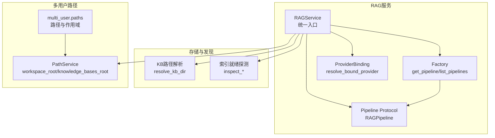
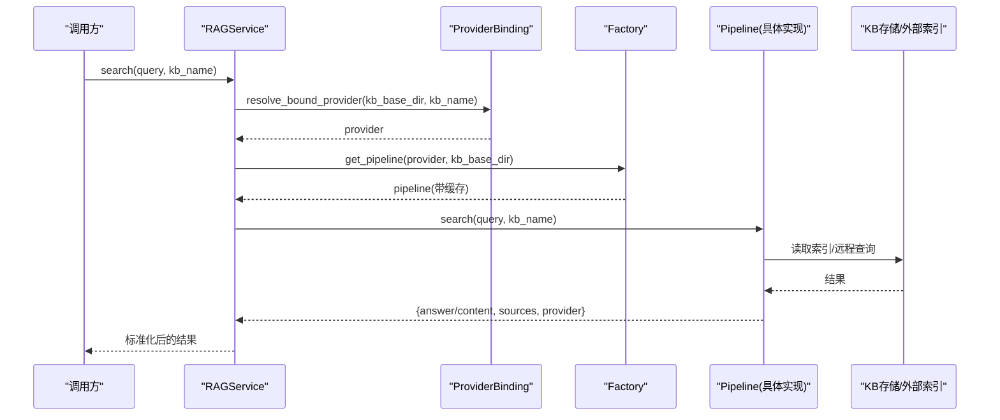
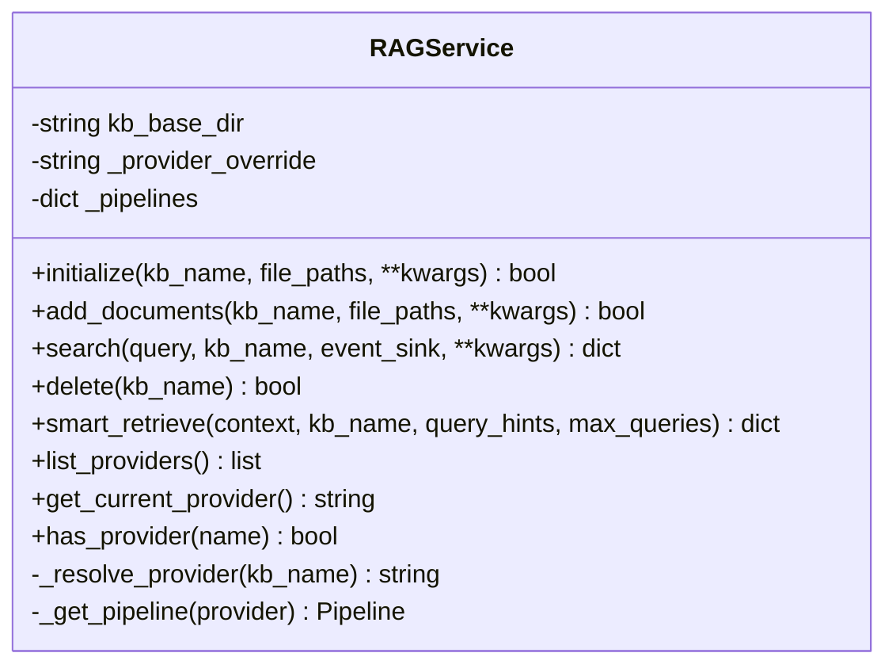
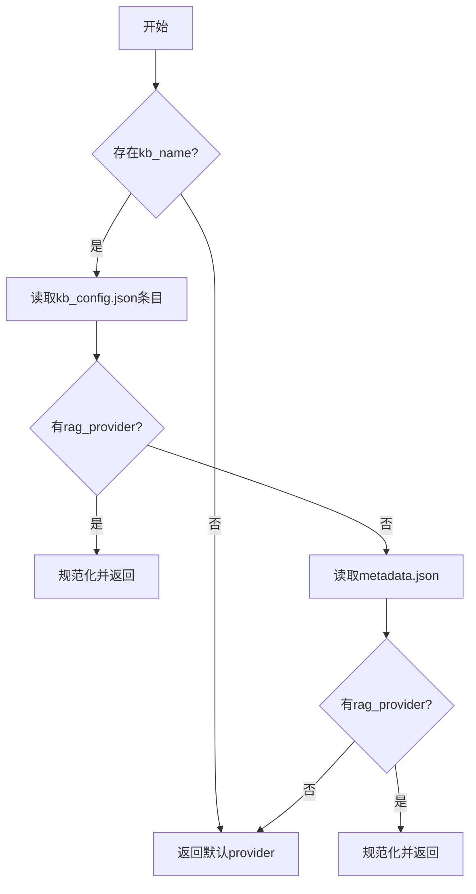
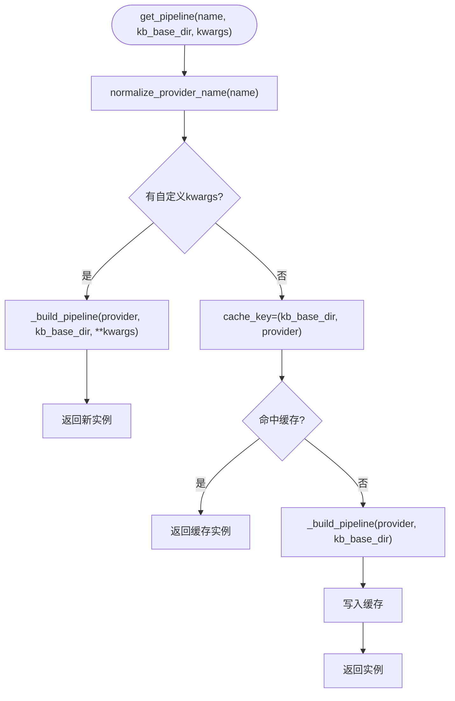
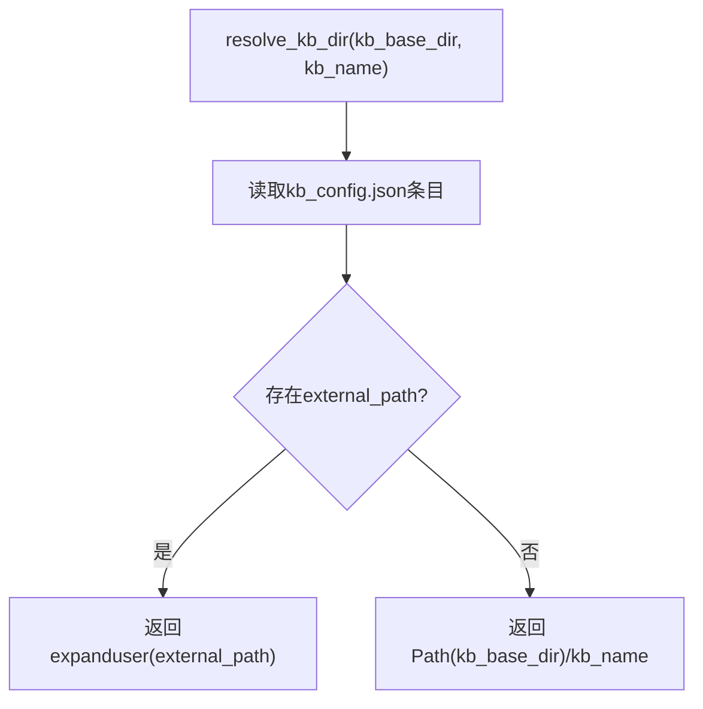
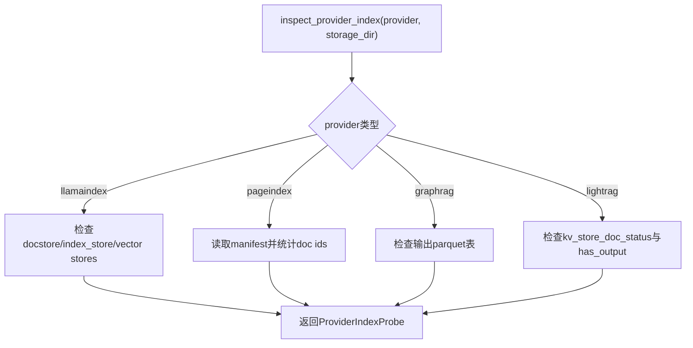
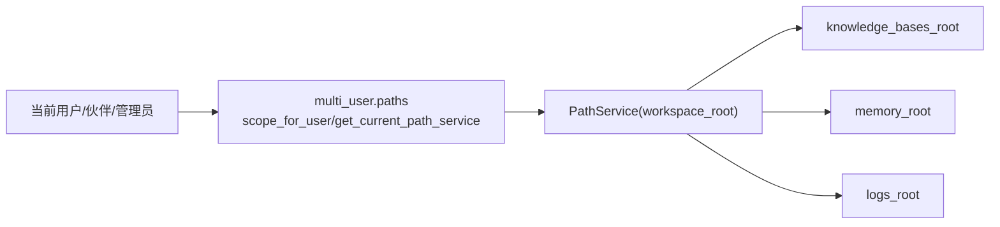
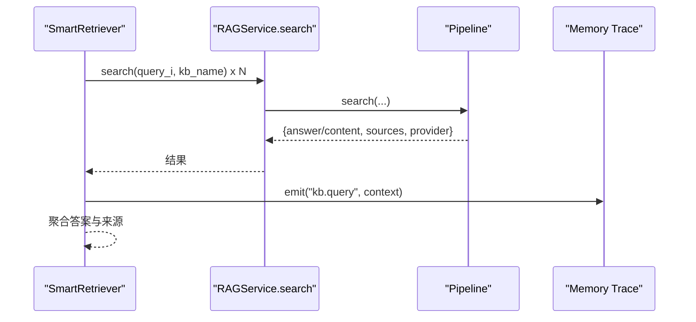
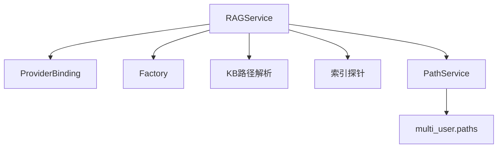

# RAG服务架构

<cite>
**本文引用的文件**
- [service.py](file://deeptutor/services/rag/service.py)
- [factory.py](file://deeptutor/services/rag/factory.py)
- [provider_binding.py](file://deeptutor/services/rag/provider_binding.py)
- [kb_paths.py](file://deeptutor/services/rag/kb_paths.py)
- [index_probe.py](file://deeptutor/services/rag/index_probe.py)
- [smart_retriever.py](file://deeptutor/services/rag/smart_retriever.py)
- [base.py](file://deeptutor/services/rag/pipelines/base.py)
- [paths.py](file://deeptutor/multi_user/paths.py)
- [path_service.py](file://deeptutor/services/path_service.py)
</cite>

## 目录
1. [简介](#简介)
2. [项目结构](#项目结构)
3. [核心组件](#核心组件)
4. [架构总览](#架构总览)
5. [详细组件分析](#详细组件分析)
6. [依赖关系分析](#依赖关系分析)
7. [性能与缓存策略](#性能与缓存策略)
8. [故障排查指南](#故障排查指南)
9. [结论](#结论)
10. [附录：使用示例与最佳实践](#附录使用示例与最佳实践)

## 简介
本文件面向DeepTutor的RAG（检索增强生成）服务，聚焦于统一入口RAGService的设计模式、基于provider绑定的动态路由机制、服务初始化流程、知识库发现与索引就绪探测、管道缓存策略、多用户路径解析与权限隔离，以及可扩展性与错误处理。文档通过代码级图示与分步说明，帮助读者快速理解并正确使用RAG服务。

## 项目结构
RAG服务位于 services/rag 下，采用“统一服务 + 工厂 + 管道协议”的分层设计：
- 统一服务：RAGService 提供 initialize/add_documents/search/delete/smart_retrieve 等统一接口，屏蔽底层引擎差异。
- 工厂与绑定：factory.py 负责按 provider 名称构建具体管道实例；provider_binding.py 从 kb_config.json / metadata.json 解析KB绑定的provider。
- 存储与发现：kb_paths.py 统一解析KB本地或外部路径；index_probe.py 探测各provider索引是否就绪。
- 多用户路径：multi_user/paths.py 与 services/path_service.py 提供按用户/工作区隔离的路径服务。

图表来源
- [service.py:23-66](file://deeptutor/services/rag/service.py#L23-L66)
- [factory.py:120-179](file://deeptutor/services/rag/factory.py#L120-L179)
- [provider_binding.py:45-63](file://deeptutor/services/rag/provider_binding.py#L45-L63)
- [kb_paths.py:24-34](file://deeptutor/services/rag/kb_paths.py#L24-L34)
- [index_probe.py:38-106](file://deeptutor/services/rag/index_probe.py#L38-L106)
- [paths.py:140-161](file://deeptutor/multi_user/paths.py#L140-L161)
- [path_service.py:116-117](file://deeptutor/services/path_service.py#L116-L117)

章节来源
- [service.py:23-66](file://deeptutor/services/rag/service.py#L23-L66)
- [factory.py:120-179](file://deeptutor/services/rag/factory.py#L120-L179)
- [provider_binding.py:45-63](file://deeptutor/services/rag/provider_binding.py#L45-L63)
- [kb_paths.py:24-34](file://deeptutor/services/rag/kb_paths.py#L24-L34)
- [index_probe.py:38-106](file://deeptutor/services/rag/index_probe.py#L38-L106)
- [paths.py:140-161](file://deeptutor/multi_user/paths.py#L140-L161)
- [path_service.py:116-117](file://deeptutor/services/path_service.py#L116-L117)

## 核心组件
- RAGService：统一入口，按KB名解析provider，选择并复用对应pipeline，封装搜索、增量添加、删除、智能检索等能力。
- ProviderBinding：权威读取KB绑定的provider（优先kb_config.json，其次metadata.json），保证调用一致性。
- Factory：按provider名称创建具体pipeline实例，并提供全局缓存与可用列表。
- KB路径解析：统一处理本地KB与linked KB的外部路径，避免直接拼接路径导致链接失效。
- 索引探针：跨provider检测索引是否就绪、统计文档数、汇总失败原因。
- 多用户路径：为每个用户/伙伴/管理员提供独立workspace根，确保知识基目录隔离。

章节来源
- [service.py:23-66](file://deeptutor/services/rag/service.py#L23-L66)
- [provider_binding.py:45-63](file://deeptutor/services/rag/provider_binding.py#L45-L63)
- [factory.py:163-179](file://deeptutor/services/rag/factory.py#L163-L179)
- [kb_paths.py:24-34](file://deeptutor/services/rag/kb_paths.py#L24-L34)
- [index_probe.py:38-106](file://deeptutor/services/rag/index_probe.py#L38-L106)
- [paths.py:140-161](file://deeptutor/multi_user/paths.py#L140-L161)

## 架构总览
RAGService作为门面，将上层调用路由到具体provider的pipeline。provider由KB绑定决定，支持多种后端（本地向量、图检索、远程服务等）。所有对磁盘的访问都经过统一的KB路径解析，确保linked KB正确指向外部索引。

图表来源
- [service.py:84-120](file://deeptutor/services/rag/service.py#L84-L120)
- [provider_binding.py:45-63](file://deeptutor/services/rag/provider_binding.py#L45-L63)
- [factory.py:163-179](file://deeptutor/services/rag/factory.py#L163-L179)

## 详细组件分析

### RAGService：统一入口与动态路由
- 构造时可选传入provider覆盖；否则按KB名解析绑定provider。
- 内部维护pipeline实例缓存（按provider），避免重复创建。
- 提供initialize/add_documents/search/delete/smart_retrieve等方法，统一返回格式，自动补齐query/answer/content/provider字段。
- 搜索过程捕获原始日志并过滤噪音，同时向内存trace记录查询摘要。

图表来源
- [service.py:23-66](file://deeptutor/services/rag/service.py#L23-L66)
- [service.py:68-120](file://deeptutor/services/rag/service.py#L68-L120)
- [service.py:279-323](file://deeptutor/services/rag/service.py#L279-L323)

章节来源
- [service.py:23-66](file://deeptutor/services/rag/service.py#L23-L66)
- [service.py:68-120](file://deeptutor/services/rag/service.py#L68-L120)
- [service.py:279-323](file://deeptutor/services/rag/service.py#L279-L323)

### Provider绑定机制：权威解析与兼容回退
- 优先级：kb_config.json中的knowledge_bases.kb_name.rag_provider > metadata.json中的rag_provider > 默认provider。
- normalize_provider_name确保未知/废弃provider回落到默认值，避免选择不存在管道。

图表来源
- [provider_binding.py:45-63](file://deeptutor/services/rag/provider_binding.py#L45-L63)
- [factory.py:54-61](file://deeptutor/services/rag/factory.py#L54-L61)

章节来源
- [provider_binding.py:45-63](file://deeptutor/services/rag/provider_binding.py#L45-L63)
- [factory.py:54-61](file://deeptutor/services/rag/factory.py#L54-L61)

### 管道工厂与缓存策略
- get_pipeline按provider名称构建具体pipeline，并在无自定义参数时使用全局缓存（键为(kb_base_dir, provider)）。
- 新增provider只需在_build_pipeline中注册，无需改动上层调用。
- list_pipelines聚合各provider的配置状态与模式信息，供UI展示。

图表来源
- [factory.py:163-179](file://deeptutor/services/rag/factory.py#L163-L179)
- [factory.py:120-160](file://deeptutor/services/rag/factory.py#L120-L160)

章节来源
- [factory.py:120-179](file://deeptutor/services/rag/factory.py#L120-L179)

### 知识库路径解析与Linked KB
- resolve_kb_dir统一返回KB的实际存储目录：若为linked KB则返回external_path，否则返回kb_base_dir/kb_name。
- 所有pipeline必须通过此函数定位存储，避免硬编码路径导致linked KB不可用。

图表来源
- [kb_paths.py:24-34](file://deeptutor/services/rag/kb_paths.py#L24-L34)
- [kb_paths.py:37-47](file://deeptutor/services/rag/kb_paths.py#L37-L47)

章节来源
- [kb_paths.py:24-34](file://deeptutor/services/rag/kb_paths.py#L24-L34)
- [kb_paths.py:37-47](file://deeptutor/services/rag/kb_paths.py#L37-L47)

### 索引就绪探测与版本管理
- index_probe针对各provider检查索引是否ready，并给出doc_count与failure_summary。
- 支持按version-list条目探测，便于多版本共存与回滚。
- has_ready_provider_index用于快速判断是否存在可查询索引。

图表来源
- [index_probe.py:38-106](file://deeptutor/services/rag/index_probe.py#L38-L106)
- [index_probe.py:126-222](file://deeptutor/services/rag/index_probe.py#L126-L222)

章节来源
- [index_probe.py:38-106](file://deeptutor/services/rag/index_probe.py#L38-L106)
- [index_probe.py:126-222](file://deeptutor/services/rag/index_probe.py#L126-L222)

### 多用户环境下的路径解析与权限控制
- multi_user.paths根据当前用户/伙伴/管理员解析workspace root，并确保knowledge_bases目录存在。
- PathService.get_knowledge_bases_root返回当前workspace的知识库根，RAGService在构造时可获取该路径。
- 所有者密钥目录data/system/user-secrets/<owner_id>严格限制权限，防止沙箱访问敏感凭据。

图表来源
- [paths.py:140-161](file://deeptutor/multi_user/paths.py#L140-L161)
- [path_service.py:116-117](file://deeptutor/services/path_service.py#L116-L117)
- [paths.py:194-245](file://deeptutor/multi_user/paths.py#L194-L245)

章节来源
- [paths.py:140-161](file://deeptutor/multi_user/paths.py#L140-L161)
- [path_service.py:116-117](file://deeptutor/services/path_service.py#L116-L117)
- [paths.py:194-245](file://deeptutor/multi_user/paths.py#L194-L245)

### 智能检索与事件追踪
- SmartRetriever基于RAGService.search并发检索多个查询变体，并聚合结果。
- RAGService.search过程中会发出status/raw_log事件，便于前端或上层链路追踪。
- 搜索完成后尝试向memory store发送trace事件，不阻塞主流程。

图表来源
- [smart_retriever.py:18-47](file://deeptutor/services/rag/smart_retriever.py#L18-L47)
- [service.py:84-169](file://deeptutor/services/rag/service.py#L84-L169)

章节来源
- [smart_retriever.py:18-47](file://deeptutor/services/rag/smart_retriever.py#L18-L47)
- [service.py:84-169](file://deeptutor/services/rag/service.py#L84-L169)

## 依赖关系分析
- RAGService依赖ProviderBinding解析provider，依赖Factory获取pipeline，依赖kb_paths解析存储路径，依赖index_probe进行索引健康检查。
- 多用户路径通过PathService抽象，使RAGService在不同部署模式下保持一致的API。

图表来源
- [service.py:23-66](file://deeptutor/services/rag/service.py#L23-L66)
- [provider_binding.py:45-63](file://deeptutor/services/rag/provider_binding.py#L45-L63)
- [factory.py:163-179](file://deeptutor/services/rag/factory.py#L163-L179)
- [kb_paths.py:24-34](file://deeptutor/services/rag/kb_paths.py#L24-L34)
- [index_probe.py:38-106](file://deeptutor/services/rag/index_probe.py#L38-L106)
- [paths.py:140-161](file://deeptutor/multi_user/paths.py#L140-L161)
- [path_service.py:116-117](file://deeptutor/services/path_service.py#L116-L117)

章节来源
- [service.py:23-66](file://deeptutor/services/rag/service.py#L23-L66)
- [provider_binding.py:45-63](file://deeptutor/services/rag/provider_binding.py#L45-L63)
- [factory.py:163-179](file://deeptutor/services/rag/factory.py#L163-L179)
- [kb_paths.py:24-34](file://deeptutor/services/rag/kb_paths.py#L24-L34)
- [index_probe.py:38-106](file://deeptutor/services/rag/index_probe.py#L38-L106)
- [paths.py:140-161](file://deeptutor/multi_user/paths.py#L140-L161)
- [path_service.py:116-117](file://deeptutor/services/path_service.py#L116-L117)

## 性能与缓存策略
- 管道实例缓存：Factory按(kb_base_dir, provider)缓存pipeline实例，减少重复初始化开销。
- 日志捕获优化：RAGService在搜索期间捕获底层日志，过滤高频噪音（如向量库加载/嵌入生成），降低I/O压力。
- 并发检索：SmartRetriever并发发起多次search，提升召回覆盖率与响应速度。
- 索引就绪探测：index_probe仅做轻量文件/清单检查，避免全量扫描。

[本节为通用性能讨论，不直接分析具体文件]

## 故障排查指南
- 无法解析provider：检查kb_config.json与metadata.json是否存在且格式正确；确认normalize_provider_name未回落到默认值。
- 搜索结果为空：使用index_probe检查索引是否ready；查看failure_summary定位缺失文件或未完成步骤。
- Linked KB无效：确认kb_config.json中external_path有效且可读；确保通过resolve_kb_dir访问而非直接拼接路径。
- 多用户路径问题：确认当前用户scope已创建workspace与knowledge_bases目录；检查PathService返回的root是否正确。
- 删除失败：若pipeline未实现delete，RAGService会回退到删除本地目录；确认目标目录存在且有写权限。

章节来源
- [provider_binding.py:45-63](file://deeptutor/services/rag/provider_binding.py#L45-L63)
- [index_probe.py:109-123](file://deeptutor/services/rag/index_probe.py#L109-L123)
- [kb_paths.py:24-34](file://deeptutor/services/rag/kb_paths.py#L24-L34)
- [paths.py:140-161](file://deeptutor/multi_user/paths.py#L140-L161)
- [service.py:279-292](file://deeptutor/services/rag/service.py#L279-L292)

## 结论
RAGService以统一入口屏蔽了不同RAG后端的差异，通过provider绑定机制实现按KB的动态路由，结合工厂缓存、路径解析与索引探测，提供了高内聚、低耦合、易扩展的服务架构。在多用户环境下，借助PathService与multi_user路径模块，实现了严格的资源隔离与安全边界。

[本节为总结性内容，不直接分析具体文件]

## 附录：使用示例与最佳实践
- 创建RAGService实例
  - 单用户/CLI：可直接new RAGService()，内部会尝试从PathService获取knowledge_bases_root，失败时回退到默认目录。
  - 多用户/服务端：建议显式传入kb_base_dir=PathService().get_knowledge_bases_root()，确保路径正确。
  - 参考路径：[service.py:31-55](file://deeptutor/services/rag/service.py#L31-L55)

- 配置知识库路径
  - 普通KB：位于kb_base_dir/kb_name。
  - Linked KB：在kb_config.json中设置external_path，RAGService会通过resolve_kb_dir解析到外部目录。
  - 参考路径：[kb_paths.py:24-34](file://deeptutor/services/rag/kb_paths.py#L24-L34)

- 处理不同提供商的调用
  - 通过provider绑定自动路由，无需关心具体实现；如需强制指定，可在构造时传入provider覆盖。
  - 参考路径：[service.py:57-66](file://deeptutor/services/rag/service.py#L57-L66)，[factory.py:120-160](file://deeptutor/services/rag/factory.py#L120-L160)

- 初始化与增量添加
  - initialize：从头构建索引。
  - add_documents：若pipeline支持增量添加则走增量，否则回退到initialize。
  - 参考路径：[service.py:68-82](file://deeptutor/services/rag/service.py#L68-L82)

- 搜索与智能检索
  - search：统一返回{query, answer/content, sources, provider}，并附带raw_log事件。
  - smart_retrieve：基于上下文生成多个查询并发检索并聚合。
  - 参考路径：[service.py:84-169](file://deeptutor/services/rag/service.py#L84-L169)，[smart_retriever.py:18-47](file://deeptutor/services/rag/smart_retriever.py#L18-L47)

- 错误处理与健壮性
  - 未知provider回落到默认值，避免崩溃。
  - 搜索异常时仍返回结构化结果，包含error_type/needs_reindex以便上层处理。
  - 参考路径：[factory.py:54-61](file://deeptutor/services/rag/factory.py#L54-L61)，[service.py:122-136](file://deeptutor/services/rag/service.py#L122-L136)

- 管道协议与扩展
  - 新provider需实现RAGPipeline协议（initialize/add_documents/search/delete），并在factory._build_pipeline中注册。
  - 参考路径：[base.py:16-38](file://deeptutor/services/rag/pipelines/base.py#L16-L38)，[factory.py:120-160](file://deeptutor/services/rag/factory.py#L120-L160)

章节来源
- [service.py:31-55](file://deeptutor/services/rag/service.py#L31-L55)
- [kb_paths.py:24-34](file://deeptutor/services/rag/kb_paths.py#L24-L34)
- [service.py:57-66](file://deeptutor/services/rag/service.py#L57-L66)
- [factory.py:120-160](file://deeptutor/services/rag/factory.py#L120-L160)
- [service.py:68-82](file://deeptutor/services/rag/service.py#L68-L82)
- [service.py:84-169](file://deeptutor/services/rag/service.py#L84-L169)
- [smart_retriever.py:18-47](file://deeptutor/services/rag/smart_retriever.py#L18-L47)
- [factory.py:54-61](file://deeptutor/services/rag/factory.py#L54-L61)
- [service.py:122-136](file://deeptutor/services/rag/service.py#L122-L136)
- [base.py:16-38](file://deeptutor/services/rag/pipelines/base.py#L16-L38)
- [factory.py:120-160](file://deeptutor/services/rag/factory.py#L120-L160)