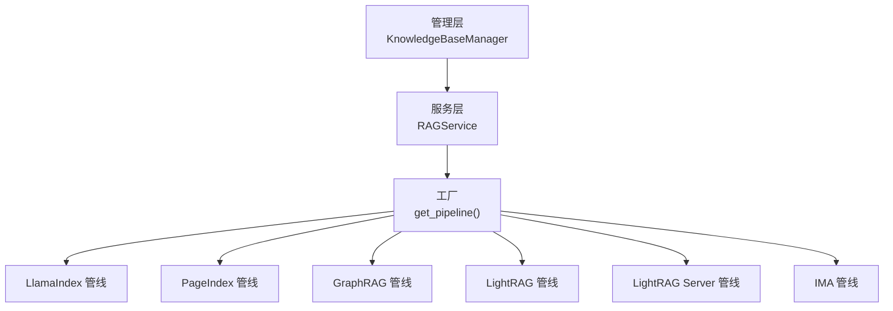
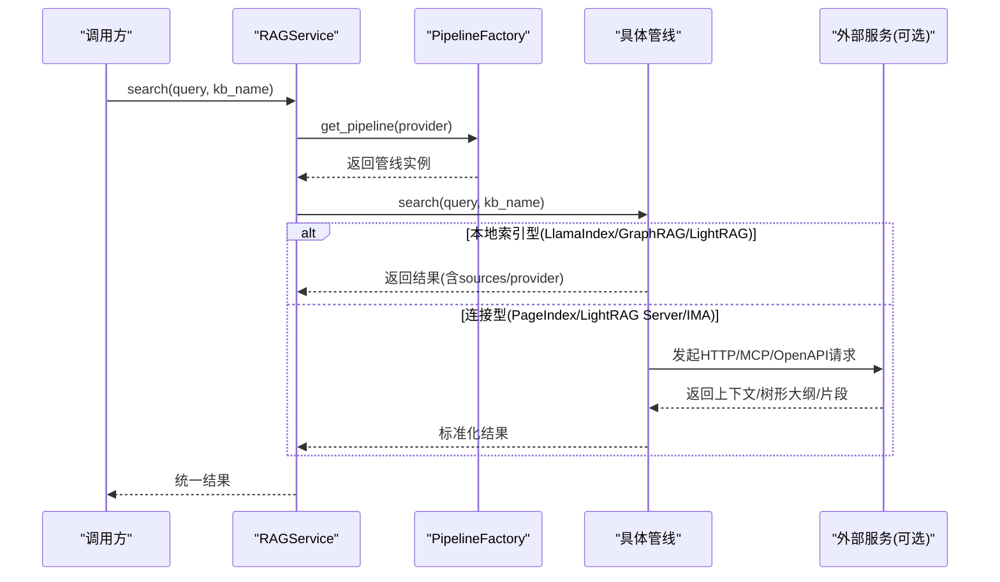
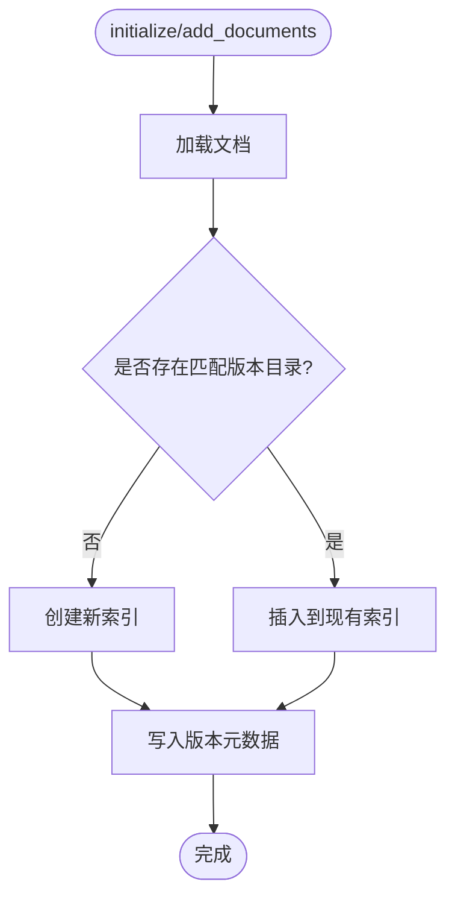
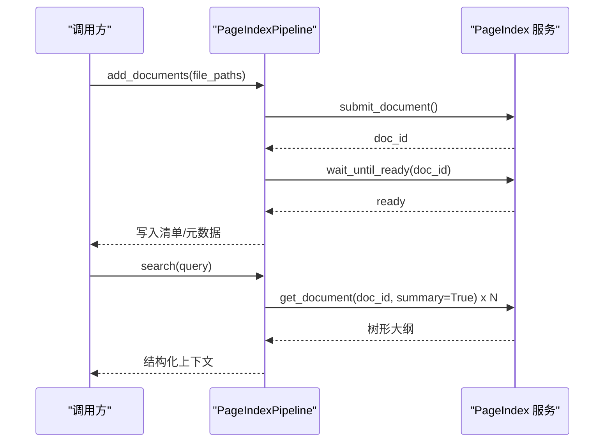
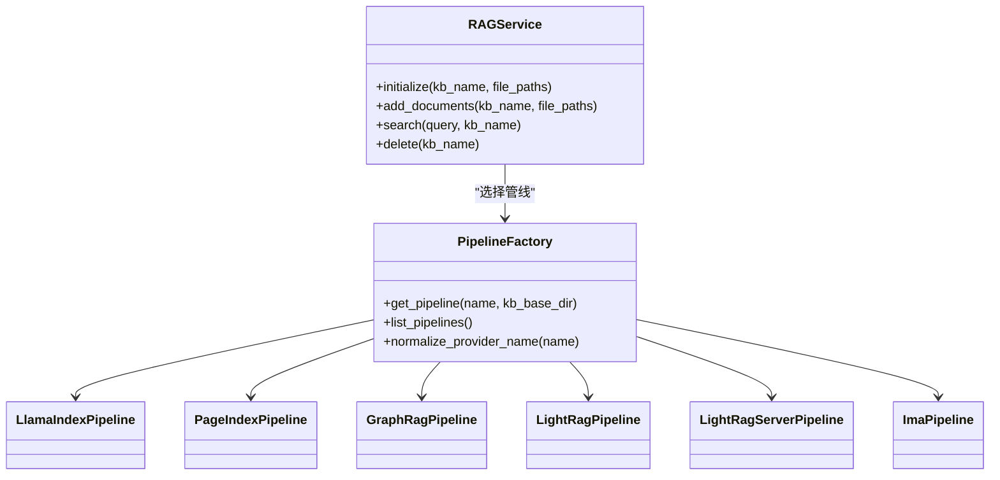

# 多引擎知识库

<cite>
**本文引用的文件**
- [deeptutor/knowledge/kb_types.py](file://deeptutor/knowledge/kb_types.py)
- [deeptutor/knowledge/manager.py](file://deeptutor/knowledge/manager.py)
- [deeptutor/knowledge/add_documents.py](file://deeptutor/knowledge/add_documents.py)
- [deeptutor/services/rag/factory.py](file://deeptutor/services/rag/factory.py)
- [deeptutor/services/rag/service.py](file://deeptutor/services/rag/service.py)
- [deeptutor/services/rag/pipelines/llamaindex/pipeline.py](file://deeptutor/services/rag/pipelines/llamaindex/pipeline.py)
- [deeptutor/services/rag/pipelines/pageindex/pipeline.py](file://deeptutor/services/rag/pipelines/pageindex/pipeline.py)
- [deeptutor/services/rag/pipelines/graphrag/pipeline.py](file://deeptutor/services/rag/pipelines/graphrag/pipeline.py)
- [deeptutor/services/rag/pipelines/lightrag/pipeline.py](file://deeptutor/services/rag/pipelines/lightrag/pipeline.py)
- [deeptutor/services/rag/pipelines/lightrag_server/pipeline.py](file://deeptutor/services/rag/pipelines/lightrag_server/pipeline.py)
- [deeptutor/services/rag/pipelines/ima/pipeline.py](file://deeptutor/services/rag/pipelines/ima/pipeline.py)
</cite>

## 目录
1. [简介](#简介)
2. [项目结构](#项目结构)
3. [核心组件](#核心组件)
4. [架构总览](#架构总览)
5. [详细组件分析](#详细组件分析)
6. [依赖关系分析](#依赖关系分析)
7. [性能考量](#性能考量)
8. [故障排查指南](#故障排查指南)
9. [结论](#结论)
10. [附录：使用示例与最佳实践](#附录使用示例与最佳实践)

## 简介
本文件为 DeepTutor 的“多引擎知识库”提供系统化文档，覆盖支持的检索引擎、文档处理管道、版本控制机制、单文档移除能力以及面向不同规模与性能需求的知识管理场景。系统通过统一的 RAG 服务层将多种后端（本地向量+BM25、托管推理检索、知识图谱、外部 LightRAG 实例、腾讯 IMA 搜索、Obsidian 仓库）抽象为一致的索引/检索接口，便于上层应用以统一方式创建、配置和使用知识库。

## 项目结构
DeepTutor 的知识库子系统由“管理层 + 服务层 + 引擎管线”三层构成：
- 管理层：负责知识库注册、状态维护、连接型知识库（指针型）识别与生命周期管理。
- 服务层：统一入口，按知识库绑定的提供者选择具体管线，封装初始化、增量添加、检索与删除等流程。
- 引擎管线：各检索引擎的具体实现，遵循统一接口，支持本地或远程索引与检索。

图表来源
- [deeptutor/services/rag/factory.py:120-179](file://deeptutor/services/rag/factory.py#L120-L179)
- [deeptutor/services/rag/service.py:63-82](file://deeptutor/services/rag/service.py#L63-L82)

章节来源
- [deeptutor/knowledge/manager.py:244-341](file://deeptutor/knowledge/manager.py#L244-L341)
- [deeptutor/services/rag/factory.py:1-48](file://deeptutor/services/rag/factory.py#L1-L48)
- [deeptutor/services/rag/service.py:23-82](file://deeptutor/services/rag/service.py#L23-L82)

## 核心组件
- 知识库类型与连接型知识库识别：定义并区分本地索引型与连接型（Obsidian、Linked、Subagent、LightRAG Server、IMA），后者不执行本地索引，仅作为指针存在。
- 知识库管理器：负责注册、发现、清理孤儿条目、状态更新、嵌入指纹对齐与版本列表刷新。
- RAG 服务：统一入口，解析绑定提供者，调用对应管线进行初始化、增量添加、检索与删除。
- 管线工厂：根据提供者名称选择具体管线，并提供可用管线清单与兼容性判断。
- 各引擎管线：实现 initialize/add_documents/search/delete 的统一契约，适配不同后端特性。

章节来源
- [deeptutor/knowledge/kb_types.py:1-116](file://deeptutor/knowledge/kb_types.py#L1-L116)
- [deeptutor/knowledge/manager.py:244-341](file://deeptutor/knowledge/manager.py#L244-L341)
- [deeptutor/services/rag/service.py:23-82](file://deeptutor/services/rag/service.py#L23-L82)
- [deeptutor/services/rag/factory.py:1-48](file://deeptutor/services/rag/factory.py#L1-L48)

## 架构总览
下图展示从 API 到具体引擎的调用路径，以及连接型知识库如何绕过本地索引直接走远端检索。

图表来源
- [deeptutor/services/rag/service.py:84-169](file://deeptutor/services/rag/service.py#L84-L169)
- [deeptutor/services/rag/factory.py:120-179](file://deeptutor/services/rag/factory.py#L120-L179)
- [deeptutor/services/rag/pipelines/pageindex/pipeline.py:162-231](file://deeptutor/services/rag/pipelines/pageindex/pipeline.py#L162-L231)
- [deeptutor/services/rag/pipelines/lightrag_server/pipeline.py:67-88](file://deeptutor/services/rag/pipelines/lightrag_server/pipeline.py#L67-L88)
- [deeptutor/services/rag/pipelines/ima/pipeline.py:63-83](file://deeptutor/services/rag/pipelines/ima/pipeline.py#L63-L83)

## 详细组件分析

### LlamaIndex（默认本地向量+BM25）
- 特点
  - 本地构建向量索引，支持混合 BM25/向量检索。
  - 基于当前嵌入模型签名生成/选择版本目录，失败时自动清理临时版本目录。
  - 支持增量添加文档，可复用已有索引或新建版本目录。
- 适用场景
  - 需要离线、可控、可回滚索引；对检索速度与精度有较高要求；可接受本地存储与计算资源。
- 配置方法
  - 无需额外全局密钥；需确保嵌入服务连通性。
  - 通过 RAGService.initialize/add_documents/search 调用，内部自动选择版本目录。
- 关键流程
  - 初始化：加载文档 → 构建索引 → 写入版本元数据。
  - 检索：按嵌入签名解析读取目录 → 检索节点 → 组装 sources。
  - 增量添加：若存在匹配版本则插入，否则新建版本目录并写入元数据。

图表来源
- [deeptutor/services/rag/pipelines/llamaindex/pipeline.py:75-122](file://deeptutor/services/rag/pipelines/llamaindex/pipeline.py#L75-L122)
- [deeptutor/services/rag/pipelines/llamaindex/pipeline.py:225-279](file://deeptutor/services/rag/pipelines/llamaindex/pipeline.py#L225-L279)

章节来源
- [deeptutor/services/rag/pipelines/llamaindex/pipeline.py:38-178](file://deeptutor/services/rag/pipelines/llamaindex/pipeline.py#L38-L178)
- [deeptutor/services/rag/pipelines/llamaindex/pipeline.py:225-287](file://deeptutor/services/rag/pipelines/llamaindex/pipeline.py#L225-L287)

### PageIndex（托管推理检索，带页面级引用）
- 特点
  - 无本地向量索引，文档提交至托管服务；检索返回文档树形大纲（标题/页码/摘要）。
  - 深度检索由聊天代理通过 MCP 工具完成；search 提供程序化调用时的结构化上下文。
- 适用场景
  - 希望零本地索引成本、利用托管推理能力；需要页面级定位与结构化大纲。
- 配置方法
  - 需在“知识 → RAG 设置”中配置 API Key；支持 PDF/Office/文本/Markdown 等格式。
- 关键流程
  - 初始化/增量：过滤支持格式 → 提交文档 → 等待就绪 → 写入清单与元数据。
  - 检索：读取清单 → 并发获取文档树 → 格式化输出 sources。

图表来源
- [deeptutor/services/rag/pipelines/pageindex/pipeline.py:79-154](file://deeptutor/services/rag/pipelines/pageindex/pipeline.py#L79-L154)
- [deeptutor/services/rag/pipelines/pageindex/pipeline.py:162-231](file://deeptutor/services/rag/pipelines/pageindex/pipeline.py#L162-L231)

章节来源
- [deeptutor/services/rag/pipelines/pageindex/pipeline.py:57-154](file://deeptutor/services/rag/pipelines/pageindex/pipeline.py#L57-L154)
- [deeptutor/services/rag/pipelines/pageindex/pipeline.py:162-328](file://deeptutor/services/rag/pipelines/pageindex/pipeline.py#L162-L328)

### GraphRAG（知识图谱检索）
- 特点
  - 本地知识图谱检索（microsoft/graphrag），支持 global/local/drift/basic 模式。
  - 文档先由 DeepTutor 解析为纯文本，再交由 GraphRAG 构建图谱与查询。
- 适用场景
  - 需要概念关联、社区摘要与复杂推理；可接受较高的 LLM 调用与计算开销。
- 配置方法
  - 可选依赖，需安装 graphrag 扩展；在“知识 → RAG 设置”中选择模式。
- 关键流程
  - 初始化/增量：准备输入 → 写配置 → 构建/更新图谱 → 写元数据。
  - 检索：按模式查询 → 映射上下文为 sources。

章节来源
- [deeptutor/services/rag/pipelines/graphrag/pipeline.py:36-193](file://deeptutor/services/rag/pipelines/graphrag/pipeline.py#L36-L193)

### LightRAG（知识图谱检索）
- 特点
  - 图+向量检索（HKUDS/LightRAG），支持 naive/local/global/hybrid/mix 模式。
  - 通过共享解析层生成 MinerU 风格 content_list，支持多模态解析。
- 适用场景
  - 需要结合图结构与向量检索；可接受 LLM 密集索引过程。
- 配置方法
  - 可选依赖，需安装 rag-lightrag 扩展；在“知识 → RAG 设置”中选择模式。
- 关键流程
  - 初始化/增量：解析文档 → 插入 LightRAG → 校验输出 → 写元数据。
  - 检索：按模式查询 → 返回答案与模式信息。

章节来源
- [deeptutor/services/rag/pipelines/lightrag/pipeline.py:40-245](file://deeptutor/services/rag/pipelines/lightrag/pipeline.py#L40-L245)

### LightRAG Server（外部 LightRAG 实例 HTTP 检索）
- 特点
  - 无本地索引，KB 仅为指向外部 LightRAG 服务器的连接指针。
  - 仅实现检索；initialize/add_documents 明确拒绝；delete 为 no-op。
- 适用场景
  - 已部署独立 LightRAG 服务；希望集中索引与检索，避免重复构建。
- 配置方法
  - 在 KB 配置中设置 server_url 与可选 api_key；检索时按模式调用 /query。
- 关键流程
  - 检索：读取 KB 配置 → 构造客户端 → 查询上下文 → 标准化结果。

章节来源
- [deeptutor/services/rag/pipelines/lightrag_server/pipeline.py:37-117](file://deeptutor/services/rag/pipelines/lightrag_server/pipeline.py#L37-L117)

### 腾讯 IMA（OpenAPI 搜索）
- 特点
  - 无本地索引，KB 为指向 IMA 知识库的连接指针。
  - 检索调用 OpenAPI 获取匹配片段，按段落预算限制 top_k。
- 适用场景
  - 已在 IMA 中维护知识库；希望通过统一接口检索而不复制数据。
- 配置方法
  - 在 KB 配置中设置 client_id、api_key、knowledge_base_id。
- 关键流程
  - 检索：读取配置 → 调用 search_knowledge → 映射 sources → 渲染上下文。

章节来源
- [deeptutor/services/rag/pipelines/ima/pipeline.py:35-148](file://deeptutor/services/rag/pipelines/ima/pipeline.py#L35-L148)

### 链接的 Obsidian 仓库
- 特点
  - 指针型知识库，指向用户拥有的 Markdown 文件夹；无索引，运行时导航真实文件。
  - 聊天循环将其路由到 Obsidian 能力而非通用 rag。
- 适用场景
  - 直接使用 Obsidian 仓库作为知识源，避免复制与索引开销。
- 配置方法
  - 通过注册 Obsidian vault 的方式创建指针型 KB；无需本地索引。

章节来源
- [deeptutor/knowledge/kb_types.py:1-44](file://deeptutor/knowledge/kb_types.py#L1-L44)
- [deeptutor/knowledge/manager.py:691-723](file://deeptutor/knowledge/manager.py#L691-L723)

## 依赖关系分析
- 提供者选择与缓存
  - 工厂根据提供者名称选择管线，并在无自定义参数时缓存实例。
  - 未知/遗留提供者会归一化为默认提供者，并提示重新索引。
- 版本与嵌入签名
  - LlamaIndex 使用嵌入签名选择/重建版本目录；其他提供者使用合成签名，不受活跃嵌入配置影响。
- 连接型知识库
  - 跳过索引流水线、孤儿修剪与嵌入对齐；删除不触碰外部资源。

图表来源
- [deeptutor/services/rag/service.py:23-82](file://deeptutor/services/rag/service.py#L23-L82)
- [deeptutor/services/rag/factory.py:120-179](file://deeptutor/services/rag/factory.py#L120-L179)

章节来源
- [deeptutor/services/rag/factory.py:54-99](file://deeptutor/services/rag/factory.py#L54-L99)
- [deeptutor/knowledge/kb_types.py:77-104](file://deeptutor/knowledge/kb_types.py#L77-L104)

## 性能考量
- 本地索引型（LlamaIndex/GraphRAG/LightRAG）
  - 索引阶段可能涉及大量 LLM 调用与向量计算；建议分批增量添加，避免一次性全量重建。
  - LlamaIndex 支持复用现有索引插入，减少重复计算。
- 托管/外部型（PageIndex/LightRAG Server/IMA）
  - 无本地索引成本；检索延迟取决于网络与服务端性能；注意并发与超时策略。
- 版本与回滚
  - 版本目录设计允许保留历史索引；切换嵌入模型时可快速回退到匹配版本。
- 日志与事件
  - 检索过程捕获底层日志并过滤噪音，有助于定位性能瓶颈与错误。

[本节为通用指导，不直接分析具体文件]

## 故障排查指南
- 常见错误与处理
  - 未配置提供者：返回 not_configured；检查 RAG 设置或 KB 配置。
  - 无索引：返回 needs_reindex；执行初始化或增量添加。
  - 检索失败：返回 retrieval_error；查看原始日志与错误类型。
  - 嵌入不匹配：LlamaIndex 提示需重新索引；切换回原嵌入模型或重建索引。
- 单文档移除
  - 即使知识库处于错误状态，也可删除失败的原始文档；不会触碰向量索引，后续重新索引会清理残留向量。
- 孤儿条目清理
  - 列出知识库时会清理缺失目录的注册项；新创建的 KB 有宽限期避免误删。

章节来源
- [deeptutor/services/rag/service.py:84-169](file://deeptutor/services/rag/service.py#L84-L169)
- [deeptutor/knowledge/add_documents.py:113-141](file://deeptutor/knowledge/add_documents.py#L113-L141)
- [deeptutor/knowledge/manager.py:515-600](file://deeptutor/knowledge/manager.py#L515-L600)

## 结论
DeepTutor 的多引擎知识库通过统一的服务层与管线抽象，将本地向量、托管推理、知识图谱与外部服务整合为一套一致的知识管理能力。版本化索引与连接型知识库设计兼顾了灵活性、可回滚性与运维成本；单文档移除与孤儿清理提升了容错与可维护性。用户可根据规模、性能与合规需求选择合适的引擎组合。

[本节为总结，不直接分析具体文件]

## 附录：使用示例与最佳实践
- 创建与配置
  - 选择引擎：在“知识 → RAG 设置”中选择 LlamaIndex/GraphRAG/LightRAG/Page Index/LightRAG Server/IMA。
  - 连接型知识库：为 Obsidian/LightRAG Server/IMA 配置指针（vault_path/server_url/client_id 等）。
- 文档处理管道
  - 文本提取：各引擎通过各自解析器或共享解析层将文档转为文本/块。
  - 分块策略：LlamaIndex 内置分块与嵌入；LightRAG 通过解析层生成 content_list；GraphRAG 接收纯文本。
  - 嵌入生成：LlamaIndex 使用当前嵌入配置；其他引擎不依赖本地嵌入签名。
  - 索引构建：按版本目录组织；失败时清理临时目录；成功写入元数据。
- 版本控制机制
  - 每次重建索引生成 version-N 目录；支持按嵌入签名选择读取；UI 可显示版本标签。
- 单文档移除
  - 在知识库错误状态下仍可删除 raw/ 中的失败文档；metadata.json 中记录哈希以便去重与清理。
- 多引擎选择建议
  - 小规模/快速上手：LlamaIndex（默认）。
  - 免本地索引/页面级引用：PageIndex。
  - 复杂推理/概念关联：GraphRAG。
  - 图+向量/多模态：LightRAG。
  - 已有外部索引：LightRAG Server。
  - 企业云知识库：IMA。
  - 直接读本地笔记：Obsidian。

章节来源
- [deeptutor/services/rag/factory.py:182-275](file://deeptutor/services/rag/factory.py#L182-L275)
- [deeptutor/knowledge/add_documents.py:199-336](file://deeptutor/knowledge/add_documents.py#L199-L336)
- [deeptutor/services/rag/pipelines/llamaindex/pipeline.py:75-122](file://deeptutor/services/rag/pipelines/llamaindex/pipeline.py#L75-L122)
- [deeptutor/services/rag/pipelines/lightrag/pipeline.py:75-144](file://deeptutor/services/rag/pipelines/lightrag/pipeline.py#L75-L144)
- [deeptutor/services/rag/pipelines/graphrag/pipeline.py:73-128](file://deeptutor/services/rag/pipelines/graphrag/pipeline.py#L73-L128)
- [deeptutor/services/rag/pipelines/pageindex/pipeline.py:79-154](file://deeptutor/services/rag/pipelines/pageindex/pipeline.py#L79-L154)
- [deeptutor/services/rag/pipelines/lightrag_server/pipeline.py:67-117](file://deeptutor/services/rag/pipelines/lightrag_server/pipeline.py#L67-L117)
- [deeptutor/services/rag/pipelines/ima/pipeline.py:63-111](file://deeptutor/services/rag/pipelines/ima/pipeline.py#L63-L111)