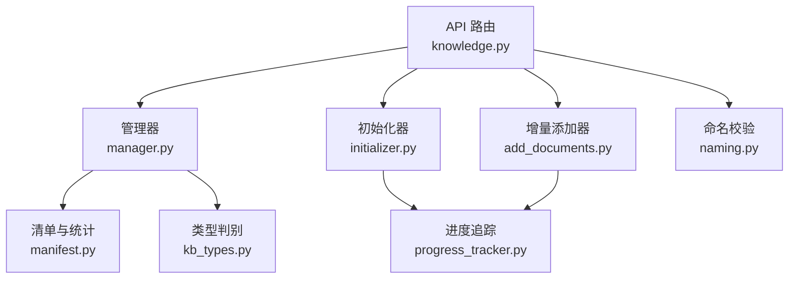
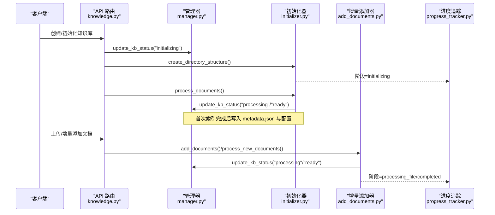
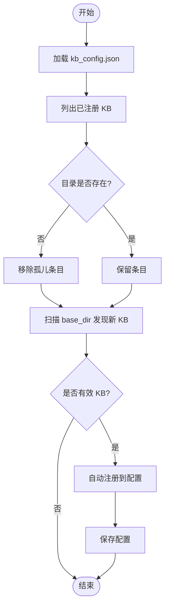
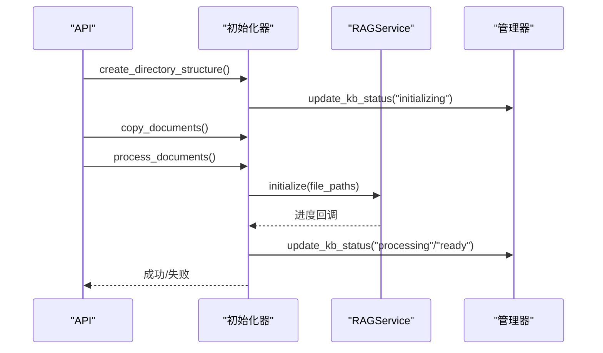
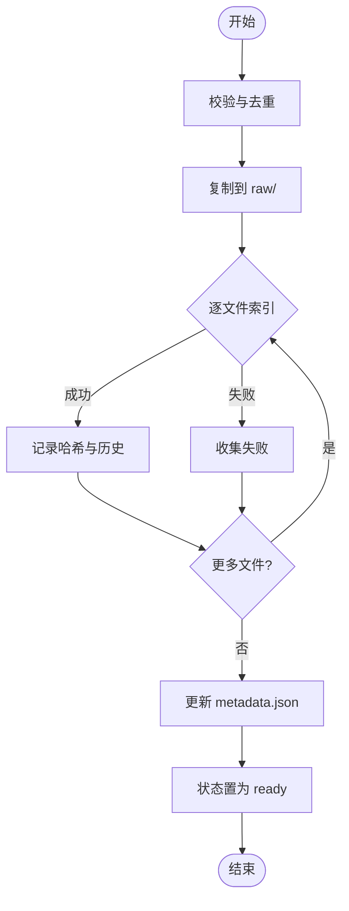
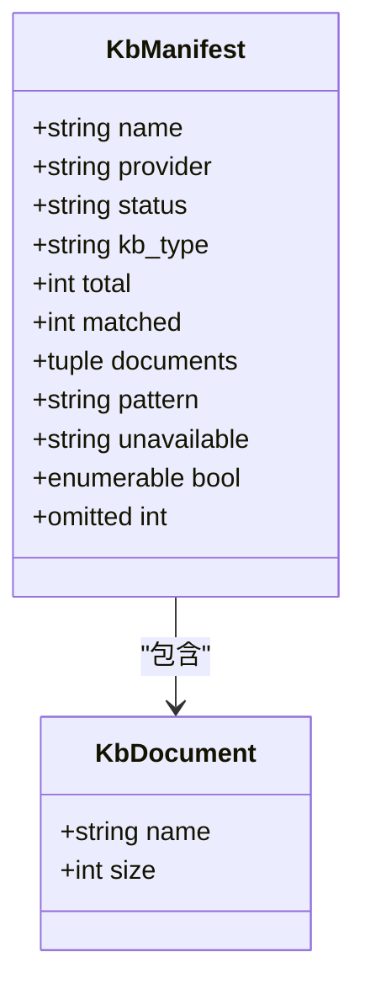
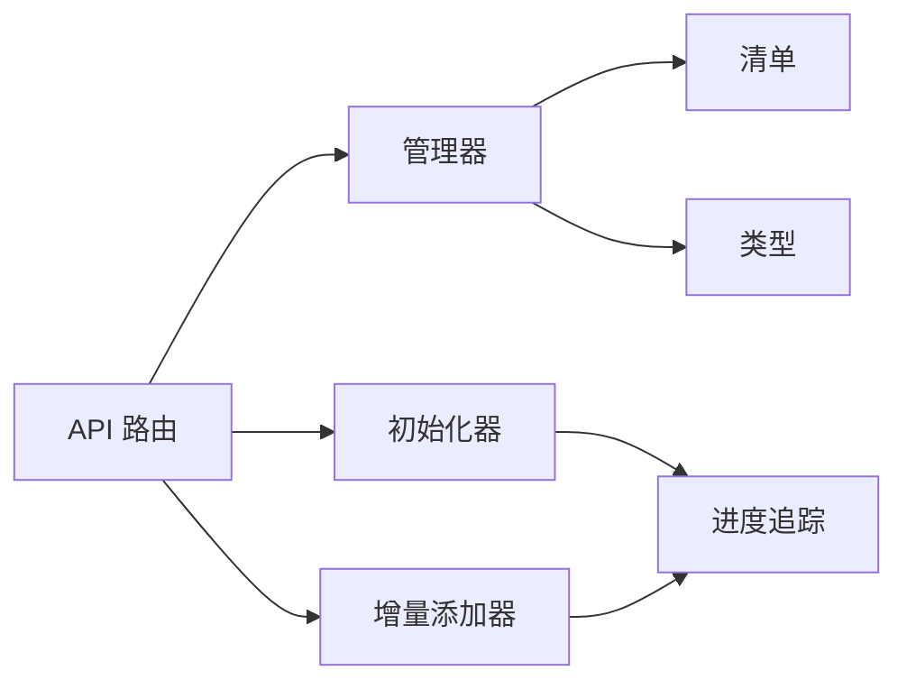

# 知识库管理

<cite>
**本文引用的文件**
- [manager.py](file://deeptutor/knowledge/manager.py)
- [add_documents.py](file://deeptutor/knowledge/add_documents.py)
- [initializer.py](file://deeptutor/knowledge/initializer.py)
- [manifest.py](file://deeptutor/knowledge/manifest.py)
- [kb_types.py](file://deeptutor/knowledge/kb_types.py)
- [naming.py](file://deeptutor/knowledge/naming.py)
- [progress_tracker.py](file://deeptutor/knowledge/progress_tracker.py)
- [knowledge.py](file://deeptutor/api/routers/knowledge.py)
</cite>

## 目录
1. [简介](#简介)
2. [项目结构](#项目结构)
3. [核心组件](#核心组件)
4. [架构总览](#架构总览)
5. [详细组件分析](#详细组件分析)
6. [依赖关系分析](#依赖关系分析)
7. [性能与资源使用](#性能与资源使用)
8. [故障排除指南](#故障排除指南)
9. [结论](#结论)
10. [附录：API 示例](#附录api-示例)

## 简介
本文件面向 DeepTutor 的知识库（Knowledge Base, KB）子系统，系统性说明其生命周期管理、文档添加流程、清单与元数据机制、命名规范与目录设计、备份清理与恢复思路、以及性能监控与排障要点。内容基于代码实现进行梳理，帮助读者在不深入源码的情况下也能正确使用和维护知识库。

## 项目结构
知识库相关能力主要分布在以下模块：
- 生命周期与配置：manager.py（注册、列表、状态更新、删除、清理索引存储等）
- 初始化与批量处理：initializer.py（创建目录、复制文档、调用 RAG 服务完成索引）
- 增量文档添加：add_documents.py（校验、去重、分片索引、失败记录、元数据更新）
- 清单与统计：manifest.py（KB 文档清单构建、渲染、不可枚举原因）
- 类型与连接型 KB：kb_types.py（区分本地索引型与外部连接型）
- 命名规范：naming.py（名称校验与规范化）
- 进度追踪：progress_tracker.py（阶段化进度持久化与广播）
- API 路由：knowledge.py（上传、初始化、文件管理、删除、移动、文件夹操作等）

图表来源
- [knowledge.py:1-120](file://deeptutor/api/routers/knowledge.py#L1-L120)
- [manager.py:244-340](file://deeptutor/knowledge/manager.py#L244-L340)
- [initializer.py:26-129](file://deeptutor/knowledge/initializer.py#L26-L129)
- [add_documents.py:144-337](file://deeptutor/knowledge/add_documents.py#L144-L337)
- [manifest.py:157-199](file://deeptutor/knowledge/manifest.py#L157-L199)
- [kb_types.py:1-44](file://deeptutor/knowledge/kb_types.py#L1-L44)
- [progress_tracker.py:34-132](file://deeptutor/knowledge/progress_tracker.py#L34-L132)
- [naming.py:13-40](file://deeptutor/knowledge/naming.py#L13-L40)

章节来源
- [knowledge.py:1-120](file://deeptutor/api/routers/knowledge.py#L1-L120)
- [manager.py:244-340](file://deeptutor/knowledge/manager.py#L244-L340)
- [initializer.py:26-129](file://deeptutor/knowledge/initializer.py#L26-L129)
- [add_documents.py:144-337](file://deeptutor/knowledge/add_documents.py#L144-L337)
- [manifest.py:157-199](file://deeptutor/knowledge/manifest.py#L157-L199)
- [kb_types.py:1-44](file://deeptutor/knowledge/kb_types.py#L1-L44)
- [progress_tracker.py:34-132](file://deeptutor/knowledge/progress_tracker.py#L34-L132)
- [naming.py:13-40](file://deeptutor/knowledge/naming.py#L13-L40)

## 核心组件
- 知识库管理器（KnowledgeBaseManager）
  - 负责 kb_config.json 的加载/保存、KB 注册/发现/删除、状态更新、索引版本探测、嵌入签名对齐、PocketBase 同步等。
  - 关键方法：update_kb_status、list_knowledge_bases、delete_knowledge_base、clean_rag_storage、register_* 系列。
- 初始化器（KnowledgeBaseInitializer）
  - 负责创建目录结构、复制文档、调用 RAGService.initialize 完成首次索引，并更新 metadata.json 与配置。
- 增量文档添加器（DocumentAdder）
  - 负责文件校验、去重、复制到 raw/、通过 RAGService.add_documents 增量索引、记录哈希与历史。
- 清单与统计（manifest）
  - 从磁盘读取 KB 的真实文档集合，提供系统提示中的清单片段和工具返回的完整清单。
- 类型与连接型 KB（kb_types）
  - 区分本地索引型与连接型（Obsidian、Linked、Subagent、LightRAG Server、IMA），统一判定与路径解析。
- 进度追踪（ProgressTracker）
  - 将阶段化进度写入 .progress.json 与 kb_config.json，并通过任务流与广播推送给前端。
- 命名规范（naming）
  - 对 KB 名称进行 Unicode 规范化、长度限制、控制字符与保留字符过滤。

章节来源
- [manager.py:244-340](file://deeptutor/knowledge/manager.py#L244-L340)
- [initializer.py:26-129](file://deeptutor/knowledge/initializer.py#L26-L129)
- [add_documents.py:144-337](file://deeptutor/knowledge/add_documents.py#L144-L337)
- [manifest.py:157-199](file://deeptutor/knowledge/manifest.py#L157-L199)
- [kb_types.py:1-44](file://deeptutor/knowledge/kb_types.py#L1-L44)
- [progress_tracker.py:34-132](file://deeptutor/knowledge/progress_tracker.py#L34-L132)
- [naming.py:13-40](file://deeptutor/knowledge/naming.py#L13-L40)

## 架构总览
知识库的生命周期由 API 路由驱动，内部通过管理器协调初始化器与增量添加器，配合清单与类型系统，确保状态一致、可观测、可回滚（通过清理与重建）。

图表来源
- [knowledge.py:752-800](file://deeptutor/api/routers/knowledge.py#L752-L800)
- [initializer.py:144-223](file://deeptutor/knowledge/initializer.py#L144-L223)
- [add_documents.py:258-337](file://deeptutor/knowledge/add_documents.py#L258-L337)
- [progress_tracker.py:133-211](file://deeptutor/knowledge/progress_tracker.py#L133-L211)
- [manager.py:381-489](file://deeptutor/knowledge/manager.py#L381-L489)

## 详细组件分析

### 知识库管理器（KnowledgeBaseManager）
- 职责
  - 维护 kb_config.json，支持自动发现、孤儿条目清理、默认 KB 管理。
  - 状态机：initializing → processing → ready/error，并在 ready 时记录最后完成时间、索引计数与动作。
  - 嵌入指纹与版本对齐：根据当前嵌入配置与磁盘版本目录，标记 needs_reindex/embedding_mismatch。
  - 删除与清理：删除 KB 目录与配置；清理索引存储（带可选备份）。
- 关键流程
  - 列表与孤儿清理：扫描 base_dir，剔除无目录的注册项（考虑初始化窗口期）。
  - 自动注册：发现有效 KB 目录后自动写入配置。
  - 状态更新：统一入口 update_kb_status，持久化到配置并可选同步至 PocketBase。
  - 清理索引存储：识别 flat version-* 目录与 legacy 存储，支持备份后删除。

图表来源
- [manager.py:515-600](file://deeptutor/knowledge/manager.py#L515-L600)
- [manager.py:602-673](file://deeptutor/knowledge/manager.py#L602-L673)

章节来源
- [manager.py:515-600](file://deeptutor/knowledge/manager.py#L515-L600)
- [manager.py:602-673](file://deeptutor/knowledge/manager.py#L602-L673)
- [manager.py:1332-1472](file://deeptutor/knowledge/manager.py#L1332-L1472)

### 初始化流程（KnowledgeBaseInitializer）
- 步骤
  - 创建目录结构与 metadata.json，注册为 initializing。
  - 复制文档到 raw/。
  - 调用 RAGService.initialize 执行首次索引，期间持续上报进度。
  - 成功后更新 metadata.json（provider、时间戳、计数、动作）与配置，状态置为 ready。
- 错误处理
  - 任何异常都会将状态置为 error，并记录错误信息。

图表来源
- [initializer.py:109-223](file://deeptutor/knowledge/initializer.py#L109-L223)
- [initializer.py:245-301](file://deeptutor/knowledge/initializer.py#L245-L301)

章节来源
- [initializer.py:109-223](file://deeptutor/knowledge/initializer.py#L109-L223)
- [initializer.py:245-301](file://deeptutor/knowledge/initializer.py#L245-L301)

### 增量文档添加（DocumentAdder）
- 流程
  - 校验与去重：计算文件哈希，跳过已索引或冲突文件（可允许重复）。
  - 保存到 raw/：保持上传时的相对路径结构。
  - 增量索引：调用 RAGService.add_documents，逐文件处理并记录成功/失败。
  - 更新元数据：记录 provider、时间戳、计数、动作与历史。
- 失败处理
  - 每个文件的失败被收集并汇总，最终在必要时抛出错误，同时更新状态为 error。

图表来源
- [add_documents.py:216-337](file://deeptutor/knowledge/add_documents.py#L216-L337)
- [add_documents.py:339-431](file://deeptutor/knowledge/add_documents.py#L339-L431)

章节来源
- [add_documents.py:216-337](file://deeptutor/knowledge/add_documents.py#L216-L337)
- [add_documents.py:339-431](file://deeptutor/knowledge/add_documents.py#L339-L431)

### 清单管理机制（manifest）
- 作用
  - 提供“权威”的 KB 文档清单，用于系统提示与工具输出，避免检索结果误导数量判断。
- 特性
  - 支持按模式过滤（glob/子串），限制显示条数，报告省略数量。
  - 对远程/代理/缺失场景给出不可枚举原因。
- 数据结构
  - KbManifest/KbDocument 描述 KB 的提供者、状态、总数、匹配数、文档列表等。

图表来源
- [manifest.py:69-108](file://deeptutor/knowledge/manifest.py#L69-L108)
- [manifest.py:157-199](file://deeptutor/knowledge/manifest.py#L157-L199)

章节来源
- [manifest.py:69-108](file://deeptutor/knowledge/manifest.py#L69-L108)
- [manifest.py:157-199](file://deeptutor/knowledge/manifest.py#L157-L199)

### 命名规范与目录结构
- 命名规范
  - 名称需经 Unicode NFC 规范化，去除首尾空白，禁止控制字符与路径/URL 保留字符，最大长度限制。
- 目录结构原则
  - KB 根目录位于 base_dir/<name>，raw/ 存放原始文档（组织用文件夹不影响检索）。
  - 索引存储采用扁平 version-* 目录与兼容 legacy 目录（rag_storage、llamaindex_storage）。
  - 清单与统计不依赖索引计数，而是直接遍历 raw/ 获取真实文档集合。

章节来源
- [naming.py:13-40](file://deeptutor/knowledge/naming.py#L13-L40)
- [manager.py:1415-1472](file://deeptutor/knowledge/manager.py#L1415-L1472)
- [manifest.py:111-154](file://deeptutor/knowledge/manifest.py#L111-L154)

### 连接型知识库（kb_types）
- 类型
  - obsidian、linked、subagent、lightrag_server、ima。
- 行为
  - 无本地索引与嵌入对齐；删除不触碰外部资源；清单不可枚举或为空。
- 辅助函数
  - is_connected_kb、external_root_of 用于统一处理。

章节来源
- [kb_types.py:1-44](file://deeptutor/knowledge/kb_types.py#L1-L44)
- [kb_types.py:90-104](file://deeptutor/knowledge/kb_types.py#L90-L104)

### 进度追踪（ProgressTracker）
- 功能
  - 阶段化进度（initializing/processing_documents/processing_file/completed/error）。
  - 持久化到 .progress.json 与 kb_config.json，支持任务流事件与广播。
- 使用
  - 初始化器与增量添加器在各阶段调用 update，管理器在状态变更时写入。

章节来源
- [progress_tracker.py:24-132](file://deeptutor/knowledge/progress_tracker.py#L24-L132)
- [progress_tracker.py:133-211](file://deeptutor/knowledge/progress_tracker.py#L133-L211)

## 依赖关系分析
- API 路由依赖管理器、初始化器、增量添加器、清单与类型系统，以及进度追踪。
- 管理器依赖清单与类型系统以正确枚举与处理不同 KB 类型。
- 初始化器与增量添加器均依赖 RAGService 完成索引，并通过管理器更新状态。
- 进度追踪贯穿整个生命周期，确保前后端状态一致。

图表来源
- [knowledge.py:1-120](file://deeptutor/api/routers/knowledge.py#L1-L120)
- [manager.py:244-340](file://deeptutor/knowledge/manager.py#L244-L340)
- [initializer.py:26-129](file://deeptutor/knowledge/initializer.py#L26-L129)
- [add_documents.py:144-337](file://deeptutor/knowledge/add_documents.py#L144-L337)
- [manifest.py:157-199](file://deeptutor/knowledge/manifest.py#L157-L199)
- [kb_types.py:1-44](file://deeptutor/knowledge/kb_types.py#L1-L44)
- [progress_tracker.py:34-132](file://deeptutor/knowledge/progress_tracker.py#L34-L132)

## 性能与资源使用
- 上传与索引
  - 大文件与批量上传走线程执行以避免阻塞事件循环。
  - 增量索引逐文件处理，失败隔离，避免单点失败影响整体。
- 清单与统计
  - 清单仅遍历 raw/，避免解析大型 docstore JSON；对远程/代理类型直接标记不可枚举。
- 状态与进度
  - 原子写配置与进度文件，减少并发竞争；就绪态清除冗余进度字段，降低 UI 负担。
- 建议
  - 合理分批上传，避免单次过大请求。
  - 关注 needs_reindex 与 embedding_mismatch 标志，及时重建索引。
  - 利用清单与统计接口监控 KB 规模与索引健康度。

[本节为通用指导，不直接分析具体文件]

## 故障排除指南
- 常见问题
  - 连接型 KB 无法上传/重索引：属于只读指针，需通过对应能力访问。
  - 旧格式索引需要重建：needs_reindex 为真时，先清理或重建索引。
  - 上传失败：检查文件名、大小限制、扩展名白名单；查看错误详情。
  - 进度卡住：检查 .progress.json 与任务日志，确认是否有未完成的后台任务。
- 定位手段
  - 使用清单接口查看 KB 文档数量与状态。
  - 查看管理器状态与进度，结合任务 ID 拉取任务日志。
  - 对于错误状态，删除问题文件后重新索引。

章节来源
- [knowledge.py:695-721](file://deeptutor/api/routers/knowledge.py#L695-L721)
- [add_documents.py:339-431](file://deeptutor/knowledge/add_documents.py#L339-L431)
- [progress_tracker.py:213-245](file://deeptutor/knowledge/progress_tracker.py#L213-L245)

## 结论
DeepTutor 的知识库子系统通过清晰的分层与职责划分，实现了从创建、初始化、增量添加到状态监控与清理的全生命周期管理。清单与类型系统确保了数据的权威性与一致性；进度追踪提供了良好的可观测性；命名与目录规范保障了跨平台兼容与可维护性。生产环境中应重点关注索引健康、嵌入配置一致性与上传性能优化。

[本节为总结，不直接分析具体文件]

## 附录：API 示例
以下为常见操作的 API 路径与用途（基于路由定义）：
- 创建/初始化知识库
  - POST /api/v1/knowledge/{kb_name}/initialize
  - 用途：创建目录结构、复制文档、执行首次索引，状态置为 ready。
- 上传/增量添加文档
  - POST /api/v1/knowledge/{kb_name}/upload
  - 用途：校验、去重、复制到 raw/、增量索引，状态置为 ready 或 error。
- 删除单个原始文档
  - DELETE /api/v1/knowledge/{kb_name}/files/{filename}
  - 用途：删除 raw/ 中的文件，返回 was_indexed 指示是否需要重索引。
- 移动/组织文件（仅展示）
  - POST /api/v1/knowledge/{kb_name}/files/move
  - 用途：在 raw/ 下移动文件或文件夹，不影响检索。
- 创建文件夹（仅展示）
  - POST /api/v1/knowledge/{kb_name}/folders
  - 用途：在 raw/ 下创建组织用文件夹。
- 列出知识库
  - GET /api/v1/knowledge
  - 用途：返回所有可见 KB 的信息、统计、状态与进度。
- 获取知识库信息
  - GET /api/v1/knowledge/{kb_name}
  - 用途：获取指定 KB 的详细信息与统计。

注意：
- 连接型 KB（obsidian、linked、subagent、lightrag_server、ima）不支持上传与重索引。
- 若 KB 处于 needs_reindex 状态，需先清理或重建索引后再进行增量添加。

章节来源
- [knowledge.py:752-800](file://deeptutor/api/routers/knowledge.py#L752-L800)
- [knowledge.py:2046-2078](file://deeptutor/api/routers/knowledge.py#L2046-L2078)
- [knowledge.py:2145-2162](file://deeptutor/api/routers/knowledge.py#L2145-L2162)
- [knowledge.py:1792-1821](file://deeptutor/api/routers/knowledge.py#L1792-L1821)