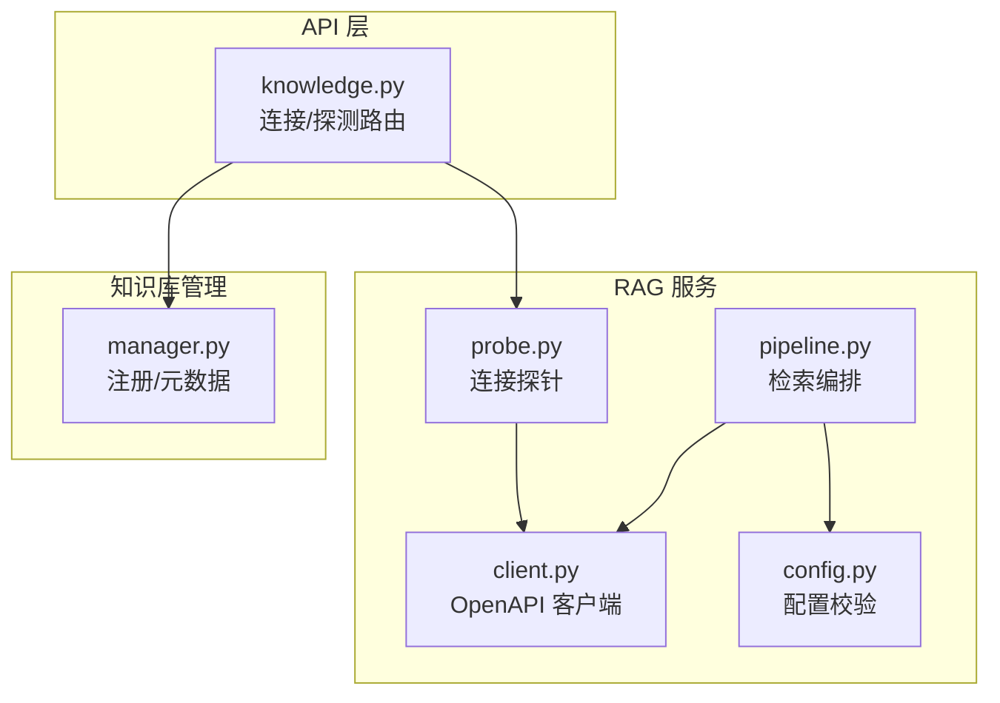
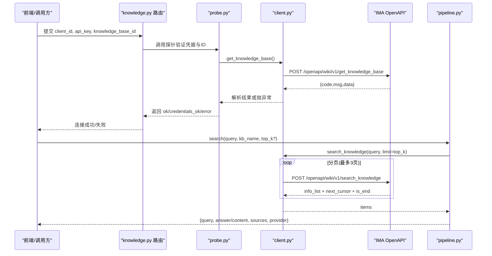
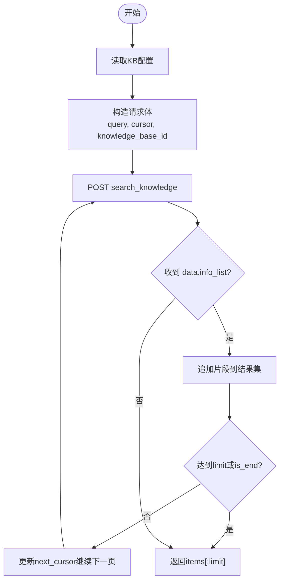
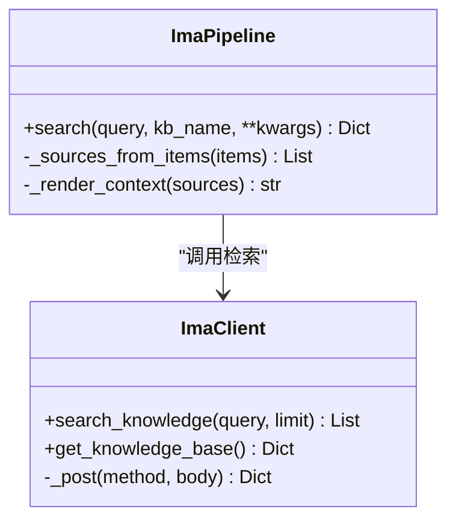
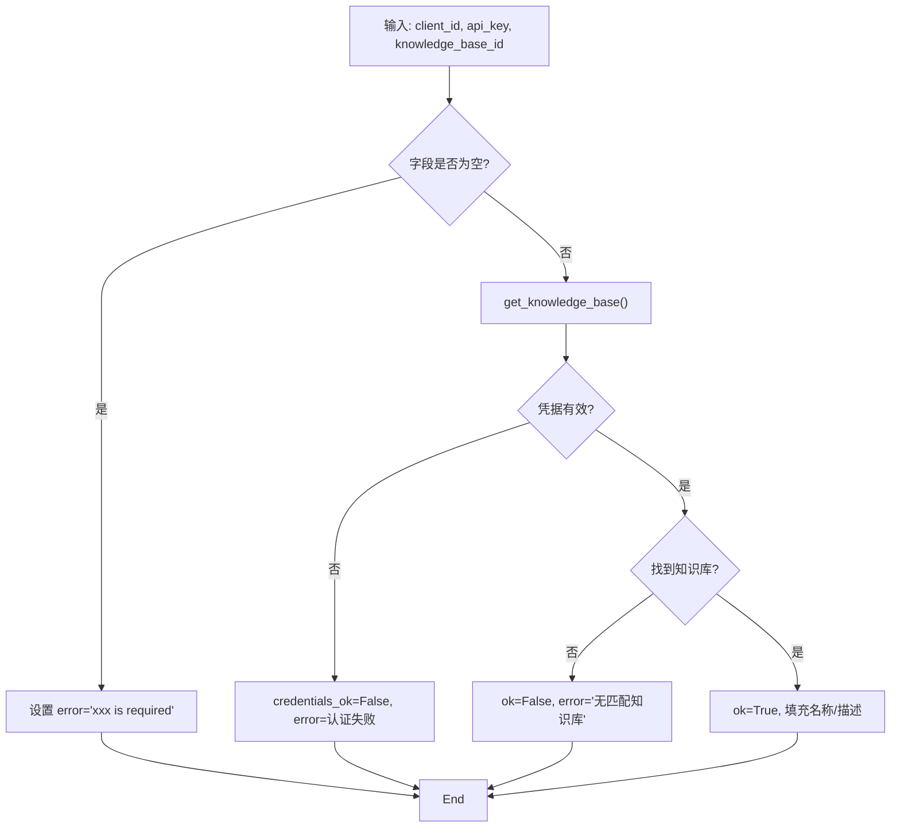
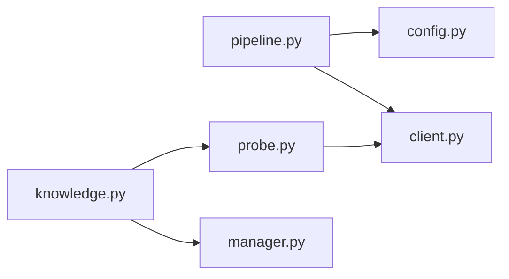

# 腾讯IMA管道

<cite>
**本文引用的文件**
- [pipeline.py](file://deeptutor/services/rag/pipelines/ima/pipeline.py)
- [client.py](file://deeptutor/services/rag/pipelines/ima/client.py)
- [config.py](file://deeptutor/services/rag/pipelines/ima/config.py)
- [probe.py](file://deeptutor/services/rag/pipelines/ima/probe.py)
- [knowledge.py](file://deeptutor/api/routers/knowledge.py)
- [manager.py](file://deeptutor/knowledge/manager.py)
- [test_ima_pipeline.py](file://tests/services/rag/test_ima_pipeline.py)
</cite>

## 目录
1. [简介](#简介)
2. [项目结构](#项目结构)
3. [核心组件](#核心组件)
4. [架构总览](#架构总览)
5. [详细组件分析](#详细组件分析)
6. [依赖关系分析](#依赖关系分析)
7. [性能与成本优化](#性能与成本优化)
8. [故障排查指南](#故障排查指南)
9. [结论](#结论)
10. [附录：配置与使用示例](#附录配置与使用示例)

## 简介
本文件为 DeepTutor 中的“腾讯IMA管道”提供完整技术文档。该管道以检索为主，不维护本地索引，所有文档的索引与知识管理由腾讯IMA平台负责。DeepTutor 通过 IMA 的 OpenAPI 进行认证、查询与结果格式化，并提供连接前探针用于健康检查与可用性检测。本文覆盖认证配置、请求构造、预处理与查询优化、响应解析、错误处理与重试策略、配额与成本管理、以及常见问题解决方案。

## 项目结构
IMA 管道位于 RAG 服务下的 ima 子模块，包含客户端、配置、探针与管道编排四个核心文件，并通过 API 路由暴露连接与探测能力，知识库管理器负责持久化连接指针。

**图表来源**
- [pipeline.py:1-148](file://deeptutor/services/rag/pipelines/ima/pipeline.py#L1-L148)
- [client.py:1-162](file://deeptutor/services/rag/pipelines/ima/client.py#L1-L162)
- [config.py:1-83](file://deeptutor/services/rag/pipelines/ima/config.py#L1-L83)
- [probe.py:1-103](file://deeptutor/services/rag/pipelines/ima/probe.py#L1-L103)
- [knowledge.py:1712-1749](file://deeptutor/api/routers/knowledge.py#L1712-L1749)
- [manager.py:890-933](file://deeptutor/knowledge/manager.py#L890-L933)

**章节来源**
- [pipeline.py:1-148](file://deeptutor/services/rag/pipelines/ima/pipeline.py#L1-L148)
- [client.py:1-162](file://deeptutor/services/rag/pipelines/ima/client.py#L1-L162)
- [config.py:1-83](file://deeptutor/services/rag/pipelines/ima/config.py#L1-L83)
- [probe.py:1-103](file://deeptutor/services/rag/pipelines/ima/probe.py#L1-L103)
- [knowledge.py:1712-1749](file://deeptutor/api/routers/knowledge.py#L1712-L1749)
- [manager.py:890-933](file://deeptutor/knowledge/manager.py#L890-L933)

## 核心组件
- ImaPipeline（检索编排）：读取 KB 配置，调用客户端检索，将片段渲染为上下文并返回统一结果结构。
- ImaClient（OpenAPI 客户端）：封装 POST 到 https://ima.qq.com/openapi/wiki/v1/<method>，注入认证头，解析 {code,msg,data} 信封，分页获取结果。
- ImaConfig（配置）：从 kb_config.json 条目中解析 client_id、api_key、knowledge_base_id，缺失时抛出明确错误。
- probe_knowledge_base（探针）：在连接前验证凭据与知识库 ID 是否可解析，返回结构化状态。
- API 路由（knowledge.py）：提供 /connect-ima 等接口，服务端重放探针后再注册指针。
- 知识库管理器（manager.py）：注册 type: ima 的连接指针，不创建本地索引文件夹，删除仅移除指针。

**章节来源**
- [pipeline.py:35-111](file://deeptutor/services/rag/pipelines/ima/pipeline.py#L35-L111)
- [client.py:57-152](file://deeptutor/services/rag/pipelines/ima/client.py#L57-L152)
- [config.py:36-73](file://deeptutor/services/rag/pipelines/ima/config.py#L36-L73)
- [probe.py:22-94](file://deeptutor/services/rag/pipelines/ima/probe.py#L22-L94)
- [knowledge.py:1712-1749](file://deeptutor/api/routers/knowledge.py#L1712-L1749)
- [manager.py:890-933](file://deeptutor/knowledge/manager.py#L890-L933)

## 架构总览
下图展示了从用户发起连接到执行检索的端到端流程，包括认证、请求构造、分页检索、结果格式化与错误分类。

**图表来源**
- [knowledge.py:1712-1749](file://deeptutor/api/routers/knowledge.py#L1712-L1749)
- [probe.py:35-94](file://deeptutor/services/rag/pipelines/ima/probe.py#L35-L94)
- [client.py:83-152](file://deeptutor/services/rag/pipelines/ima/client.py#L83-L152)
- [pipeline.py:63-83](file://deeptutor/services/rag/pipelines/ima/pipeline.py#L63-L83)

## 详细组件分析

### 认证与配置
- 认证方式：每次 HTTP 请求携带两个自定义头部：
  - ima-openapi-clientid
  - ima-openapi-apikey
- 配置来源：每个知识库在 kb_config.json 中保存一条 entry，必须包含 client_id、api_key、knowledge_base_id；任一缺失会抛出明确的未配置错误。
- 安全边界：连接指针仅存储必要字段，元数据输出中不包含敏感密钥。

**章节来源**
- [client.py:71-81](file://deeptutor/services/rag/pipelines/ima/client.py#L71-L81)
- [config.py:45-73](file://deeptutor/services/rag/pipelines/ima/config.py#L45-L73)
- [manager.py:917-933](file://deeptutor/knowledge/manager.py#L917-L933)

### 请求构造与查询优化
- 基础 URL：https://ima.qq.com/openapi/wiki/v1
- 检索方法：POST search_knowledge，参数包含 query、cursor、knowledge_base_id。
- 分页控制：默认最多拉取3页，避免无限循环；同时限制单次检索最大条目数（top_k 上限为50）。
- 查询预算：由于 IMA 返回的是高亮片段而非全文，top_k 作为“片段预算”，默认10条，可按需调整但不超过上限。

**图表来源**
- [client.py:111-135](file://deeptutor/services/rag/pipelines/ima/client.py#L111-L135)
- [pipeline.py:53-59](file://deeptutor/services/rag/pipelines/ima/pipeline.py#L53-L59)

**章节来源**
- [client.py:111-135](file://deeptutor/services/rag/pipelines/ima/client.py#L111-L135)
- [pipeline.py:53-59](file://deeptutor/services/rag/pipelines/ima/pipeline.py#L53-L59)

### 响应解析与格式化
- 信封解析：统一解析 {code, msg, data}，code=0 表示成功；特定业务码映射为认证错误或限流错误。
- 片段映射：将 IMA 返回项映射为 sources 标准结构，包含 title、content（高亮片段）、source、chunk_id（media_id）。
- 上下文渲染：将 sources 扁平化为带编号的文本块，作为 answer/content 提供给上层模型。

**图表来源**
- [pipeline.py:114-144](file://deeptutor/services/rag/pipelines/ima/pipeline.py#L114-L144)
- [client.py:83-152](file://deeptutor/services/rag/pipelines/ima/client.py#L83-L152)

**章节来源**
- [pipeline.py:114-144](file://deeptutor/services/rag/pipelines/ima/pipeline.py#L114-L144)
- [client.py:83-107](file://deeptutor/services/rag/pipelines/ima/client.py#L83-L107)

### 探针机制（健康检查与可用性检测）
- 目的：在连接前验证凭据是否正确、知识库 ID 是否可解析，避免后续检索失败。
- 行为：调用 get_knowledge_base；若凭据被拒绝则 credentials_ok=False；若 ID 不存在则提示无匹配库；网络异常报告不可达。
- 输出：ImaProbe 对象包含 ok、credentials_ok、knowledge_base_name、description、error 等字段。

**图表来源**
- [probe.py:35-94](file://deeptutor/services/rag/pipelines/ima/probe.py#L35-L94)

**章节来源**
- [probe.py:35-94](file://deeptutor/services/rag/pipelines/ima/probe.py#L35-L94)

### 错误处理与重试策略
- 错误分类：
  - 认证错误：特定业务码映射为 ImaAuthError。
  - 限流错误：HTTP 429 或特定业务码映射为 ImaRateLimitError。
  - 其他错误：非 JSON 或未知业务码抛出 ImaAPIError。
- 重试建议：
  - 限流错误：采用指数退避重试（例如 1s、2s、4s），最多重试次数受业务 SLA 约束。
  - 认证错误：不重试，提示用户重新配置凭据。
  - 网络错误：结合超时与重试，但需避免雪崩；建议在网关或客户端层实现熔断与降级。
- 管道级错误：检索失败返回统一结构，包含 error_type（not_configured/retrieval_error）与可读 message。

**章节来源**
- [client.py:83-107](file://deeptutor/services/rag/pipelines/ima/client.py#L83-L107)
- [pipeline.py:63-93](file://deeptutor/services/rag/pipelines/ima/pipeline.py#L63-L93)
- [test_ima_pipeline.py:166-192](file://tests/services/rag/test_ima_pipeline.py#L166-L192)

### 成本优化与配额管理最佳实践
- 控制 top_k：默认10，上限50；根据场景调小以减少令牌消耗与 IMA 调用次数。
- 限制分页：客户端已限制最多3页，避免极端情况下的过度拉取。
- 缓存热点查询：对高频 query 做短期缓存，减少重复检索。
- 监控与告警：统计检索失败率、限流比例、平均耗时；设置阈值告警。
- 配额管理：结合 IMA 账户配额与内部节流策略，高峰期降低并发与 top_k。

[本节为通用指导，不直接分析具体文件]

## 依赖关系分析
- pipeline.py 依赖 config.py 与 client.py，负责检索编排与结果格式化。
- client.py 依赖 httpx 与 config.py，负责 OpenAPI 通信与错误映射。
- probe.py 依赖 client.py 与 config.py，负责连接前验证。
- knowledge.py 路由调用 probe.py 与 manager.py，对外暴露连接与探测能力。
- manager.py 负责写入 type: ima 的连接指针，不触碰 IMA 库内容。

**图表来源**
- [pipeline.py:1-148](file://deeptutor/services/rag/pipelines/ima/pipeline.py#L1-L148)
- [client.py:1-162](file://deeptutor/services/rag/pipelines/ima/client.py#L1-L162)
- [config.py:1-83](file://deeptutor/services/rag/pipelines/ima/config.py#L1-L83)
- [probe.py:1-103](file://deeptutor/services/rag/pipelines/ima/probe.py#L1-L103)
- [knowledge.py:1712-1749](file://deeptutor/api/routers/knowledge.py#L1712-L1749)
- [manager.py:890-933](file://deeptutor/knowledge/manager.py#L890-L933)

**章节来源**
- [pipeline.py:1-148](file://deeptutor/services/rag/pipelines/ima/pipeline.py#L1-L148)
- [client.py:1-162](file://deeptutor/services/rag/pipelines/ima/client.py#L1-L162)
- [config.py:1-83](file://deeptutor/services/rag/pipelines/ima/config.py#L1-L83)
- [probe.py:1-103](file://deeptutor/services/rag/pipelines/ima/probe.py#L1-L103)
- [knowledge.py:1712-1749](file://deeptutor/api/routers/knowledge.py#L1712-L1749)
- [manager.py:890-933](file://deeptutor/knowledge/manager.py#L890-L933)

## 性能与成本优化
- 检索预算：合理设置 top_k，避免过大导致上下文过长与成本上升。
- 分页上限：保持默认3页限制，防止极端场景下无限拉取。
- 片段裁剪：仅保留必要字段（title、highlight_content），减少传输与处理开销。
- 并发控制：在高负载环境下限制并发检索，配合限流与退避策略。
- 缓存策略：对相同 query 短时间缓存结果，提升响应速度并降低成本。

[本节为通用指导，不直接分析具体文件]

## 故障排查指南
- 连接失败：
  - 检查 client_id、api_key 是否正确；确认 knowledge_base_id 是否存在于 IMA。
  - 查看探针返回的 error 信息，定位是认证问题还是 ID 不匹配。
- 检索失败：
  - 关注 error_type：not_configured 表示配置缺失；retrieval_error 表示网络或 IMA 侧异常。
  - 检查 top_k 是否超出上限；确认分页逻辑是否正常结束。
- 限流与超时：
  - 遇到限流错误时，实施指数退避重试；必要时降低并发与 top_k。
  - 调整客户端超时时间，避免长时间阻塞。
- 日志与调试：
  - 启用详细日志，记录请求 URL、头部、请求体与响应信封。
  - 使用测试用例中的 MockTransport 模拟 IMA 响应，快速定位问题。

**章节来源**
- [test_ima_pipeline.py:166-192](file://tests/services/rag/test_ima_pipeline.py#L166-L192)
- [test_ima_pipeline.py:233-294](file://tests/services/rag/test_ima_pipeline.py#L233-L294)
- [test_ima_pipeline.py:388-411](file://tests/services/rag/test_ima_pipeline.py#L388-L411)

## 结论
腾讯IMA管道以检索为核心，通过 OpenAPI 完成认证、查询与结果格式化，不维护本地索引。其设计强调连接前验证、分页控制与错误分类，便于在生产环境中稳定运行。通过合理的 top_k 配置、分页限制与重试策略，可在保证检索质量的同时有效控制成本与配额消耗。

[本节为总结性内容，不直接分析具体文件]

## 附录：配置与使用示例
- 配置项说明：
  - client_id：用户在 IMA 平台颁发的客户端标识。
  - api_key：与 client_id 配对的访问密钥。
  - knowledge_base_id：要检索的知识库 ID。
- 连接步骤：
  - 在前端或调用方提交上述三项至 /connect-ima。
  - 服务端调用探针验证凭据与 ID，成功后注册 type: ima 的连接指针。
- 检索步骤：
  - 调用检索接口，传入 query、kb_name 与可选 top_k。
  - 管道读取配置，调用 IMA 检索，返回统一结构的结果。
- 过滤条件：
  - 当前实现支持 top_k 控制结果数量；如需更细粒度过滤，可在上层对 sources 进行二次筛选。
- 常见错误与解决：
  - 未配置：确保 kb_config.json 中包含全部必填字段。
  - 认证失败：核对 client_id 与 api_key 是否匹配。
  - 限流：降低并发或 top_k，实施退避重试。

**章节来源**
- [config.py:45-73](file://deeptutor/services/rag/pipelines/ima/config.py#L45-L73)
- [knowledge.py:1712-1749](file://deeptutor/api/routers/knowledge.py#L1712-L1749)
- [pipeline.py:63-83](file://deeptutor/services/rag/pipelines/ima/pipeline.py#L63-L83)
- [test_ima_pipeline.py:55-80](file://tests/services/rag/test_ima_pipeline.py#L55-L80)