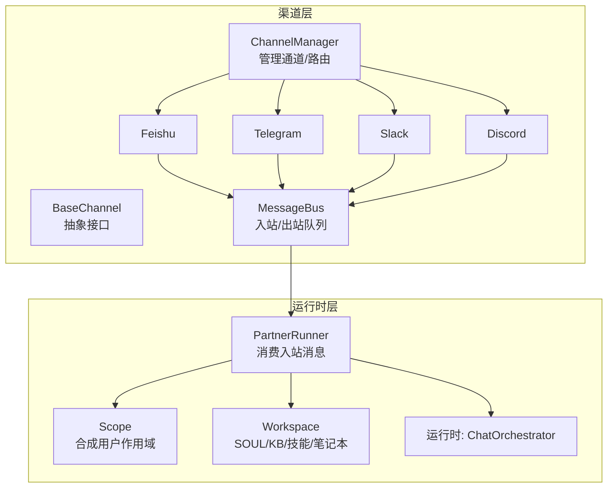
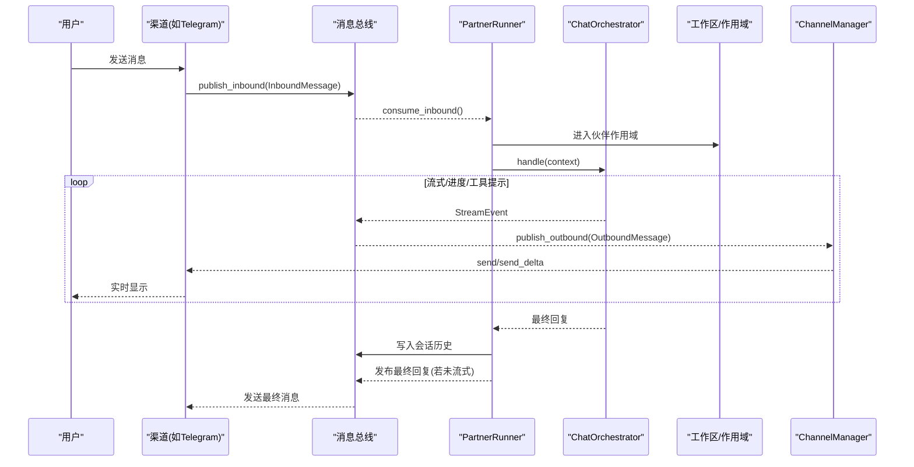
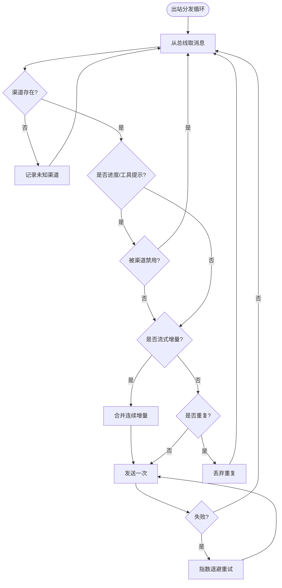
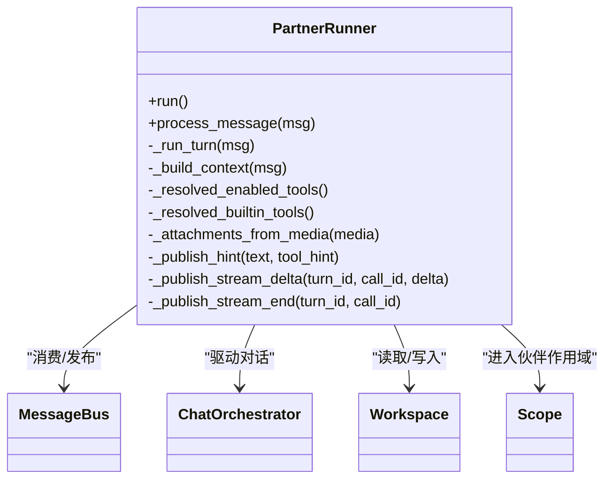
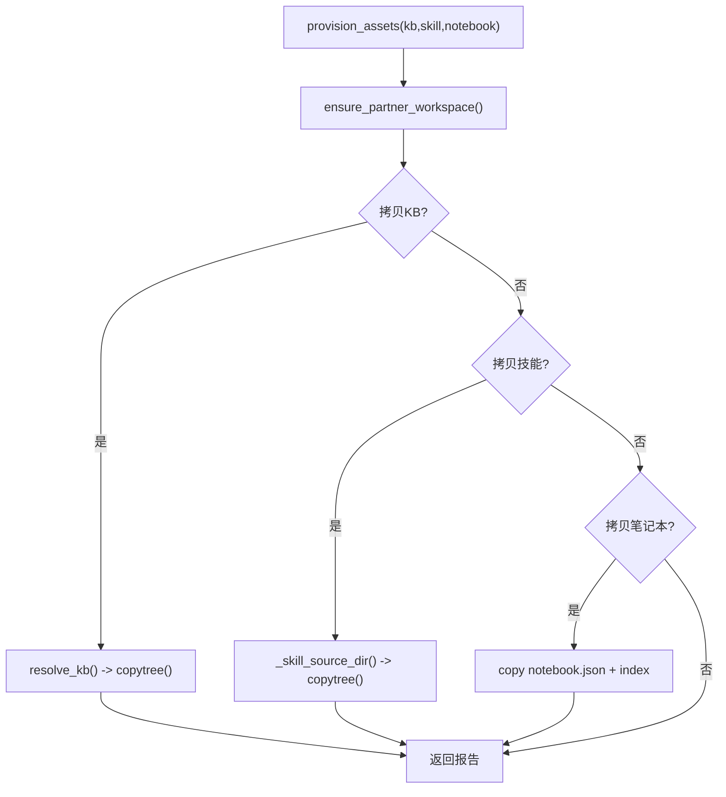
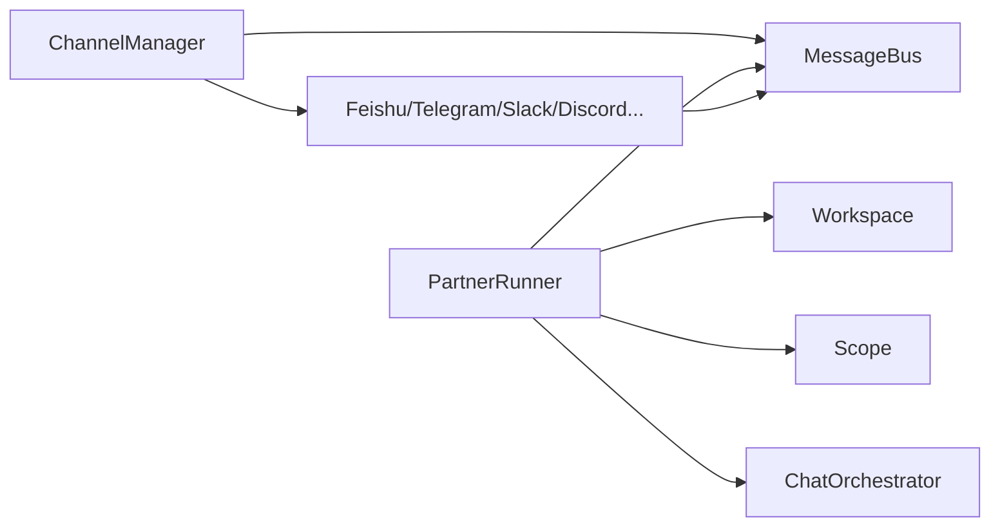

# 伙伴系统

<cite>
**本文引用的文件**
- [deeptutor/partners/__init__.py](file://deeptutor/partners/__init__.py)
- [deeptutor/partners/channels/base.py](file://deeptutor/partners/channels/base.py)
- [deeptutor/partners/channels/manager.py](file://deeptutor/partners/channels/manager.py)
- [deeptutor/partners/channels/feishu.py](file://deeptutor/partners/channels/feishu.py)
- [deeptutor/partners/channels/telegram.py](file://deeptutor/partners/channels/telegram.py)
- [deeptutor/partners/channels/slack.py](file://deeptutor/partners/channels/slack.py)
- [deeptutor/partners/channels/discord.py](file://deeptutor/partners/channels/discord.py)
- [deeptutor/partners/config/schema.py](file://deeptutor/partners/config/schema.py)
- [deeptutor/services/partners/runtime.py](file://deeptutor/services/partners/runtime.py)
- [deeptutor/services/partners/workspace.py](file://deeptutor/services/partners/workspace.py)
- [deeptutor/services/partners/scope.py](file://deeptutor/services/partners/scope.py)
</cite>

## 目录
1. [简介](#简介)
2. [项目结构](#项目结构)
3. [核心组件](#核心组件)
4. [架构总览](#架构总览)
5. [详细组件分析](#详细组件分析)
6. [依赖关系分析](#依赖关系分析)
7. [性能与可靠性](#性能与可靠性)
8. [故障排查指南](#故障排查指南)
9. [结论](#结论)
10. [附录：多渠道接入清单与配置要点](#附录多渠道接入清单与配置要点)

## 简介
本文件为 DeepTutor 的“伙伴系统”提供系统化、可落地的技术文档。伙伴系统的目标是让每个“伙伴”成为拥有独立人格（个人灵魂）、独立记忆、技能、知识库和笔记本的持久化 AI 助手，并通过多种即时通讯渠道对外提供服务。其关键设计包括：
- 持久化伴侣：以文件系统形式保存 SOUL.md、知识、技能、笔记本与记忆，确保重启后仍可延续个性与上下文。
- 工作空间隔离：通过“合成用户作用域”，将伙伴的资源与管理员/其他用户资源严格隔离。
- 统一代理循环：所有伙伴消息均复用产品聊天能力（ChatOrchestrator → AgenticChatPipeline），保证一致的智能体验。
- 多渠道接入：统一的 ChannelManager + BaseChannel 抽象，支持飞书、Telegram、Slack、Discord、钉钉、QQ/NapCat、企业微信、WhatsApp、Zulip、Mattermost、Matrix、Mochat、Microsoft Teams 等。
- 运行时环境：消息总线解耦通道与代理执行；流式增量输出、重试退避、重复抑制等机制保障稳定性与用户体验。

## 项目结构
伙伴系统主要分布在两个层次：
- partners：IM 渠道层（通道实现、消息总线、配置模式）。
- services/partners：伙伴运行时（会话、工作区、作用域、命令处理、模型选择）。

图表来源
- [deeptutor/partners/channels/manager.py:31-135](file://deeptutor/partners/channels/manager.py#L31-L135)
- [deeptutor/partners/channels/base.py:19-174](file://deeptutor/partners/channels/base.py#L19-L174)
- [deeptutor/services/partners/runtime.py:72-180](file://deeptutor/services/partners/runtime.py#L72-L180)
- [deeptutor/services/partners/workspace.py:1-25](file://deeptutor/services/partners/workspace.py#L1-L25)
- [deeptutor/services/partners/scope.py:1-54](file://deeptutor/services/partners/scope.py#L1-L54)

章节来源
- [deeptutor/partners/__init__.py:1-12](file://deeptutor/partners/__init__.py#L1-L12)

## 核心组件
- 渠道管理器（ChannelManager）：发现并初始化启用的渠道，启动/停止通道，负责出站消息分发、去重、流式增量合并与重试退避。
- 渠道基类（BaseChannel）：定义 start/stop/send/send_delta 等接口，内置权限校验、流式开关、音频转写等通用能力。
- 配置系统（ChannelsConfig/DeliveryOverrides/StreamingSupport）：声明式配置，支持 camelCase/snake_case 兼容、每渠道投递开关、最大重试次数等。
- 伙伴运行时（PartnerRunner）：消费入站消息，组装 UnifiedContext，进入伙伴作用域，驱动 ChatOrchestrator 完成一轮对话，并将结果回写到会话存储与出站总线。
- 工作区（Workspace）：按 chat 用户工作区布局复制/维护 SOUL.md、知识、技能、笔记本，并提供清单与删除能力。
- 作用域（Scope）：以“partner_”前缀创建合成用户，使所有服务在伙伴上下文中解析到独立路径。

章节来源
- [deeptutor/partners/channels/manager.py:31-135](file://deeptutor/partners/channels/manager.py#L31-L135)
- [deeptutor/partners/channels/base.py:19-174](file://deeptutor/partners/channels/base.py#L19-L174)
- [deeptutor/partners/config/schema.py:9-51](file://deeptutor/partners/config/schema.py#L9-L51)
- [deeptutor/services/partners/runtime.py:72-180](file://deeptutor/services/partners/runtime.py#L72-L180)
- [deeptutor/services/partners/workspace.py:68-156](file://deeptutor/services/partners/workspace.py#L68-L156)
- [deeptutor/services/partners/scope.py:19-54](file://deeptutor/services/partners/scope.py#L19-L54)

## 架构总览
伙伴系统采用“通道-总线-运行器-代理”的分层架构：
- 各 IM 平台通过 Channel 接入，统一封装为 InboundMessage 发布到 MessageBus。
- PartnerRunner 订阅入站消息，进入伙伴作用域，构建上下文并调用 ChatOrchestrator 执行一轮对话。
- 运行过程中产生的内容、工具提示、进度事件通过 MessageBus 转为 OutboundMessage，由 ChannelManager 路由到对应渠道。
- 工作区提供 SOUL、技能、知识库、笔记本等资源，确保每个伙伴的个性化与数据隔离。

图表来源
- [deeptutor/partners/channels/base.py:126-174](file://deeptutor/partners/channels/base.py#L126-L174)
- [deeptutor/services/partners/runtime.py:93-180](file://deeptutor/services/partners/runtime.py#L93-L180)
- [deeptutor/services/partners/runtime.py:212-360](file://deeptutor/services/partners/runtime.py#L212-L360)
- [deeptutor/partners/channels/manager.py:187-232](file://deeptutor/partners/channels/manager.py#L187-L232)

## 详细组件分析

### 渠道管理器（ChannelManager）
职责
- 扫描并启用渠道，注入 Groq 转录密钥与投递开关。
- 启动/停止所有渠道，启动出站分发协程。
- 出站消息分发：流式增量合并、重复抑制、指数退避重试。

关键点
- 允许列表校验：空 allow_from 会拒绝全部访问，需显式设置 ["*"] 或白名单。
- 流式合并：对同一 (channel, chat_id) 且同 stream_id 的 _stream_delta 进行合并，减少编辑 API 调用。
- 重复抑制：基于 origin_message_id/message_id 与内容指纹避免重复回复。
- 重试策略：默认最多 3 次，延迟 1s/2s/4s。

图表来源
- [deeptutor/partners/channels/manager.py:187-327](file://deeptutor/partners/channels/manager.py#L187-L327)

章节来源
- [deeptutor/partners/channels/manager.py:31-135](file://deeptutor/partners/channels/manager.py#L31-L135)
- [deeptutor/partners/channels/manager.py:153-185](file://deeptutor/partners/channels/manager.py#L153-L185)
- [deeptutor/partners/channels/manager.py:239-327](file://deeptutor/partners/channels/manager.py#L239-L327)

### 渠道基类（BaseChannel）
职责
- 定义 start/stop/send/send_delta 抽象方法。
- 内置权限控制（allow_from）、流式能力探测、音频转写。
- 统一将平台消息包装为 InboundMessage 并发布到总线。

关键点
- supports_streaming：当配置开启 streaming 且子类实现了 send_delta 时生效。
- is_allowed：空列表表示拒绝所有人，包含 "*" 表示放行所有人。
- _handle_message：自动注入 _wants_stream 标记（当支持流式且允许进度投递时）。

章节来源
- [deeptutor/partners/channels/base.py:19-174](file://deeptutor/partners/channels/base.py#L19-L174)

### 配置系统（ChannelsConfig / DeliveryOverrides / StreamingSupport）
职责
- 声明式配置，支持 camelCase/snake_case 双键名。
- 每渠道投递开关：send_progress、send_tool_hints。
- 全局出站重试上限：send_max_retries。

使用方式
- 各渠道通过 Pydantic 模型校验配置，并在 ChannelManager 初始化时读取。
- 运行时根据 channel 名称动态读取 per-channel 覆盖项。

章节来源
- [deeptutor/partners/config/schema.py:9-51](file://deeptutor/partners/config/schema.py#L9-L51)
- [deeptutor/partners/channels/manager.py:90-106](file://deeptutor/partners/channels/manager.py#L90-L106)

### 伙伴运行时（PartnerRunner）
职责
- 持续消费入站消息，串行化同一 session_key 的处理。
- 组装 UnifiedContext（会话历史、附件、语言、SOUL、技能清单、知识库、元数据）。
- 激活 LLM 选择，进入伙伴作用域，驱动 ChatOrchestrator。
- 将流式内容、工具提示、进度事件发布为 OutboundMessage。
- 失败时尝试备用模型；无回复时将终止文本作为回复。

关键点
- 作用域切换：user_context(partner_user(...)) 确保所有服务解析到伙伴工作区。
- 流式协议：_stream_delta/_stream_end 配合 ChannelManager 的合并逻辑。
- 附件处理：图片与文档提取，生成 source manifest。

图表来源
- [deeptutor/services/partners/runtime.py:72-180](file://deeptutor/services/partners/runtime.py#L72-L180)
- [deeptutor/services/partners/runtime.py:212-360](file://deeptutor/services/partners/runtime.py#L212-L360)
- [deeptutor/services/partners/runtime.py:364-434](file://deeptutor/services/partners/runtime.py#L364-L434)
- [deeptutor/services/partners/runtime.py:675-705](file://deeptutor/services/partners/runtime.py#L675-L705)

章节来源
- [deeptutor/services/partners/runtime.py:93-180](file://deeptutor/services/partners/runtime.py#L93-L180)
- [deeptutor/services/partners/runtime.py:212-360](file://deeptutor/services/partners/runtime.py#L212-L360)
- [deeptutor/services/partners/runtime.py:364-434](file://deeptutor/services/partners/runtime.py#L364-L434)

### 工作区与作用域（Workspace & Scope）
职责
- 工作区：按 chat 用户工作区格式克隆 SOUL.md、知识、技能、笔记本，并提供清单与删除。
- 作用域：以 partner_ 前缀构造合成用户，使所有服务在伙伴上下文中解析到独立路径。

关键点
- provision_assets：在请求者权限下解析并拷贝 KB/技能/笔记本到伙伴工作区。
- list_assets/remove_asset：列出与移除已拷贝资源。
- read_soul/write_soul：读写伙伴人格。

图表来源
- [deeptutor/services/partners/workspace.py:119-156](file://deeptutor/services/partners/workspace.py#L119-L156)
- [deeptutor/services/partners/workspace.py:164-248](file://deeptutor/services/partners/workspace.py#L164-L248)
- [deeptutor/services/partners/workspace.py:283-376](file://deeptutor/services/partners/workspace.py#L283-L376)
- [deeptutor/services/partners/scope.py:19-54](file://deeptutor/services/partners/scope.py#L19-L54)

章节来源
- [deeptutor/services/partners/workspace.py:68-156](file://deeptutor/services/partners/workspace.py#L68-L156)
- [deeptutor/services/partners/workspace.py:283-376](file://deeptutor/services/partners/workspace.py#L283-L376)
- [deeptutor/services/partners/scope.py:19-54](file://deeptutor/services/partners/scope.py#L19-L54)

### 具体渠道实现示例
- 飞书（Feishu/Lark）：基于 lark-oapi SDK，支持长连接、卡片/富文本解析、媒体处理。
- Telegram：基于 python-telegram-bot，支持命令、Markdown→HTML 转换、表格渲染、流式编辑。
- Slack：Socket Mode 接入，线程回复、表情反应、DM/群组策略。
- Discord：Gateway WebSocket 接入，速率限制重试、流式编辑、附件上传。

章节来源
- [deeptutor/partners/channels/feishu.py:1-200](file://deeptutor/partners/channels/feishu.py#L1-L200)
- [deeptutor/partners/channels/telegram.py:1-200](file://deeptutor/partners/channels/telegram.py#L1-L200)
- [deeptutor/partners/channels/slack.py:1-200](file://deeptutor/partners/channels/slack.py#L1-L200)
- [deeptutor/partners/channels/discord.py:1-200](file://deeptutor/partners/channels/discord.py#L1-L200)

## 依赖关系分析
- ChannelManager 依赖 MessageBus 与各渠道实现，负责生命周期管理与出站路由。
- PartnerRunner 依赖 MessageBus、Workspace、Scope 以及 ChatOrchestrator，负责对话执行与会话持久化。
- 渠道实现依赖各自平台的 SDK，并通过 BaseChannel 统一接入。
- 配置系统为 ChannelManager 与渠道实现提供类型安全的配置解析。

图表来源
- [deeptutor/partners/channels/manager.py:31-135](file://deeptutor/partners/channels/manager.py#L31-L135)
- [deeptutor/services/partners/runtime.py:72-180](file://deeptutor/services/partners/runtime.py#L72-L180)

章节来源
- [deeptutor/partners/channels/manager.py:31-135](file://deeptutor/partners/channels/manager.py#L31-L135)
- [deeptutor/services/partners/runtime.py:72-180](file://deeptutor/services/partners/runtime.py#L72-L180)

## 性能与可靠性
- 流式增量合并：ChannelManager 对同一会话的连续 _stream_delta 进行合并，显著降低编辑 API 调用次数，提升响应流畅度。
- 重复抑制：基于 origin_message_id/message_id 与内容指纹，避免重复回复。
- 指数退避重试：出站失败时按 1s/2s/4s 间隔重试，提高鲁棒性。
- 会话级串行化：PartnerRunner 对同一 session_key 加锁，避免并发冲突。
- 附件与文档提取：对图片与文档进行大小限制与提取，减少无效负载。

[本节为通用指导，不直接分析具体文件]

## 故障排查指南
常见问题与定位建议
- 渠道无法启动：检查渠道 token/app_token 等凭据是否正确，日志中是否有认证失败或连接超时。
- 消息被拒绝：确认 allow_from 非空且包含发送者 ID，或使用 ["*"] 放行。
- 流式不生效：确认渠道配置 streaming 为真，且 send_progress 开启；同时渠道需实现 send_delta。
- 重复消息：检查 metadata 中的 origin_message_id/message_id 是否正确传递。
- 附件未送达：查看文件大小与 MIME 类型是否符合限制；部分渠道对媒体上传有额外限制。

章节来源
- [deeptutor/partners/channels/base.py:116-174](file://deeptutor/partners/channels/base.py#L116-L174)
- [deeptutor/partners/channels/manager.py:108-120](file://deeptutor/partners/channels/manager.py#L108-L120)
- [deeptutor/partners/channels/manager.py:160-185](file://deeptutor/partners/channels/manager.py#L160-L185)
- [deeptutor/partners/channels/manager.py:296-327](file://deeptutor/partners/channels/manager.py#L296-L327)

## 结论
DeepTutor 的伙伴系统通过“持久化工作区 + 合成用户作用域 + 统一代理循环 + 多渠道接入”的设计，实现了真正的 AI 助手生态：
- 每个伙伴拥有独立的灵魂、记忆、技能、知识库与笔记本，支持多用户、多场景的个性化服务。
- 渠道层解耦了平台差异，运行时层保证了智能体验的一致性。
- 流式输出、重试与去重等机制提升了可用性与用户体验。
- 通过配置系统与权限控制，可实现灵活的多渠道消息路由与访问治理。

[本节为总结性内容，不直接分析具体文件]

## 附录：多渠道接入清单与配置要点
- 飞书（Feishu/Lark）：使用 lark-oapi SDK，支持卡片/富文本解析与媒体处理。
- Telegram：基于 python-telegram-bot，支持命令、Markdown→HTML、表格渲染与流式编辑。
- Slack：Socket Mode，支持线程回复、表情反应、DM/群组策略。
- Discord：Gateway WebSocket，支持速率限制重试、流式编辑与附件上传。
- 钉钉、QQ/NapCat、企业微信、WhatsApp、Zulip、Mattermost、Matrix、Mochat、Microsoft Teams：遵循 BaseChannel 接口与 ChannelsConfig 配置模式接入。

章节来源
- [deeptutor/partners/channels/feishu.py:1-200](file://deeptutor/partners/channels/feishu.py#L1-L200)
- [deeptutor/partners/channels/telegram.py:1-200](file://deeptutor/partners/channels/telegram.py#L1-L200)
- [deeptutor/partners/channels/slack.py:1-200](file://deeptutor/partners/channels/slack.py#L1-L200)
- [deeptutor/partners/channels/discord.py:1-200](file://deeptutor/partners/channels/discord.py#L1-L200)
- [deeptutor/partners/config/schema.py:9-51](file://deeptutor/partners/config/schema.py#L9-L51)