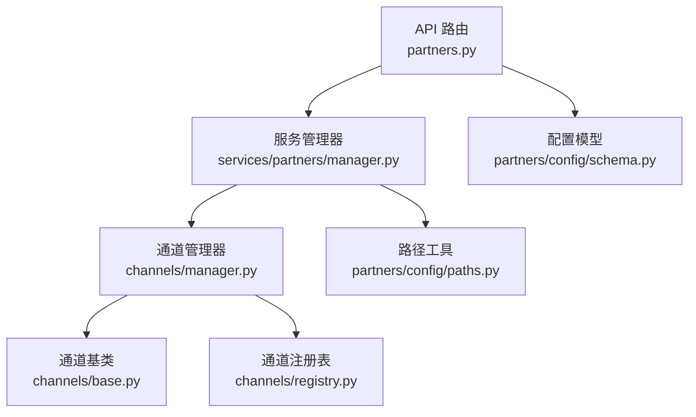
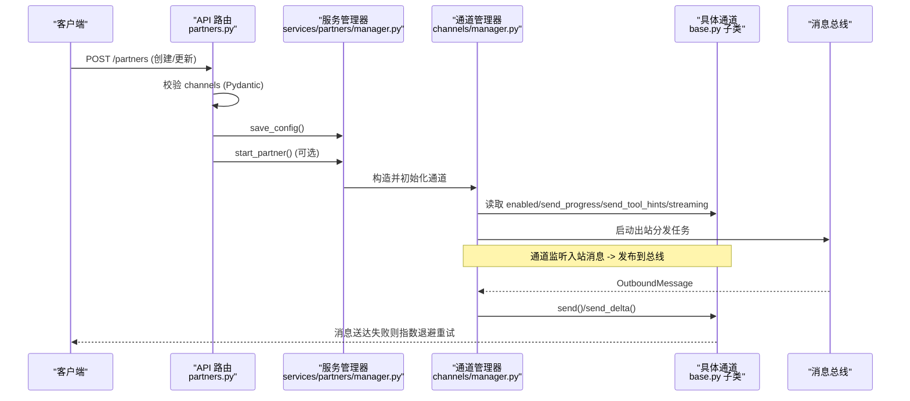
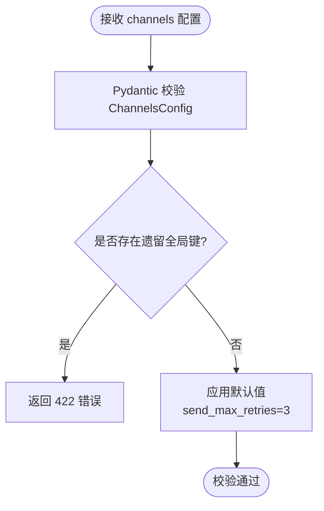
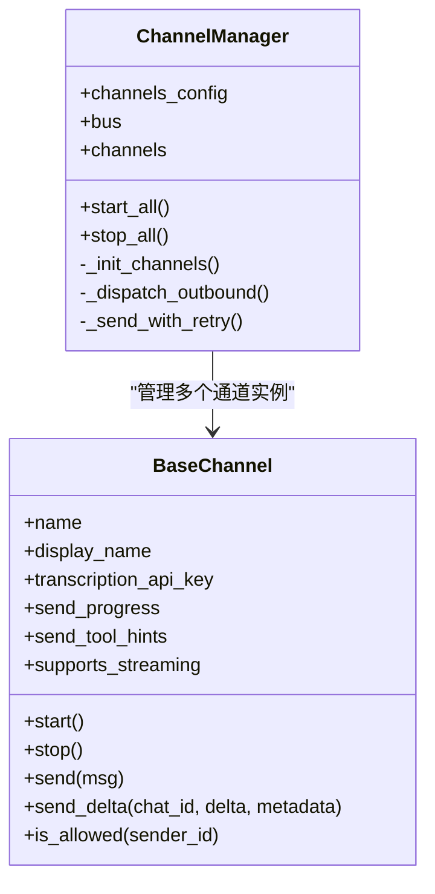
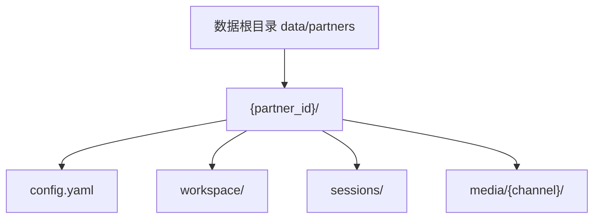
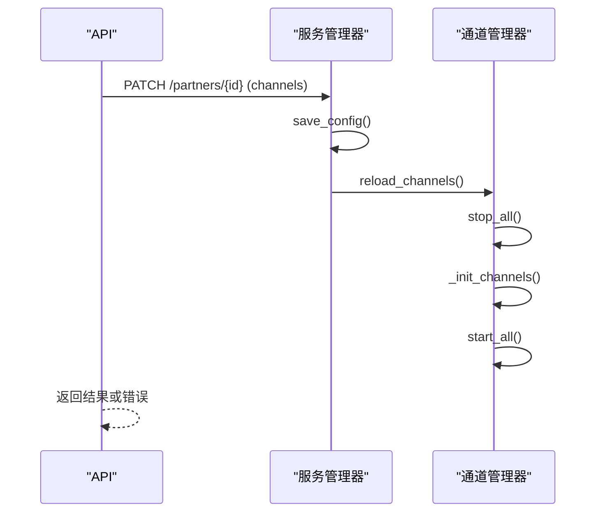
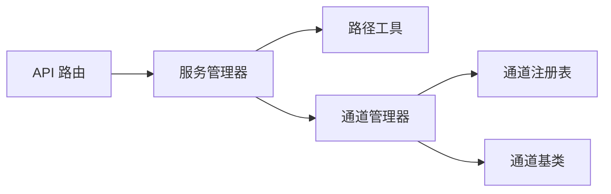

# 伙伴配置

<cite>
**本文引用的文件**
- [deeptutor/partners/config/schema.py](file://deeptutor/partners/config/schema.py)
- [deeptutor/partners/config/paths.py](file://deeptutor/partners/config/paths.py)
- [deeptutor/partners/channels/base.py](file://deeptutor/partners/channels/base.py)
- [deeptutor/partners/channels/manager.py](file://deeptutor/partners/channels/manager.py)
- [deeptutor/partners/channels/registry.py](file://deeptutor/partners/channels/registry.py)
- [deeptutor/api/routers/partners.py](file://deeptutor/api/routers/partners.py)
- [deeptutor/services/partners/manager.py](file://deeptutor/services/partners/manager.py)
</cite>

## 目录
1. [简介](#简介)
2. [项目结构](#项目结构)
3. [核心组件](#核心组件)
4. [架构总览](#架构总览)
5. [详细组件分析](#详细组件分析)
6. [依赖关系分析](#依赖关系分析)
7. [性能考量](#性能考量)
8. [故障排查指南](#故障排查指南)
9. [结论](#结论)
10. [附录](#附录)

## 简介
本文件面向 DeepTutor 的“伙伴（Partner）”配置系统，系统性说明其配置架构、验证规则、默认值管理、渠道启用与白名单、API 密钥管理、连接参数、配置文件路径与多环境支持、热重载机制、安全策略（敏感信息遮蔽与权限控制）、版本兼容与迁移策略，并通过具体示例展示如何创建不同个性的伙伴配置（个人灵魂、模型策略、渠道绑定）。

## 项目结构
DeepTutor 的伙伴配置由“配置模型 + 通道管理器 + API 路由 + 持久化与管理器”共同构成：
- 配置模型：定义 ChannelsConfig 及通用字段（如 send_progress、send_tool_hints、streaming、send_max_retries），并支持 camelCase/snake_case 双命名。
- 通道发现与初始化：通过包扫描与 entry_points 自动发现内置与插件通道，按 enabled 开关初始化。
- API 路由：提供创建/更新/启动/停止/重载等接口，并在入口处校验 channels 配置。
- 持久化与管理器：以 YAML 存储每个伙伴的配置，提供加载、保存、合并、生命周期管理。

**图示来源**
- [deeptutor/api/routers/partners.py:447-662](file://deeptutor/api/routers/partners.py#L447-L662)
- [deeptutor/services/partners/manager.py:318-400](file://deeptutor/services/partners/manager.py#L318-L400)
- [deeptutor/partners/channels/manager.py:31-136](file://deeptutor/partners/channels/manager.py#L31-L136)
- [deeptutor/partners/channels/base.py:19-185](file://deeptutor/partners/channels/base.py#L19-L185)
- [deeptutor/partners/channels/registry.py:17-86](file://deeptutor/partners/channels/registry.py#L17-L86)
- [deeptutor/partners/config/schema.py:9-51](file://deeptutor/partners/config/schema.py#L9-L51)
- [deeptutor/partners/config/paths.py:10-54](file://deeptutor/partners/config/paths.py#L10-L54)

**章节来源**
- [deeptutor/api/routers/partners.py:447-662](file://deeptutor/api/routers/partners.py#L447-L662)
- [deeptutor/services/partners/manager.py:318-400](file://deeptutor/services/partners/manager.py#L318-L400)
- [deeptutor/partners/channels/manager.py:31-136](file://deeptutor/partners/channels/manager.py#L31-L136)
- [deeptutor/partners/channels/base.py:19-185](file://deeptutor/partners/channels/base.py#L19-L185)
- [deeptutor/partners/channels/registry.py:17-86](file://deeptutor/partners/channels/registry.py#L17-L86)
- [deeptutor/partners/config/schema.py:9-51](file://deeptutor/partners/config/schema.py#L9-L51)
- [deeptutor/partners/config/paths.py:10-54](file://deeptutor/partners/config/paths.py#L10-L54)

## 核心组件
- ChannelsConfig：统一描述各渠道配置段，支持额外字段（extra="allow"），并提供全局发送重试次数 send_max_retries。
- DeliveryOverrides：每渠道投递开关（进度、工具提示）。
- StreamingSupport：是否开启流式编辑消息（需渠道实现 send_delta）。
- ChannelManager：负责通道发现、初始化、启停、出站消息分发、去重、流片段合并与指数退避重试。
- BaseChannel：抽象通道接口，包含 allow_from 白名单、transcription 能力、supports_streaming 判定、_handle_message 入站处理。
- PartnerManager：伙伴实例与配置的运行时管理，YAML 持久化、字段合并、自动启动、会话存储、工作区路径。
- API 路由：创建/更新/启动/停止/重载通道、获取 schema、工具选项、资产与灵魂模板等。

**章节来源**
- [deeptutor/partners/config/schema.py:9-51](file://deeptutor/partners/config/schema.py#L9-L51)
- [deeptutor/partners/channels/manager.py:31-136](file://deeptutor/partners/channels/manager.py#L31-L136)
- [deeptutor/partners/channels/base.py:19-185](file://deeptutor/partners/channels/base.py#L19-L185)
- [deeptutor/services/partners/manager.py:169-210](file://deeptutor/services/partners/manager.py#L169-L210)
- [deeptutor/api/routers/partners.py:447-662](file://deeptutor/api/routers/partners.py#L447-L662)

## 架构总览
下图展示了从 API 请求到通道投递的完整流程，包括配置校验、通道初始化、出站消息分发与重试。

**图示来源**
- [deeptutor/api/routers/partners.py:203-231](file://deeptutor/api/routers/partners.py#L203-L231)
- [deeptutor/api/routers/partners.py:447-502](file://deeptutor/api/routers/partners.py#L447-L502)
- [deeptutor/services/partners/manager.py:371-400](file://deeptutor/services/partners/manager.py#L371-L400)
- [deeptutor/partners/channels/manager.py:57-136](file://deeptutor/partners/channels/manager.py#L57-L136)
- [deeptutor/partners/channels/base.py:126-175](file://deeptutor/partners/channels/base.py#L126-L175)

## 详细组件分析

### 配置模型与验证规则
- ChannelsConfig：
  - 允许额外字段，便于扩展新渠道配置。
  - 提供 send_max_retries（默认 3），用于出站失败重试上限。
- DeliveryOverrides：
  - send_progress：是否向该渠道投递“播报进度”。
  - send_tool_hints：是否投递“工具调用提示”。
- StreamingSupport：
  - streaming：是否启用“就地编辑消息”的流式回复（需渠道实现 send_delta）。
- 验证入口：
  - API 层在创建/更新时通过 Pydantic 校验 channels 结构，拒绝遗留的全局投递键（LEGACY_GLOBAL_DELIVERY_KEYS），并返回结构化错误。

**图示来源**
- [deeptutor/partners/config/schema.py:9-51](file://deeptutor/partners/config/schema.py#L9-L51)
- [deeptutor/api/routers/partners.py:203-231](file://deeptutor/api/routers/partners.py#L203-L231)

**章节来源**
- [deeptutor/partners/config/schema.py:9-51](file://deeptutor/partners/config/schema.py#L9-L51)
- [deeptutor/api/routers/partners.py:203-231](file://deeptutor/api/routers/partners.py#L203-L231)

### 通道初始化与运行
- 通道发现：
  - 通过包扫描内置通道模块，并结合 entry_points 加载外部插件；内置优先，避免被插件覆盖。
- 初始化逻辑：
  - 仅当某渠道配置段存在且 enabled=True 时初始化。
  - 解析 per-channel 的 send_progress、send_tool_hints（同时支持 camelCase 别名）。
  - 注入 Groq 转录密钥（若配置）。
  - 校验 allow_from：空列表将直接终止（防止误配导致全拒）。
- 运行期：
  - 启动所有通道与出站分发任务。
  - 出站消息去重（基于内容指纹与 origin/message id）。
  - 流片段合并：对同一 (channel, chat_id, stream_id) 的连续 _stream_delta 进行合并，减少 edit 调用。
  - 失败重试：指数退避（1s/2s/4s），可配置最大尝试次数。

**图示来源**
- [deeptutor/partners/channels/manager.py:31-136](file://deeptutor/partners/channels/manager.py#L31-L136)
- [deeptutor/partners/channels/base.py:19-185](file://deeptutor/partners/channels/base.py#L19-L185)

**章节来源**
- [deeptutor/partners/channels/manager.py:57-136](file://deeptutor/partners/channels/manager.py#L57-L136)
- [deeptutor/partners/channels/base.py:116-185](file://deeptutor/partners/channels/base.py#L116-L185)
- [deeptutor/partners/channels/registry.py:17-86](file://deeptutor/partners/channels/registry.py#L17-L86)

### 配置持久化与路径管理
- 数据根目录：data/partners（管理员工作区下），避免上下文变量递归。
- 子目录：
  - get_runtime_subdir(name)：运行时子目录。
  - get_media_dir(channel)：共享媒体下载目录（可按 channel 隔离）。
  - get_partner_dir(partner_id)：{partner_id}/config.yaml、workspace、sessions、media。
- 配置加载/保存：
  - load_config：从 config.yaml 读取并映射为 PartnerConfig，清理遗留全局投递键，规范化 mcp_tools。
  - save_config：原子写入（临时文件+替换），支持 auto_start 标记。
- 多环境支持：
  - 通过不同的 workspace_root（管理员路径服务）切换环境；部署时可指向不同根目录以实现多环境隔离。

**图示来源**
- [deeptutor/partners/config/paths.py:10-54](file://deeptutor/partners/config/paths.py#L10-L54)
- [deeptutor/services/partners/manager.py:371-400](file://deeptutor/services/partners/manager.py#L371-L400)

**章节来源**
- [deeptutor/partners/config/paths.py:10-54](file://deeptutor/partners/config/paths.py#L10-L54)
- [deeptutor/services/partners/manager.py:371-400](file://deeptutor/services/partners/manager.py#L371-L400)

### 配置热重载机制
- 触发点：
  - 更新 channels 后，若实例正在运行，调用 reload_channels 重新初始化通道。
- 行为：
  - 停止旧通道，按新配置重建通道实例，重启出站分发任务。
  - 若重载失败，记录 last_reload_error 并返回错误。
- 注意：
  - LLM 选择与工具配置变更无需重载，因为每次回合从当前配置对象解析。

**图示来源**
- [deeptutor/api/routers/partners.py:589-613](file://deeptutor/api/routers/partners.py#L589-L613)
- [deeptutor/api/routers/partners.py:649-662](file://deeptutor/api/routers/partners.py#L649-L662)
- [deeptutor/partners/channels/manager.py:122-151](file://deeptutor/partners/channels/manager.py#L122-L151)

**章节来源**
- [deeptutor/api/routers/partners.py:589-613](file://deeptutor/api/routers/partners.py#L589-L613)
- [deeptutor/api/routers/partners.py:649-662](file://deeptutor/api/routers/partners.py#L649-L662)
- [deeptutor/partners/channels/manager.py:122-151](file://deeptutor/partners/channels/manager.py#L122-L151)

### 安全考虑：敏感信息与权限控制
- 敏感信息遮蔽：
  - 非编辑响应中，通道配置内的疑似密钥字段（token、secret、password、api_key、apikey、encrypt_key 等）会被替换为 "***"。
  - 编辑视图可通过 include_secrets=true 获取原始值。
- 白名单访问控制：
  - 每个通道支持 allow_from：空列表表示拒绝所有人（启动时会报错）；包含 "*" 表示允许所有人；否则仅允许指定用户 ID。
- 传输与存储：
  - 配置以 YAML 存储在本地文件系统，建议结合部署级加密（如磁盘加密、密钥管理服务）保护敏感字段。
  - 出站失败重试期间不暴露明文密钥（日志中已做遮蔽）。

**章节来源**
- [deeptutor/services/partners/manager.py:41-86](file://deeptutor/services/partners/manager.py#L41-L86)
- [deeptutor/partners/channels/base.py:116-125](file://deeptutor/partners/channels/base.py#L116-L125)
- [deeptutor/partners/channels/manager.py:108-114](file://deeptutor/partners/channels/manager.py#L108-L114)
- [deeptutor/api/routers/partners.py:537-558](file://deeptutor/api/routers/partners.py#L537-L558)

### 支持的配置选项与默认值
- 渠道启用开关：enabled（布尔，默认 false）。
- 投递开关：send_progress、send_tool_hints（默认 true）。
- 流式支持：streaming（默认 false，需渠道实现 send_delta）。
- 发送重试：send_max_retries（默认 3）。
- 白名单：allow_from（空列表拒绝全部，"*" 允许全部）。
- 模型策略：llm_selection、backup_llm_selection（通过 API 校验并应用到模型目录）。
- 工具授权：enabled_tools、builtin_tools、mcp_tools（默认关闭，除非显式允许）。
- 外观与语言：emoji、color、avatar、language。
- 灵魂来源：soul_origin（type/id 溯源）。

**章节来源**
- [deeptutor/partners/config/schema.py:15-51](file://deeptutor/partners/config/schema.py#L15-L51)
- [deeptutor/partners/channels/base.py:105-125](file://deeptutor/partners/channels/base.py#L105-L125)
- [deeptutor/services/partners/manager.py:169-210](file://deeptutor/services/partners/manager.py#L169-L210)
- [deeptutor/api/routers/partners.py:117-151](file://deeptutor/api/routers/partners.py#L117-L151)

### 配置文件路径与多环境支持
- 根路径：data/partners（管理员工作区下），避免上下文变量递归。
- 多环境：通过管理员路径服务的 workspace_root 切换不同根目录，从而实现开发/测试/生产等多环境隔离。
- 媒体与工作区：
  - 共享媒体目录：get_media_dir(channel)。
  - 伙伴工作区：get_partner_workspace(partner_id)。
  - 会话目录：get_partner_sessions_dir(partner_id)。

**章节来源**
- [deeptutor/partners/config/paths.py:10-54](file://deeptutor/partners/config/paths.py#L10-L54)

### 版本兼容性与迁移策略
- 遗留全局投递键：
  - 在 API 层拒绝包含 send_progress/sendToolHints 等顶层键的请求。
  - 加载配置时自动剥离这些键，确保向后兼容。
- MCP 工具默认策略：
  - 未配置或格式异常时默认为空（关闭），只有显式 ["*"] 才放开。
- 标识符规范化：
  - partner_id 与 soul_id 使用 ASCII/URL 安全的 slugify，纯中文名称会生成稳定哈希后缀，保证可分享与可达性。

**章节来源**
- [deeptutor/api/routers/partners.py:203-231](file://deeptutor/api/routers/partners.py#L203-L231)
- [deeptutor/services/partners/manager.py:41-93](file://deeptutor/services/partners/manager.py#L41-L93)
- [deeptutor/services/partners/manager.py:140-167](file://deeptutor/services/partners/manager.py#L140-L167)
- [deeptutor/services/partners/manager.py:95-131](file://deeptutor/services/partners/manager.py#L95-L131)

### 示例：创建不同个性的伙伴配置
以下示例聚焦于“个人灵魂、模型策略、渠道绑定”的组合方式，实际字段名与取值请参考对应源码位置。

- 示例一：教学助手（启用 Telegram，限制白名单，开启流式）
  - 渠道：telegram.enabled=true，allow_from=["user1","user2"]，streaming=true，send_progress=true。
  - 模型策略：llm_selection={"role":"teacher"}，backup_llm_selection 设置备用模型。
  - 工具授权：enabled_tools 仅开放问答相关工具，builtin_tools 限制记忆工具。
  - 参考路径：
    - [创建/更新请求模型:117-151](file://deeptutor/api/routers/partners.py#L117-L151)
    - [通道配置模型:15-51](file://deeptutor/partners/config/schema.py#L15-L51)
    - [白名单与流式支持:105-125](file://deeptutor/partners/channels/base.py#L105-L125)

- 示例二：客服机器人（启用 Discord，禁用工具提示，严格白名单）
  - 渠道：discord.enabled=true，allow_from=["bot_user"], send_tool_hints=false。
  - 模型策略：llm_selection={"role":"support"}，backup_llm_selection 用于降级。
  - 工具授权：mcp_tools=[]（默认关闭），builtin_tools 仅开放知识库检索。
  - 参考路径：
    - [通道发现与初始化:57-136](file://deeptutor/partners/channels/manager.py#L57-L136)
    - [MCP 工具默认策略:140-167](file://deeptutor/services/partners/manager.py#L140-L167)

- 示例三：研究助理（启用飞书，启用流式，宽松白名单）
  - 渠道：feishu.enabled=true，allow_from=["*"], streaming=true。
  - 模型策略：llm_selection={"role":"researcher"}，backup_llm_selection 设置备用。
  - 工具授权：enabled_tools 开放搜索与笔记工具，mcp_tools 按需授权。
  - 参考路径：
    - [飞书通道配置与流式:240-266](file://deeptutor/partners/channels/feishu.py#L240-L266)
    - [流式支持判定:105-115](file://deeptutor/partners/channels/base.py#L105-L115)

- 示例四：个人灵魂（SOUL.md）
  - 来源：default/library/persona/custom。
  - 创建时可选择从库或现有 persona 克隆，或直接上传自定义 Markdown。
  - 参考路径：
    - [灵魂来源解析](file://deeptutor/api/routers/partners.py:269-301)
    - [灵魂模板库接口](file://deeptutor/api/routers/partners.py:327-403)

**章节来源**
- [deeptutor/api/routers/partners.py:117-151](file://deeptutor/api/routers/partners.py#L117-L151)
- [deeptutor/api/routers/partners.py:269-301](file://deeptutor/api/routers/partners.py#L269-L301)
- [deeptutor/api/routers/partners.py:327-403](file://deeptutor/api/routers/partners.py#L327-L403)
- [deeptutor/partners/config/schema.py:15-51](file://deeptutor/partners/config/schema.py#L15-L51)
- [deeptutor/partners/channels/base.py:105-125](file://deeptutor/partners/channels/base.py#L105-L125)
- [deeptutor/partners/channels/manager.py:57-136](file://deeptutor/partners/channels/manager.py#L57-L136)
- [deeptutor/services/partners/manager.py:140-167](file://deeptutor/services/partners/manager.py#L140-L167)

## 依赖关系分析
- API 路由依赖：
  - 配置模型（Pydantic）用于校验 channels。
  - 服务管理器用于持久化与生命周期管理。
- 服务管理器依赖：
  - 路径工具用于定位数据目录与工作区。
  - 通道管理器用于启动/停止通道与出站分发。
- 通道管理器依赖：
  - 通道注册表用于发现内置与插件通道。
  - 通道基类定义统一接口与权限控制。

**图示来源**
- [deeptutor/api/routers/partners.py:447-662](file://deeptutor/api/routers/partners.py#L447-L662)
- [deeptutor/services/partners/manager.py:318-400](file://deeptutor/services/partners/manager.py#L318-L400)
- [deeptutor/partners/channels/manager.py:31-136](file://deeptutor/partners/channels/manager.py#L31-L136)
- [deeptutor/partners/channels/registry.py:17-86](file://deeptutor/partners/channels/registry.py#L17-L86)
- [deeptutor/partners/channels/base.py:19-185](file://deeptutor/partners/channels/base.py#L19-L185)

**章节来源**
- [deeptutor/api/routers/partners.py:447-662](file://deeptutor/api/routers/partners.py#L447-L662)
- [deeptutor/services/partners/manager.py:318-400](file://deeptutor/services/partners/manager.py#L318-L400)
- [deeptutor/partners/channels/manager.py:31-136](file://deeptutor/partners/channels/manager.py#L31-L136)
- [deeptutor/partners/channels/registry.py:17-86](file://deeptutor/partners/channels/registry.py#L17-L86)
- [deeptutor/partners/channels/base.py:19-185](file://deeptutor/partners/channels/base.py#L19-L185)

## 性能考量
- 出站消息合并：对同一流的连续 _stream_delta 进行合并，降低 edit 调用频率。
- 重复抑制：基于内容指纹与 origin/message id 的去重，避免重复推送。
- 重试策略：指数退避（1s/2s/4s），可配置最大尝试次数，平衡可靠性与资源占用。
- 流式支持：仅在渠道实现 send_delta 且配置开启时启用，提升用户体验的同时避免无效开销。

**章节来源**
- [deeptutor/partners/channels/manager.py:213-294](file://deeptutor/partners/channels/manager.py#L213-L294)
- [deeptutor/partners/channels/manager.py:296-327](file://deeptutor/partners/channels/manager.py#L296-L327)
- [deeptutor/partners/channels/base.py:105-115](file://deeptutor/partners/channels/base.py#L105-L115)

## 故障排查指南
- 通道不可用：
  - 检查通道模块是否安装依赖；查看 discover_all_with_errors 的错误输出。
- 白名单误配：
  - allow_from 为空会导致启动时报错；请设置为 ["*"] 或添加具体用户 ID。
- 配置校验失败：
  - 检查 channels 结构是否符合 ChannelsConfig；移除遗留全局投递键。
- 重载失败：
  - 查看 last_reload_error；确认通道配置有效后再尝试重载。
- 出站失败：
  - 关注日志中的重试次数与延迟；必要时调整 send_max_retries。

**章节来源**
- [deeptutor/partners/channels/registry.py:63-86](file://deeptutor/partners/channels/registry.py#L63-L86)
- [deeptutor/partners/channels/manager.py:108-114](file://deeptutor/partners/channels/manager.py#L108-L114)
- [deeptutor/api/routers/partners.py:203-231](file://deeptutor/api/routers/partners.py#L203-L231)
- [deeptutor/api/routers/partners.py:649-662](file://deeptutor/api/routers/partners.py#L649-L662)
- [deeptutor/partners/channels/manager.py:296-327](file://deeptutor/partners/channels/manager.py#L296-L327)

## 结论
DeepTutor 的伙伴配置系统以清晰的模型与分层架构实现了灵活的渠道管理、严格的验证与安全策略、稳定的持久化与热重载机制。通过 ChannelsConfig、DeliveryOverrides、StreamingSupport 等模型，配合通道管理器与 API 路由，能够高效地支撑多种个性伙伴的创建与运行。建议在部署中结合磁盘加密与密钥管理服务，完善敏感信息保护；在生产环境中合理配置白名单与重试策略，确保稳定性与性能。

## 附录
- 常用接口：
  - 创建/更新伙伴：POST/PATCH /partners
  - 启动/停止：POST /partners/{id}/start, /partners/{id}/stop
  - 重载通道：POST /partners/{id}/channels/reload
  - 获取通道 Schema：GET /partners/channels/schema
- 关键路径：
  - 数据根目录：data/partners
  - 伙伴目录：data/partners/{partner_id}
  - 工作区：data/partners/{partner_id}/workspace
  - 会话：data/partners/{partner_id}/sessions
  - 媒体：data/partners/{partner_id}/media/{channel}

**章节来源**
- [deeptutor/api/routers/partners.py:447-662](file://deeptutor/api/routers/partners.py#L447-L662)
- [deeptutor/partners/config/paths.py:10-54](file://deeptutor/partners/config/paths.py#L10-L54)