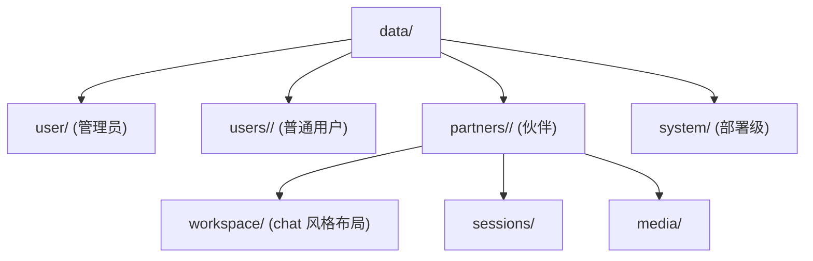
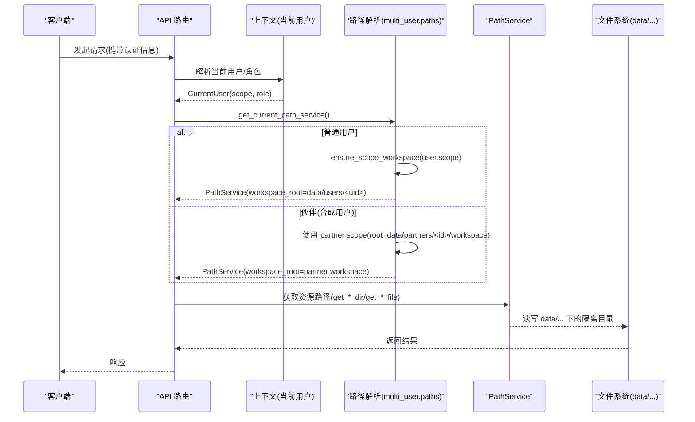
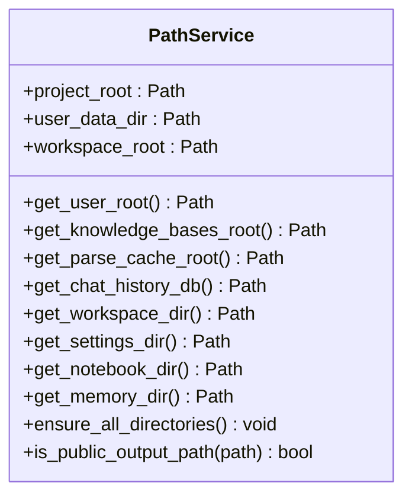
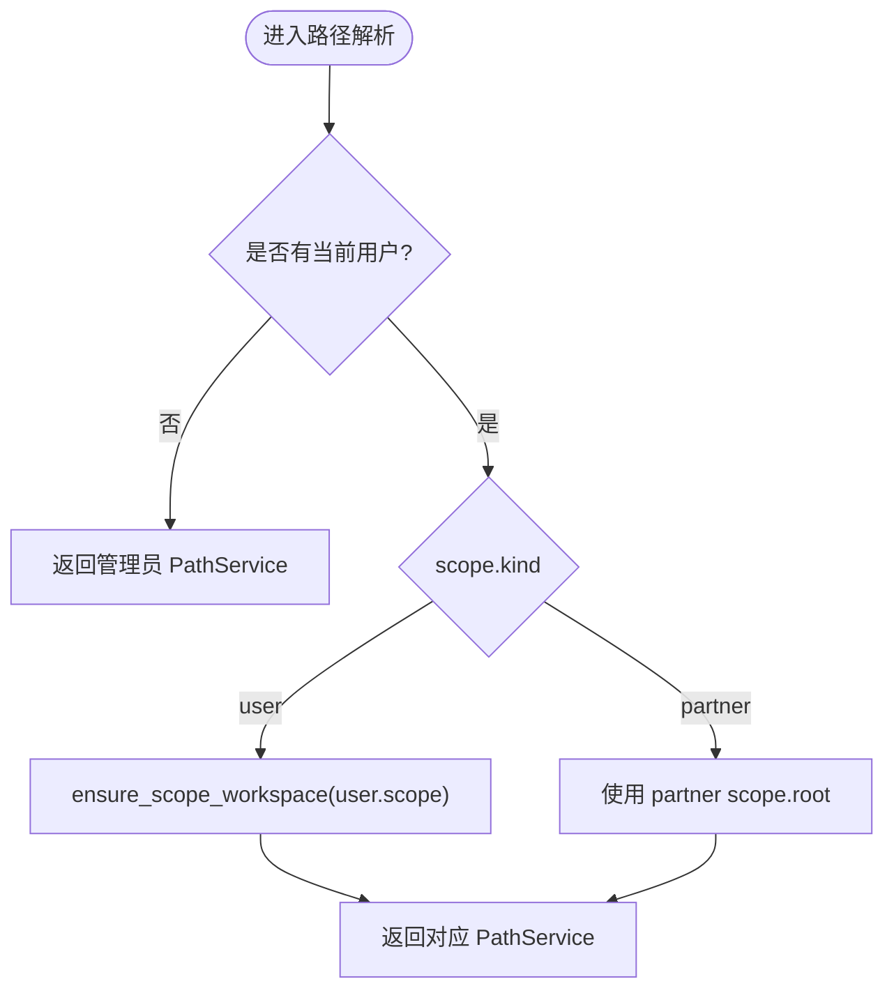
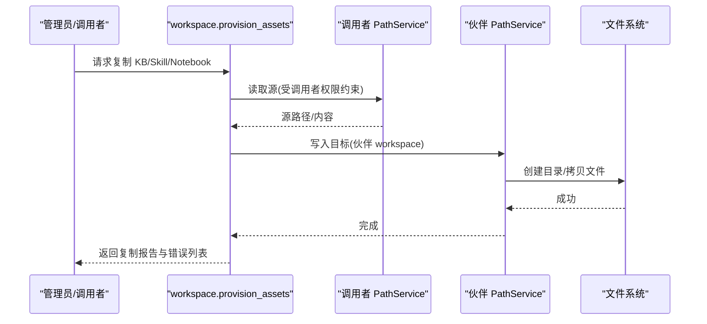
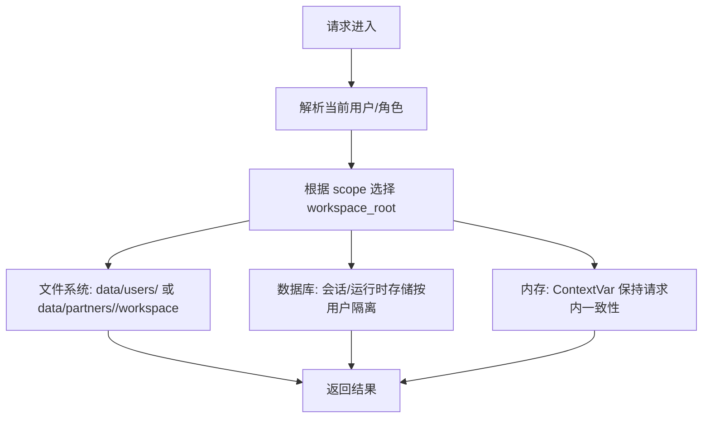
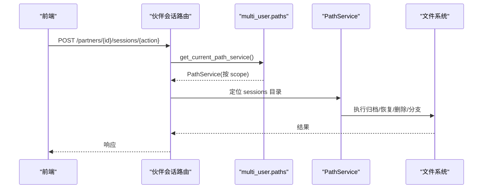
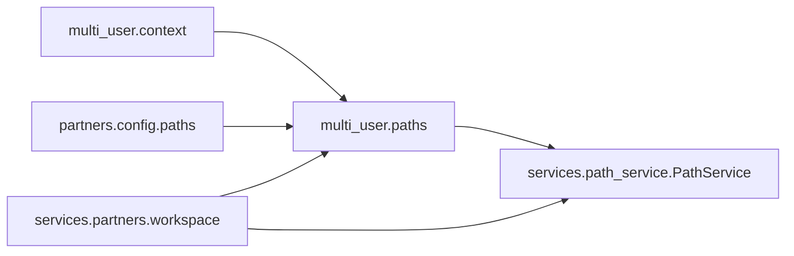

# 工作空间隔离

<cite>
**本文引用的文件**
- [path_service.py](file://deeptutor/services/path_service.py)
- [paths.py](file://deeptutor/multi_user/paths.py)
- [context.py](file://deeptutor/multi_user/context.py)
- [models.py](file://deeptutor/multi_user/models.py)
- [paths.py](file://deeptutor/partners/config/paths.py)
- [workspace.py](file://deeptutor/services/partners/workspace.py)
- [test_resource_isolation.py](file://tests/multi_user/test_resource_isolation.py)
- [test_owner_path_service.py](file://tests/multi_user/test_owner_path_service.py)
- [partners-api.ts](file://web/lib/partners-api.ts)
- [notebook-api.ts](file://web/lib/notebook-api.ts)
</cite>

## 目录
1. [简介](#简介)
2. [项目结构](#项目结构)
3. [核心组件](#核心组件)
4. [架构总览](#架构总览)
5. [详细组件分析](#详细组件分析)
6. [依赖关系分析](#依赖关系分析)
7. [性能考虑](#性能考虑)
8. [故障排查指南](#故障排查指南)
9. [结论](#结论)
10. [附录](#附录)

## 简介
本文件面向 DeepTutor 的“伙伴工作空间隔离系统”，系统性说明多租户数据隔离与资源边界管理的设计与实现。重点覆盖：
- 工作空间的概念、设计原理与组织方式（知识基础、技能、笔记本、记忆、会话）
- 路径服务实现：基于用户/伙伴上下文的路径生成与访问控制
- 资源隔离机制：文件系统、数据库与内存隔离策略
- 实践示例：创建与管理多个独立伙伴工作空间，以及资源迁移与备份恢复
- 安全性设计与性能优化要点

## 项目结构
DeepTutor 将运行时数据统一收敛到单一挂载点 data/ 下，按作用域划分：
- data/user：管理员工作区（admin scope root 为 data/）
- data/users/<uid>：每个非管理员用户的独立工作区
- data/partners/<id>：伙伴（合成用户）工作区，内部采用与 chat 用户一致的 workspace 布局
- data/system：部署级状态（账户、授权、审计、索引），以及 per-owner 密钥目录

图示来源
- [paths.py:1-15](file://deeptutor/multi_user/paths.py#L1-L15)
- [paths.py:35-40](file://deeptutor/multi_user/paths.py#L35-L40)
- [paths.py:42-54](file://deeptutor/partners/config/paths.py#L42-L54)

章节来源
- [paths.py:1-15](file://deeptutor/multi_user/paths.py#L1-L15)
- [paths.py:35-40](file://deeptutor/multi_user/paths.py#L35-L40)
- [paths.py:42-54](file://deeptutor/partners/config/paths.py#L42-L54)

## 核心组件
- 路径服务 PathService：集中管理运行时存储布局，提供按功能划分的子目录访问方法，支持以 workspace_root 为根的多实例化，从而天然支持多租户隔离。
- 多用户路径解析 multi_user.paths：定义 admin/user/partner 的作用域与根路径，负责工作区目录初始化、历史布局迁移、owner 解析与权限相关路径。
- 请求上下文 multi_user.context：通过 ContextVar 维护当前用户，用于在请求内解析路径与服务实例。
- 伙伴路径 helpers partners.config.paths：以管理员工作区为锚点，提供 data/partners 下的伙伴专属路径（workspace、sessions、media）。
- 伙伴资产编排 services.partners.workspace：将知识基础、技能、笔记本等资产复制到伙伴工作区，遵循调用者权限，并在伙伴侧形成可独立管理的快照。

章节来源
- [path_service.py:59-127](file://deeptutor/services/path_service.py#L59-L127)
- [paths.py:89-125](file://deeptutor/multi_user/paths.py#L89-L125)
- [context.py:11-27](file://deeptutor/multi_user/context.py#L11-L27)
- [paths.py:10-54](file://deeptutor/partners/config/paths.py#L10-L54)
- [workspace.py:116-157](file://deeptutor/services/partners/workspace.py#L116-L157)

## 架构总览
下图展示了从请求进入、身份解析、路径选择到具体资源访问的关键流程，涵盖用户与伙伴两种场景。

图示来源
- [context.py:11-27](file://deeptutor/multi_user/context.py#L11-L27)
- [paths.py:153-161](file://deeptutor/multi_user/paths.py#L153-L161)
- [paths.py:113-125](file://deeptutor/multi_user/paths.py#L113-L125)
- [path_service.py:113-127](file://deeptutor/services/path_service.py#L113-L127)

## 详细组件分析

### 路径服务 PathService：统一的运行时存储布局
- 职责：封装 data/user 或各租户 workspace 下的目录结构，提供稳定的 API 访问各类资源（聊天、笔记、书籍、日志、设置等）。
- 关键特性：
  - 支持以任意 workspace_root 构造实例，便于多租户隔离。
  - 提供 ensure_all_directories 一次性创建所有必要目录。
  - 公开公共输出白名单 is_public_output_path，限制可暴露的文件范围。
  - 针对聊天子系统细分 deep_solve/deep_question/deep_research/math_animator 等子目录。
  - 对旧版 memory 目录进行自动迁移到新位置。

图示来源
- [path_service.py:59-127](file://deeptutor/services/path_service.py#L59-L127)
- [path_service.py:193-238](file://deeptutor/services/path_service.py#L193-L238)
- [path_service.py:256-328](file://deeptutor/services/path_service.py#L256-L328)
- [path_service.py:376-429](file://deeptutor/services/path_service.py#L376-L429)

章节来源
- [path_service.py:59-127](file://deeptutor/services/path_service.py#L59-L127)
- [path_service.py:193-238](file://deeptutor/services/path_service.py#L193-L238)
- [path_service.py:256-328](file://deeptutor/services/path_service.py#L256-L328)
- [path_service.py:376-429](file://deeptutor/services/path_service.py#L376-L429)

### 多用户路径解析与作用域：admin / user / partner
- 作用域模型 UserScope：包含 kind、user_id、root，并缓存 key 用于复用 PathService 实例。
- 管理员作用域：根为 data/，用于部署级管理与系统目录。
- 普通用户作用域：根为 data/users/<uid>，首次访问时确保目录存在。
- 伙伴作用域：根为 data/partners/<id>/workspace，采用与 chat 用户一致的 workspace 布局，使工具链无需感知差异。
- Owner 解析：当涉及“所有者绑定”的资源（如 OAuth 刷新令牌），需回退到真实人类账户的工作区，避免凭据错置。

图示来源
- [paths.py:153-161](file://deeptutor/multi_user/paths.py#L153-L161)
- [paths.py:113-125](file://deeptutor/multi_user/paths.py#L113-L125)
- [paths.py:164-208](file://deeptutor/multi_user/paths.py#L164-L208)

章节来源
- [models.py:36-52](file://deeptutor/multi_user/models.py#L36-L52)
- [paths.py:89-125](file://deeptutor/multi_user/paths.py#L89-L125)
- [paths.py:153-208](file://deeptutor/multi_user/paths.py#L153-L208)

### 伙伴工作区与资源编排
- 伙伴工作区布局：完全复刻 chat 用户 workspace 格式，位于 data/partners/<id>/workspace，内含 knowledge_bases、skills、notebook、memory 等。
- 资源供给 provision_assets：在调用者上下文中校验权限后，将 KB、技能、笔记本复制到伙伴工作区；失败项记录错误。
- 资源清单与删除：list_assets/remove_asset 可在伙伴侧独立管理副本。
- 会话与媒体：sessions 与 media 目录按伙伴维度隔离。

图示来源
- [workspace.py:116-157](file://deeptutor/services/partners/workspace.py#L116-L157)
- [workspace.py:164-248](file://deeptutor/services/partners/workspace.py#L164-L248)
- [workspace.py:283-376](file://deeptutor/services/partners/workspace.py#L283-L376)
- [paths.py:42-54](file://deeptutor/partners/config/paths.py#L42-L54)

章节来源
- [workspace.py:116-157](file://deeptutor/services/partners/workspace.py#L116-L157)
- [workspace.py:164-248](file://deeptutor/services/partners/workspace.py#L164-L248)
- [workspace.py:283-376](file://deeptutor/services/partners/workspace.py#L283-L376)
- [paths.py:42-54](file://deeptutor/partners/config/paths.py#L42-L54)

### 资源隔离机制：文件系统、数据库、内存
- 文件系统隔离
  - 普通用户：data/users/<uid> 下各自拥有 workspace、knowledge_bases、memory、settings 等。
  - 伙伴：data/partners/<id>/workspace 作为其 scope root，与用户 workspace 同构。
  - 管理员：data/ 作为 admin root，system 目录存放部署级状态与 owner 密钥。
  - 测试验证：相同 book_id 在不同用户下得到不同路径；伙伴目录不随请求用户变化。
- 数据库隔离
  - 会话数据库与运行时存储按用户作用域区分，保证跨用户不可见。
- 内存隔离
  - 通过 ContextVar 维护当前用户，确保路径解析与资源访问在请求内始终一致。
  - 历史布局迁移采用线程锁保护，避免并发重复迁移。

图示来源
- [test_resource_isolation.py:4-24](file://tests/multi_user/test_resource_isolation.py#L4-L24)
- [test_resource_isolation.py:27-48](file://tests/multi_user/test_resource_isolation.py#L27-L48)
- [context.py:11-27](file://deeptutor/multi_user/context.py#L11-L27)
- [paths.py:48-87](file://deeptutor/multi_user/paths.py#L48-L87)

章节来源
- [test_resource_isolation.py:4-24](file://tests/multi_user/test_resource_isolation.py#L4-L24)
- [test_resource_isolation.py:27-48](file://tests/multi_user/test_resource_isolation.py#L27-L48)
- [context.py:11-27](file://deeptutor/multi_user/context.py#L11-L27)
- [paths.py:48-87](file://deeptutor/multi_user/paths.py#L48-L87)

### 路径服务与访问控制：基于用户 ID 的路径生成
- 管理员路径服务：固定指向 data/，用于系统级操作。
- 当前路径服务：根据当前用户 scope 返回对应的 PathService；若无可识别用户则回退到默认实例。
- 所有者路径服务：对于“所有者绑定”的资源（如 OAuth 凭据），伙伴会回退到其拥有者的工作区，避免凭据错置。
- 前端协作：前端通过 API 操作伙伴会话（归档/恢复/删除/分支），后端依据伙伴 ID 与用户上下文执行。

图示来源
- [paths.py:149-161](file://deeptutor/multi_user/paths.py#L149-L161)
- [paths.py:164-208](file://deeptutor/multi_user/paths.py#L164-L208)
- [partners-api.ts:373-419](file://web/lib/partners-api.ts#L373-L419)

章节来源
- [paths.py:149-161](file://deeptutor/multi_user/paths.py#L149-L161)
- [paths.py:164-208](file://deeptutor/multi_user/paths.py#L164-L208)
- [partners-api.ts:373-419](file://web/lib/partners-api.ts#L373-L419)

### 笔记本与记忆的独立存储
- 笔记本：每个工作区拥有独立的 notebook 目录与 notebooks_index.json 索引；前端通过 API 列出与操作。
- 记忆：每个工作区拥有独立的 memory 目录；前端通过 API 拉取 L1/L2/L3 层快照。

章节来源
- [path_service.py:256-277](file://deeptutor/services/path_service.py#L256-L277)
- [notebook-api.ts:1-52](file://web/lib/notebook-api.ts#L1-L52)

## 依赖关系分析
- PathService 依赖 runtime.home 获取运行时根目录，并通过 multi_user.paths 在多用户模式下被替换为按 scope 的实例。
- multi_user.paths 依赖 context 获取当前用户，并负责目录迁移与系统目录初始化。
- partners.config.paths 以管理员路径服务为锚点，避免伙伴路径递归引用自身 workspace。
- services.partners.workspace 依赖 multi_user.knowledge_access/skill_access 等权限检查模块，确保复制过程符合调用者权限。

图示来源
- [context.py:11-27](file://deeptutor/multi_user/context.py#L11-L27)
- [paths.py:153-161](file://deeptutor/multi_user/paths.py#L153-L161)
- [paths.py:10-17](file://deeptutor/partners/config/paths.py#L10-L17)
- [workspace.py:35-41](file://deeptutor/services/partners/workspace.py#L35-L41)

章节来源
- [context.py:11-27](file://deeptutor/multi_user/context.py#L11-L27)
- [paths.py:153-161](file://deeptutor/multi_user/paths.py#L153-L161)
- [paths.py:10-17](file://deeptutor/partners/config/paths.py#L10-L17)
- [workspace.py:35-41](file://deeptutor/services/partners/workspace.py#L35-L41)

## 性能考虑
- 目录懒创建与缓存：PathService.ensure_all_directories 按需创建目录；multi_user.paths 缓存 PathService 实例以减少对象创建开销。
- 历史迁移幂等：legacy 迁移仅执行一次，避免重复 IO。
- 公开输出白名单：is_public_output_path 精确限定可暴露路径，减少不必要的全局扫描。
- 前端缓存：client-cache 提供短 TTL 的本地缓存，降低重复请求压力。

[本节为通用指导，不直接分析具体文件]

## 故障排查指南
- 无法访问伙伴会话或资源
  - 确认当前用户上下文是否正确设置；检查 get_current_path_service 是否返回预期 scope。
  - 核对伙伴 workspace 是否存在且具备所需子目录。
- 历史布局迁移异常
  - 检查 legacy multi-user 目录是否存在冲突目标；迁移不会覆盖已有目标，需人工处理残留。
- 凭据错置风险
  - 涉及所有者绑定的资源（如 OAuth 刷新令牌）必须通过 get_owner_path_service 访问，避免在伙伴 workspace 中查找不存在的人账户凭据。
- 前端会话操作失败
  - 检查 partners-api.ts 调用的接口参数与后端路由契约是否一致。

章节来源
- [paths.py:48-87](file://deeptutor/multi_user/paths.py#L48-L87)
- [paths.py:164-208](file://deeptutor/multi_user/paths.py#L164-L208)
- [partners-api.ts:373-419](file://web/lib/partners-api.ts#L373-L419)

## 结论
DeepTutor 的伙伴工作空间隔离系统通过统一的路径服务与多用户作用域模型，实现了清晰的数据边界与安全的资源访问控制。伙伴工作区采用与用户工作区一致的布局，简化了工具链适配；同时通过 owner 解析与系统目录隔离，保障了凭据安全。结合严格的文件系统、数据库与内存隔离策略，系统在多租户环境下具备良好的可扩展性与可维护性。

## 附录

### 实践示例：创建与管理多个独立伙伴工作空间
- 创建伙伴工作区
  - 调用 provision_assets 将知识基础、技能、笔记本复制到伙伴 workspace。
  - 使用 partners.config.paths.get_partner_workspace/partner_sessions_dir/partner_media_dir 管理会话与媒体。
- 资源迁移
  - 升级部署时，legacy multi-user 树会被迁移至 data/users 与 data/system；迁移幂等且不覆盖已有目标。
- 备份与恢复
  - 由于伙伴 workspace 是完整文件树，可直接备份 data/partners/<id> 目录；恢复时确保目录结构与权限正确。

章节来源
- [workspace.py:116-157](file://deeptutor/services/partners/workspace.py#L116-L157)
- [paths.py:48-87](file://deeptutor/multi_user/paths.py#L48-L87)
- [paths.py:42-54](file://deeptutor/partners/config/paths.py#L42-L54)

### 安全性设计要点
- 管理员与工作区分离：系统目录与 owner 密钥置于 data/system，沙箱不挂载。
- 所有者绑定资源：伙伴运行上下文中的所有者绑定资源回退到真实人账户，防止凭据泄露。
- 公开输出白名单：严格限制可暴露的文件路径，避免敏感文件外泄。

章节来源
- [paths.py:128-137](file://deeptutor/multi_user/paths.py#L128-L137)
- [paths.py:164-208](file://deeptutor/multi_user/paths.py#L164-L208)
- [path_service.py:135-191](file://deeptutor/services/path_service.py#L135-L191)