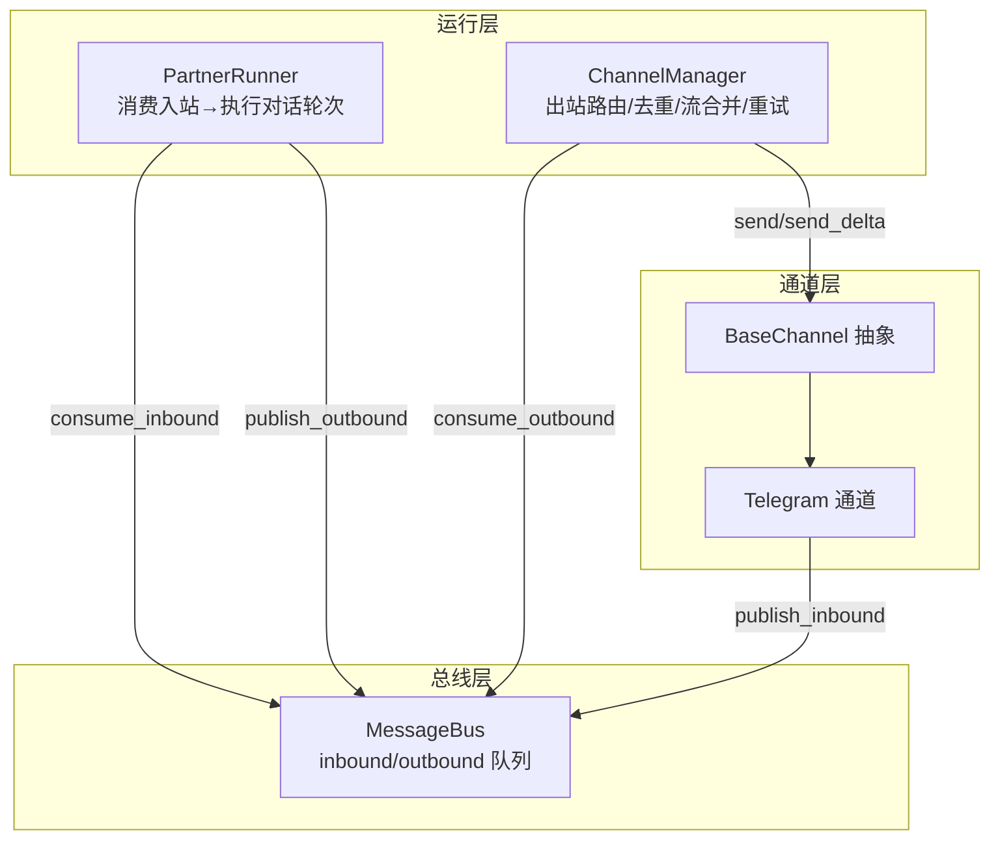
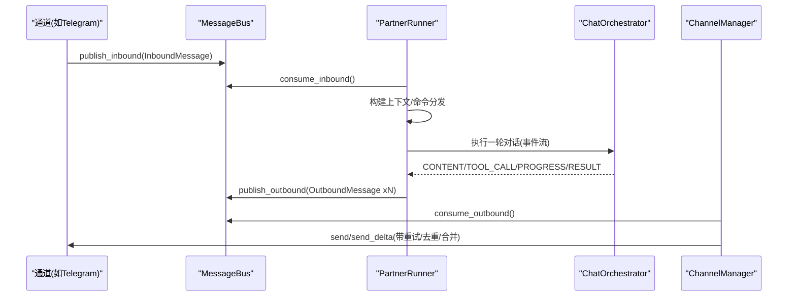
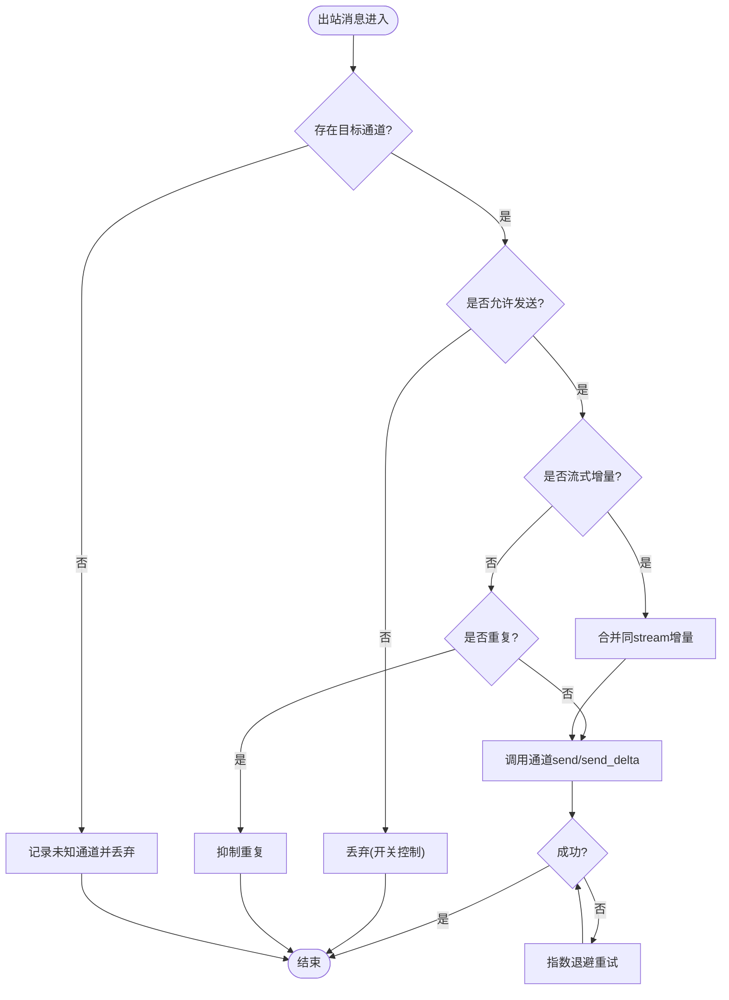
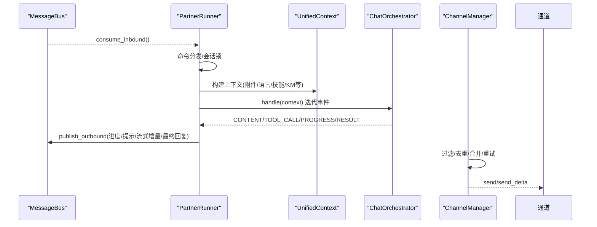
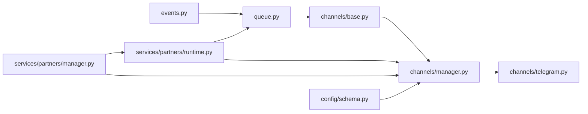

# 消息总线

<cite>
**本文引用的文件**
- [deeptutor/partners/bus/__init__.py](file://deeptutor/partners/bus/__init__.py)
- [deeptutor/partners/bus/events.py](file://deeptutor/partners/bus/events.py)
- [deeptutor/partners/bus/queue.py](file://deeptutor/partners/bus/queue.py)
- [deeptutor/partners/channels/base.py](file://deeptutor/partners/channels/base.py)
- [deeptutor/partners/channels/manager.py](file://deeptutor/partners/channels/manager.py)
- [deeptutor/partners/channels/telegram.py](file://deeptutor/partners/channels/telegram.py)
- [deeptutor/partners/config/schema.py](file://deeptutor/partners/config/schema.py)
- [deeptutor/services/partners/runtime.py](file://deeptutor/services/partners/runtime.py)
- [deeptutor/services/partners/manager.py](file://deeptutor/services/partners/manager.py)
</cite>

## 目录
1. [简介](#简介)
2. [项目结构](#项目结构)
3. [核心组件](#核心组件)
4. [架构总览](#架构总览)
5. [详细组件分析](#详细组件分析)
6. [依赖关系分析](#依赖关系分析)
7. [性能与可靠性](#性能与可靠性)
8. [故障排查指南](#故障排查指南)
9. [结论](#结论)
10. [附录：自定义消息处理器示例](#附录自定义消息处理器示例)

## 简介
本文件为 DeepTutor 伙伴消息总线系统的权威技术文档，聚焦事件驱动架构、消息类型定义、发布订阅模式、异步处理机制、队列管理（生产者/消费者、背压、持久化策略）、消息处理管道（转换、过滤、聚合），以及可靠性和扩展性设计。文档同时提供实现自定义消息处理器的实践指引，涵盖错误重试、日志记录与性能监控。

## 项目结构
消息总线位于 partners 子系统中，围绕“通道-总线-运行器”的解耦设计展开：
- 事件与队列：InboundMessage/OutboundMessage 与 MessageBus（基于 asyncio.Queue）
- 通道抽象与实现：BaseChannel 及具体平台（如 Telegram）
- 通道管理器：ChannelManager 负责出站路由、去重、流式合并与重试
- 服务层：PartnerRunner 消费入站消息并驱动聊天智能体循环；PartnerManager 编排实例生命周期与出站分发

图表来源
- [deeptutor/partners/bus/queue.py:8-45](file://deeptutor/partners/bus/queue.py#L8-L45)
- [deeptutor/partners/channels/base.py:19-88](file://deeptutor/partners/channels/base.py#L19-L88)
- [deeptutor/partners/channels/manager.py:31-55](file://deeptutor/partners/channels/manager.py#L31-L55)
- [deeptutor/services/partners/runtime.py:72-127](file://deeptutor/services/partners/runtime.py#L72-L127)

章节来源
- [deeptutor/partners/bus/__init__.py:1-7](file://deeptutor/partners/bus/__init__.py#L1-L7)
- [deeptutor/partners/bus/events.py:8-37](file://deeptutor/partners/bus/events.py#L8-L37)
- [deeptutor/partners/bus/queue.py:1-45](file://deeptutor/partners/bus/queue.py#L1-L45)
- [deeptutor/partners/channels/base.py:1-185](file://deeptutor/partners/channels/base.py#L1-L185)
- [deeptutor/partners/channels/manager.py:1-341](file://deeptutor/partners/channels/manager.py#L1-L341)
- [deeptutor/partners/channels/telegram.py:1-200](file://deeptutor/partners/channels/telegram.py#L1-L200)
- [deeptutor/partners/config/schema.py:1-51](file://deeptutor/partners/config/schema.py#L1-L51)
- [deeptutor/services/partners/runtime.py:1-709](file://deeptutor/services/partners/runtime.py#L1-L709)
- [deeptutor/services/partners/manager.py:1-800](file://deeptutor/services/partners/manager.py#L1-L800)

## 核心组件
- InboundMessage/OutboundMessage：统一的消息数据结构，承载通道标识、会话键、内容、媒体与元数据，用于跨模块传递上下文与状态。
- MessageBus：基于 asyncio.Queue 的轻量级异步消息总线，提供入站/出站的生产与消费接口，天然具备背压能力。
- BaseChannel：通道抽象，封装权限校验、流式支持检测、音频转写、消息转发到总线等通用逻辑。
- ChannelManager：出站消息路由器，负责去重、流式片段合并、按通道配置过滤、指数退避重试。
- PartnerRunner：入站消息消费者，将消息转换为对话轮次，驱动 ChatOrchestrator，并将结果通过总线发出。
- PartnerManager：在进程内编排每个伙伴实例的生命周期，启动 runner、router、通道监听任务，并维护会话存储与工作区。

章节来源
- [deeptutor/partners/bus/events.py:8-37](file://deeptutor/partners/bus/events.py#L8-L37)
- [deeptutor/partners/bus/queue.py:8-45](file://deeptutor/partners/bus/queue.py#L8-L45)
- [deeptutor/partners/channels/base.py:19-185](file://deeptutor/partners/channels/base.py#L19-L185)
- [deeptutor/partners/channels/manager.py:31-341](file://deeptutor/partners/channels/manager.py#L31-L341)
- [deeptutor/services/partners/runtime.py:72-709](file://deeptutor/services/partners/runtime.py#L72-L709)
- [deeptutor/services/partners/manager.py:318-800](file://deeptutor/services/partners/manager.py#L318-L800)

## 架构总览
事件驱动的核心在于“通道 → 总线 → 运行器 → 总线 → 通道”的闭环：
- 通道侧将平台消息包装为 InboundMessage 并发布到总线入队
- 运行器消费入站消息，构建上下文并执行对话轮次，期间可产生进度、工具调用提示、流式增量等 OutboundMessage
- 通道管理器消费出站消息，进行过滤、去重、流式合并后，调用具体通道的 send/send_delta 完成投递
- 服务层还负责将非进度类出站消息广播至内部事件总线，供上层系统感知

图表来源
- [deeptutor/partners/bus/queue.py:20-34](file://deeptutor/partners/bus/queue.py#L20-L34)
- [deeptutor/services/partners/runtime.py:93-127](file://deeptutor/services/partners/runtime.py#L93-L127)
- [deeptutor/services/partners/runtime.py:182-360](file://deeptutor/services/partners/runtime.py#L182-L360)
- [deeptutor/partners/channels/manager.py:187-327](file://deeptutor/partners/channels/manager.py#L187-L327)

## 详细组件分析

### 消息类型与元数据
- InboundMessage：包含 channel、sender_id、chat_id、content、timestamp、media、metadata、session_key_override；提供 session_key 计算以区分会话。
- OutboundMessage：包含 channel、chat_id、content、reply_to、media、metadata；通过 metadata 携带 _progress、_tool_hint、_stream_delta/_stream_end/_stream_id、origin_message_id/message_id 等控制字段。

章节来源
- [deeptutor/partners/bus/events.py:8-37](file://deeptutor/partners/bus/events.py#L8-L37)

### 队列管理与背压
- MessageBus 使用 asyncio.Queue 作为内存队列，提供 put/get 语义，天然具备容量限制与背压保护。
- 入站：通道侧 publish_inbound，运行器侧 consume_inbound 阻塞等待。
- 出站：运行器侧 publish_outbound，通道管理器侧 consume_outbound 阻塞等待。
- 队列大小可通过 inbound_size/outbound_size 观测，便于监控与告警。

章节来源
- [deeptutor/partners/bus/queue.py:8-45](file://deeptutor/partners/bus/queue.py#L8-L45)

### 通道抽象与实现
- BaseChannel：定义 start/stop/send 抽象方法，提供权限校验 is_allowed、流式支持检测 supports_streaming、音频转写 transcribe_audio、统一入站封装 _handle_message。
- Telegram 通道：实现 Markdown→HTML 转换、表格渲染、流式编辑缓冲、发送重试策略等。

章节来源
- [deeptutor/partners/channels/base.py:19-185](file://deeptutor/partners/channels/base.py#L19-L185)
- [deeptutor/partners/channels/telegram.py:1-200](file://deeptutor/partners/channels/telegram.py#L1-L200)

### 出站路由与流式合并
- ChannelManager._dispatch_outbound：从总线消费出站消息，按 channel 路由，应用发送开关过滤（send_progress/send_tool_hints），对连续同 stream 的 _stream_delta 进行合并以减少频繁编辑。
- 去重：基于 origin_message_id/message_id 与内容指纹避免重复回复。
- 重试：指数退避（1s/2s/4s），可配置最大重试次数。

图表来源
- [deeptutor/partners/channels/manager.py:187-327](file://deeptutor/partners/channels/manager.py#L187-L327)

### 运行器与消息处理管道
- PartnerRunner.run：无限循环消费入站消息，每消息创建独立任务，按 session_key 串行化（锁）。
- process_message：先尝试命令分发，否则执行对话轮次；将用户与助手消息追加到会话存储。
- _execute_turn：组装 UnifiedContext，激活 LLM 选择，迭代事件流；根据事件类型产出进度、工具提示、流式增量与最终回复；失败时回退备用模型。
- 流式协议：通过 _publish_stream_delta/_publish_stream_end 标记流段边界，并在结束时标记 _streamed 以避免重复发送。

图表来源
- [deeptutor/services/partners/runtime.py:93-127](file://deeptutor/services/partners/runtime.py#L93-L127)
- [deeptutor/services/partners/runtime.py:182-360](file://deeptutor/services/partners/runtime.py#L182-L360)
- [deeptutor/partners/channels/manager.py:187-327](file://deeptutor/partners/channels/manager.py#L187-L327)

章节来源
- [deeptutor/services/partners/runtime.py:72-709](file://deeptutor/services/partners/runtime.py#L72-L709)

### 服务层编排与出站广播
- PartnerManager.start_partner：为每个伙伴创建 MessageBus、PartnerRunner、ChannelManager，并启动 runner、router 与各通道监听任务。
- _outbound_router：消费总线出站消息，若存在通道则直接发送；非进度消息写入 notify_queue 并发布到全局 EventBus（CAPABILITY_COMPLETE），便于上层系统追踪。

章节来源
- [deeptutor/services/partners/manager.py:472-571](file://deeptutor/services/partners/manager.py#L472-L571)

## 依赖关系分析
- 事件与队列：events.py 定义消息结构，queue.py 提供异步队列实现。
- 通道层：base.py 定义抽象，telegram.py 等实现具体平台；manager.py 协调多通道。
- 服务层：runtime.py 消费入站并驱动智能体循环；manager.py 编排实例生命周期与出站广播。
- 配置：schema.py 提供 Pydantic 模型，支持 camelCase/snake_case 兼容与通道级开关。

图表来源
- [deeptutor/partners/bus/events.py:8-37](file://deeptutor/partners/bus/events.py#L8-L37)
- [deeptutor/partners/bus/queue.py:8-45](file://deeptutor/partners/bus/queue.py#L8-L45)
- [deeptutor/partners/channels/base.py:19-185](file://deeptutor/partners/channels/base.py#L19-L185)
- [deeptutor/partners/channels/manager.py:31-341](file://deeptutor/partners/channels/manager.py#L31-L341)
- [deeptutor/partners/channels/telegram.py:1-200](file://deeptutor/partners/channels/telegram.py#L1-L200)
- [deeptutor/services/partners/runtime.py:72-709](file://deeptutor/services/partners/runtime.py#L72-L709)
- [deeptutor/services/partners/manager.py:472-571](file://deeptutor/services/partners/manager.py#L472-L571)
- [deeptutor/partners/config/schema.py:1-51](file://deeptutor/partners/config/schema.py#L1-L51)

## 性能与可靠性
- 背压与吞吐：asyncio.Queue 提供内置背压；建议在高吞吐场景下监控 inbound/outbound 队列长度，必要时调整并发或限流。
- 流式优化：ChannelManager 对同 stream 的增量进行合并，减少频繁编辑 API 调用；通道侧（如 Telegram）可实现最小编辑间隔节流。
- 重试与容错：出站发送采用指数退避重试，可配置最大重试次数；异常被记录并继续处理后续消息，避免单点阻塞。
- 去重与幂等：基于 origin_message_id/message_id 与内容指纹抑制重复回复，提升稳定性。
- 可扩展性：通道通过注册表发现与插件机制扩展；配置支持 per-channel 开关与驼峰/蛇形兼容，便于多环境部署。

[本节为通用指导，不直接分析特定文件]

## 故障排查指南
- 通道无法启动：检查 ChannelManager 初始化日志与通道配置；确认 allow_from 不为空列表，否则会拒绝所有访问。
- 出站未送达：查看 ChannelManager 重试日志与 send_max_retries 配置；确认通道 send/send_delta 实现是否正确抛出异常以便重试。
- 流式显示异常：核对 _stream_delta/_stream_end 配对与 _stream_id 一致性；确保通道实现了 send_delta 且开启 streaming。
- 重复消息：检查 metadata 中 origin_message_id/message_id 是否正确设置；必要时调整去重策略。
- 性能瓶颈：监控 inbound/outbound 队列长度；评估流式合并效果与通道编辑频率；考虑增加并发或限流。

章节来源
- [deeptutor/partners/channels/base.py:116-175](file://deeptutor/partners/channels/base.py#L116-L175)
- [deeptutor/partners/channels/manager.py:153-327](file://deeptutor/partners/channels/manager.py#L153-L327)
- [deeptutor/partners/channels/telegram.py:196-200](file://deeptutor/partners/channels/telegram.py#L196-L200)

## 结论
DeepTutor 伙伴消息总线以事件驱动为核心，通过清晰的消息结构与异步队列实现通道与运行器的解耦。ChannelManager 提供了稳健的出站路由、去重、流式合并与重试机制；PartnerRunner 将 IM 消息无缝接入产品级对话智能体循环。整体设计具备良好的可靠性与扩展性，适合在多通道、高并发场景下稳定运行。

[本节为总结性内容，不直接分析特定文件]

## 附录：自定义消息处理器示例
以下示例展示如何在现有总线基础上实现自定义消息处理器，包括错误重试、日志记录与性能监控。

- 基本步骤
  - 定义处理器类，接收 MessageBus 与必要配置。
  - 在独立协程中循环 consume_outbound，按 channel/chat_id/content 进行业务处理。
  - 使用 try/except 捕获异常，记录日志并按需重试（可复用指数退避策略）。
  - 使用 time/perf_counter 统计处理耗时，定期上报指标。

- 关键要点
  - 重试策略：参考 ChannelManager 的指数退避（1s/2s/4s），结合业务容忍度调整。
  - 日志记录：记录消息关键字段（脱敏）与异常堆栈，便于定位问题。
  - 性能监控：统计平均延迟、P95/P99 延迟、错误率与吞吐量。
  - 幂等性：基于 message_id 或业务主键去重，避免重复处理。

- 参考位置
  - 出站消费入口：[deeptutor/partners/bus/queue.py:28-34](file://deeptutor/partners/bus/queue.py#L28-L34)
  - 重试与退避：[deeptutor/partners/channels/manager.py:296-327](file://deeptutor/partners/channels/manager.py#L296-L327)
  - 日志与指标：可在处理器中集成 loguru 与 Prometheus 客户端

[本节为概念性示例，不直接引用代码片段]