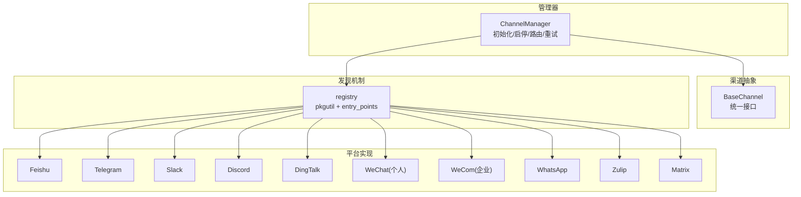
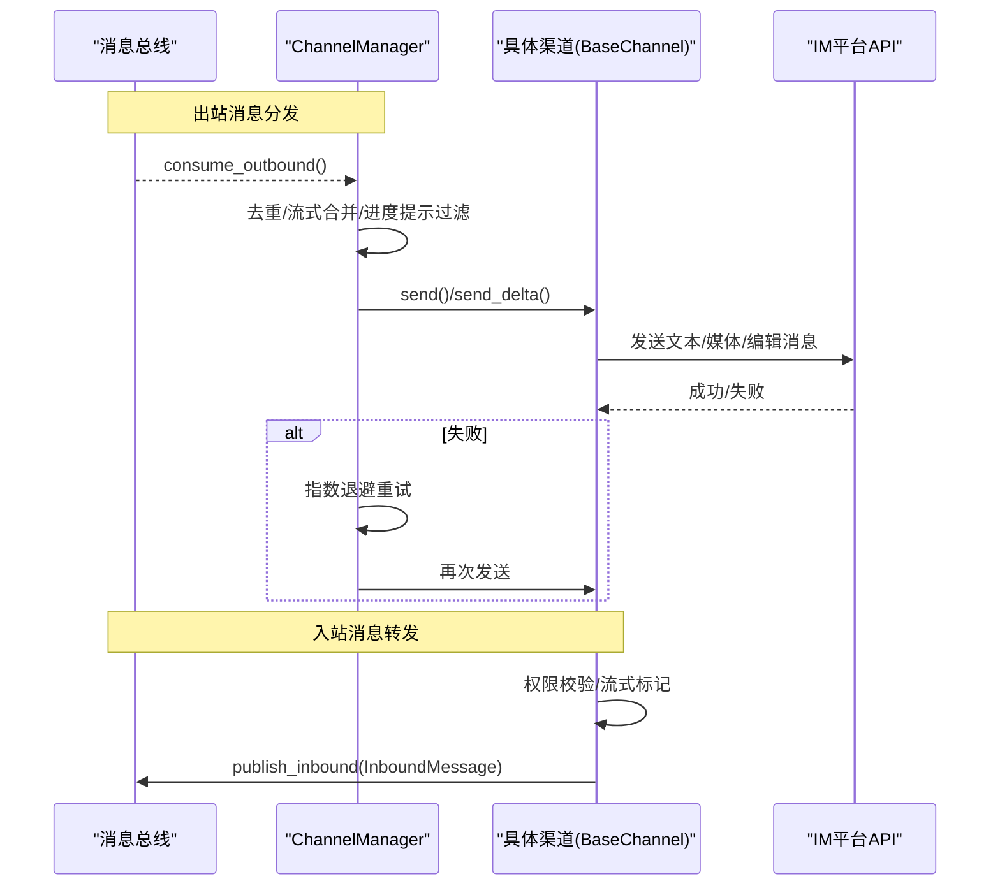
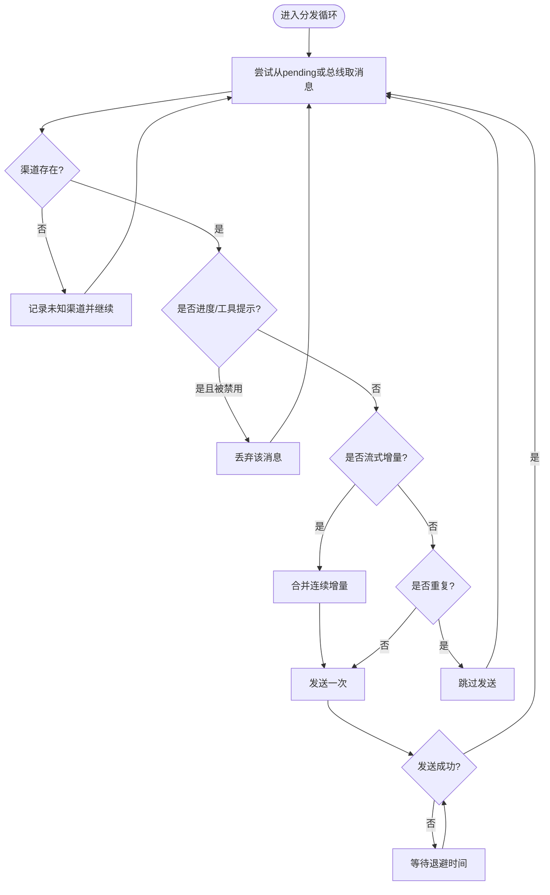
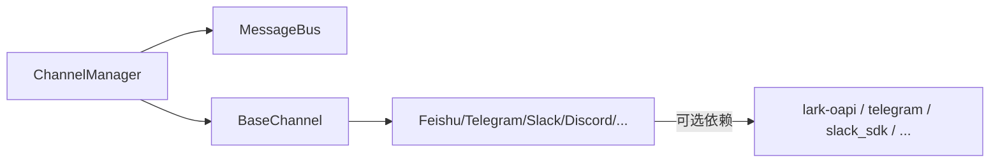

# 渠道管理

<cite>
**本文引用的文件**
- [manager.py](file://deeptutor/partners/channels/manager.py)
- [base.py](file://deeptutor/partners/channels/base.py)
- [registry.py](file://deeptutor/partners/channels/registry.py)
- [feishu.py](file://deeptutor/partners/channels/feishu.py)
- [telegram.py](file://deeptutor/partners/channels/telegram.py)
- [slack.py](file://deeptutor/partners/channels/slack.py)
- [discord.py](file://deeptutor/partners/channels/discord.py)
- [dingtalk.py](file://deeptutor/partners/channels/dingtalk.py)
- [weixin.py](file://deeptutor/partners/channels/weixin.py)
- [wecom.py](file://deeptutor/partners/channels/wecom.py)
- [whatsapp.py](file://deeptutor/partners/channels/whatsapp.py)
- [zulip.py](file://deeptutor/partners/channels/zulip.py)
- [matrix.py](file://deeptutor/partners/channels/matrix.py)
- [__init__.py](file://deeptutor/partners/__init__.py)
</cite>

## 目录
1. [简介](#简介)
2. [项目结构](#项目结构)
3. [核心组件](#核心组件)
4. [架构总览](#架构总览)
5. [详细组件分析](#详细组件分析)
6. [依赖关系分析](#依赖关系分析)
7. [性能考量](#性能考量)
8. [故障排查指南](#故障排查指南)
9. [结论](#结论)
10. [附录](#附录)

## 简介
本文件为 DeepTutor 渠道管理系统的权威技术文档，聚焦 ChannelManager 的职责与实现：渠道初始化、启动/停止管理、消息路由、去重、流式增量合并与退避重试。同时梳理已支持的 IM 平台接入（飞书、Telegram、Slack、Discord、钉钉、QQ/NapCat、企业微信、WhatsApp、Zulip、Mattermost、Matrix、Mochat、Microsoft Teams），说明渠道发现机制（pkgutil 扫描与 entry_points 插件系统），并提供多渠道配置与管理示例，强调可扩展性设计以支持新平台快速集成。

## 项目结构
渠道子系统位于 deeptutor/partners/channels，采用“统一抽象 + 多平台实现”的分层组织：
- base.py：定义 BaseChannel 抽象接口，规范 start/stop/send/send_delta 等生命周期与发送契约。
- manager.py：ChannelManager 负责启用渠道、启动/停止、出站消息分发、去重、流式合并与重试。
- registry.py：自动发现内置渠道模块（pkgutil）与外部插件（entry_points）。
- 各平台通道实现：如 feishu.py、telegram.py、slack.py、discord.py、dingtalk.py、weixin.py、wecom.py、whatsapp.py、zulip.py、matrix.py 等。

图表来源
- [manager.py:31-152](file://deeptutor/partners/channels/manager.py#L31-L152)
- [base.py:19-115](file://deeptutor/partners/channels/base.py#L19-L115)
- [registry.py:17-86](file://deeptutor/partners/channels/registry.py#L17-L86)

章节来源
- [__init__.py:1-12](file://deeptutor/partners/__init__.py#L1-L12)

## 核心组件
- ChannelManager：集中管理渠道生命周期与出站消息路由，提供：
  - 渠道初始化：基于配置启用并实例化渠道，注入 Groq 转录密钥与发送控制标志。
  - 启动/停止：并行启动所有渠道，统一关闭并取消分发任务。
  - 消息路由：从消息总线消费出站消息，按 channel/chat_id 投递到对应渠道。
  - 去重：对同一来源的重复回复进行指纹去重，避免重复推送。
  - 流式增量合并：将同一会话的连续 _stream_delta 合并，减少频繁编辑调用。
  - 重试机制：指数退避重试（固定延迟序列），失败记录日志并在耗尽时放弃。
- BaseChannel：抽象基类，定义统一的 send/send_delta/start/stop 接口与权限校验、流式能力探测、音频转录辅助方法。
- Registry：通过 pkgutil 扫描内置渠道模块，并通过 importlib.metadata.entry_points 加载外部插件；内置优先，同名插件被忽略。

章节来源
- [manager.py:31-341](file://deeptutor/partners/channels/manager.py#L31-L341)
- [base.py:19-185](file://deeptutor/partners/channels/base.py#L19-L185)
- [registry.py:17-86](file://deeptutor/partners/channels/registry.py#L17-L86)

## 架构总览
下图展示 ChannelManager 如何协调消息总线与各渠道实现，完成入站/出站消息流转、流式处理与重试。

图表来源
- [manager.py:187-328](file://deeptutor/partners/channels/manager.py#L187-L328)
- [base.py:126-175](file://deeptutor/partners/channels/base.py#L126-L175)

## 详细组件分析

### ChannelManager：职责与算法
- 初始化
  - 通过 discover_all() 获取可用渠道类，读取 ChannelsConfig 中对应 section，仅启用 enabled=True 的渠道。
  - 设置每渠道的 send_progress 与 send_tool_hints 布尔开关（兼容 snake_case 与 camelCase 别名）。
  - 校验 allow_from 非空列表，防止误配导致全拒绝。
- 启动/停止
  - start_all：创建出站分发协程，并发启动各渠道；异常隔离，不影响其他渠道。
  - stop_all：取消分发任务，逐个调用 channel.stop() 并记录错误。
- 出站路由与流式合并
  - 循环从 bus.consume_outbound() 取消息，若 pending 队列有积压则优先处理。
  - 根据 metadata._progress/_tool_hint 与渠道开关决定是否丢弃进度或工具提示。
  - 对 _stream_delta 且非 _stream_end 的消息执行 _coalesce_stream_deltas，合并同 stream_id 的连续增量，减少 edit 调用。
- 去重
  - 使用内容规范化后的 SHA1 指纹，结合 origin_message_id 或 message_id 作为键，避免对同一来源的重复回复。
- 重试
  - _send_with_retry 使用固定延迟序列 (1s, 2s, 4s) 的指数退避，最多尝试 send_max_retries 次；CancelledError 直接上抛以支持优雅停机。

图表来源
- [manager.py:187-328](file://deeptutor/partners/channels/manager.py#L187-L328)

章节来源
- [manager.py:31-341](file://deeptutor/partners/channels/manager.py#L31-L341)

### BaseChannel：统一接口与能力
- 生命周期：start/stop 由子类实现；is_running 暴露运行状态。
- 发送契约：
  - send：发送完整消息（文本+媒体）。
  - send_delta：可选实现以支持流式增量更新（原地编辑）。
- 能力探测：supports_streaming 在配置开启 streaming 且子类重写 send_delta 时为真。
- 权限控制：allow_from 为空列表表示拒绝全部；包含 "*" 表示允许全部；否则白名单匹配。
- 音频转录：transcribe_audio 通过 GroqTranscriptionProvider 异步转写。

章节来源
- [base.py:19-185](file://deeptutor/partners/channels/base.py#L19-L185)

### 渠道发现机制：pkgutil 与 entry_points
- 内置渠道：discover_channel_names 通过 pkgutil.iter_modules 扫描 deeptutor.partners.channels 包下的模块名，排除内部模块。
- 动态加载：load_channel_class 导入模块并查找第一个 BaseChannel 子类。
- 插件系统：discover_plugins 通过 importlib.metadata.entry_points(group="deeptutor.partners.channels") 加载外部插件；同名内置优先，插件被覆盖时会告警。
- 汇总：discover_all/discover_all_with_errors 返回可用渠道映射及加载错误信息，便于诊断缺失可选依赖。

章节来源
- [registry.py:17-86](file://deeptutor/partners/channels/registry.py#L17-L86)

### 平台接入实现概览
以下平台均继承 BaseChannel，实现各自连接方式、消息收发与流式能力：
- 飞书（Feishu/Lark）：使用 lark-oapi SDK WebSocket 长连接，支持富文本卡片解析与多种消息类型。
- Telegram：基于 python-telegram-bot，支持 Markdown→HTML 转换、表格渲染、流式编辑与分片发送。
- Slack：Socket Mode 模式，WebSocket 接收事件，REST 发送消息；支持线程回复与表情反应。
- Discord：Gateway WebSocket 长连接，REST 发送与编辑消息，支持速率限制重试与流式编辑。
- 钉钉（DingTalk）：Stream Mode 接收事件，HTTP API 发送消息，支持私聊与群聊。
- QQ/NapCat：通过 NapCat 桥接（见 napcat.py），复用通用通道协议。
- 企业微信（WeCom）：WebSocket 长连接，事件驱动，支持欢迎消息与多类型消息处理。
- WhatsApp：Node.js Bridge（Baileys）通信，WebSocket 收发消息，支持二维码登录与状态同步。
- Zulip：Event Queue API，支持 LaTeX 转换、附件上传与分片发送。
- Mattermost：（见 mattermost.py）遵循统一通道接口。
- Matrix（Element）：nio 客户端，支持端到端加密、Markdown→HTML 清洗与安全标签过滤。
- Mochat：（见 mochat.py）遵循统一通道接口。
- Microsoft Teams：（见 msteams.py）遵循统一通道接口。

章节来源
- [feishu.py:1-200](file://deeptutor/partners/channels/feishu.py#L1-L200)
- [telegram.py:1-200](file://deeptutor/partners/channels/telegram.py#L1-L200)
- [slack.py:1-200](file://deeptutor/partners/channels/slack.py#L1-L200)
- [discord.py:1-200](file://deeptutor/partners/channels/discord.py#L1-L200)
- [dingtalk.py:1-200](file://deeptutor/partners/channels/dingtalk.py#L1-L200)
- [weixin.py:1-200](file://deeptutor/partners/channels/weixin.py#L1-L200)
- [wecom.py:1-200](file://deeptutor/partners/channels/wecom.py#L1-L200)
- [whatsapp.py:1-190](file://deeptutor/partners/channels/whatsapp.py#L1-L190)
- [zulip.py:1-200](file://deeptutor/partners/channels/zulip.py#L1-L200)
- [matrix.py:1-200](file://deeptutor/partners/channels/matrix.py#L1-L200)

### 消息去重、流式增量合并与退避重试
- 消息去重
  - 对内容进行空白归一化后计算 SHA1 指纹；结合 origin_message_id 或 message_id 形成键，避免对同一来源的重复回复。
  - 进度消息（_progress）不参与去重，确保用户始终看到最新进展。
- 流式增量合并
  - 针对同一 (channel, chat_id) 且相同 _stream_id 的连续 _stream_delta 消息进行合并，直到遇到 _stream_end 或其他不匹配消息为止。
  - 合并结果作为单条 OutboundMessage 下发，显著降低 edit 调用频率。
- 退避重试
  - 固定延迟序列 (1s, 2s, 4s)，最大尝试次数由 send_max_retries 控制。
  - 捕获异常并记录警告/错误；CancelledError 立即上抛以支持优雅停机。

章节来源
- [manager.py:153-328](file://deeptutor/partners/channels/manager.py#L153-L328)

### 配置与管理示例：多渠道消息路由
- 启用渠道
  - 在 ChannelsConfig 中为每个渠道设置 enabled=True，并填写必要凭据（如 token、client_id、site 等）。
  - 可通过 default_config() 快速生成默认配置模板。
- 发送进度与工具提示控制
  - send_progress：控制是否向渠道推送进度消息（如“正在思考…”、“正在生成…”）。
  - send_tool_hints：控制是否推送工具调用提示（如“正在调用搜索…”）。
  - 两者均可在渠道级配置中独立开关，支持 snake_case 与 camelCase 别名。
- 路由策略
  - 出站消息携带 channel 字段，ChannelManager 根据该字段选择目标渠道。
  - 对于流式输出，metadata 中的 _stream_id 用于区分不同会话的增量流。
- 权限控制
  - allow_from：空列表拒绝全部；包含 "*" 允许全部；否则白名单匹配 sender_id。

章节来源
- [manager.py:57-115](file://deeptutor/partners/channels/manager.py#L57-L115)
- [base.py:116-125](file://deeptutor/partners/channels/base.py#L116-L125)

### 可扩展性设计：快速集成新平台
- 新增步骤
  - 在 deeptutor/partners/channels 下新建模块（如 newplatform.py），实现 BaseChannel 的子类，提供 name、display_name、default_config、start、stop、send、send_delta（可选）。
  - 若希望作为外部插件发布，可在打包时注册 entry_points group="deeptutor.partners.channels"，名称即渠道名。
- 自动发现
  - 内置模块会被 pkgutil 自动发现；外部插件通过 entry_points 加载。
  - 内置优先，同名插件会被忽略并记录告警。
- 配置与能力
  - 通过 DeliveryOverrides 与 StreamingSupport 扩展配置项。
  - supports_streaming 自动判断是否启用流式能力。

章节来源
- [registry.py:17-86](file://deeptutor/partners/channels/registry.py#L17-L86)
- [base.py:105-115](file://deeptutor/partners/channels/base.py#L105-L115)

## 依赖关系分析
ChannelManager 依赖消息总线与渠道抽象；各平台实现依赖各自的 SDK 或第三方库（如 lark-oapi、python-telegram-bot、slack_sdk、websockets、httpx、nio 等）。部分平台为可选依赖，未安装时将跳过并记录调试日志。

图表来源
- [manager.py:10-14](file://deeptutor/partners/channels/manager.py#L10-L14)
- [base.py:9-11](file://deeptutor/partners/channels/base.py#L9-L11)

章节来源
- [manager.py:10-14](file://deeptutor/partners/channels/manager.py#L10-L14)
- [base.py:9-11](file://deeptutor/partners/channels/base.py#L9-L11)

## 性能考量
- 流式增量合并：减少高频 edit 调用，降低平台限流风险与网络开销。
- 去重：避免重复发送，节省带宽与平台配额。
- 重试退避：固定延迟序列平衡瞬时抖动与资源占用，避免雪崩。
- 并发启动：start_all 使用 asyncio.gather 并行启动渠道，缩短冷启动时间。
- 分片发送：部分平台（如 Discord、Zulip）对消息长度有限制，需分片发送以避免截断。

[本节为通用指导，无需特定文件引用]

## 故障排查指南
- 渠道未启用
  - 检查 ChannelsConfig 中对应 section 的 enabled 是否为 True。
  - 查看 ChannelManager 初始化日志，确认渠道是否被启用。
- 权限拒绝
  - allow_from 为空列表会拒绝全部访问；设置为 ["*"] 或添加具体 sender_id。
  - BaseChannel.is_allowed 会在拒绝时记录警告。
- 插件加载失败
  - 外部插件无法加载时，discover_plugins 会记录警告；内置模块缺失可选依赖时，discover_all_with_errors 会返回错误映射。
- 流式未生效
  - 确认渠道配置开启 streaming，且子类实现了 send_delta；supports_streaming 为 False 时不会走流式路径。
- 发送失败
  - ChannelManager 会记录失败与重试信息；检查渠道 SDK 连接状态与凭据配置。

章节来源
- [manager.py:57-115](file://deeptutor/partners/channels/manager.py#L57-L115)
- [base.py:116-125](file://deeptutor/partners/channels/base.py#L116-L125)
- [registry.py:40-86](file://deeptutor/partners/channels/registry.py#L40-L86)

## 结论
DeepTutor 渠道管理系统通过 ChannelManager 统一管理多渠道的生命周期与消息路由，结合去重、流式增量合并与退避重试，提供了稳定高效的跨平台消息能力。基于 pkgutil 与 entry_points 的发现机制，使得新增平台只需实现 BaseChannel 接口即可无缝接入。配合灵活的配置选项（send_progress、send_tool_hints、allow_from 等），可满足不同场景下的精细化控制需求。

[本节为总结性内容，无需特定文件引用]

## 附录
- 常用配置键
  - enabled：是否启用该渠道。
  - send_progress：是否推送进度消息。
  - send_tool_hints：是否推送工具提示。
  - allow_from：访问白名单，空列表拒绝全部，"*" 允许全部。
  - streaming：是否启用流式输出（需子类实现 send_delta）。
- 平台特有配置
  - 各平台 Config 类定义了必要的凭据与行为参数（如 token、client_id、site、access_token 等）。
- 参考实现
  - 各平台通道实现展示了连接方式、消息收发、流式编辑与错误处理的典型模式，可作为新平台集成的参考。

[本节为补充信息，无需特定文件引用]