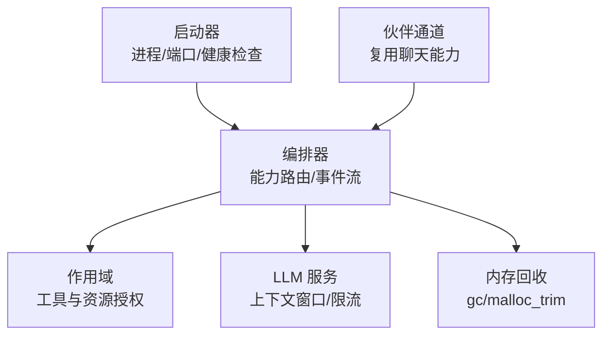
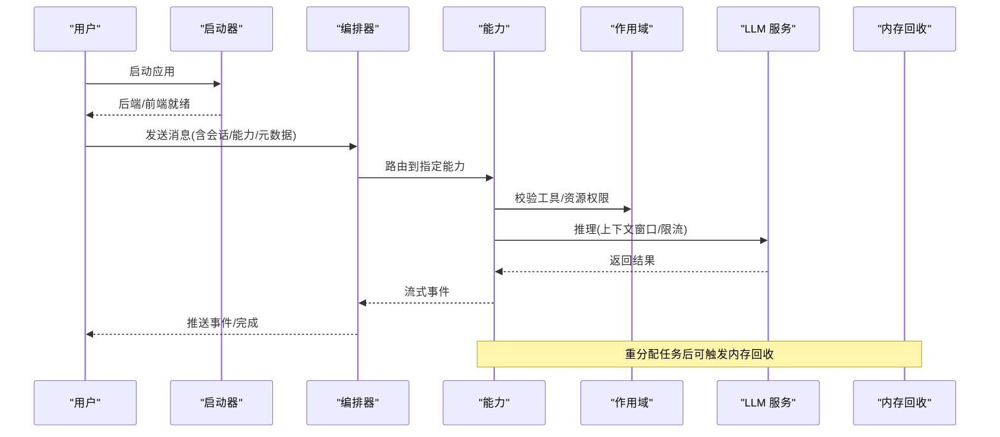
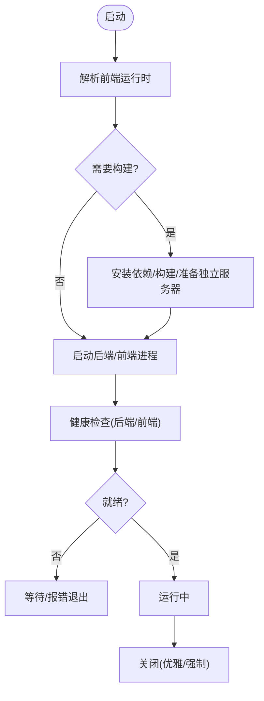
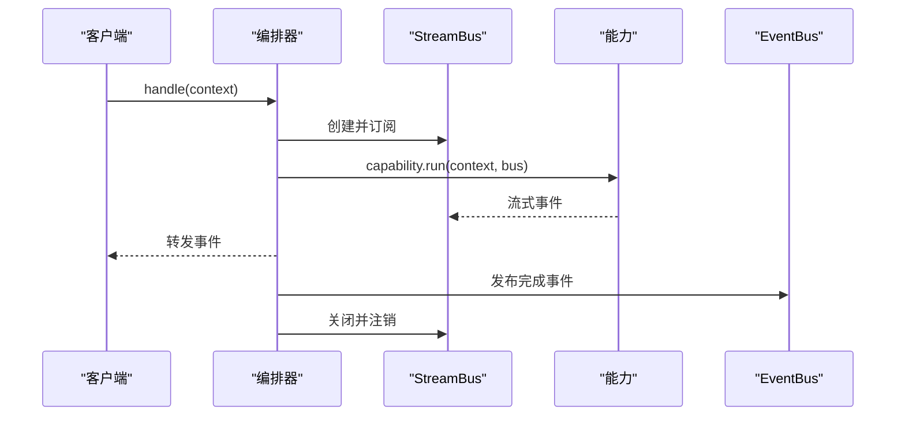
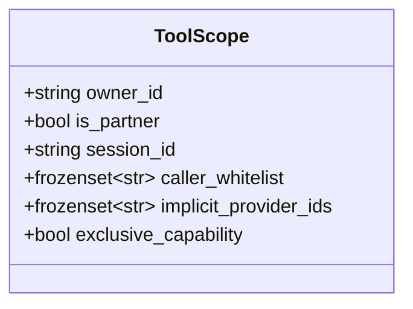
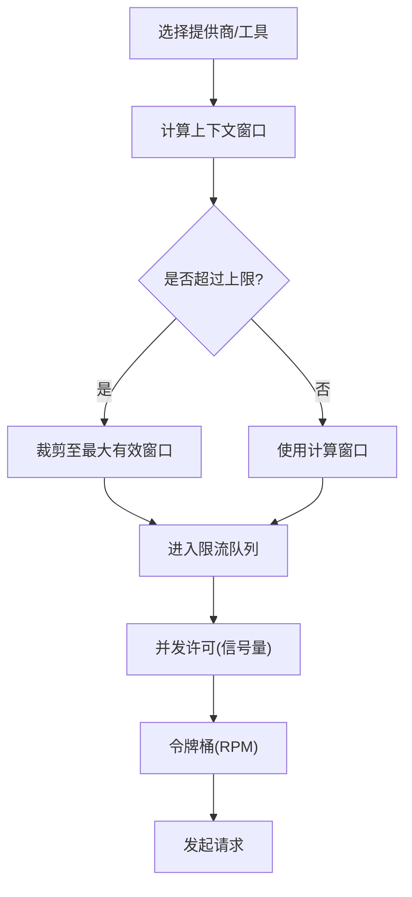
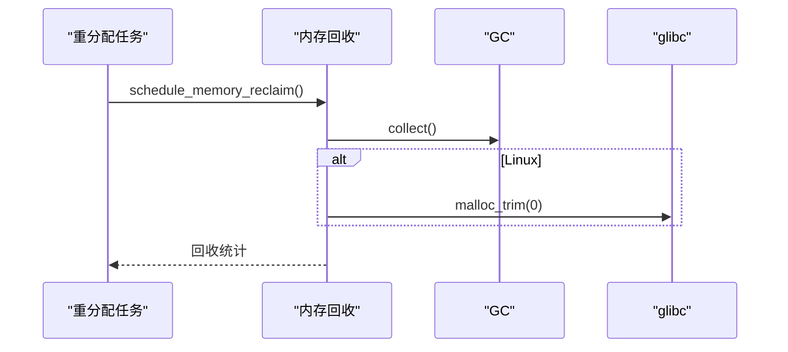
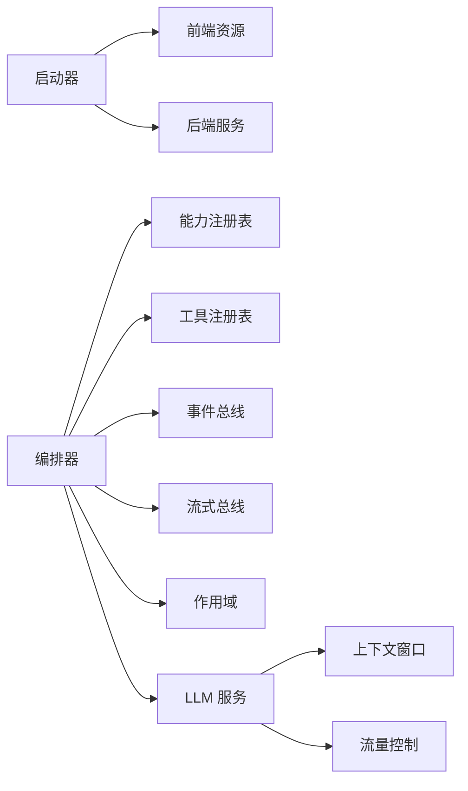

# 运行时环境

<cite>
**本文引用的文件**
- [runtime/__init__.py](file://deeptutor/runtime/__init__.py)
- [runtime/launcher.py](file://deeptutor/runtime/launcher.py)
- [runtime/orchestrator.py](file://deeptutor/runtime/orchestrator.py)
- [runtime/providers/scope.py](file://deeptutor/runtime/providers/scope.py)
- [runtime/memory_reclaim.py](file://deeptutor/runtime/memory_reclaim.py)
- [services/llm/context_window.py](file://deeptutor/services/llm/context_window.py)
- [services/llm/traffic_control.py](file://deeptutor/services/llm/traffic_control.py)
- [partners/__init__.py](file://deeptutor/partners/__init__.py)
</cite>

## 目录
1. [简介](#简介)
2. [项目结构](#项目结构)
3. [核心组件](#核心组件)
4. [架构总览](#架构总览)
5. [详细组件分析](#详细组件分析)
6. [依赖关系分析](#依赖关系分析)
7. [性能考量](#性能考量)
8. [故障排查指南](#故障排查指南)
9. [结论](#结论)
10. [附录](#附录)

## 简介
本文件面向 DeepTutor 的“伙伴运行时环境”，聚焦运行时的生命周期管理（启动、初始化、关闭）、模型运行时（LLM 提供商选择、上下文窗口管理、请求限流）、作用域管理机制（能力访问控制、工具权限、资源配置）、运行时状态管理（会话状态、缓存策略、内存回收），并提供配置与优化示例（并发控制、错误处理、监控指标）以及可扩展性与故障恢复机制说明。文档以代码级事实为依据，辅以可视化图示帮助理解。

## 项目结构
DeepTutor 的运行时由多个模块协作完成：
- 启动器负责本地 Web 应用的进程管理与健康检查
- 编排器统一路由用户消息到具体能力并管理事件流
- 作用域定义决定一次调用可使用的工具与资源
- LLM 服务提供上下文窗口估算与流量控制
- 内存回收在重分配任务后释放堆内存
- 伙伴通道复用聊天能力的代理循环，不单独维护引擎

**图表来源**
- [runtime/launcher.py:1-120](file://deeptutor/runtime/launcher.py#L1-L120)
- [runtime/orchestrator.py:26-147](file://deeptutor/runtime/orchestrator.py#L26-L147)
- [runtime/providers/scope.py:16-46](file://deeptutor/runtime/providers/scope.py#L16-L46)
- [services/llm/context_window.py:1-79](file://deeptutor/services/llm/context_window.py#L1-L79)
- [services/llm/traffic_control.py:13-126](file://deeptutor/services/llm/traffic_control.py#L13-L126)
- [runtime/memory_reclaim.py:17-74](file://deeptutor/runtime/memory_reclaim.py#L17-L74)
- [partners/__init__.py:1-12](file://deeptutor/partners/__init__.py#L1-L12)

**章节来源**
- [runtime/launcher.py:1-120](file://deeptutor/runtime/launcher.py#L1-L120)
- [runtime/orchestrator.py:26-147](file://deeptutor/runtime/orchestrator.py#L26-L147)
- [runtime/providers/scope.py:16-46](file://deeptutor/runtime/providers/scope.py#L16-L46)
- [services/llm/context_window.py:1-79](file://deeptutor/services/llm/context_window.py#L1-L79)
- [services/llm/traffic_control.py:13-126](file://deeptutor/services/llm/traffic_control.py#L13-L126)
- [runtime/memory_reclaim.py:17-74](file://deeptutor/runtime/memory_reclaim.py#L17-L74)
- [partners/__init__.py:1-12](file://deeptutor/partners/__init__.py#L1-L12)

## 核心组件
- 启动器：负责后端与前端进程的启动、端口冲突检测与解决、健康等待、优雅关闭；同时准备前端静态资源与环境变量注入。
- 编排器：统一入口，根据上下文中的能力名称路由到对应能力执行，管理流式事件总线，发布完成事件。
- 作用域：描述一次调用所需的身份与授权输入，包括拥有者、是否伙伴、会话、白名单、隐式提供商与独占能力标志。
- LLM 上下文窗口：根据模型名与输出限制估算有效上下文窗口，支持大上下文模型默认值与上限保护。
- 流量控制：基于信号量与令牌桶实现并发与速率限制，防止本地过载与远端限流触发。
- 内存回收：在重分配任务后异步触发垃圾回收与 Linux 平台下的 malloc_trim，降低常驻内存占用。
- 伙伴通道：通过复用聊天能力的代理循环，将 IM 渠道消息接入同一运行时。

**章节来源**
- [runtime/launcher.py:42-110](file://deeptutor/runtime/launcher.py#L42-L110)
- [runtime/orchestrator.py:26-147](file://deeptutor/runtime/orchestrator.py#L26-L147)
- [runtime/providers/scope.py:16-46](file://deeptutor/runtime/providers/scope.py#L16-L46)
- [services/llm/context_window.py:26-79](file://deeptutor/services/llm/context_window.py#L26-L79)
- [services/llm/traffic_control.py:13-126](file://deeptutor/services/llm/traffic_control.py#L13-L126)
- [runtime/memory_reclaim.py:17-74](file://deeptutor/runtime/memory_reclaim.py#L17-L74)
- [partners/__init__.py:1-12](file://deeptutor/partners/__init__.py#L1-L12)

## 架构总览
运行时围绕“启动—编排—能力—LLM—资源”的主干链路组织。启动器确保前后端就绪，编排器接收上下文并路由到能力，能力在执行过程中使用作用域进行工具与资源授权，并通过 LLM 服务进行推理与限流，必要时触发内存回收以降低驻留内存。

**图表来源**
- [runtime/launcher.py:453-483](file://deeptutor/runtime/launcher.py#L453-L483)
- [runtime/orchestrator.py:36-147](file://deeptutor/runtime/orchestrator.py#L36-L147)
- [runtime/providers/scope.py:16-46](file://deeptutor/runtime/providers/scope.py#L16-L46)
- [services/llm/context_window.py:41-79](file://deeptutor/services/llm/context_window.py#L41-L79)
- [services/llm/traffic_control.py:78-122](file://deeptutor/services/llm/traffic_control.py#L78-L122)
- [runtime/memory_reclaim.py:44-74](file://deeptutor/runtime/memory_reclaim.py#L44-L74)

## 详细组件分析

### 启动器：生命周期管理（启动、初始化、关闭）
- 启动流程：
  - 解析前端运行时（打包或源码构建），复制/修补占位符，安装依赖，生产构建并准备独立服务器。
  - 启动后端与前端子进程，设置进程组与日志流转发。
  - 健康检查：轮询 HTTP 接口直至就绪或超时。
- 初始化：
  - 重置路径与服务单例，避免多实例污染。
  - 调整环境变量（如 glibc arena 参数）以减少内存碎片。
- 关闭流程：
  - 优雅终止：先发送 SIGTERM，等待超时后强制 SIGKILL。
  - 端口冲突处理：检测占用端口，提示或杀死占用进程，保存新端口配置。

**图表来源**
- [runtime/launcher.py:485-773](file://deeptutor/runtime/launcher.py#L485-L773)
- [runtime/launcher.py:453-483](file://deeptutor/runtime/launcher.py#L453-L483)
- [runtime/launcher.py:148-163](file://deeptutor/runtime/launcher.py#L148-L163)
- [runtime/launcher.py:408-451](file://deeptutor/runtime/launcher.py#L408-L451)

**章节来源**
- [runtime/launcher.py:42-110](file://deeptutor/runtime/launcher.py#L42-L110)
- [runtime/launcher.py:148-163](file://deeptutor/runtime/launcher.py#L148-L163)
- [runtime/launcher.py:408-451](file://deeptutor/runtime/launcher.py#L408-L451)
- [runtime/launcher.py:453-483](file://deeptutor/runtime/launcher.py#L453-L483)
- [runtime/launcher.py:485-773](file://deeptutor/runtime/launcher.py#L485-L773)

### 编排器：会话与事件流管理
- 会话与会话 ID：若未设置则生成新的会话 ID。
- 能力路由：根据 active_capability 选择能力，否则默认 chat。
- 事件流：创建 StreamBus，注册/注销 turn_id，发送 SESSION/DONE 事件，异常时上报失败状态。
- 完成事件：发布 CAPABILITY_COMPLETE 到全局事件总线，携带能力、会话、turn 信息。

**图表来源**
- [runtime/orchestrator.py:36-147](file://deeptutor/runtime/orchestrator.py#L36-L147)

**章节来源**
- [runtime/orchestrator.py:36-147](file://deeptutor/runtime/orchestrator.py#L36-L147)

### 作用域管理：能力访问控制、工具权限与资源配置
- ToolScope 字段含义：
  - owner_id：拥有者标识，用于资源隔离与凭据访问。
  - is_partner：是否为伙伴（合成非管理员用户）。
  - session_id：会话标识。
  - caller_whitelist：调用方白名单（None 表示无限制）。
  - implicit_provider_ids：隐式授权的提供商集合（例如知识基资源绑定）。
  - exclusive_capability：独占能力标志，此时不应暴露提供商工具。
- 决策点：
  - 当 exclusive_capability 为真时，屏蔽提供商工具，避免与独占能力表面冲突。
  - 结合 caller_whitelist 与 implicit_provider_ids 动态决定可用工具集。

**图表来源**
- [runtime/providers/scope.py:16-46](file://deeptutor/runtime/providers/scope.py#L16-L46)

**章节来源**
- [runtime/providers/scope.py:16-46](file://deeptutor/runtime/providers/scope.py#L16-L46)

### 模型运行时：LLM 提供商选择、上下文窗口与请求限流
- 提供商选择：
  - 通过能力与工具注册表获取可用能力与工具，结合作用域决定实际可用的提供商工具。
- 上下文窗口：
  - 根据模型名判断是否属于大上下文模型族，计算默认窗口；支持显式配置与最大有效窗口上限。
- 请求限流：
  - TrafficController 使用信号量控制并发，令牌桶控制 RPM；支持获取超时与等待告警。

**图表来源**
- [services/llm/context_window.py:41-79](file://deeptutor/services/llm/context_window.py#L41-L79)
- [services/llm/traffic_control.py:21-122](file://deeptutor/services/llm/traffic_control.py#L21-L122)
- [runtime/orchestrator.py:26-147](file://deeptutor/runtime/orchestrator.py#L26-L147)
- [runtime/providers/scope.py:16-46](file://deeptutor/runtime/providers/scope.py#L16-L46)

**章节来源**
- [services/llm/context_window.py:41-79](file://deeptutor/services/llm/context_window.py#L41-L79)
- [services/llm/traffic_control.py:21-122](file://deeptutor/services/llm/traffic_control.py#L21-L122)
- [runtime/orchestrator.py:26-147](file://deeptutor/runtime/orchestrator.py#L26-L147)
- [runtime/providers/scope.py:16-46](file://deeptutor/runtime/providers/scope.py#L16-L46)

### 运行时状态管理：会话状态、缓存策略与内存回收
- 会话状态：
  - 编排器在每次 turn 开始时生成/传递 session_id，并在 DONE 事件中携带状态。
- 缓存策略：
  - 启动器对前端资源进行缓存与占位符替换，避免重复构建与写入只读目录。
- 内存回收：
  - 在重分配任务后调度异步回收，触发 gc.collect()，Linux 下尝试 malloc_trim 释放空闲页。

**图表来源**
- [runtime/memory_reclaim.py:44-74](file://deeptutor/runtime/memory_reclaim.py#L44-L74)
- [runtime/launcher.py:485-562](file://deeptutor/runtime/launcher.py#L485-L562)
- [runtime/orchestrator.py:36-147](file://deeptutor/runtime/orchestrator.py#L36-L147)

**章节来源**
- [runtime/memory_reclaim.py:44-74](file://deeptutor/runtime/memory_reclaim.py#L44-L74)
- [runtime/launcher.py:485-562](file://deeptutor/runtime/launcher.py#L485-L562)
- [runtime/orchestrator.py:36-147](file://deeptutor/runtime/orchestrator.py#L36-L147)

### 伙伴通道：复用聊天能力
- 伙伴通道层解耦 IM 渠道与代理运行时，直接复用聊天能力的代理循环，无需独立引擎。

**章节来源**
- [partners/__init__.py:1-12](file://deeptutor/partners/__init__.py#L1-L12)

## 依赖关系分析
- 启动器依赖：
  - 前端资源与 Node/npm（源码模式）或打包产物（发行模式）。
  - 后端健康检查与进程管理。
- 编排器依赖：
  - 能力注册表、工具注册表、事件总线、流式总线。
- LLM 服务依赖：
  - 上下文窗口估算、流量控制。
- 作用域依赖：
  - 作为输入记录被能力与工具授权逻辑消费。

**图表来源**
- [runtime/launcher.py:485-773](file://deeptutor/runtime/launcher.py#L485-L773)
- [runtime/orchestrator.py:26-147](file://deeptutor/runtime/orchestrator.py#L26-L147)
- [services/llm/context_window.py:41-79](file://deeptutor/services/llm/context_window.py#L41-L79)
- [services/llm/traffic_control.py:21-122](file://deeptutor/services/llm/traffic_control.py#L21-L122)
- [runtime/providers/scope.py:16-46](file://deeptutor/runtime/providers/scope.py#L16-L46)

**章节来源**
- [runtime/launcher.py:485-773](file://deeptutor/runtime/launcher.py#L485-L773)
- [runtime/orchestrator.py:26-147](file://deeptutor/runtime/orchestrator.py#L26-L147)
- [services/llm/context_window.py:41-79](file://deeptutor/services/llm/context_window.py#L41-L79)
- [services/llm/traffic_control.py:21-122](file://deeptutor/services/llm/traffic_control.py#L21-L122)
- [runtime/providers/scope.py:16-46](file://deeptutor/runtime/providers/scope.py#L16-L46)

## 性能考量
- 并发控制：
  - 使用 TrafficController 的信号量限制并发请求，避免本地资源耗尽。
  - 令牌桶按分钟平滑限流，减少突发导致的远端限流。
- 上下文窗口：
  - 自动识别大上下文模型族，提高默认窗口；始终限制在最大有效窗口内，避免过度消耗。
- 内存回收：
  - 在重分配任务后异步回收，Linux 平台尝试释放空闲页，降低 RSS。
- 启动优化：
  - 前端构建指纹化，避免重复构建；生产模式独立部署，减少开发服务器开销。

[本节为通用指导，不直接分析具体文件]

## 故障排查指南
- 端口冲突：
  - 启动器会检测占用端口，列出监听进程，支持交互式更换端口或杀死占用进程。
- 健康检查失败：
  - 若后端/前端未在超时时间内就绪，抛出错误并提示超时时间。
- 能力未知：
  - 编排器在能力不存在时返回错误事件，包含可用能力列表。
- 限流与超时：
  - 流量控制器在并发超限或令牌不足时记录警告/错误，可能抛出超时异常。
- 内存压力：
  - 观察内存回收任务是否成功执行；Linux 平台确认 malloc_trim 可用性。

**章节来源**
- [runtime/launcher.py:408-451](file://deeptutor/runtime/launcher.py#L408-L451)
- [runtime/launcher.py:453-483](file://deeptutor/runtime/launcher.py#L453-L483)
- [runtime/orchestrator.py:49-67](file://deeptutor/runtime/orchestrator.py#L49-L67)
- [services/llm/traffic_control.py:85-112](file://deeptutor/services/llm/traffic_control.py#L85-L112)
- [runtime/memory_reclaim.py:17-41](file://deeptutor/runtime/memory_reclaim.py#L17-L41)

## 结论
DeepTutor 的伙伴运行时环境通过启动器、编排器、作用域、LLM 服务与内存回收等组件协同工作，实现了健壮的生命周期管理、灵活的模型运行时控制与安全的资源访问。其设计强调可扩展性（能力/工具注册、作用域扩展）与故障恢复（健康检查、限流与超时、内存回收）。在生产环境中，建议合理配置并发与限流参数，关注上下文窗口与内存使用，并结合日志与事件进行监控与排障。

[本节为总结，不直接分析具体文件]

## 附录
- 配置与优化示例要点：
  - 并发控制：根据系统资源与远端配额设置 max_concurrency 与 requests_per_minute。
  - 上下文窗口：为大上下文模型启用较大默认窗口，但注意输出 token 限制与最大有效窗口。
  - 内存回收：在文档解析、索引构建等重分配任务后调用回收函数。
  - 监控指标：关注健康检查耗时、限流等待时长、事件完成状态与内存回收统计。

[本节为通用指导，不直接分析具体文件]