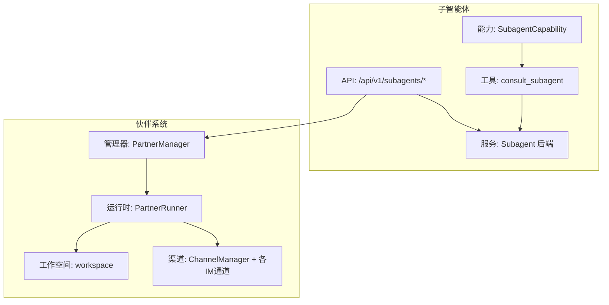
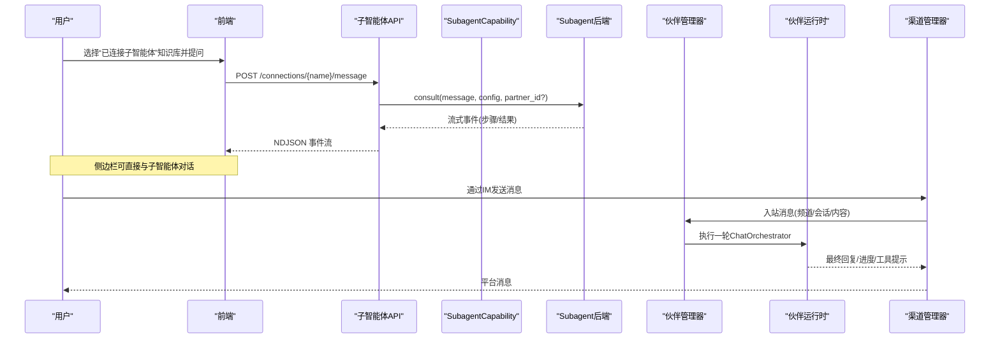
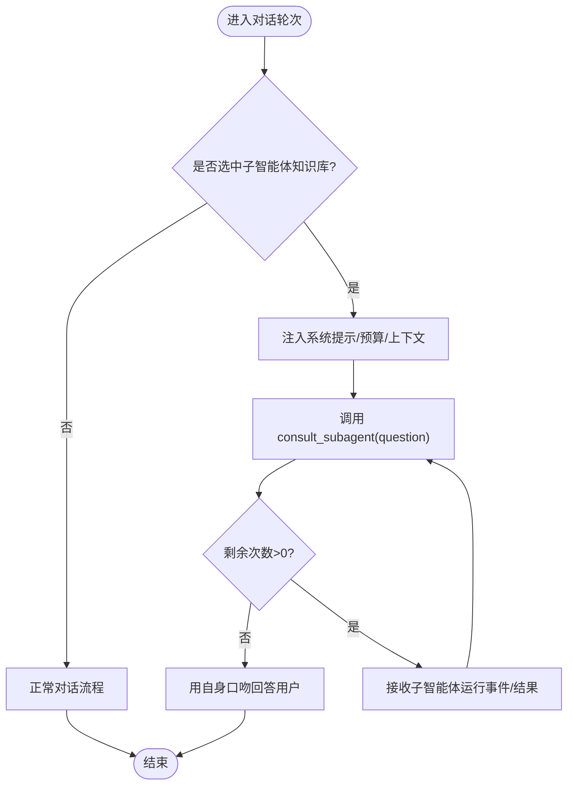
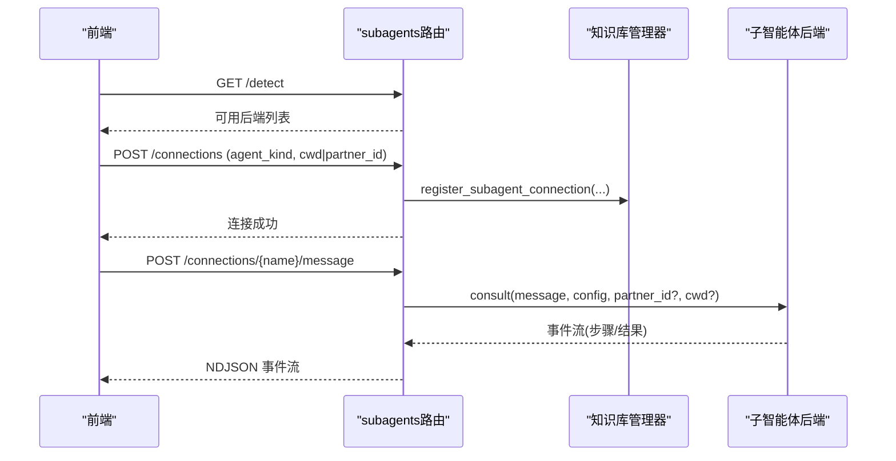
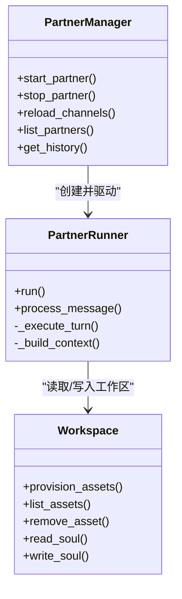
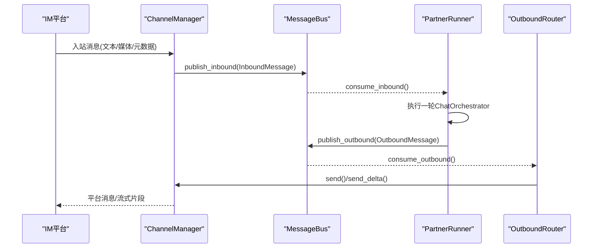
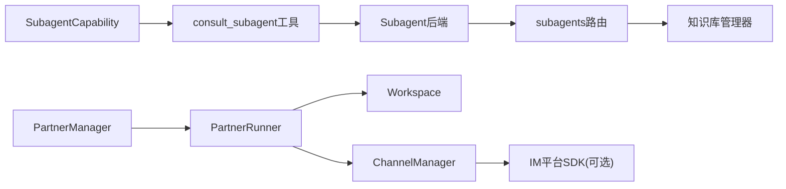

# 子智能体和伙伴系统

<cite>
**本文引用的文件**
- [deeptutor/capabilities/subagent/capability.py](file://deeptutor/capabilities/subagent/capability.py)
- [deeptutor/capabilities/subagent/tools.py](file://deeptutor/capabilities/subagent/tools.py)
- [deeptutor/api/routers/subagents.py](file://deeptutor/api/routers/subagents.py)
- [deeptutor/services/subagent/__init__.py](file://deeptutor/services/subagent/__init__.py)
- [web/lib/subagents-api.ts](file://web/lib/subagents-api.ts)
- [tests/knowledge/test_subagent_connection_kb.py](file://tests/knowledge/test_subagent_connection_kb.py)
- [deeptutor/services/partners/manager.py](file://deeptutor/services/partners/manager.py)
- [deeptutor/services/partners/runtime.py](file://deeptutor/services/partners/runtime.py)
- [deeptutor/services/partners/workspace.py](file://deeptutor/services/partners/workspace.py)
- [deeptutor/tools/partner_memory.py](file://deeptutor/tools/partner_memory.py)
- [deeptutor/partners/channels/manager.py](file://deeptutor/partners/channels/manager.py)
- [deeptutor/partners/channels/feishu.py](file://deeptutor/partners/channels/feishu.py)
- [deeptutor/partners/channels/dingtalk.py](file://deeptutor/partners/channels/dingtalk.py)
- [deeptutor/partners/channels/wecom.py](file://deeptutor/partners/channels/wecom.py)
- [pyproject.toml](file://pyproject.toml)
</cite>

## 目录
1. [简介](#简介)
2. [项目结构](#项目结构)
3. [核心组件](#核心组件)
4. [架构总览](#架构总览)
5. [详细组件分析](#详细组件分析)
6. [依赖关系分析](#依赖关系分析)
7. [性能考量](#性能考量)
8. [故障排查指南](#故障排查指南)
9. [结论](#结论)
10. [附录：配置与使用示例](#附录配置与使用示例)

## 简介
本文件面向 DeepTutor 的“子智能体”和“伙伴系统”，系统性说明：
- 子智能体如何允许从任意对话轮次咨询实时编码 CLI（Claude Code、Codex、Gemini、Kimi、opencode、MiMo）或伙伴，并展示其工具调用、预算控制与流式回显机制。
- 伙伴系统的架构：持久化伴侣、个人灵魂（Soul）、模型策略、库（知识基础/技能/笔记本）、记忆与渠道管理。
- 伙伴与 IM 平台的集成机制：飞书、Telegram、Slack、Discord、钉钉、QQ/NapCat、企业微信、WhatsApp、Zulip、Mattermost、Matrix、Mochat、Microsoft Teams 等。
- 工作空间隔离：每个伙伴拥有独立的知识基础、技能、笔记本与记忆，互不干扰。
- 通过具体示例展示如何配置和使用子智能体进行代码查询，以及如何设置和管理具有不同个性的伙伴，体现真正的 AI 助手生态。

## 项目结构
围绕子智能体与伙伴系统的关键目录与职责：
- 子智能体能力层：将“本地外部智能体/伙伴”作为可被主对话调用的委托者，提供 consult_subagent 工具、预算控制与上下文注入。
- 子智能体服务层：后端驱动各 CLI 后端（本地进程/受管服务器），统一事件流与类型定义。
- API 路由：连接管理、检测、设置同步、直接消息流式接口。
- 伙伴服务层：生命周期管理、运行时编排、会话存储、工作空间与资产复制。
- 渠道层：多 IM 平台接入，统一出站消息分发、重试、去重与流式合并。

图表来源
- [deeptutor/capabilities/subagent/capability.py:1-218](file://deeptutor/capabilities/subagent/capability.py#L1-L218)
- [deeptutor/api/routers/subagents.py:1-326](file://deeptutor/api/routers/subagents.py#L1-L326)
- [deeptutor/services/partners/manager.py:1-800](file://deeptutor/services/partners/manager.py#L1-L800)
- [deeptutor/services/partners/runtime.py:1-709](file://deeptutor/services/partners/runtime.py#L1-L709)
- [deeptutor/partners/channels/manager.py:1-341](file://deeptutor/partners/channels/manager.py#L1-L341)

章节来源
- [deeptutor/capabilities/subagent/capability.py:1-218](file://deeptutor/capabilities/subagent/capability.py#L1-L218)
- [deeptutor/api/routers/subagents.py:1-326](file://deeptutor/api/routers/subagents.py#L1-L326)
- [deeptutor/services/partners/manager.py:1-800](file://deeptutor/services/partners/manager.py#L1-L800)
- [deeptutor/services/partners/runtime.py:1-709](file://deeptutor/services/partners/runtime.py#L1-L709)
- [deeptutor/partners/channels/manager.py:1-341](file://deeptutor/partners/channels/manager.py#L1-L341)

## 核心组件
- 子智能体能力（SubagentCapability）：在选中知识库为“已连接子智能体”时激活，独占本轮对话，仅暴露 consult_subagent 工具；注入连接信息、预算、图像转发、会话延续等上下文。
- 子智能体工具（consult_subagent）：描述可咨询的外部智能体（本地 CLI 或伙伴），支持多次追问与预算限制，结果实时展示给用户。
- 子智能体服务（services/subagent）：封装各后端（Claude Code、Codex、Gemini CLI、Kimi CLI、opencode、MiMo Code、partner），统一事件流与类型。
- 子智能体 API（routers/subagents）：检测可用后端、列出/创建/删除连接、同步后端选项、直接发消息并流式返回运行过程。
- 伙伴管理器（PartnerManager）：创建/启动/停止伙伴实例，管理配置、会话、通道与自动启动策略。
- 伙伴运行时（PartnerRunner）：将每条入站消息转为一次 ChatOrchestrator 回合，执行 agent loop，处理流式输出、工具提示、错误回退到备用模型。
- 伙伴工作空间（workspace）：按聊天用户工作区格式克隆 SOUL.md、知识基础、技能、笔记本与记忆，确保工具链无需特殊适配即可读取。
- 渠道管理器（ChannelManager）：发现并启用 IM 通道，出站消息分发、重复抑制、流式增量合并、指数退避重试。

章节来源
- [deeptutor/capabilities/subagent/capability.py:1-218](file://deeptutor/capabilities/subagent/capability.py#L1-L218)
- [deeptutor/capabilities/subagent/tools.py:45-67](file://deeptutor/capabilities/subagent/tools.py#L45-L67)
- [deeptutor/services/subagent/__init__.py:1-55](file://deeptutor/services/subagent/__init__.py#L1-L55)
- [deeptutor/api/routers/subagents.py:1-326](file://deeptutor/api/routers/subagents.py#L1-L326)
- [deeptutor/services/partners/manager.py:1-800](file://deeptutor/services/partners/manager.py#L1-L800)
- [deeptutor/services/partners/runtime.py:1-709](file://deeptutor/services/partners/runtime.py#L1-L709)
- [deeptutor/services/partners/workspace.py:1-389](file://deeptutor/services/partners/workspace.py#L1-L389)
- [deeptutor/partners/channels/manager.py:1-341](file://deeptutor/partners/channels/manager.py#L1-L341)

## 架构总览
子智能体与伙伴系统共同构成“可插拔的助手生态”：主对话可在任意轮次委派给本地 CLI 或伙伴；伙伴则作为持久化的“有个性、有记忆、有渠道”的独立助手，复用同一套 agent 循环与工作区。

图表来源
- [deeptutor/api/routers/subagents.py:216-298](file://deeptutor/api/routers/subagents.py#L216-L298)
- [deeptutor/services/partners/runtime.py:137-360](file://deeptutor/services/partners/runtime.py#L137-L360)
- [deeptutor/partners/channels/manager.py:187-328](file://deeptutor/partners/channels/manager.py#L187-L328)

## 详细组件分析

### 子智能体能力与工具
- 能力激活：当当前上下文选中的知识库是“已连接子智能体”时激活，注入系统提示与最小轮数保障，确保足够轮次完成最终回答。
- 工具行为：consult_subagent 支持多次追问，每次调用会返回剩余次数；支持图片转发（需开启）；跨轮次保持会话连续性（基于 chat session + 连接名）。
- 预算控制：每轮可配置的 consult_budget，并在 prompt 中明确上限，避免无限调用。

图表来源
- [deeptutor/capabilities/subagent/capability.py:32-117](file://deeptutor/capabilities/subagent/capability.py#L32-L117)
- [deeptutor/capabilities/subagent/tools.py:45-67](file://deeptutor/capabilities/subagent/tools.py#L45-L67)

章节来源
- [deeptutor/capabilities/subagent/capability.py:32-117](file://deeptutor/capabilities/subagent/capability.py#L32-L117)
- [deeptutor/capabilities/subagent/tools.py:45-67](file://deeptutor/capabilities/subagent/tools.py#L45-L67)

### 子智能体服务与API
- 后端检测与选项同步：detect_all 探测本机可用的 CLI；list_backend_options/sync_backend_options 拉取模型与推理强度选项。
- 连接管理：注册为 type: subagent 的知识库条目，支持本地 cwd 或 partner_id；删除连接时清理跨轮会话缓存。
- 直接消息流：/connections/{name}/message 以 NDJSON 流式返回子智能体的原生运行事件，侧边栏可复用相同渲染逻辑。

图表来源
- [deeptutor/api/routers/subagents.py:63-94](file://deeptutor/api/routers/subagents.py#L63-L94)
- [deeptutor/api/routers/subagents.py:132-190](file://deeptutor/api/routers/subagents.py#L132-L190)
- [deeptutor/api/routers/subagents.py:216-298](file://deeptutor/api/routers/subagents.py#L216-L298)

章节来源
- [deeptutor/api/routers/subagents.py:1-326](file://deeptutor/api/routers/subagents.py#L1-L326)
- [deeptutor/services/subagent/__init__.py:1-55](file://deeptutor/services/subagent/__init__.py#L1-L55)
- [web/lib/subagents-api.ts:43-176](file://web/lib/subagents-api.ts#L43-L176)

### 伙伴系统：管理器、运行时与工作空间
- 管理器（PartnerManager）：负责伙伴实例的生命周期、配置持久化、通道管理、会话存储、最近活跃伙伴列表、自动启动策略。
- 运行时（PartnerRunner）：将入站消息转换为一次 ChatOrchestrator 回合，组装上下文（SOUL、技能、知识库、语言、附件），处理流式输出、工具提示、错误回退到备用模型。
- 工作空间（workspace）：按聊天用户工作区格式克隆 SOUL.md、知识基础、技能、笔记本与记忆；提供清单与删除能力，保证伙伴工具链零适配。

图表来源
- [deeptutor/services/partners/manager.py:472-627](file://deeptutor/services/partners/manager.py#L472-L627)
- [deeptutor/services/partners/runtime.py:137-434](file://deeptutor/services/partners/runtime.py#L137-L434)
- [deeptutor/services/partners/workspace.py:119-376](file://deeptutor/services/partners/workspace.py#L119-L376)

章节来源
- [deeptutor/services/partners/manager.py:1-800](file://deeptutor/services/partners/manager.py#L1-L800)
- [deeptutor/services/partners/runtime.py:1-709](file://deeptutor/services/partners/runtime.py#L1-L709)
- [deeptutor/services/partners/workspace.py:1-389](file://deeptutor/services/partners/workspace.py#L1-L389)

### 伙伴的记忆与权限边界
- 分裂式记忆：伙伴拥有独立的长期记忆（位于 data/partners/<id>/workspace/memory），仅 partner_memorize 写入；partner_read 同时读取伙伴自身记忆与所有者共享 L3 记忆（只读）。
- 工具挂载：partner_read、partner_memorize、partner_search 强制挂载于伙伴回合，不在产品对话中暴露，避免越权。

章节来源
- [deeptutor/tools/partner_memory.py:1-38](file://deeptutor/tools/partner_memory.py#L1-L38)

### IM 渠道管理与平台集成
- 渠道管理器：根据配置动态发现并启用通道，出站消息分发具备重复抑制、流式增量合并、指数退避重试。
- 平台支持：通过可选依赖与通道实现覆盖飞书、Telegram、Slack、Discord、钉钉、QQ/NapCat、企业微信、WhatsApp、Zulip、Mattermost、Matrix、Mochat、Microsoft Teams。
- 典型通道：
  - 飞书：WebSocket 长连接，支持卡片流式更新与富文本解析。
  - 钉钉：Stream 模式接收事件，HTTP 发送消息。
  - 企业微信：WebSocket 长连接，简化鉴权与消息收发。

图表来源
- [deeptutor/partners/channels/manager.py:187-328](file://deeptutor/partners/channels/manager.py#L187-L328)
- [deeptutor/partners/channels/feishu.py:239-330](file://deeptutor/partners/channels/feishu.py#L239-L330)
- [deeptutor/partners/channels/dingtalk.py:107-120](file://deeptutor/partners/channels/dingtalk.py#L107-L120)
- [deeptutor/partners/channels/wecom.py:21-55](file://deeptutor/partners/channels/wecom.py#L21-L55)

章节来源
- [deeptutor/partners/channels/manager.py:1-341](file://deeptutor/partners/channels/manager.py#L1-L341)
- [deeptutor/partners/channels/feishu.py:209-330](file://deeptutor/partners/channels/feishu.py#L209-L330)
- [deeptutor/partners/channels/dingtalk.py:81-120](file://deeptutor/partners/channels/dingtalk.py#L81-L120)
- [deeptutor/partners/channels/wecom.py:1-55](file://deeptutor/partners/channels/wecom.py#L1-L55)
- [pyproject.toml:123-151](file://pyproject.toml#L123-L151)

## 依赖关系分析
- 子智能体能力依赖：
  - 绑定与工具：connection_for_turn、subagent_refs、SUBAGENT_TOOL_NAMES。
  - 服务层：load_subagent_settings、sessions、backend.consult。
- 伙伴系统依赖：
  - 运行时：ChatOrchestrator、model_selection、user_context、PartnerSessionStore。
  - 工作区：PathService、multi_user paths、knowledge manager。
  - 渠道：ChannelManager、各平台 SDK（可选依赖）。

图表来源
- [deeptutor/capabilities/subagent/capability.py:15-23](file://deeptutor/capabilities/subagent/capability.py#L15-L23)
- [deeptutor/api/routers/subagents.py:26-38](file://deeptutor/api/routers/subagents.py#L26-L38)
- [deeptutor/services/partners/runtime.py:238-243](file://deeptutor/services/partners/runtime.py#L238-L243)
- [pyproject.toml:123-151](file://pyproject.toml#L123-L151)

章节来源
- [deeptutor/capabilities/subagent/capability.py:15-23](file://deeptutor/capabilities/subagent/capability.py#L15-L23)
- [deeptutor/api/routers/subagents.py:26-38](file://deeptutor/api/routers/subagents.py#L26-L38)
- [deeptutor/services/partners/runtime.py:238-243](file://deeptutor/services/partners/runtime.py#L238-L243)
- [pyproject.toml:123-151](file://pyproject.toml#L123-L151)

## 性能考量
- 子智能体预算：通过 per-turn 的 consult_budget 限制调用次数，避免过度消耗与延迟。
- 流式优化：渠道管理器对同一流段（channel+chat_id+stream_id）的 _stream_delta 进行合并，减少编辑 API 调用频率。
- 重试与去重：出站消息采用指数退避重试，并对相同来源消息的重复回复进行指纹去重。
- 备份模型：伙伴回合失败时尝试 backup_llm_selection，提高鲁棒性。
- 附件处理：伙伴运行时对图片和文档进行大小限制与提取，避免过大负载影响性能。

[本节为通用指导，不直接分析具体文件]

## 故障排查指南
- 子智能体连接问题：
  - 检查 detect 接口是否返回目标后端；确认连接是否存在且 agent_kind 正确；必要时删除连接并重建。
  - 若 partner_id 为空或无效，创建连接时会报错；确保 partner 存在且当前用户可见。
- 子智能体消息流异常：
  - 查看 /connections/{name}/message 的 NDJSON 流是否包含 error channel；确认后端 consult 是否抛出异常。
  - 若跨轮会话未恢复，检查 session_key 与 remember_session 是否生效。
- 伙伴通道异常：
  - 检查通道配置 enabled 与凭据；关注 ChannelManager 日志中的通道不可用或启动失败。
  - 出站失败会记录重试次数与错误；确认 allow_from 白名单是否误拒。
- 工作区资源异常：
  - 知识基础/技能/笔记本复制失败会记录 errors；检查源路径与权限。
  - 删除资源后确认索引与配置文件同步更新。

章节来源
- [deeptutor/api/routers/subagents.py:132-209](file://deeptutor/api/routers/subagents.py#L132-L209)
- [deeptutor/api/routers/subagents.py:216-298](file://deeptutor/api/routers/subagents.py#L216-L298)
- [deeptutor/partners/channels/manager.py:108-151](file://deeptutor/partners/channels/manager.py#L108-L151)
- [deeptutor/services/partners/workspace.py:119-157](file://deeptutor/services/partners/workspace.py#L119-L157)

## 结论
DeepTutor 的子智能体与伙伴系统通过统一的 agent 循环与工作区抽象，实现了“随时可委派的本地/远程智能体”与“持久化、个性化、多渠道的助手”两大能力。子智能体让主对话在任意轮次高效委派任务；伙伴则以独立身份、记忆与渠道构建真正的 AI 助手生态。通过预算控制、流式优化与健壮的错误处理，系统在易用性与稳定性之间取得平衡。

[本节为总结，不直接分析具体文件]

## 附录：配置与使用示例

### 示例一：配置并使用子智能体进行代码查询
- 在前端调用 detect 接口获取本机可用的 CLI（如 Claude Code、Codex、Gemini CLI、Kimi CLI、opencode、MiMo Code）。
- 创建连接：
  - 本地 CLI：指定 name、agent_kind、cwd（可选）。
  - 伙伴：指定 name、agent_kind="partner"、partner_id（需当前用户可见）。
- 在对话中选择该“已连接子智能体”知识库，主对话会在需要时调用 consult_subagent 向子智能体提问，最多 consult_budget 次；结果实时展示。
- 如需直接对话：调用 /connections/{name}/message，获得 NDJSON 流式事件，侧边栏可渲染完整运行过程。

章节来源
- [web/lib/subagents-api.ts:43-176](file://web/lib/subagents-api.ts#L43-L176)
- [deeptutor/api/routers/subagents.py:63-94](file://deeptutor/api/routers/subagents.py#L63-L94)
- [deeptutor/api/routers/subagents.py:132-190](file://deeptutor/api/routers/subagents.py#L132-L190)
- [deeptutor/api/routers/subagents.py:216-298](file://deeptutor/api/routers/subagents.py#L216-L298)

### 示例二：设置与管理具有不同个性的伙伴
- 创建伙伴：
  - 通过 /api/v1/partners 管理界面或 API 创建，分配名称、描述、emoji/color/avatar。
  - 配置 SOUL.md（个人灵魂）：可通过模板库或自定义内容设定个性与风格。
- 配置模型策略：
  - llm_selection：主模型选择；backup_llm_selection：失败时的备用模型。
- 配置渠道：
  - 在 channels 下为各平台（飞书、钉钉、企业微信等）设置凭据与 allow_from；enabled=true 启用。
- 工作空间资产：
  - 复制知识基础、技能、笔记本到伙伴工作区，确保 RAG、技能、笔记本工具无需适配即可使用。
- 运行与监控：
  - 启动伙伴后，观察通道状态与最近活跃会话；出错时查看 last_reload_error 与日志。

章节来源
- [deeptutor/services/partners/manager.py:472-627](file://deeptutor/services/partners/manager.py#L472-L627)
- [deeptutor/services/partners/workspace.py:119-376](file://deeptutor/services/partners/workspace.py#L119-L376)
- [deeptutor/partners/channels/manager.py:57-115](file://deeptutor/partners/channels/manager.py#L57-L115)