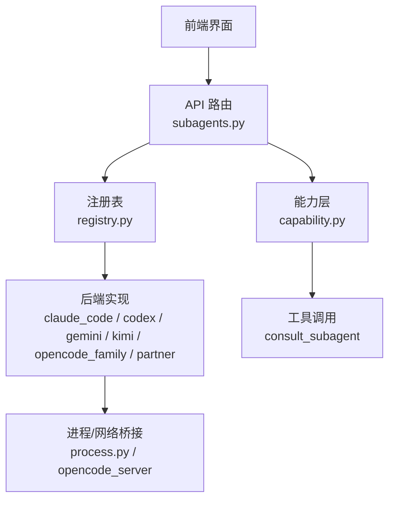
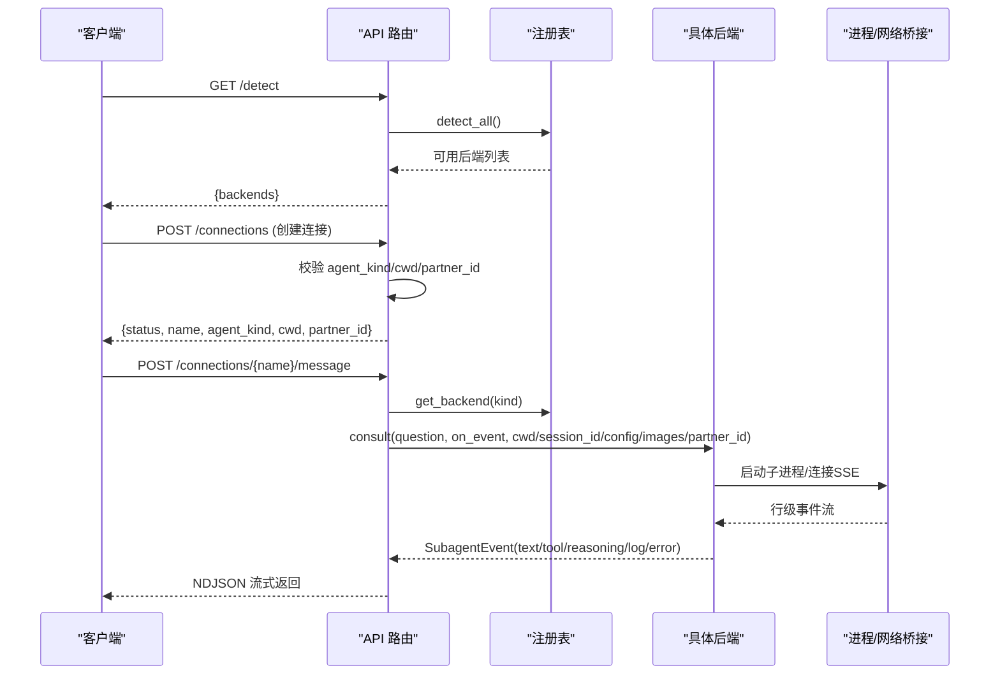
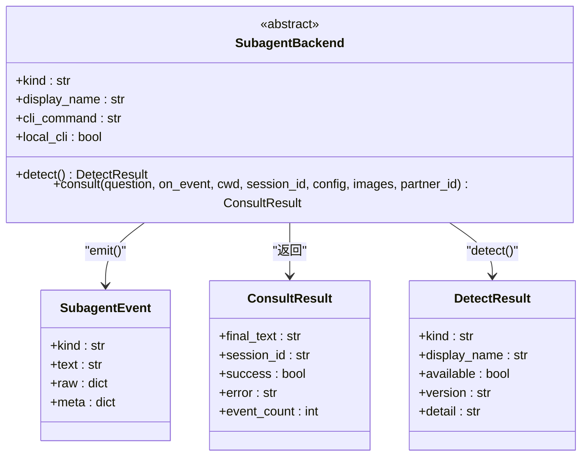
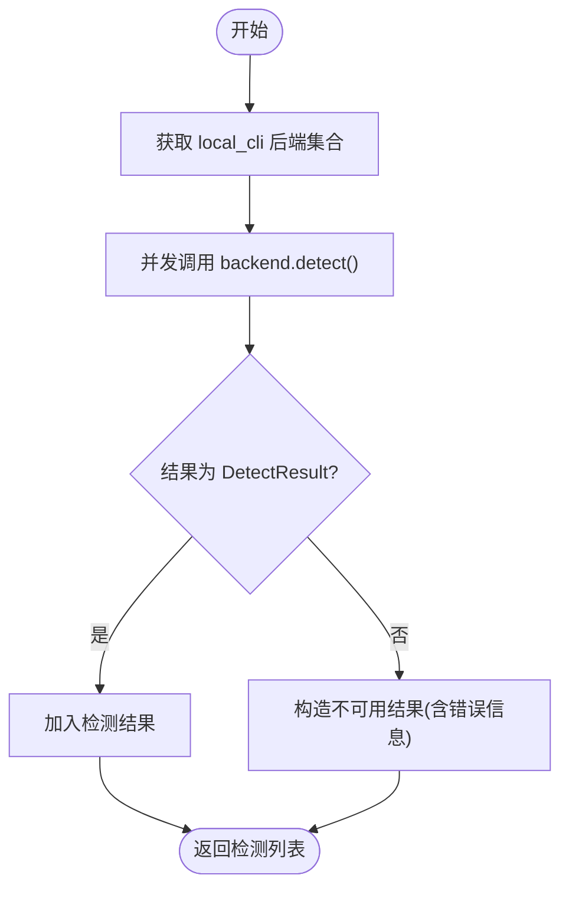
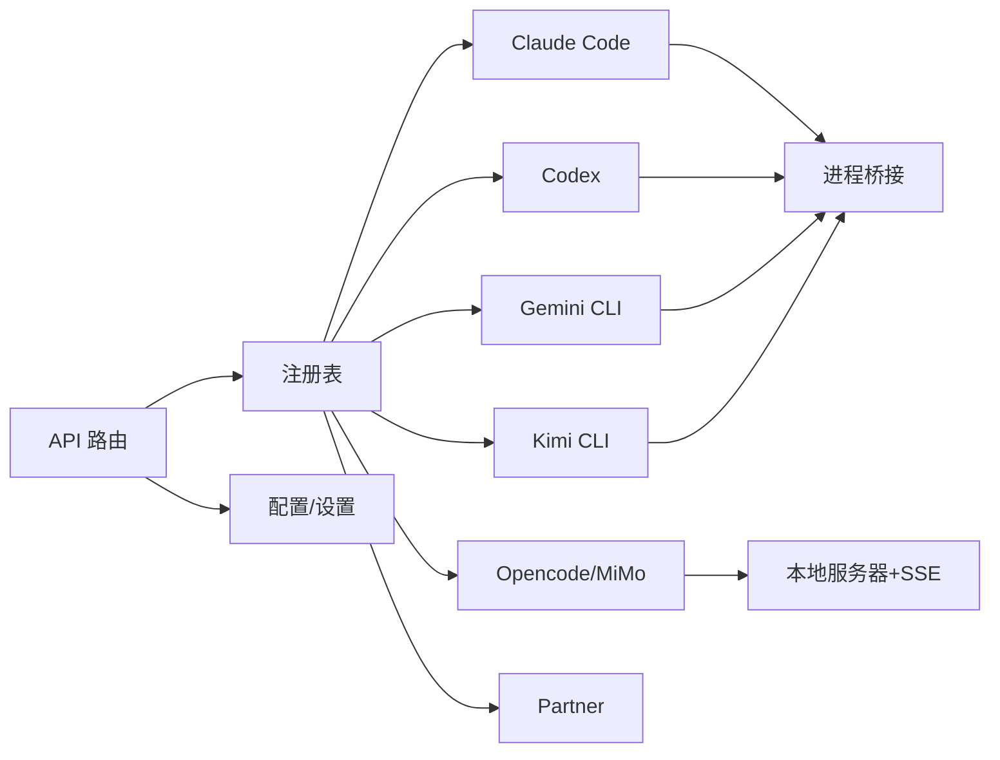

# 子智能体系统

<cite>
**本文引用的文件**
- [deeptutor/api/routers/subagents.py](file://deeptutor/api/routers/subagents.py)
- [deeptutor/services/subagent/__init__.py](file://deeptutor/services/subagent/__init__.py)
- [deeptutor/services/subagent/base.py](file://deeptutor/services/subagent/base.py)
- [deeptutor/services/subagent/registry.py](file://deeptutor/services/subagent/registry.py)
- [deeptutor/services/subagent/types.py](file://deeptutor/services/subagent/types.py)
- [deeptutor/services/subagent/process.py](file://deeptutor/services/subagent/process.py)
- [deeptutor/services/subagent/config.py](file://deeptutor/services/subagent/config.py)
- [deeptutor/services/subagent/claude_code.py](file://deeptutor/services/subagent/claude_code.py)
- [deeptutor/services/subagent/codex.py](file://deeptutor/services/subagent/codex.py)
- [deeptutor/services/subagent/gemini.py](file://deeptutor/services/subagent/gemini.py)
- [deeptutor/services/subagent/kimi.py](file://deeptutor/services/subagent/kimi.py)
- [deeptutor/services/subagent/opencode_family.py](file://deeptutor/services/subagent/opencode_family.py)
- [deeptutor/services/subagent/partner.py](file://deeptutor/services/subagent/partner.py)
- [deeptutor/capabilities/subagent/capability.py](file://deeptutor/capabilities/subagent/capability.py)
</cite>

## 目录
1. [简介](#简介)
2. [项目结构](#项目结构)
3. [核心组件](#核心组件)
4. [架构总览](#架构总览)
5. [详细组件分析](#详细组件分析)
6. [依赖关系分析](#依赖关系分析)
7. [性能考量](#性能考量)
8. [故障排查指南](#故障排查指南)
9. [结论](#结论)
10. [附录：配置与使用示例](#附录：配置与使用示例)

## 简介
本文件为 DeepTutor 的“子智能体系统”提供完整、可操作的技术文档。子智能体的核心思想是：在对话的任何轮次，主智能体都可以将任务委派给本地已安装的实时编码 CLI（Claude Code、Codex、Gemini CLI、Kimi CLI、opencode/MiMo Code）或用户绑定的“伙伴（Partner）”，以完成代码查询、文件操作和开发任务。系统通过统一的注册表发现后端、检测可用性、管理会话与事件流，并以工具调用机制无缝集成到主对话中。

## 项目结构
子智能体系统由三层构成：
- API 层：暴露连接、消息、设置等 HTTP 接口，支撑前端“我的智能体 → 已连接智能体”能力。
- 驱动层（services/subagent）：统一抽象 SubagentBackend，实现各后端的检测、进程/HTTP 通信、事件映射与生命周期管理。
- 能力层（capabilities/subagent）：将子智能体作为知识能力注入对话循环，控制预算、会话延续与工具调用。



图表来源
- [deeptutor/api/routers/subagents.py:63-94](file://deeptutor/api/routers/subagents.py#L63-L94)
- [deeptutor/services/subagent/registry.py:24-76](file://deeptutor/services/subagent/registry.py#L24-L76)
- [deeptutor/services/subagent/process.py:33-136](file://deeptutor/services/subagent/process.py#L33-L136)
- [deeptutor/capabilities/subagent/capability.py:32-63](file://deeptutor/capabilities/subagent/capability.py#L32-L63)

章节来源
- [deeptutor/api/routers/subagents.py:1-326](file://deeptutor/api/routers/subagents.py#L1-L326)
- [deeptutor/services/subagent/registry.py:1-80](file://deeptutor/services/subagent/registry.py#L1-L80)
- [deeptutor/services/subagent/process.py:1-140](file://deeptutor/services/subagent/process.py#L1-L140)
- [deeptutor/capabilities/subagent/capability.py:1-218](file://deeptutor/capabilities/subagent/capability.py#L1-L218)

## 核心组件
- 后端契约：SubagentBackend 定义 detect() 与 consult() 两个抽象方法，屏蔽各 CLI 差异，统一输出标准事件与结果。
- 注册表：集中维护所有可用后端（本地 CLI + Partner），提供 list/get/detect_all 能力。
- 类型与事件：SubagentEvent、ConsultResult、DetectResult 定义跨层数据契约；事件通道包括 text、reasoning、tool、tool_result、log、result、error。
- 进程/网络桥接：stream_process_lines 负责子进程行级流式读取与优雅终止；opencode_family 通过本地 HTTP 服务器+SSE 获取细粒度事件。
- 能力层：SubagentCapability 将子智能体接入对话循环，注入系统提示、预算与会话延续，并通过工具调用触发 consult。

章节来源
- [deeptutor/services/subagent/base.py:1-65](file://deeptutor/services/subagent/base.py#L1-L65)
- [deeptutor/services/subagent/registry.py:1-80](file://deeptutor/services/subagent/registry.py#L1-L80)
- [deeptutor/services/subagent/types.py:1-107](file://deeptutor/services/subagent/types.py#L1-L107)
- [deeptutor/services/subagent/process.py:1-140](file://deeptutor/services/subagent/process.py#L1-L140)
- [deeptutor/services/subagent/opencode_family.py:1-519](file://deeptutor/services/subagent/opencode_family.py#L1-L519)
- [deeptutor/capabilities/subagent/capability.py:1-218](file://deeptutor/capabilities/subagent/capability.py#L1-L218)

## 架构总览
下图展示从 API 到后端的事件流与生命周期：



图表来源
- [deeptutor/api/routers/subagents.py:63-94](file://deeptutor/api/routers/subagents.py#L63-L94)
- [deeptutor/api/routers/subagents.py:132-190](file://deeptutor/api/routers/subagents.py#L132-L190)
- [deeptutor/api/routers/subagents.py:216-298](file://deeptutor/api/routers/subagents.py#L216-L298)
- [deeptutor/services/subagent/registry.py:47-76](file://deeptutor/services/subagent/registry.py#L47-L76)
- [deeptutor/services/subagent/process.py:33-136](file://deeptutor/services/subagent/process.py#L33-L136)

## 详细组件分析

### 后端契约与类型
- SubagentBackend：统一抽象 detect() 与 consult()，支持 cwd、session_id、images、partner_id 等上下文参数；consult 必须等待子智能体结束。
- 事件通道：text、reasoning、tool、tool_result、log、result、error；UI 按通道分组渲染。
- ConsultResult：携带 final_text、session_id、success、error、event_count。
- DetectResult：描述 kind、display_name、available、version、detail。



图表来源
- [deeptutor/services/subagent/base.py:24-61](file://deeptutor/services/subagent/base.py#L24-L61)
- [deeptutor/services/subagent/types.py:38-91](file://deeptutor/services/subagent/types.py#L38-L91)

章节来源
- [deeptutor/services/subagent/base.py:1-65](file://deeptutor/services/subagent/base.py#L1-L65)
- [deeptutor/services/subagent/types.py:1-107](file://deeptutor/services/subagent/types.py#L1-L107)

### 注册表与后端发现
- 注册表集中声明所有后端实例（Claude Code、Codex、Gemini CLI、Kimi CLI、opencode、MiMo Code、Partner）。
- detect_all() 仅对 local_cli=True 的后端执行机器级检测（例如 --version），非 CLI 的 Partner 不参与本机检测。
- get_backend(kind) 用于根据 kind 解析具体后端；list_backend_kinds() 列出全部可连接种类。



图表来源
- [deeptutor/services/subagent/registry.py:47-76](file://deeptutor/services/subagent/registry.py#L47-L76)

章节来源
- [deeptutor/services/subagent/registry.py:1-80](file://deeptutor/services/subagent/registry.py#L1-L80)

### 进程管理与通信协议
- stream_process_lines：异步启动子进程，逐行读取 stdout/stderr，最终 yield exit 码；取消时优雅终止，避免僵尸进程。
- probe_version：快速探测 CLI 是否安装并可用（带超时），供 detect() 使用。
- Claude Code/Codex/Gemini/Kimi：均基于 JSONL/stream-json 事件流，后端各自解析不同事件集合并映射为标准事件。
- Opencode/MiMo：通过本地 HTTP 服务器+SSE 订阅事件总线，支持 token 级增量、权限自动应答与更丰富的工具状态。

章节来源
- [deeptutor/services/subagent/process.py:1-140](file://deeptutor/services/subagent/process.py#L1-L140)
- [deeptutor/services/subagent/claude_code.py:1-374](file://deeptutor/services/subagent/claude_code.py#L1-L374)
- [deeptutor/services/subagent/codex.py:1-330](file://deeptutor/services/subagent/codex.py#L1-L330)
- [deeptutor/services/subagent/gemini.py:1-302](file://deeptutor/services/subagent/gemini.py#L1-L302)
- [deeptutor/services/subagent/kimi.py:1-278](file://deeptutor/services/subagent/kimi.py#L1-L278)
- [deeptutor/services/subagent/opencode_family.py:1-519](file://deeptutor/services/subagent/opencode_family.py#L1-L519)

### 各后端实现差异
- Claude Code：以 -p 模式运行，启用 stream-json 与 include-partial-messages 实现 token 级打字效果；通过 Read 工具访问图片路径；支持 permission_mode、model、effort、system_prompt。
- Codex：以 exec --json 运行，sandbox/approval/network_access 通过 -c 配置；支持 resume 续会；web_search 等 item 支持占位→填充；命令执行分 start/output 两行。
- Gemini CLI：以 -p stream-json 运行；无思考摘要；approval-mode 映射到 yolo/auto_edit/default/plan；图片通过 @path 引用并允许 include-directories。
- Kimi CLI：以 --print --output-format stream-json 运行；通过 --session 自建会话 ID；支持 --yolo/--thinking；退出码 75 表示可重试的提供者错误。
- Opencode/MiMo：共享基类，通过本地服务器 SSE 订阅 message.part.delta 与 tool 状态变更；自动回复权限请求；支持模型 providerID/modelID 与 effort variant。
- Partner：不启动子进程，直接通过伙伴管理器发送消息；session_id 即伙伴会话键；并行工具调用被重排为“调用→结果”相邻行。

章节来源
- [deeptutor/services/subagent/claude_code.py:60-173](file://deeptutor/services/subagent/claude_code.py#L60-L173)
- [deeptutor/services/subagent/codex.py:60-227](file://deeptutor/services/subagent/codex.py#L60-L227)
- [deeptutor/services/subagent/gemini.py:74-243](file://deeptutor/services/subagent/gemini.py#L74-L243)
- [deeptutor/services/subagent/kimi.py:69-214](file://deeptutor/services/subagent/kimi.py#L69-L214)
- [deeptutor/services/subagent/opencode_family.py:80-383](file://deeptutor/services/subagent/opencode_family.py#L80-L383)
- [deeptutor/services/subagent/partner.py:51-155](file://deeptutor/services/subagent/partner.py#L51-L155)

### 能力层与工具调用集成
- SubagentCapability：当当前轮次的选中知识库为已连接的子智能体时激活；注入系统提示与最小轮次预算；通过 augment_kwargs 注入 _subagent 上下文（kind、cwd、budget、config、state、images、session_key）。
- 预算控制：_resolve_budget 优先使用本轮配置覆盖，否则读取全局默认；确保有足够轮次写出最终答案。
- 会话延续：首次 consult 时从跨轮注册表恢复 session_id，使子智能体在本轮内保持上下文；侧边栏“直接与智能体对话”也复用同一会话。

```mermaid
sequenceDiagram
    participant Loop as "对话循环"
    participant Cap as "SubagentCapability"
    participant Tool as "consult_subagent"
    participant API as "API 路由"
    participant BE as "后端"
    participant User as "用户"
    
    Loop->>Cap: "is_active()/system_block()/augment_kwargs()"
    Cap-->>Loop: "注入 budget/system_prompt/_subagent state"
    Loop->>Tool: "调用 consult_subagent(question)"
    Tool->>API: "POST /connections/{name}/message"
    API->>BE: "consult(question, on_event, ...)"
    BE-->>API: "事件流(text/tool/reasoning/log/error)"
    API-->>Loop: "流式事件"
    Loop-->>User: "最终回答"
```

图表来源
- [deeptutor/capabilities/subagent/capability.py:32-117](file://deeptutor/capabilities/subagent/capability.py#L32-L117)
- [deeptutor/api/routers/subagents.py:216-298](file://deeptutor/api/routers/subagents.py#L216-L298)

章节来源
- [deeptutor/capabilities/subagent/capability.py:1-218](file://deeptutor/capabilities/subagent/capability.py#L1-L218)
- [deeptutor/api/routers/subagents.py:216-298](file://deeptutor/api/routers/subagents.py#L216-L298)

### 连接管理与设置
- 连接创建：POST /connections 校验 agent_kind、cwd/partner_id，写入 KB 元数据（type=subagent），并返回连接信息。
- 连接删除：DELETE /connections/{name} 移除指针 KB，并遗忘该连接的活跃会话。
- 设置读写：GET/PUT /settings 读取/更新 consult_budget 与 per-backend 配置（如 model、effort、permission_mode、system_prompt、extra_args 等）。

章节来源
- [deeptutor/api/routers/subagents.py:132-190](file://deeptutor/api/routers/subagents.py#L132-L190)
- [deeptutor/api/routers/subagents.py:193-209](file://deeptutor/api/routers/subagents.py#L193-L209)
- [deeptutor/api/routers/subagents.py:301-322](file://deeptutor/api/routers/subagents.py#L301-L322)

## 依赖关系分析
- API 路由依赖注册表与后端服务，以及 KB 管理器进行连接持久化。
- 后端依赖 process.py 提供的进程/版本探测能力；opencode_family 额外依赖本地服务器管理。
- 能力层依赖注册表与 sessions 模块，注入预算与会话延续。



图表来源
- [deeptutor/api/routers/subagents.py:26-38](file://deeptutor/api/routers/subagents.py#L26-L38)
- [deeptutor/services/subagent/registry.py:24-35](file://deeptutor/services/subagent/registry.py#L24-L35)
- [deeptutor/services/subagent/process.py:33-136](file://deeptutor/services/subagent/process.py#L33-L136)
- [deeptutor/services/subagent/opencode_family.py:124-176](file://deeptutor/services/subagent/opencode_family.py#L124-L176)

章节来源
- [deeptutor/api/routers/subagents.py:1-326](file://deeptutor/api/routers/subagents.py#L1-L326)
- [deeptutor/services/subagent/registry.py:1-80](file://deeptutor/services/subagent/registry.py#L1-L80)
- [deeptutor/services/subagent/process.py:1-140](file://deeptutor/services/subagent/process.py#L1-L140)
- [deeptutor/services/subagent/opencode_family.py:1-519](file://deeptutor/services/subagent/opencode_family.py#L1-L519)

## 性能考量
- 流式处理：所有后端均以行级或 token 级流式输出，降低首字节延迟，提升用户体验。
- 并发检测：detect_all() 并发探测多个后端，减少初始化耗时。
- 资源释放：进程桥接在取消或异常时确保子进程终止，避免僵尸进程占用资源。
- 预算控制：通过 consult_budget 限制每轮咨询次数，防止过度调用导致资源耗尽。
- 图片传输：部分后端支持图片附件（Codex 的 -i、Claude Code 的 Read 路径、opencode 的 base64 file part），注意临时目录与权限。

[本节为通用指导，无需特定文件引用]

## 故障排查指南
- 检测失败：若 detect() 返回不可用，检查 PATH 中是否存在对应 CLI，或环境变量是否正确。
- 进程退出码非零：consult 结束时若 returncode != 0 且无最终文本，视为失败；查看 stderr 日志定位原因。
- 权限拒绝：opencode_family 遇到 permission.asked 时，若 auto_approve 关闭则拒绝；开启后可自动放行一次。
- 会话中断：取消请求时会尝试中止运行；若未响应，后端会在 finally 中清理监听器与进程句柄。
- 伙伴不可用：Partner 后端需确保伙伴实例存在并可启动；若启动失败，consult 返回错误信息。

章节来源
- [deeptutor/services/subagent/process.py:94-136](file://deeptutor/services/subagent/process.py#L94-L136)
- [deeptutor/services/subagent/claude_code.py:147-173](file://deeptutor/services/subagent/claude_code.py#L147-L173)
- [deeptutor/services/subagent/codex.py:137-157](file://deeptutor/services/subagent/codex.py#L137-L157)
- [deeptutor/services/subagent/gemini.py:151-177](file://deeptutor/services/subagent/gemini.py#L151-L177)
- [deeptutor/services/subagent/kimi.py:143-168](file://deeptutor/services/subagent/kimi.py#L143-L168)
- [deeptutor/services/subagent/opencode_family.py:124-189](file://deeptutor/services/subagent/opencode_family.py#L124-L189)
- [deeptutor/services/subagent/partner.py:91-155](file://deeptutor/services/subagent/partner.py#L91-L155)

## 结论
DeepTutor 的子智能体系统通过统一抽象与注册表机制，将多种本地 CLI 与伙伴能力整合进对话流程，实现了在任何轮次按需委派任务的灵活架构。其流式事件模型、会话延续与预算控制确保了高可用性与良好体验。扩展新后端只需实现 SubagentBackend 并在注册表中登记即可。

[本节为总结性内容，无需特定文件引用]

## 附录：配置与使用示例
以下示例说明如何配置和使用不同子智能体进行代码查询、文件操作与开发任务。请根据实际环境调整参数。

- 连接本地 CLI（以 Claude Code 为例）
  - 步骤：
    - 调用 GET /api/v1/subagents/detect 确认可用。
    - 调用 POST /api/v1/subagents/connections，传入 name、agent_kind="claude_code"、可选 cwd。
    - 在对话中选择该连接作为知识库，随后主智能体可通过工具调用 consult_subagent 发起任务。
  - 参考路径：
    - [deeptutor/api/routers/subagents.py:63-94](file://deeptutor/api/routers/subagents.py#L63-L94)
    - [deeptutor/api/routers/subagents.py:132-190](file://deeptutor/api/routers/subagents.py#L132-L190)

- 连接伙伴（Partner）
  - 步骤：
    - 调用 GET /api/v1/subagents/partners 获取可见伙伴列表。
    - 调用 POST /api/v1/subagents/connections，传入 name、agent_kind="partner"、partner_id。
    - 后续 consult 将进入该伙伴的独立会话，历史归档于伙伴侧。
  - 参考路径：
    - [deeptutor/api/routers/subagents.py:97-106](file://deeptutor/api/routers/subagents.py#L97-L106)
    - [deeptutor/api/routers/subagents.py:132-190](file://deeptutor/api/routers/subagents.py#L132-L190)
    - [deeptutor/services/subagent/partner.py:70-155](file://deeptutor/services/subagent/partner.py#L70-L155)

- 设置咨询预算与后端参数
  - 步骤：
    - GET /api/v1/subagents/settings 读取当前设置。
    - PUT /api/v1/subagents/settings 更新 consult_budget 与 backends.*（如 model、effort、permission_mode、system_prompt、extra_args）。
  - 参考路径：
    - [deeptutor/api/routers/subagents.py:301-322](file://deeptutor/api/routers/subagents.py#L301-L322)
    - [deeptutor/services/subagent/config.py](file://deeptutor/services/subagent/config.py)

- 直接与已连接智能体对话（侧边栏）
  - 步骤：
    - 调用 POST /api/v1/subagents/connections/{name}/message，传入 chat_session_id 与 message。
    - 接收 NDJSON 流式事件，包含 user_question、tool/tool_result、reasoning、text、error、done。
  - 参考路径：
    - [deeptutor/api/routers/subagents.py:216-298](file://deeptutor/api/routers/subagents.py#L216-L298)

- 典型任务示例
  - 代码查询：选择 Claude Code 或 Codex，cwd 指向仓库根目录，提问“查找某函数定义并解释”。
  - 文件操作：选择 Gemini CLI 或 Kimi CLI，配合 permission_mode/yolo 自动批准编辑，提问“批量替换某模式”。
  - 开发任务：选择 opencode/MiMo，利用 token 级流式反馈与权限自动应答，提问“修复测试失败并生成补丁”。

[本节为使用指导，结合上述文件路径进行配置与调用]