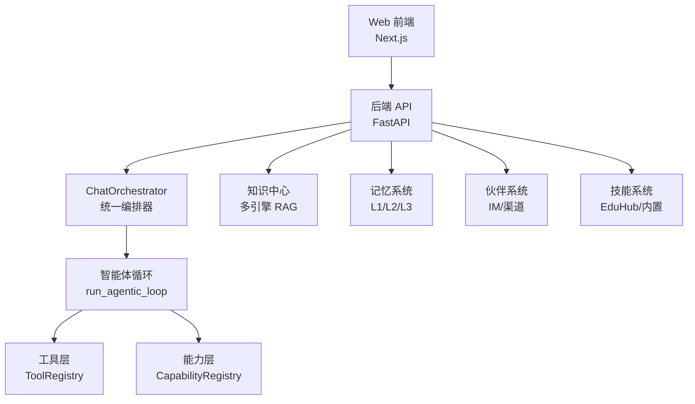
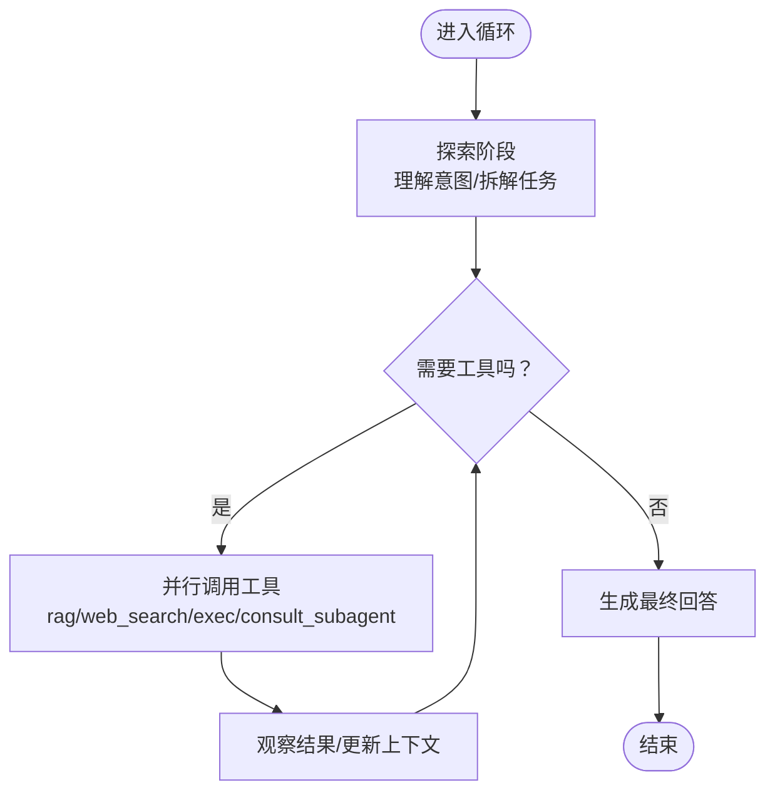
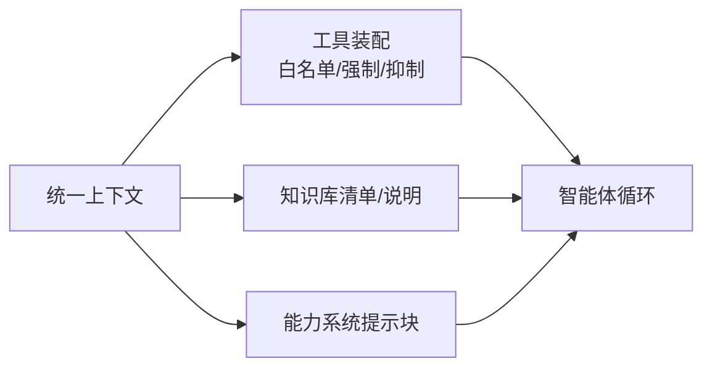
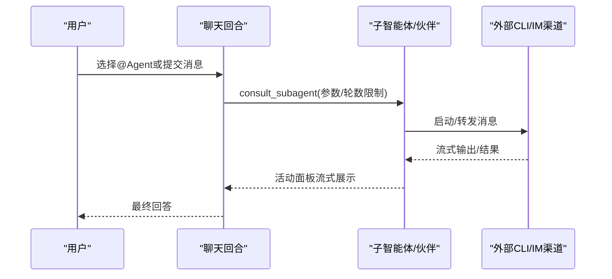
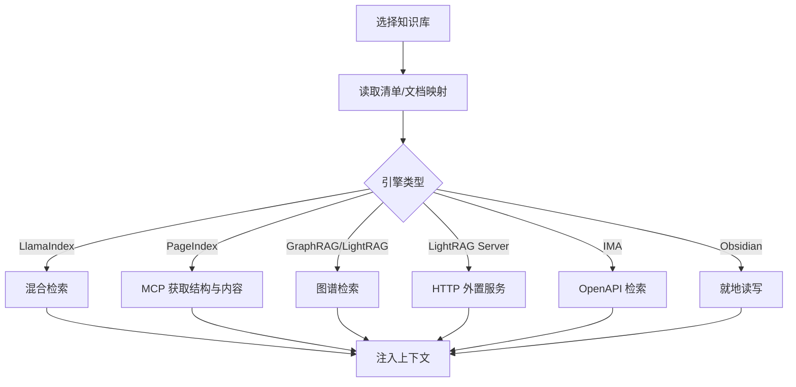
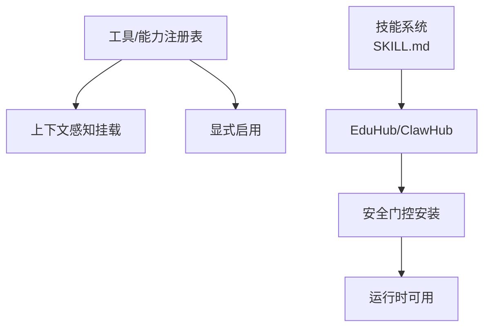
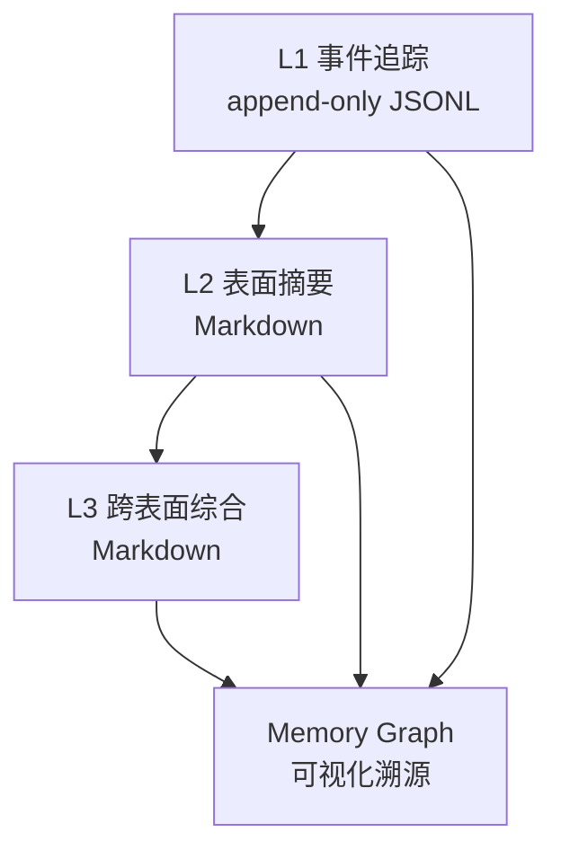
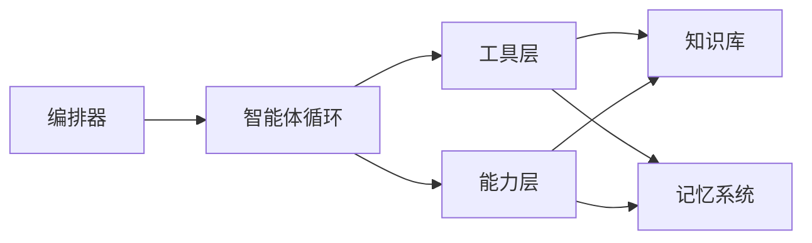

# 核心特性概览

<cite>
**本文引用的文件**
- [README.md](file://README.md)
- [AGENTS.md](file://AGENTS.md)
- [agentic_pipeline.py](file://deeptutor/agents/chat/agentic_pipeline.py)
- [chat_agent.py](file://deeptutor/agents/chat/chat_agent.py)
- [__init__.py（智能体循环原语）](file://deeptutor/core/agentic/__init__.py)
- [__init__.py（记忆子系统）](file://deeptutor/services/memory/__init__.py)
- [SKILL.md](file://SKILL.md)
</cite>

## 目录
1. [简介](#简介)
2. [项目结构](#项目结构)
3. [核心组件](#核心组件)
4. [架构总览](#架构总览)
5. [详细组件分析](#详细组件分析)
6. [依赖关系分析](#依赖关系分析)
7. [性能考量](#性能考量)
8. [故障排查指南](#故障排查指南)
9. [结论](#结论)
10. [附录](#附录)

## 简介
DeepTutor 是一个“智能体原生”的学习工作区，将辅导、解题、出题、研究、可视化与掌握度练习统一在可扩展的框架中。其六大核心特性围绕“同一运行时、连接式上下文、子智能体与伙伴、多引擎知识库、可扩展工具与技能、可检查的记忆系统”展开，既保证端到端体验的一致性，又为扩展与定制提供清晰接口。

## 项目结构
- 前端 Next.js 应用位于 web/，后端 FastAPI 服务位于 deeptutor/api/，能力与智能体实现集中在 deeptutor/agents、deeptutor/capabilities、deeptutor/services 等模块。
- 统一的智能体循环与工具/能力注册机制贯穿 Chat、Solve、Research、Visualize、Mastery Path 等模式，确保“切换目标而非切换引擎”。
- 知识中心支持多种检索引擎（LlamaIndex、PageIndex、GraphRAG、LightRAG/LightRAG Server、IMA、Obsidian），并通过版本化索引与文档解析插件实现灵活接入。
- 记忆系统采用三层设计（L1 事件追踪、L2 表面摘要、L3 跨表面综合），并提供可视化的 Memory Graph 进行溯源。



图表来源
- [AGENTS.md:10-25](file://AGENTS.md#L10-L25)
- [README.md:189-198](file://README.md#L189-L198)

章节来源
- [README.md:189-198](file://README.md#L189-L198)
- [AGENTS.md:10-25](file://AGENTS.md#L10-L25)

## 核心组件
- 统一运行时的智能体循环：所有模式共享同一轮询式 LLM 循环，通过标签驱动的阶段（探索、检索、调用工具、最终回答）组织推理与执行。
- 连接的学习上下文：会话级上下文（模型、知识库、人格、语音等）与一次性引用（文件、历史、书籍、笔记、题库）共同构成跨工作流一致的输入。
- 子智能体与伙伴系统：可在任意回合咨询外部 CLI（Claude Code、Codex、Gemini、Kimi、opencode、MiMo）或已配置的伙伴；伙伴拥有独立灵魂、模型策略、库与记忆，并可通过 IM 渠道持久在线。
- 多引擎知识库：按引擎绑定知识库，支持本地向量+BM25、托管页面级检索、知识图谱检索、外部 LightRAG 服务、IMA 开放 API 以及 Obsidian 直读直写。
- 可扩展的工具与技能系统：内置工具、MCP 服务器、CLI 应用、图像/视频/语音生成模型，以及从 EduHub 安装的社区技能，均通过注册表动态挂载。
- 可检查的记忆系统：L1 追加式事件追踪、L2 表面事实摘要、L3 跨表面综合，配合 Memory Graph 可追溯任何合成断言到原始证据。

章节来源
- [README.md:189-198](file://README.md#L189-L198)
- [README.md:468-487](file://README.md#L468-L487)
- [README.md:491-528](file://README.md#L491-L528)
- [README.md:569-583](file://README.md#L569-L583)
- [README.md:585-600](file://README.md#L585-L600)
- [README.md:602-617](file://README.md#L602-L617)

## 架构总览
DeepTutor 以“入口点 → 编排器 → 工具/能力注册表 → 具体能力”的分层架构组织请求。所有能力通过统一的 StreamBus 输出事件，编排器负责路由与收敛。

```mermaid
sequenceDiagram
participant Client as "客户端"
participant API as "后端 API"
participant Orchestrator as "ChatOrchestrator"
participant Loop as "智能体循环"
participant Tools as "工具层"
participant KB as "知识库"
participant Memory as "记忆系统"
Client->>API : 发送消息/能力请求
API->>Orchestrator : 构建统一上下文
Orchestrator->>Loop : 启动单循环
Loop->>Tools : 按需调用工具rag/web_search/exec/consult_subagent 等
Tools->>KB : 检索/读取文档
Tools->>Memory : 读取/写入记忆
Loop-->>Client : 流式阶段标签探索/检索/工具调用/最终回答
```

图表来源
- [AGENTS.md:10-25](file://AGENTS.md#L10-L25)
- [README.md:468-487](file://README.md#L468-L487)

章节来源
- [AGENTS.md:10-25](file://AGENTS.md#L10-L25)
- [README.md:468-487](file://README.md#L468-L487)

## 详细组件分析

### 特性一：统一运行时的智能体循环
- 工作原理：基于标签驱动的 LLM 循环，将一轮对话拆分为“探索→检索→工具调用→最终回答”，当模型停止调用工具时即视为答案完成。循环内支持并行工具执行、预算控制与快速终止路径。
- 使用场景：聊天、解题、研究、可视化、掌握度练习等模式共用同一循环，用户只需切换目标而不更换引擎。
- 技术实现：核心原语暴露 run_agentic_loop、run_labeled_step、dispatch_tool_calls 等；能力通过系统提示块、预循环种子与专属工具注入行为。



图表来源
- [__init__.py（智能体循环原语）:1-19](file://deeptutor/core/agentic/__init__.py#L1-L19)
- [README.md:468-487](file://README.md#L468-L487)

章节来源
- [__init__.py（智能体循环原语）:1-19](file://deeptutor/core/agentic/__init__.py#L1-L19)
- [README.md:468-487](file://README.md#L468-L487)

### 特性二：连接的学习上下文
- 工作原理：会话级“粘性上下文”（子智能体、知识库、人格、模型、语音）持久存在于组合器工具栏；一次性引用（文件、历史、书籍、笔记、题库）通过“+”菜单在单回合生效。
- 使用场景：跨工作流保持一致的知识与偏好，使聊天、Co-Writer、Book、Partners 都能复用相同资源。
- 技术实现：编排器在每回合组装系统提示块与工具白名单，并根据是否处于“独占能力”决定替换或叠加工具集；同时准备知识库清单与 PageIndex 文档映射，保持提示稳定。



图表来源
- [agentic_pipeline.py:607-656](file://deeptutor/agents/chat/agentic_pipeline.py#L607-L656)
- [agentic_pipeline.py:1405-1506](file://deeptutor/agents/chat/agentic_pipeline.py#L1405-L1506)

章节来源
- [agentic_pipeline.py:607-656](file://deeptutor/agents/chat/agentic_pipeline.py#L607-L656)
- [agentic_pipeline.py:1405-1506](file://deeptutor/agents/chat/agentic_pipeline.py#L1405-L1506)
- [README.md:468-487](file://README.md#L468-L487)

### 特性三：子智能体和伙伴系统
- 工作原理：子智能体可在任意回合被咨询，实际运行外部 CLI 或伙伴，并将工作流流式回传到活动面板；伙伴拥有独立灵魂、模型策略、库与记忆，并通过 IM 渠道持久在线。
- 使用场景：在聊天中直接调用 Claude Code/Codex/Gemini/Kimi/opencode/MiMo，或将已有对话导入为可搜索、可恢复的智能体；伙伴可作为“有个性与电话号码的聊天”。
- 技术实现：通过 consult_subagent 工具与伙伴专用工具集（partner_*）挂载；伙伴转由合成用户作用域执行，但权限沿 owner 元数据传递，读写记忆遵循“读主记、写自记”的隔离策略。



图表来源
- [README.md:491-528](file://README.md#L491-L528)
- [agentic_pipeline.py:459-474](file://deeptutor/agents/chat/agentic_pipeline.py#L459-L474)

章节来源
- [README.md:491-528](file://README.md#L491-L528)
- [agentic_pipeline.py:459-474](file://deeptutor/agents/chat/agentic_pipeline.py#L459-L474)

### 特性四：多引擎知识库
- 工作原理：每个知识库绑定一个检索引擎，支持 LlamaIndex（默认）、PageIndex（托管、页面级引用）、GraphRAG/LightRAG（知识图谱）、LightRAG Server（HTTP 外置服务）、腾讯 IMA（OpenAPI 检索）、Obsidian（就地读写）。
- 使用场景：为聊天、Co-Writer、Book、Partners 提供一致的知识基础；支持增量添加、版本化重建、错误状态单文档移除。
- 技术实现：每回合读取知识库清单与文档映射，渲染系统提示中的“知识库说明”；PageIndex 通过 MCP 工具获取结构与内容；RAG 工具根据所选 KB 执行混合检索。



图表来源
- [README.md:569-583](file://README.md#L569-L583)
- [agentic_pipeline.py:1405-1506](file://deeptutor/agents/chat/agentic_pipeline.py#L1405-L1506)
- [chat_agent.py:174-203](file://deeptutor/agents/chat/chat_agent.py#L174-L203)

章节来源
- [README.md:569-583](file://README.md#L569-L583)
- [agentic_pipeline.py:1405-1506](file://deeptutor/agents/chat/agentic_pipeline.py#L1405-L1506)
- [chat_agent.py:174-203](file://deeptutor/agents/chat/chat_agent.py#L174-L203)

### 特性五：可扩展的工具和技能系统
- 工作原理：工具通过 ToolRegistry 注册并按上下文自动挂载或显式启用；技能以 Agent-Skills 格式（SKILL.md + 参考文件）组织，可从 EduHub 安装并在安全门控后落地。
- 使用场景：内置工具（rag、web_search、reason、exec 等）、MCP 服务器、CLI 应用、图像/视频/语音生成模型；用户可发布/安装社区技能，形成生态。
- 技术实现：能力可声明 owned_tools 与 system_block；工具层懒加载导出；技能安装经过安全校验（后缀白名单、去 always、来源锁定）。



图表来源
- [SKILL.md:86-96](file://SKILL.md#L86-L96)
- [README.md:585-600](file://README.md#L585-L600)
- [agentic_pipeline.py:639-656](file://deeptutor/agents/chat/agentic_pipeline.py#L639-L656)

章节来源
- [SKILL.md:86-96](file://SKILL.md#L86-L96)
- [README.md:585-600](file://README.md#L585-L600)
- [agentic_pipeline.py:639-656](file://deeptutor/agents/chat/agentic_pipeline.py#L639-L656)

### 特性六：可检查的记忆系统
- 工作原理：三层记忆——L1 追加式事件追踪（trace/<surface>/<date>.jsonl）、L2 表面事实摘要（L2/<surface>.md）、L3 跨表面综合（L3/*.md）。L2 引用 L1，L3 引用 L2，形成可审计的证据链。
- 使用场景：个性化画像、近期偏好、范围与主题偏好等；支持查看、编辑、清理与审计。
- 技术实现：通过 MemoryStore 门面访问；consolidator 驱动 L1→L2、L2→L3 操作；Memory Graph 可视化金字塔结构，便于溯源。



图表来源
- [README.md:602-617](file://README.md#L602-L617)
- [__init__.py（记忆子系统）:1-13](file://deeptutor/services/memory/__init__.py#L1-L13)

章节来源
- [README.md:602-617](file://README.md#L602-L617)
- [__init__.py（记忆子系统）:1-13](file://deeptutor/services/memory/__init__.py#L1-L13)

## 依赖关系分析
- 编排器依赖智能体循环原语与工具/能力注册表；能力通过系统提示块与专属工具影响循环行为。
- 知识库通过 RAG 工具与 MCP 工具注入上下文；记忆系统通过工具与能力钩子参与上下文与总结。
- 伙伴系统复用同一循环，但以合成用户作用域执行，权限与资源隔离通过元数据与路径服务实现。



图表来源
- [AGENTS.md:10-25](file://AGENTS.md#L10-L25)
- [README.md:189-198](file://README.md#L189-L198)

章节来源
- [AGENTS.md:10-25](file://AGENTS.md#L10-L25)
- [README.md:189-198](file://README.md#L189-L198)

## 性能考量
- 智能体循环支持并行工具调用与预算控制，避免无界重试；对空查询与占位符进行拒绝以减少无效往返。
- 知识库清单与 PageIndex 文档映射在每回合只读取一次，保持系统提示字节稳定，减少重复开销。
- 记忆系统采用文件存储与追加式追踪，避免隐藏向量库带来的不可控成本；合并过程受预算约束（Update/Audit/Dedup）。
- 部署形态下（Docker/Compose）建议合理配置端口与代理，避免不必要的网络往返；必要时使用 LightRAG Server 将检索卸载至外部实例。

[本节为通用指导，不直接分析具体文件]

## 故障排查指南
- 若 RAG 检索失败：检查所选知识库是否有效、解析引擎是否配置正确、文档是否存在错误状态；可尝试移除问题文档并重建索引。
- 若工具调用卡住：确认工具沙箱与 exec 开关、MCP 服务可达性；必要时降低并发或关闭非必需工具。
- 若伙伴无法响应：检查 IM 渠道配置与凭据、通道监听端口；确认合成用户作用域的权限与 owner 元数据是否正确传递。
- 若记忆图异常：核对 L1 追踪文件是否完整、L2/L3 是否被误删；可通过 CLI 清理特定表面或全部 L1，再触发合并。

章节来源
- [README.md:569-583](file://README.md#L569-L583)
- [README.md:602-617](file://README.md#L602-L617)
- [agentic_pipeline.py:1405-1506](file://deeptutor/agents/chat/agentic_pipeline.py#L1405-L1506)

## 结论
DeepTutor 通过统一智能体循环、连接式上下文、子智能体与伙伴、多引擎知识库、可扩展工具与技能、可检查记忆系统，构建了端到端的智能辅导体验。各特性协同工作，既能满足日常学习与创作需求，又为扩展与定制提供了清晰的接口与生态支撑。

[本节为总结，不直接分析具体文件]

## 附录
- 快速上手：推荐使用 Web 应用，完成初始化后通过 Settings 配置模型与知识库；或使用 CLI 进行脚本化与自动化。
- 典型工作流：聊天结合 RAG 与网页搜索；创建知识库并用于 Co-Writer 编辑；通过 Book 将资料编译为交互式学习材料；使用 Mastery Path 进行掌握度练习。
- 扩展建议：优先通过能力系统注入新工具与系统提示块；通过技能系统引入社区能力；通过伙伴系统集成 IM 渠道与外部智能体。

[本节为补充信息，不直接分析具体文件]