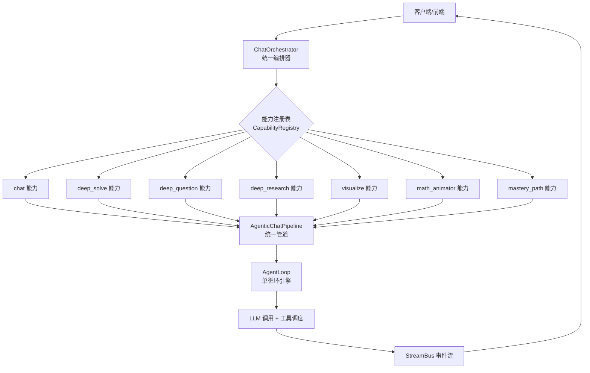
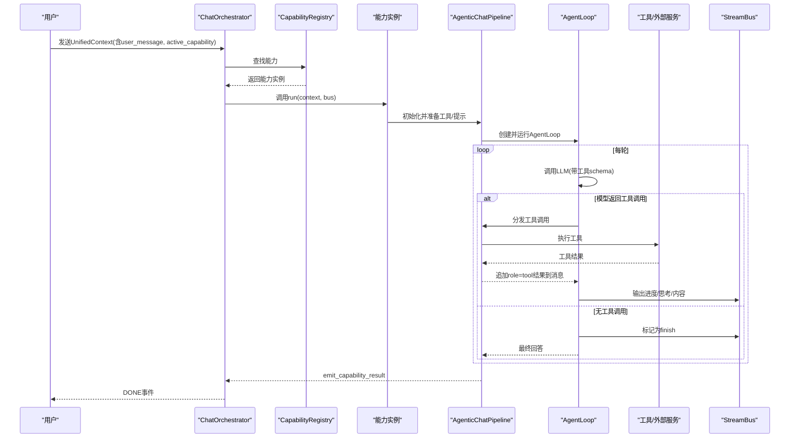
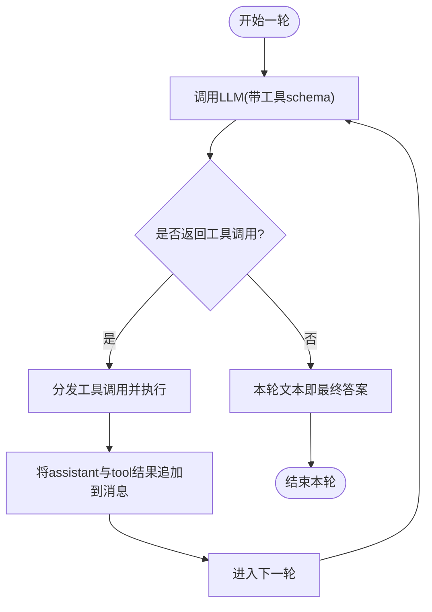
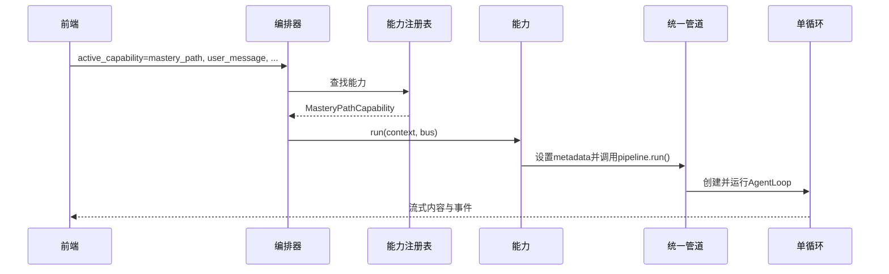
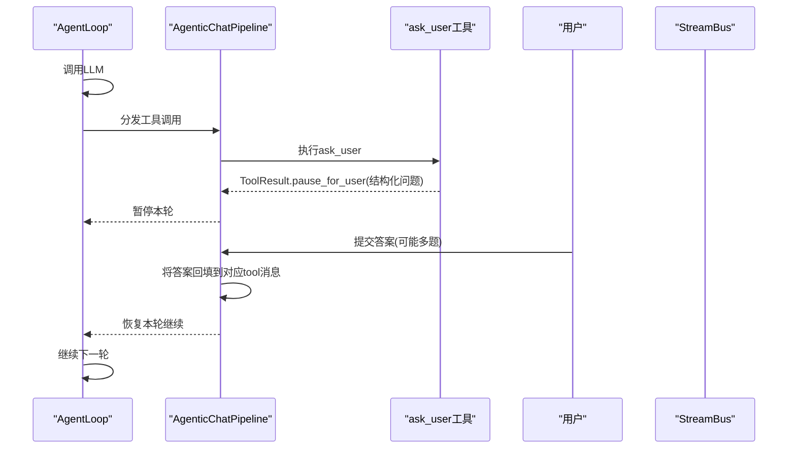
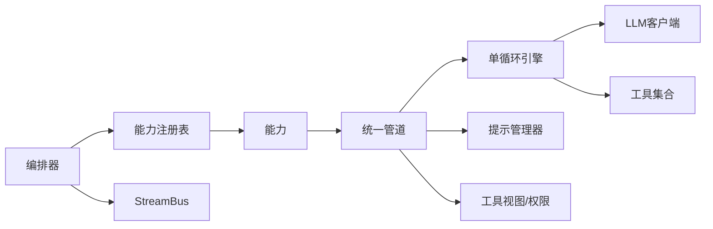

# 统一运行时的智能体循环

<cite>
**本文引用的文件**
- [orchestrator.py](file://deeptutor/runtime/orchestrator.py)
- [capability_registry.py](file://deeptutor/runtime/registry/capability_registry.py)
- [builtin_capabilities.py](file://deeptutor/runtime/bootstrap/builtin_capabilities.py)
- [agentic_pipeline.py](file://deeptutor/agents/chat/agentic_pipeline.py)
- [agent_loop.py](file://deeptutor/agents/chat/agent_loop.py)
- [context.py](file://deeptutor/core/context.py)
- [ask_user.py](file://deeptutor/tools/ask_user.py)
- [mastery capability.py](file://deeptutor/capabilities/mastery/capability.py)
- [mastery loop hooks](file://deeptutor/capabilities/mastery/loop.py)
- [question pipeline.py](file://deeptutor/agents/question/pipeline.py)
</cite>

## 目录

1. [简介](#简介)
2. [项目结构](#项目结构)
3. [核心组件](#核心组件)
4. [架构总览](#架构总览)
5. [详细组件分析](#详细组件分析)
6. [依赖关系分析](#依赖关系分析)
7. [性能考量](#性能考量)
8. [故障排查指南](#故障排查指南)
9. [结论](#结论)
10. [附录](#附录)

## 简介

本文件面向DeepTutor的统一运行时“单一智能体循环”，解释它如何以同一套探索-响应双阶段机制，支撑聊天、测验、研究、可视化、问题解决与掌握路径等多种模式。文档重点说明：

- 一轮用户请求如何在统一编排下进入能力路由，再进入统一的AgentLoop；
- 智能体的思考轮次、工具调用、结果观察与最终消息生成的完整流程；
- 上下文管理、会话状态维护与跨模式上下文共享的实现细节；
- ask_user特殊机制如何实现结构化澄清问题并暂停/恢复本轮；
- 在不同模式间切换时，如何通过设置active_capability与metadata注入，而不改变底层引擎。

## 项目结构

DeepTutor将“能力（Capability）”作为模式入口，由运行时编排器根据上下文中的active_capability选择具体能力；大多数能力复用统一的AgenticChatPipeline与AgentLoop，实现“一次对话、一个循环、多模式复用”。

图表来源

- [orchestrator.py:36-114](file://deeptutor/runtime/orchestrator.py#L36-L114)
- [capability_registry.py:39-115](file://deeptutor/runtime/registry/capability_registry.py#L39-L115)
- [builtin_capabilities.py:1-11](file://deeptutor/runtime/bootstrap/builtin_capabilities.py#L1-L11)
- [agentic_pipeline.py:185-346](file://deeptutor/agents/chat/agentic_pipeline.py#L185-L346)
- [agent_loop.py:151-227](file://deeptutor/agents/chat/agent_loop.py#L151-L227)

章节来源

- [orchestrator.py:36-114](file://deeptutor/runtime/orchestrator.py#L36-L114)
- [capability_registry.py:39-115](file://deeptutor/runtime/registry/capability_registry.py#L39-L115)
- [builtin_capabilities.py:1-11](file://deeptutor/runtime/bootstrap/builtin_capabilities.py#L1-L11)

## 核心组件

- ChatOrchestrator：统一入口，负责会话ID生成、能力路由、流式事件生命周期管理与完成事件发布。
- CapabilityRegistry：集中注册内置与插件能力，提供按名称获取能力实例的能力。
- AgenticChatPipeline：统一管道，负责系统提示组装、工具清单与权限裁剪、KB种子注入、消息构建、工具执行与上下文预算保护。
- AgentLoop：单循环引擎，驱动“思考-工具-观察-继续/结束”的迭代，支持ask_user暂停与强制收尾。
- UnifiedContext：贯穿全链路的上下文对象，承载会话、历史、工具开关、知识源、附件、语言、元数据等。
- ask_user工具：结构化澄清问题的载体，支持多问题、选项、自由文本，并在前端渲染交互卡片。

章节来源

- [orchestrator.py:26-147](file://deeptutor/runtime/orchestrator.py#L26-L147)
- [capability_registry.py:39-115](file://deeptutor/runtime/registry/capability_registry.py#L39-L115)
- [agentic_pipeline.py:185-800](file://deeptutor/agents/chat/agentic_pipeline.py#L185-L800)
- [agent_loop.py:151-714](file://deeptutor/agents/chat/agent_loop.py#L151-L714)
- [context.py:15-85](file://deeptutor/core/context.py#L15-L85)
- [ask_user.py:1-274](file://deeptutor/tools/ask_user.py#L1-L274)

## 架构总览

统一运行时通过“能力路由 + 统一管道 + 单循环引擎”解耦了模式差异与执行细节。不同模式只需在上下文中声明active_capability与必要metadata，即可复用同一套循环与工具生态。

图表来源

- [orchestrator.py:36-114](file://deeptutor/runtime/orchestrator.py#L36-L114)
- [agentic_pipeline.py:326-346](file://deeptutor/agents/chat/agentic_pipeline.py#L326-L346)
- [agent_loop.py:234-357](file://deeptutor/agents/chat/agent_loop.py#L234-L357)

## 详细组件分析

### 统一编排器与能力路由

- 若未指定active_capability，则默认使用chat能力；否则从注册表中解析对应能力。
- 每个turn会分配或沿用session_id，并通过StreamBus进行流式事件广播。
- 能力执行完成后，发布CAPABILITY_COMPLETE事件，便于上层统计与追踪。

章节来源

- [orchestrator.py:36-114](file://deeptutor/runtime/orchestrator.py#L36-L114)
- [capability_registry.py:49-84](file://deeptutor/runtime/registry/capability_registry.py#L49-L84)
- [builtin_capabilities.py:1-11](file://deeptutor/runtime/bootstrap/builtin_capabilities.py#L1-L11)

### 统一管道：提示、工具与上下文预算

- 系统提示与用户消息由ChatPromptAssembler拼装，包含工具清单、知识库摘要、工作区提示、能力专属块等。
- 工具清单基于用户开关、能力自有工具、外部提供者（MCP/CLI）延迟加载与授权过滤后合成。
- 每次LLM调用前检查上下文窗口，必要时折叠历史或截断工具结果片段，避免溢出。
- 支持多模态附件注入，自动适配不同绑定与模型能力。

章节来源

- [agentic_pipeline.py:350-416](file://deeptutor/agents/chat/agentic_pipeline.py#L350-L416)
- [agentic_pipeline.py:473-528](file://deeptutor/agents/chat/agentic_pipeline.py#L473-L528)
- [agentic_pipeline.py:586-624](file://deeptutor/agents/chat/agentic_pipeline.py#L586-L624)
- [agentic_pipeline.py:699-738](file://deeptutor/agents/chat/agentic_pipeline.py#L699-L738)

### 单循环引擎：探索-响应双阶段机制

- 一轮即一个AgentLoop，内部循环多次LLM调用：
  - 有工具调用：视为“探索/叙述”，将assistant消息与tool结果追加进消息列表，继续下一轮；
  - 无工具调用：视为“响应/结束”，该轮文本即最终答案。
- 当达到最大轮数仍持续请求工具时，强制发起一轮“无工具”的收尾回答。
- 支持“仅推理无动作”的兜底策略：若某轮只产出内部推理，会追加提示让模型继续行动或给出最终答案。

图表来源

- [agent_loop.py:234-357](file://deeptutor/agents/chat/agent_loop.py#L234-L357)
- [agent_loop.py:379-434](file://deeptutor/agents/chat/agent_loop.py#L379-L434)

章节来源

- [agent_loop.py:151-227](file://deeptutor/agents/chat/agent_loop.py#L151-L227)
- [agent_loop.py:234-434](file://deeptutor/agents/chat/agent_loop.py#L234-L434)

### 上下文管理与跨模式共享

- UnifiedContext承载会话ID、历史消息、工具开关、知识源、附件、语言、元数据等，贯穿编排器、能力、管道与循环。
- 能力可通过metadata注入模式信息（如mastery_mode），管道据此挂载能力专属工具与系统提示块，从而实现“同引擎、多模式”。
- 会话级conversation_history在管道中作为消息序列累积，保证上下文连贯性；同时支持压缩摘要作为system消息插入，提升长对话效率。

章节来源

- [context.py:15-85](file://deeptutor/core/context.py#L15-L85)
- [agentic_pipeline.py:374-416](file://deeptutor/agents/chat/agentic_pipeline.py#L374-L416)
- [mastery capability.py:69-73](file://deeptutor/capabilities/mastery/capability.py#L69-L73)

### 模式切换示例：不改变底层引擎

- 聊天模式：active_capability为空或"chat"，走默认聊天能力。
- 掌握路径模式：active_capability="mastery_path"，能力将设置metadata并复用统一管道。
- 其他模式（测验、研究、可视化、解题等）同理：在上下文中设置active_capability，能力内部按需注入工具与提示，底层循环不变。

图表来源

- [orchestrator.py:36-114](file://deeptutor/runtime/orchestrator.py#L36-L114)
- [capability_registry.py:49-84](file://deeptutor/runtime/registry/capability_registry.py#L49-L84)
- [mastery capability.py:69-73](file://deeptutor/capabilities/mastery/capability.py#L69-L73)
- [agentic_pipeline.py:326-346](file://deeptutor/agents/chat/agentic_pipeline.py#L326-L346)

章节来源

- [mastery capability.py:69-73](file://deeptutor/capabilities/mastery/capability.py#L69-L73)
- [builtin_capabilities.py:1-11](file://deeptutor/runtime/bootstrap/builtin_capabilities.py#L1-L11)

### ask_user特殊机制：结构化澄清问题

- ask_user工具将1至4个结构化问题打包为payload，附带选项、自由文本、占位符等，前端渲染为可交互卡片。
- 当模型调用ask_user时，本轮暂停，等待用户提交答案；管道将用户答案回填到对应的tool消息中，继续协议内流程。
- 若用户放弃或未回答，本轮以未完成状态结束，保持上下文一致。

图表来源

- [agent_loop.py:328-340](file://deeptutor/agents/chat/agent_loop.py#L328-L340)
- [agentic_pipeline.py:883-914](file://deeptutor/agents/chat/agentic_pipeline.py#L883-L914)
- [ask_user.py:1-274](file://deeptutor/tools/ask_user.py#L1-L274)

章节来源

- [ask_user.py:1-274](file://deeptutor/tools/ask_user.py#L1-L274)
- [agentic_pipeline.py:883-914](file://deeptutor/agents/chat/agentic_pipeline.py#L883-L914)
- [agent_loop.py:328-340](file://deeptutor/agents/chat/agent_loop.py#L328-L340)

### 探索-响应双阶段循环在测验/研究等模式中的体现

- 某些模式（如测验生成）采用显式的Phase 1 Explore + Phase 2 Plan/Quiz流程，Explore阶段对工具结果进行压缩摘要，减少后续阶段负载。
- 尽管这些模式有自己的管线，但底层仍遵循“工具调用→结果观察→继续/结束”的通用循环思想，确保学习上下文在用户工作流中保持一致。

章节来源

- [question pipeline.py:604-623](file://deeptutor/agents/question/pipeline.py#L604-L623)
- [question pipeline.py:1975-1984](file://deeptutor/agents/question/pipeline.py#L1975-L1984)

## 依赖关系分析

- 编排器依赖能力注册表与工具注册表，负责生命周期与事件。
- 能力通过统一管道装配提示与工具，管道依赖LLM配置、提示管理器、工具视图与权限策略。
- 单循环引擎依赖管道提供的消息构建、工具分发与上下文预算保护，同时向StreamBus输出事件。
- 各模式能力通过metadata与系统提示块注入差异化行为，但不侵入循环核心逻辑。

图表来源

- [orchestrator.py:36-114](file://deeptutor/runtime/orchestrator.py#L36-L114)
- [capability_registry.py:39-115](file://deeptutor/runtime/registry/capability_registry.py#L39-L115)
- [agentic_pipeline.py:185-346](file://deeptutor/agents/chat/agentic_pipeline.py#L185-L346)
- [agent_loop.py:151-227](file://deeptutor/agents/chat/agent_loop.py#L151-L227)

章节来源

- [orchestrator.py:36-114](file://deeptutor/runtime/orchestrator.py#L36-L114)
- [capability_registry.py:39-115](file://deeptutor/runtime/registry/capability_registry.py#L39-L115)
- [agentic_pipeline.py:185-346](file://deeptutor/agents/chat/agentic_pipeline.py#L185-L346)
- [agent_loop.py:151-227](file://deeptutor/agents/chat/agent_loop.py#L151-L227)

## 性能考量

- 轮次预算：默认最大轮数限制，防止无限循环；达到上限时强制收尾。
- 上下文窗口保护：每次LLM调用前检查窗口，必要时折叠历史或截断工具结果片段。
- 工具结果压缩：在探索阶段对工具结果进行摘要，降低后续阶段负载。
- 多模态降级：当模型不支持图像输入时，自动降级为纯文本。
- 原生工具调用回退：当提供商拒绝工具schema时，自动回退到非原生调用。

章节来源

- [agentic_pipeline.py:100-103](file://deeptutor/agents/chat/agentic_pipeline.py#L100-L103)
- [agent_loop.py:248-257](file://deeptutor/agents/chat/agent_loop.py#L248-L257)
- [agent_loop.py:438-494](file://deeptutor/agents/chat/agent_loop.py#L438-L494)
- [agent_loop.py:639-689](file://deeptutor/agents/chat/agent_loop.py#L639-L689)

## 故障排查指南

- 未知能力：检查active_capability是否正确，确认注册表已加载内置或插件能力。
- 工具不可用：检查工具白名单、权限过滤与提供者配置；确认延迟加载的工具已可用。
- ask_user未恢复：确认前端正确回填答案到对应tool_call_id；若用户放弃，本轮将以未完成状态结束。
- 上下文溢出：检查消息长度与工具结果大小，必要时启用历史折叠或结果截断。
- 提供商兼容性问题：关注工具schema与流选项的回退日志，必要时调整模型或绑定。

章节来源

- [orchestrator.py:49-67](file://deeptutor/runtime/orchestrator.py#L49-L67)
- [agentic_pipeline.py:473-528](file://deeptutor/agents/chat/agentic_pipeline.py#L473-L528)
- [agent_loop.py:260-272](file://deeptutor/agents/chat/agent_loop.py#L260-L272)
- [agent_loop.py:639-689](file://deeptutor/agents/chat/agent_loop.py#L639-L689)

## 结论

DeepTutor通过“能力路由 + 统一管道 + 单循环引擎”的设计，实现了多模式下的统一运行时。无论聊天、测验、研究、可视化、问题解决还是掌握路径，都复用同一套探索-响应双阶段循环，确保学习上下文在用户工作流中保持一致性。ask_user机制提供了结构化澄清能力，使复杂任务能在人机协作中稳步推进。通过上下文与元数据的灵活注入，模式切换无需改动底层引擎，提升了系统的可扩展性与可维护性。

## 附录

- 关键概念速查：
  - 统一上下文：承载会话、历史、工具开关、知识源、附件、语言与元数据。
  - 能力：模式入口，决定工具与提示的差异化行为。
  - 统一管道：提示组装、工具装配、上下文预算保护。
  - 单循环引擎：思考-工具-观察-继续/结束的迭代。
  - ask_user：结构化澄清问题，暂停/恢复本轮。

[本节为概念性总结，不直接分析具体文件]
