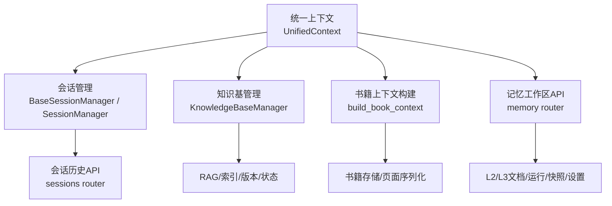
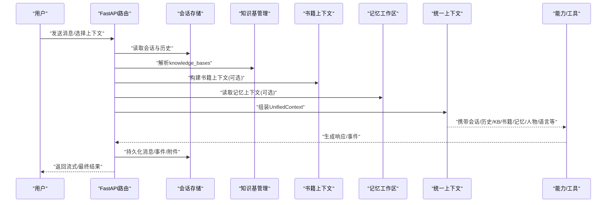
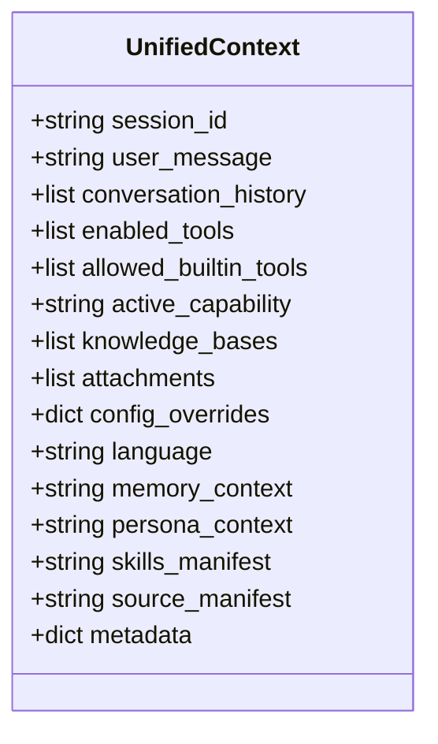
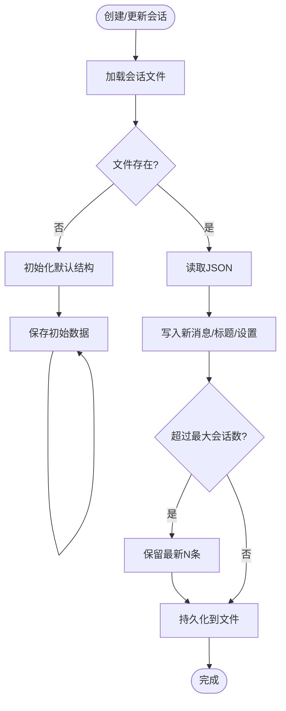
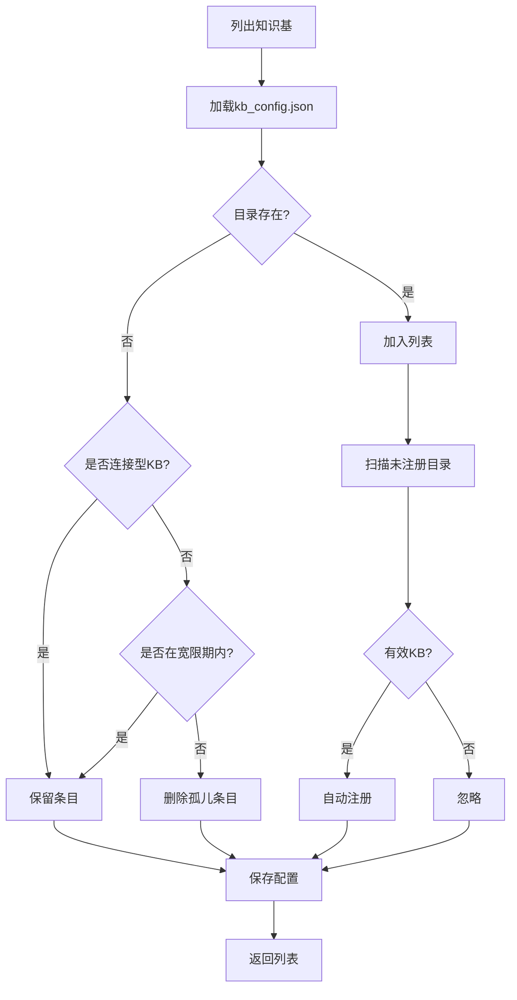
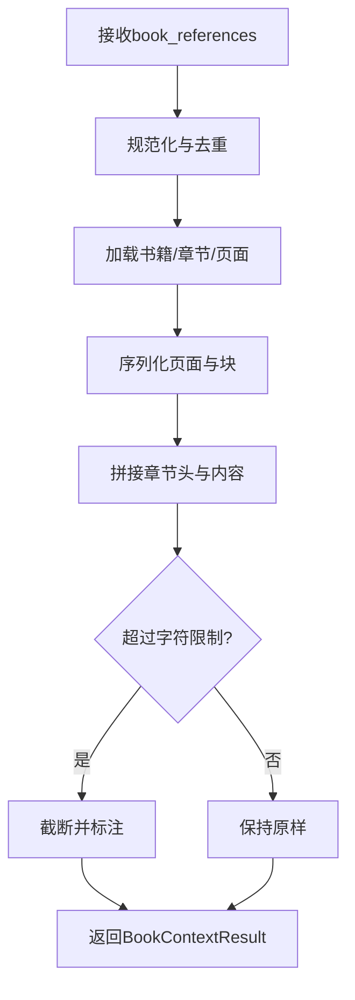
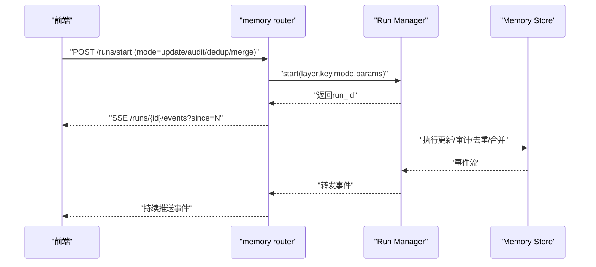
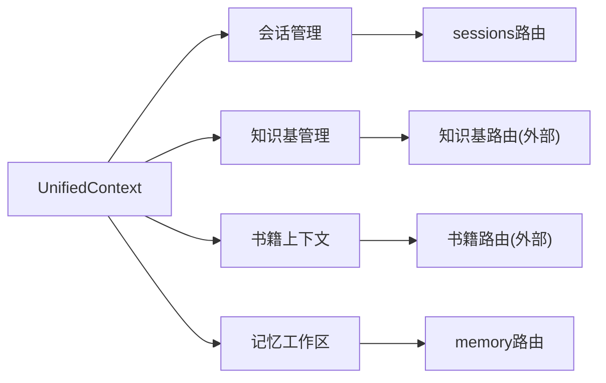

# 连接的学习上下文

<cite>
**本文引用的文件**
- [deeptutor/core/context.py](file://deeptutor/core/context.py)
- [deeptutor/knowledge/manager.py](file://deeptutor/knowledge/manager.py)
- [deeptutor/book/context.py](file://deeptutor/book/context.py)
- [deeptutor/agents/chat/session_manager.py](file://deeptutor/agents/chat/session_manager.py)
- [deeptutor/services/session/base_session_manager.py](file://deeptutor/services/session/base_session_manager.py)
- [deeptutor/api/routers/sessions.py](file://deeptutor/api/routers/sessions.py)
- [deeptutor/api/routers/memory.py](file://deeptutor/api/routers/memory.py)
</cite>

## 目录
1. [简介](#简介)
2. [项目结构](#项目结构)
3. [核心组件](#核心组件)
4. [架构总览](#架构总览)
5. [详细组件分析](#详细组件分析)
6. [依赖关系分析](#依赖关系分析)
7. [性能考量](#性能考量)
8. [故障排查指南](#故障排查指南)
9. [结论](#结论)
10. [附录](#附录)

## 简介
本文件面向 DeepTutor 的“连接的学习上下文”系统，系统性说明知识库、书籍、协作写作、笔记本、问题库、人物设定与记忆如何在聊天、研究、可视化等模式中保持可用，并解释：
- 粘性会话上下文（子智能体、知识库、人物、模型、语音）与一次性引用（文件、聊天历史、书籍、笔记本、问题库、导入的智能体）的区别与使用场景。
- 上下文在不同功能模块间的传递与共享机制。
- 上下文的生命周期管理与资源清理策略。
- 该设计如何为用户提供连贯的学习体验。

## 项目结构
DeepTutor 将“上下文”抽象为统一的运行时数据对象，贯穿编排器、工具、能力与插件调用；同时通过会话管理、知识基管理、书籍上下文构建、记忆工作区等子系统实现持久化与跨模块共享。

图表来源
- [deeptutor/core/context.py:33-84](file://deeptutor/core/context.py#L33-L84)
- [deeptutor/services/session/base_session_manager.py:23-146](file://deeptutor/services/session/base_session_manager.py#L23-L146)
- [deeptutor/agents/chat/session_manager.py:20-176](file://deeptutor/agents/chat/session_manager.py#L20-L176)
- [deeptutor/knowledge/manager.py:244-800](file://deeptutor/knowledge/manager.py#L244-L800)
- [deeptutor/book/context.py:28-139](file://deeptutor/book/context.py#L28-L139)
- [deeptutor/api/routers/memory.py:84-156](file://deeptutor/api/routers/memory.py#L84-L156)

章节来源
- [deeptutor/core/context.py:33-84](file://deeptutor/core/context.py#L33-L84)
- [deeptutor/services/session/base_session_manager.py:23-146](file://deeptutor/services/session/base_session_manager.py#L23-L146)
- [deeptutor/agents/chat/session_manager.py:20-176](file://deeptutor/agents/chat/session_manager.py#L20-L176)
- [deeptutor/knowledge/manager.py:244-800](file://deeptutor/knowledge/manager.py#L244-L800)
- [deeptutor/book/context.py:28-139](file://deeptutor/book/context.py#L28-L139)
- [deeptutor/api/routers/memory.py:84-156](file://deeptutor/api/routers/memory.py#L84-L156)

## 核心组件
- 统一上下文 UnifiedContext：承载一次用户交互所需的全部信息，包括会话ID、消息、历史、启用工具、内置工具白名单、激活能力、知识库列表、附件、配置覆盖、语言、记忆上下文、人物上下文、技能清单、源清单与元数据。
- 会话管理器 BaseSessionManager/SessionManager：提供跨模块一致的会话创建、更新、消息追加、列举、删除与限制策略。
- 知识基管理 KnowledgeBaseManager：注册、发现、状态同步、嵌入指纹对齐、连接型KB（Obsidian、链接索引、子智能体）指针管理。
- 书籍上下文 build_book_context：将选中的书籍页面序列化为紧凑的LLM上下文，支持截断与警告。
- 记忆工作区 memory router：提供L2/L3文档读写、运行（更新/审计/去重/合并）、快照、设置与追踪浏览。

章节来源
- [deeptutor/core/context.py:33-84](file://deeptutor/core/context.py#L33-L84)
- [deeptutor/services/session/base_session_manager.py:23-146](file://deeptutor/services/session/base_session_manager.py#L23-L146)
- [deeptutor/agents/chat/session_manager.py:20-176](file://deeptutor/agents/chat/session_manager.py#L20-L176)
- [deeptutor/knowledge/manager.py:244-800](file://deeptutor/knowledge/manager.py#L244-L800)
- [deeptutor/book/context.py:28-139](file://deeptutor/book/context.py#L28-L139)
- [deeptutor/api/routers/memory.py:84-156](file://deeptutor/api/routers/memory.py#L84-L156)

## 架构总览
下图展示“连接的学习上下文”在请求生命周期中的流转：前端发起请求后，后端根据会话ID加载会话历史与偏好，组装 UnifiedContext，注入知识库、书籍、记忆、人物等上下文片段，驱动各能力（聊天、研究、可视化、问题库等），并将结果写回会话与相关存储。

图表来源
- [deeptutor/api/routers/sessions.py:80-140](file://deeptutor/api/routers/sessions.py#L80-L140)
- [deeptutor/knowledge/manager.py:515-600](file://deeptutor/knowledge/manager.py#L515-L600)
- [deeptutor/book/context.py:91-139](file://deeptutor/book/context.py#L91-L139)
- [deeptutor/api/routers/memory.py:140-156](file://deeptutor/api/routers/memory.py#L140-L156)
- [deeptutor/core/context.py:33-84](file://deeptutor/core/context.py#L33-L84)

## 详细组件分析

### 统一上下文 UnifiedContext
- 职责：作为单次用户交互的“上下文包”，包含会话标识、消息、历史、工具开关、能力、知识库、附件、配置覆盖、语言、记忆与人物上下文、技能清单、源清单与扩展元数据。
- 设计要点：
  - 会话级持久化：session_id 用于关联会话历史与设置。
  - 能力级裁剪：active_capability 决定当前能力域。
  - RAG 接入：knowledge_bases 指定检索范围。
  - 多模态输入：attachments 承载图片/文件/PDF等。
  - 可插拔提示：persona_context、memory_context、skills_manifest、source_manifest 以文本形式注入系统提示。
  - 扩展性：metadata 容纳能力特定扩展字段。

图表来源
- [deeptutor/core/context.py:33-84](file://deeptutor/core/context.py#L33-L84)

章节来源
- [deeptutor/core/context.py:33-84](file://deeptutor/core/context.py#L33-L84)

### 会话管理与持久化
- BaseSessionManager：提供跨模块一致的会话CRUD、消息追加、自动排序、最大会话数限制、路径服务延迟解析（支持多用户隔离）。
- SessionManager（聊天）：继承基础类，定义聊天前缀、默认标题、聊天专属数据结构与摘要。
- sessions 路由：提供会话列表、详情、重命名、删除、分支选择、按消息删除轮次、测验结果记录等接口；删除会话时联动清理附件。

图表来源
- [deeptutor/services/session/base_session_manager.py:56-146](file://deeptutor/services/session/base_session_manager.py#L56-L146)
- [deeptutor/agents/chat/session_manager.py:94-176](file://deeptutor/agents/chat/session_manager.py#L94-L176)
- [deeptutor/api/routers/sessions.py:80-163](file://deeptutor/api/routers/sessions.py#L80-L163)

章节来源
- [deeptutor/services/session/base_session_manager.py:23-257](file://deeptutor/services/session/base_session_manager.py#L23-L257)
- [deeptutor/agents/chat/session_manager.py:20-176](file://deeptutor/agents/chat/session_manager.py#L20-L176)
- [deeptutor/api/routers/sessions.py:80-163](file://deeptutor/api/routers/sessions.py#L80-L163)

### 知识基管理（知识库）
- 注册与发现：支持本地KB、Obsidian金库、链接索引、子智能体连接；自动发现未注册的KB目录并注册。
- 状态与版本：维护status、progress、embedding指纹、index_versions；对不匹配或需要重建的情况标记needs_reindex/embedding_mismatch。
- 安全与并发：原子写入配置、共享锁读取；处理孤儿条目与竞态窗口。
- 多用户与同步：可选PocketBase镜像，便于管理面板可见性与未来多用户访问。

图表来源
- [deeptutor/knowledge/manager.py:515-600](file://deeptutor/knowledge/manager.py#L515-L600)
- [deeptutor/knowledge/manager.py:244-340](file://deeptutor/knowledge/manager.py#L244-L340)

章节来源
- [deeptutor/knowledge/manager.py:244-800](file://deeptutor/knowledge/manager.py#L244-L800)

### 书籍上下文构建（书籍）
- 输入：book_references（书ID+页ID列表），支持去重与校验。
- 处理：加载书籍、章节、页面，按类型序列化块内容，拼接章节头与学习要点，控制字符上限。
- 输出：BookContextResult（text、references、warnings），供聊天/研究/可视化等能力复用。

图表来源
- [deeptutor/book/context.py:48-139](file://deeptutor/book/context.py#L48-L139)

章节来源
- [deeptutor/book/context.py:28-139](file://deeptutor/book/context.py#L28-L139)

### 记忆工作区（记忆）
- 文档层：L2（表面）与L3（槽位）文档的读/写/行号视图/重置/应用操作。
- 运行模式：update/audit/dedup/merge，支持预算、迭代、语言与LLM选择；通过run manager启动长任务，SSE事件回放。
- 快照：从工作区实时派生实体列表，跟踪pending changes，支持刷新与差异查看。
- 设置与追踪：获取/保存memory设置；分页浏览trace事件；清理trace或按天清理。

图表来源
- [deeptutor/api/routers/memory.py:308-453](file://deeptutor/api/routers/memory.py#L308-L453)
- [deeptutor/api/routers/memory.py:140-156](file://deeptutor/api/routers/memory.py#L140-L156)

章节来源
- [deeptutor/api/routers/memory.py:84-786](file://deeptutor/api/routers/memory.py#L84-L786)

### 上下文在不同功能模块间的传递与共享
- 聊天：通过会话历史与UnifiedContext注入知识库、书籍、记忆、人物、语言等；附件与源清单随消息传递。
- 研究：复用UnifiedContext中的knowledge_bases、memory_context、persona_context，结合书籍上下文进行深度探索。
- 可视化：基于书籍上下文与笔记/问题库结果，渲染可视化内容；必要时拉取记忆与工作区快照。
- 问题库：将测验结果写回会话，并可选择上写到笔记本条目，形成闭环。

章节来源
- [deeptutor/core/context.py:33-84](file://deeptutor/core/context.py#L33-L84)
- [deeptutor/book/context.py:91-139](file://deeptutor/book/context.py#L91-L139)
- [deeptutor/api/routers/sessions.py:199-231](file://deeptutor/api/routers/sessions.py#L199-L231)

## 依赖关系分析
- 低耦合高内聚：UnifiedContext作为单一数据载体，减少跨模块参数传递复杂度。
- 会话与存储解耦：BaseSessionManager抽象路径服务，支持多用户隔离与不同后端。
- 知识基与RAG解耦：通过provider与versioning管理，屏蔽底层索引差异。
- 记忆工作区独立：通过run manager与store分离任务调度与持久化。

图表来源
- [deeptutor/core/context.py:33-84](file://deeptutor/core/context.py#L33-L84)
- [deeptutor/services/session/base_session_manager.py:23-146](file://deeptutor/services/session/base_session_manager.py#L23-L146)
- [deeptutor/knowledge/manager.py:244-800](file://deeptutor/knowledge/manager.py#L244-L800)
- [deeptutor/book/context.py:28-139](file://deeptutor/book/context.py#L28-L139)
- [deeptutor/api/routers/memory.py:84-156](file://deeptutor/api/routers/memory.py#L84-L156)

章节来源
- [deeptutor/core/context.py:33-84](file://deeptutor/core/context.py#L33-L84)
- [deeptutor/services/session/base_session_manager.py:23-146](file://deeptutor/services/session/base_session_manager.py#L23-L146)
- [deeptutor/knowledge/manager.py:244-800](file://deeptutor/knowledge/manager.py#L244-L800)
- [deeptutor/book/context.py:28-139](file://deeptutor/book/context.py#L28-L139)
- [deeptutor/api/routers/memory.py:84-156](file://deeptutor/api/routers/memory.py#L84-L156)

## 性能考量
- 会话事件载荷截断：对tool_result/observation等大事件进行上限截断，避免前端渲染压力。
- 书籍上下文截断：按页/块/整体限制字符数，防止上下文溢出。
- 知识基版本与嵌入指纹：快速识别不匹配并提示重建，避免无效检索。
- 长任务异步化：记忆工作区的更新/审计/去重/合并通过run manager与SSE事件流，避免阻塞请求。

章节来源
- [deeptutor/api/routers/sessions.py:90-140](file://deeptutor/api/routers/sessions.py#L90-L140)
- [deeptutor/book/context.py:91-139](file://deeptutor/book/context.py#L91-L139)
- [deeptutor/knowledge/manager.py:128-241](file://deeptutor/knowledge/manager.py#L128-L241)
- [deeptutor/api/routers/memory.py:308-453](file://deeptutor/api/routers/memory.py#L308-L453)

## 故障排查指南
- 会话不存在：检查sessions路由中get_session与delete_session的404处理。
- 附件清理失败：删除会话或轮次时，附件清理异常会被捕获并记录日志。
- 知识基状态异常：检查kb_config.json与index_versions，确认是否需要重建或切换嵌入配置。
- 记忆工作区冲突：reset/apply操作需确保无活跃run；否则返回409冲突。
- 大事件截断：若前端显示不完整，检查_truncated标志与MAX_EVENT_PAYLOAD限制。

章节来源
- [deeptutor/api/routers/sessions.py:133-196](file://deeptutor/api/routers/sessions.py#L133-L196)
- [deeptutor/knowledge/manager.py:244-340](file://deeptutor/knowledge/manager.py#L244-L340)
- [deeptutor/api/routers/memory.py:169-219](file://deeptutor/api/routers/memory.py#L169-L219)

## 结论
DeepTutor 的连接学习上下文以 UnifiedContext 为核心，结合会话管理、知识基管理、书籍上下文构建与记忆工作区，实现了跨模块的上下文持久化与共享。通过“粘性会话上下文”与“一次性引用”的分层设计，系统在聊天、研究、可视化等模式中保持一致的用户体验，并在生命周期结束时进行资源清理，保障性能与稳定性。

## 附录
- 粘性会话上下文示例：子智能体、知识库、人物、模型、语音等通过会话设置与UnifiedContext注入，跨轮次保持可用。
- 一次性引用示例：文件、聊天历史、书籍、笔记本、问题库、导入的智能体等在单次请求中组装并消费，不长期绑定。
- 最佳实践：
  - 明确区分“会话级”和“请求级”上下文，避免污染。
  - 合理使用书籍上下文截断与记忆工作区预算，控制成本。
  - 关注知识基状态与版本，及时重建或迁移。
  - 利用会话事件截断与附件清理，优化前端与存储。