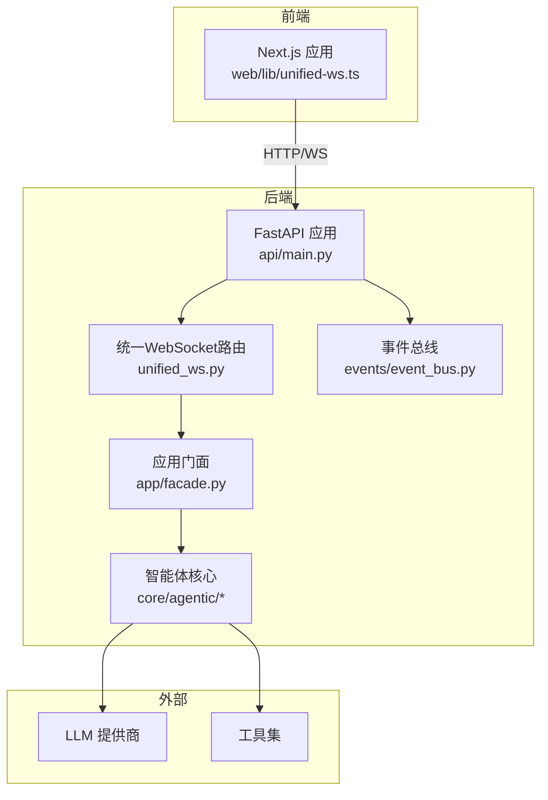
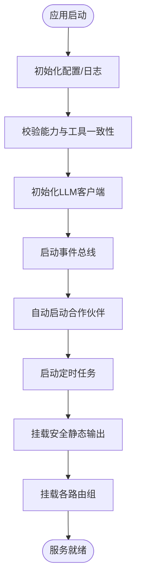
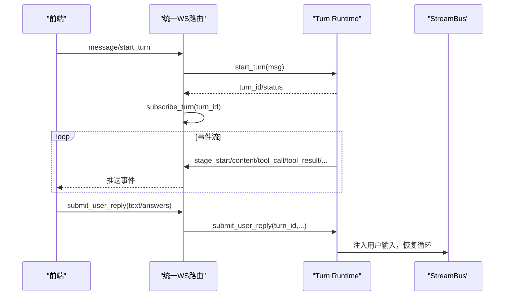
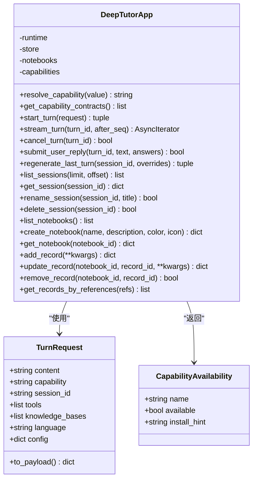
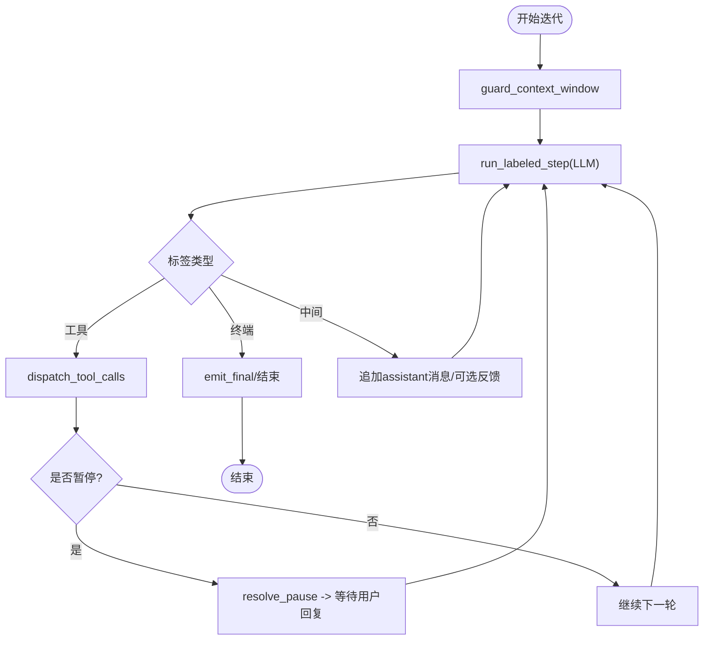
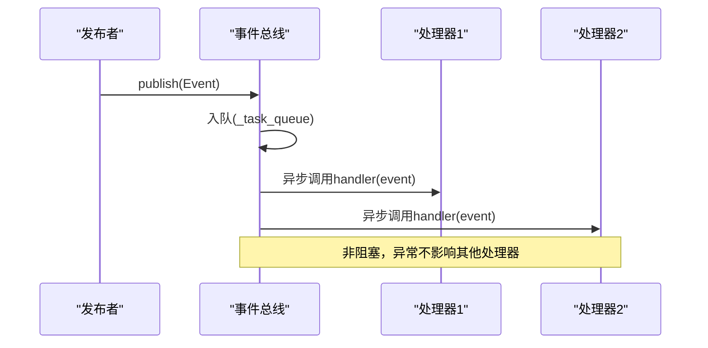
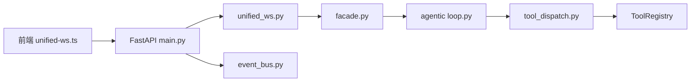
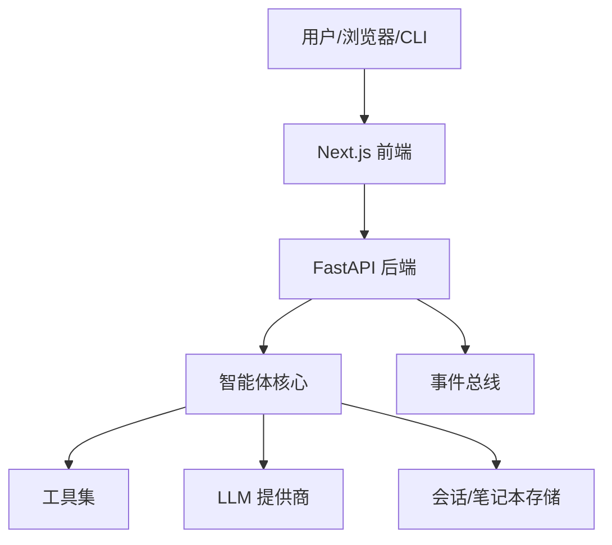
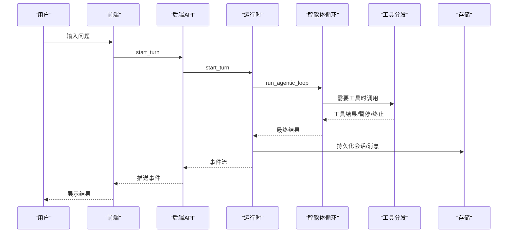

# 系统架构简介

<cite>
**本文引用的文件**
- [deeptutor/api/main.py](file://deeptutor/api/main.py)
- [deeptutor/api/routers/unified_ws.py](file://deeptutor/api/routers/unified_ws.py)
- [deeptutor/app/facade.py](file://deeptutor/app/facade.py)
- [deeptutor/core/agentic/loop.py](file://deeptutor/core/agentic/loop.py)
- [deeptutor/core/agentic/tool_dispatch.py](file://deeptutor/core/agentic/tool_dispatch.py)
- [deeptutor/events/event_bus.py](file://deeptutor/events/event_bus.py)
- [deeptutor_cli/main.py](file://deeptutor_cli/main.py)
- [web/lib/unified-ws.ts](file://web/lib/unified-ws.ts)
</cite>

## 目录
1. [引言](#引言)
2. [项目结构](#项目结构)
3. [核心组件](#核心组件)
4. [架构总览](#架构总览)
5. [详细组件分析](#详细组件分析)
6. [依赖关系分析](#依赖关系分析)
7. [性能考量](#性能考量)
8. [故障排查指南](#故障排查指南)
9. [结论](#结论)
10. [附录](#附录)

## 引言
本文件面向开发者，系统性介绍 DeepTutor 的整体架构与关键设计。重点包括：
- 前后端分离：后端 FastAPI 服务、前端 Next.js 应用、CLI 工具的职责与交互方式
- 智能体循环：探索-响应双阶段循环、工具调用机制、事件驱动架构
- 数据流向：从用户输入到 AI 处理再到结果返回的完整链路
- 设计模式：Facade、观察者、策略等模式在系统中的体现
- 边界图与组件交互图：帮助理解系统边界与模块协作

## 项目结构
DeepTutor 采用多包、分层组织：
- 后端 API（FastAPI）：统一入口、路由注册、生命周期管理、CORS、静态资源安全挂载
- 智能体核心（Agentic Core）：标签驱动的迭代调度器、工具并行分发、流式总线
- 能力与工具：按领域划分的 capability 与 tool 实现
- 事件总线：异步发布/订阅，用于跨模块通信
- CLI：提供本地运行能力、启动后端/前端、直接执行能力
- Web 前端（Next.js）：通过统一 WebSocket 客户端与后端实时通信



**图表来源**
- [deeptutor/api/main.py:248-332](file://deeptutor/api/main.py#L248-L332)
- [deeptutor/api/routers/unified_ws.py:44-133](file://deeptutor/api/routers/unified_ws.py#L44-L133)
- [deeptutor/app/facade.py:56-139](file://deeptutor/app/facade.py#L56-L139)
- [deeptutor/core/agentic/loop.py:173-372](file://deeptutor/core/agentic/loop.py#L173-L372)
- [deeptutor/events/event_bus.py:61-151](file://deeptutor/events/event_bus.py#L61-L151)

**章节来源**
- [deeptutor/api/main.py:248-332](file://deeptutor/api/main.py#L248-L332)
- [deeptutor_cli/main.py:29-73](file://deeptutor_cli/main.py#L29-L73)

## 核心组件
- 后端 FastAPI 应用：负责生命周期、CORS、路由挂载、静态输出安全访问、配置校验
- 统一 WebSocket 路由：单一 /api/v1/ws 端点，支持 start_turn、subscribe、resume、cancel、regenerate、submit_user_reply 等
- 应用门面（Facade）：对外暴露稳定的 TurnRequest/Turn 接口，封装运行时、会话、笔记本、能力注册表
- 智能体核心：标签驱动的迭代调度器（run_agentic_loop）、工具并行分发（dispatch_tool_calls）、流式总线集成
- 事件总线：异步事件队列与处理器，支持 publish/subscribe、启动/停止、flush
- CLI：命令入口，支持 run capability、serve 后端、start 前后端一体化

**章节来源**
- [deeptutor/api/main.py:116-246](file://deeptutor/api/main.py#L116-L246)
- [deeptutor/api/routers/unified_ws.py:44-325](file://deeptutor/api/routers/unified_ws.py#L44-L325)
- [deeptutor/app/facade.py:15-139](file://deeptutor/app/facade.py#L15-L139)
- [deeptutor/core/agentic/loop.py:39-172](file://deeptutor/core/agentic/loop.py#L39-L172)
- [deeptutor/core/agentic/tool_dispatch.py:55-108](file://deeptutor/core/agentic/tool_dispatch.py#L55-L108)
- [deeptutor/events/event_bus.py:22-151](file://deeptutor/events/event_bus.py#L22-L151)
- [deeptutor_cli/main.py:75-175](file://deeptutor_cli/main.py#L75-L175)

## 架构总览
DeepTutor 采用“前后端分离 + 事件驱动 + 智能体循环”的架构：
- 前端通过统一 WebSocket 客户端发起 turn 请求并订阅事件
- 后端 FastAPI 接收请求，经由统一 WebSocket 路由进入运行时
- 门面层将请求转换为 TurnRequest，交由 Turn Runtime 执行
- 智能体核心以标签协议驱动 LLM 迭代，必要时并行调用工具
- 工具执行结果回写消息历史，继续下一轮迭代或终止
- 事件总线用于跨模块通知（如能力完成、问题完成等）

```mermaid
sequenceDiagram
participant FE as "前端(Next.js)"
participant API as "FastAPI"
participant WS as "统一WS路由"
participant FAC as "门面(Facade)"
participant RT as "Turn Runtime"
participant LOOP as "智能体循环"
participant TDIS as "工具分发"
participant LLM as "LLM"
participant BUS as "事件总线"
FE->>WS : start_turn(message)
WS->>RT : start_turn(payload)
RT->>FAC : start_turn(TurnRequest)
FAC->>RT : start_turn(...)
RT->>LOOP : run_agentic_loop(initial_messages, protocol, stream)
LOOP->>LLM : 带标签的流式调用
alt 需要工具
LOOP->>TDIS : dispatch_tool_calls(tool_calls)
TDIS->>TOOLS : 并行执行工具
TDIS-->>LOOP : 结果/暂停/终止信号
end
LOOP-->>RT : LoopOutcome(final_label, messages, sources)
RT-->>WS : 事件流(stage_start/content/tool_call/tool_result/done)
WS-->>FE : 推送事件
RT->>BUS : publish(CAPABILITY_COMPLETE/...)
```

**图表来源**
- [deeptutor/api/routers/unified_ws.py:113-133](file://deeptutor/api/routers/unified_ws.py#L113-L133)
- [deeptutor/app/facade.py:114-139](file://deeptutor/app/facade.py#L114-L139)
- [deeptutor/core/agentic/loop.py:173-372](file://deeptutor/core/agentic/loop.py#L173-L372)
- [deeptutor/core/agentic/tool_dispatch.py:78-207](file://deeptutor/core/agentic/tool_dispatch.py#L78-L207)
- [deeptutor/events/event_bus.py:101-151](file://deeptutor/events/event_bus.py#L101-L151)

## 详细组件分析

### 后端 FastAPI 服务
- 生命周期管理：启动时初始化 LLM 客户端、事件总线、合作伙伴、定时任务；关闭时有序释放资源
- CORS 配置：根据认证开关动态调整允许源，支持本地与远程部署
- 静态输出安全：仅白名单路径可被读取，防止越权访问
- 路由挂载：按功能域划分路由组，统一鉴权中间件控制访问



**图表来源**
- [deeptutor/api/main.py:116-246](file://deeptutor/api/main.py#L116-L246)
- [deeptutor/api/main.py:297-332](file://deeptutor/api/main.py#L297-L332)
- [deeptutor/api/main.py:336-498](file://deeptutor/api/main.py#L336-L498)

**章节来源**
- [deeptutor/api/main.py:116-246](file://deeptutor/api/main.py#L116-L246)
- [deeptutor/api/main.py:297-332](file://deeptutor/api/main.py#L297-L332)
- [deeptutor/api/main.py:336-498](file://deeptutor/api/main.py#L336-L498)

### 统一 WebSocket 路由
- 单一端点 /api/v1/ws，支持多种消息类型：start_turn、subscribe_turn、subscribe_session、resume_from、unsubscribe、cancel_turn、submit_user_reply、regenerate、user_input
- 连接保活：心跳 ping/pong，超时检测
- 重连恢复：客户端记录 lastSeq，重连后 resume_from 续传
- 安全：WS 内鉴权，错误信息标准化



**图表来源**
- [deeptutor/api/routers/unified_ws.py:44-325](file://deeptutor/api/routers/unified_ws.py#L44-L325)
- [web/lib/unified-ws.ts:157-315](file://web/lib/unified-ws.ts#L157-L315)

**章节来源**
- [deeptutor/api/routers/unified_ws.py:44-325](file://deeptutor/api/routers/unified_ws.py#L44-L325)
- [web/lib/unified-ws.ts:15-147](file://web/lib/unified-ws.ts#L15-L147)
- [web/lib/unified-ws.ts:157-315](file://web/lib/unified-ws.ts#L157-L315)

### 应用门面（Facade）
- 稳定接口：TurnRequest、CapabilityAvailability、DeepTutorApp
- 能力解析：resolve_capability 支持别名映射
- 回合管理：start_turn、stream_turn、cancel_turn、submit_user_reply、regenerate_last_turn
- 会话与笔记本：list/get/rename/delete、notebook CRUD



**图表来源**
- [deeptutor/app/facade.py:15-139](file://deeptutor/app/facade.py#L15-L139)

**章节来源**
- [deeptutor/app/facade.py:15-139](file://deeptutor/app/facade.py#L15-L139)

### 智能体循环（探索-响应双阶段）
- 标签协议：LabelProtocol 定义 allowed/terminal/intermediate/final/tool_label
- 迭代调度：run_agentic_loop 驱动 LLM 调用，处理协议违规、终端标签、工具调用、中间标签
- 工具分发：dispatch_tool_calls 并行执行工具，去重、限流、子追踪、暂停/终止信号聚合
- 宿主钩子：LoopHost 提供上下文窗口保护、工具派发、暂停恢复、最终内容发射、强制终止等扩展点



**图表来源**
- [deeptutor/core/agentic/loop.py:39-172](file://deeptutor/core/agentic/loop.py#L39-L172)
- [deeptutor/core/agentic/loop.py:173-372](file://deeptutor/core/agentic/loop.py#L173-L372)
- [deeptutor/core/agentic/tool_dispatch.py:78-207](file://deeptutor/core/agentic/tool_dispatch.py#L78-L207)

**章节来源**
- [deeptutor/core/agentic/loop.py:39-172](file://deeptutor/core/agentic/loop.py#L39-L172)
- [deeptutor/core/agentic/loop.py:173-372](file://deeptutor/core/agentic/loop.py#L173-L372)
- [deeptutor/core/agentic/tool_dispatch.py:78-207](file://deeptutor/core/agentic/tool_dispatch.py#L78-L207)

### 事件驱动架构
- 事件总线：EventBus 单例，异步队列 + 后台处理器，支持 subscribe/publish/flush/stop
- 事件类型：SOLVE_COMPLETE、QUESTION_COMPLETE、CAPABILITY_COMPLETE
- 用途：跨模块通知能力完成、问题完成等，解耦业务逻辑



**图表来源**
- [deeptutor/events/event_bus.py:61-151](file://deeptutor/events/event_bus.py#L61-L151)

**章节来源**
- [deeptutor/events/event_bus.py:22-151](file://deeptutor/events/event_bus.py#L22-L151)

### CLI 工具
- 命令入口：Typer 组织子命令（partner/chat/kb/skill/memory/plugin/config/session/notebook/provider/book）
- 能力执行：run capability 构建 TurnRequest，调用 DeepTutorApp.start_turn 并渲染结果
- 服务启动：serve 启动后端 API，start 启动前后端一体化

**章节来源**
- [deeptutor_cli/main.py:29-73](file://deeptutor_cli/main.py#L29-L73)
- [deeptutor_cli/main.py:75-175](file://deeptutor_cli/main.py#L75-L175)

## 依赖关系分析
- 前端依赖：统一 WebSocket 客户端（web/lib/unified-ws.ts），通过 wsUrl 连接后端
- 后端依赖：FastAPI 应用、路由、门面、智能体核心、事件总线
- 智能体核心依赖：标签协议、工具分发、流式总线、上下文、追踪元数据
- 工具依赖：ToolRegistry 查找与执行，支持 MCP、内置工具等



**图表来源**
- [web/lib/unified-ws.ts:157-315](file://web/lib/unified-ws.ts#L157-L315)
- [deeptutor/api/main.py:248-332](file://deeptutor/api/main.py#L248-L332)
- [deeptutor/api/routers/unified_ws.py:44-133](file://deeptutor/api/routers/unified_ws.py#L44-L133)
- [deeptutor/app/facade.py:56-139](file://deeptutor/app/facade.py#L56-L139)
- [deeptutor/core/agentic/loop.py:173-372](file://deeptutor/core/agentic/loop.py#L173-L372)
- [deeptutor/core/agentic/tool_dispatch.py:78-207](file://deeptutor/core/agentic/tool_dispatch.py#L78-L207)
- [deeptutor/events/event_bus.py:61-151](file://deeptutor/events/event_bus.py#L61-L151)

**章节来源**
- [web/lib/unified-ws.ts:157-315](file://web/lib/unified-ws.ts#L157-L315)
- [deeptutor/api/main.py:248-332](file://deeptutor/api/main.py#L248-L332)
- [deeptutor/api/routers/unified_ws.py:44-133](file://deeptutor/api/routers/unified_ws.py#L44-L133)
- [deeptutor/app/facade.py:56-139](file://deeptutor/app/facade.py#L56-L139)
- [deeptutor/core/agentic/loop.py:173-372](file://deeptutor/core/agentic/loop.py#L173-L372)
- [deeptutor/core/agentic/tool_dispatch.py:78-207](file://deeptutor/core/agentic/tool_dispatch.py#L78-L207)
- [deeptutor/events/event_bus.py:61-151](file://deeptutor/events/event_bus.py#L61-L151)

## 性能考量
- 工具并行执行：限制最大并发数（MAX_PARALLEL_TOOL_CALLS），避免过载
- 重复调用去重：同一批次内相同工具+参数合并，减少冗余执行
- 流式传输：前端心跳与断线重连，支持 resume_from 续传，降低网络抖动影响
- 资源释放：应用关闭时有序关闭 LLM 客户端池、MCP 连接、事件总线等，防止资源泄漏
- 日志过滤：抑制 WebSocket 频繁连接日志噪音，聚焦异常

[本节为通用指导，不直接分析具体文件]

## 故障排查指南
- 配置漂移：能力清单引用未注册工具会抛出配置校验错误，需注册缺失工具或移除陈旧引用
- 工具参数缺失：分发前检查必填参数，缺失则短路并生成修正提示
- 未知工具名：执行失败时记录错误并关闭子追踪，避免悬挂状态
- 事件总线超时：flush/stop 设置超时，避免长时间阻塞
- WebSocket 断开：前端自动重连，指数退避，最多尝试次数

**章节来源**
- [deeptutor/api/main.py:57-82](file://deeptutor/api/main.py#L57-L82)
- [deeptutor/core/agentic/tool_dispatch.py:279-343](file://deeptutor/core/agentic/tool_dispatch.py#L279-L343)
- [deeptutor/core/agentic/tool_dispatch.py:436-588](file://deeptutor/core/agentic/tool_dispatch.py#L436-L588)
- [deeptutor/events/event_bus.py:153-185](file://deeptutor/events/event_bus.py#L153-L185)
- [web/lib/unified-ws.ts:257-315](file://web/lib/unified-ws.ts#L257-L315)

## 结论
DeepTutor 通过前后端分离、事件驱动与智能体循环，实现了可扩展、高可用的 AI 学习平台。其核心优势包括：
- 清晰的职责边界：API、路由、门面、智能体核心、工具、事件总线各司其职
- 灵活的扩展点：LoopHost、工具注册表、能力注册表便于新增能力与工具
- 健壮的通信机制：统一 WebSocket、心跳重连、流式事件保障用户体验
- 完善的工程化：生命周期管理、资源释放、日志与错误处理

[本节为总结性内容，不直接分析具体文件]

## 附录

### 系统边界图


[此图为概念性示意，不直接映射具体源码文件]

### 组件交互图


[此图为概念性示意，不直接映射具体源码文件]