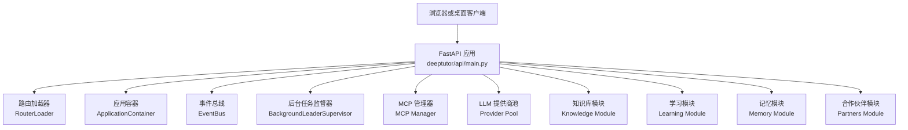
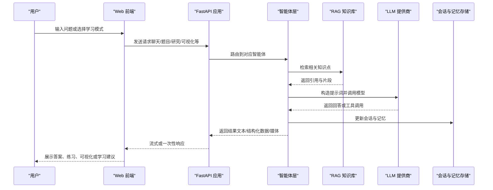
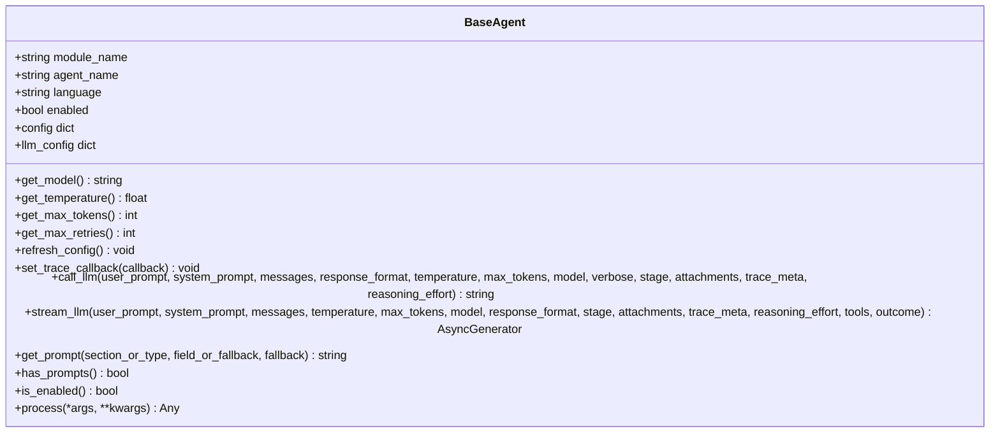
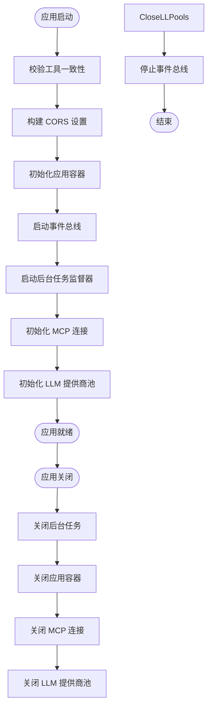
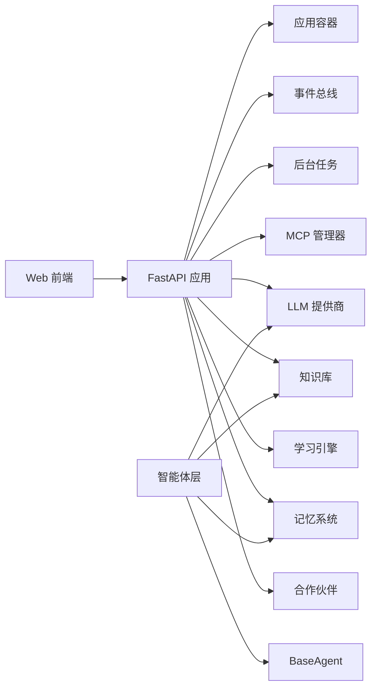

# 项目介绍与目标

<cite>
**本文引用的文件**   
- [README.md](file://README.md)
- [deeptutor/__main__.py](file://deeptutor/__main__.py)
- [deeptutor/api/main.py](file://deeptutor/api/main.py)
- [deeptutor/agents/base_agent.py](file://deeptutor/agents/base_agent.py)
- [assets/README/README_CN.md](file://assets/README/README_CN.md)
</cite>

## 目录
1. [引言](#引言)
2. [项目结构](#项目结构)
3. [核心组件](#核心组件)
4. [架构总览](#架构总览)
5. [详细组件分析](#详细组件分析)
6. [依赖关系分析](#依赖关系分析)
7. [性能与可扩展性](#性能与可扩展性)
8. [故障排查指南](#故障排查指南)
9. [结论](#结论)

## 引言
DeepTutor 是一个“智能体原生的终身个性化学习平台”。它的使命是让学习者拥有持续、可审计、可进化的个人学习体验：从对话式辅导、研究、创作到练习，所有能力共享同一个会话上下文，同时保留为不同用途设计的专用工作流。

为什么需要这样一个平台？传统在线学习通常存在以下局限：
- 内容静态化：课程视频和文档更新慢，难以跟随学习者进度动态调整。
- 缺乏个性化：统一路径无法适配不同基础、节奏和目标的学习者。
- 知识管理割裂：笔记、资料、问答、练习分散在不同工具中，难以形成连贯的知识体系。
- 反馈滞后：测评与复习安排不够及时，难以维持长期记忆与掌握度。

DeepTutor 通过多智能体协作、检索增强生成（RAG）和会话管理，构建一个以“人”为中心的智能学习系统：
- 多智能体协作：聊天、题目、研究、可视化、数学动画、书籍编译等模块由多个智能体协同完成，每个智能体专注特定任务，但共享统一的运行时与配置。
- RAG 技术：支持 LlamaIndex、PageIndex、GraphRAG、LightRAG 等知识库方案，让回答与阅读材料具备来源引用，提升可信度与可追溯性。
- 会话管理：统一的会话上下文贯穿 Chat、Quiz、Research、Visualize、Solve、Mastery Path、Reading 等模式，使跨功能学习与知识沉淀成为可能。

目标用户群体包括：
- 学生：获得个性化学习路径、即时答疑、结构化练习与复习提醒。
- 教师：设计课程、布置练习、跟踪学习进度，并与智能体协作生成教学材料。
- 研究人员：使用 Deep Research、可视化、书籍编译等能力进行文献调研与内容生产。

核心价值主张：
- 一个运行时，多种学习模式：共享上下文，保留专业工作流。
- 互联的学习工作区：主页、学习、资源将聊天、书籍、阅读、练习、任务板、日历和学习笔记本连接起来。
- 有据可依的知识与阅读：版本化知识库、外部知识源接入、带来源引用的学习体验。
- Partners 与子智能体：对接 Claude Code、Codex、Grok CLI 等实时智能体，或运行持久 Partners。
- 可审计的记忆：L1 追踪、L2 事实、L3 综合，使个性化透明且可编辑。
- 设计上可扩展：通过智能体原生运行时扩展人格、技能、MCP 服务、CLI 应用与生成模型。

这些价值在官方中文说明中被明确强调，体现了 DeepTutor 作为“智能体原生的学习工作区”的定位。

**章节来源**
- [README.md:1-34](file://README.md#L1-L34)
- [assets/README/README_CN.md:54-63](file://assets/README/README_CN.md#L54-L63)

## 项目结构
DeepTutor 采用模块化、分层清晰的工程结构：
- 后端 API 与服务：FastAPI 应用、路由加载、生命周期管理、中间件、健康检查等。
- 智能体层：BaseAgent 抽象类与各类业务智能体（聊天、题目、研究、可视化、数学动画、书籍编译等）。
- 能力与工具：Capabilities 注册表、内置工具、RAG、LLM 客户端、会话存储、记忆系统等。
- Web 前端：Next.js 应用，提供聊天、知识库、阅读、设置、空间仪表盘等界面。
- CLI 与桌面端：命令行入口、初始化向导、模块管理与插件生态。

**图表来源**
- [deeptutor/api/main.py:108-359](file://deeptutor/api/main.py#L108-L359)

**章节来源**
- [deeptutor/api/main.py:364-548](file://deeptutor/api/main.py#L364-L548)

## 核心组件
DeepTutor 的核心由以下几部分组成：
- FastAPI 应用与生命周期管理：负责启动校验、依赖注入、模块启用、迁移、事件总线、后台任务、MCP 连接、LLM 客户端池的启停。
- 智能体基类 BaseAgent：统一封装 LLM 配置、提示词管理、调用接口、Token 统计、日志与追踪回调。
- 能力与工具注册：Capabilities 与 Tools 分离，支持插件化扩展。
- 会话与记忆：会话上下文、三层记忆（L1/L2/L3）、记忆图审计。
- 知识库与 RAG：版本化索引、外部知识源、来源引用。
- 学习引擎：掌握度评估、间隔重复、学习路径规划。

这些组件共同支撑起“智能体原生”的学习体验，使系统既能灵活扩展，又能保持稳定的运行时行为。

**章节来源**
- [deeptutor/agents/base_agent.py:33-789](file://deeptutor/agents/base_agent.py#L33-L789)
- [deeptutor/api/main.py:108-359](file://deeptutor/api/main.py#L108-L359)

## 架构总览
DeepTutor 的整体架构围绕“智能体 + 能力 + 工具 + 会话 + 记忆 + 知识库”展开。前端通过 API 与后端交互，后端根据请求类型调度相应的智能体与能力，并借助 RAG 获取相关知识，最终返回结构化结果或流式响应。

**图表来源**
- [deeptutor/api/main.py:108-359](file://deeptutor/api/main.py#L108-L359)
- [deeptutor/agents/base_agent.py:349-693](file://deeptutor/agents/base_agent.py#L349-L693)

## 详细组件分析

### 智能体基类 BaseAgent
BaseAgent 是所有模块智能体的统一基类，提供：
- LLM 配置管理：api_key、base_url、model、binding、api_version。
- 参数管理：temperature、max_tokens、max_retries，来自 agents.yaml。
- 提示词管理：PromptManager 加载多语言提示词。
- 统一 LLM 调用接口：call_llm 与 stream_llm，支持非流式与流式输出。
- Token 统计与追踪：LLMStats、TraceCallback、TokenTracker。
- 日志与状态：enabled、logger、is_enabled。

这种设计使得各业务智能体无需重复实现 LLM 调用细节，专注于领域逻辑。

**图表来源**
- [deeptutor/agents/base_agent.py:33-789](file://deeptutor/agents/base_agent.py#L33-L789)

**章节来源**
- [deeptutor/agents/base_agent.py:33-789](file://deeptutor/agents/base_agent.py#L33-L789)

### FastAPI 应用与生命周期
FastAPI 应用负责：
- 启动时校验工具一致性，避免能力清单引用未注册工具。
- 构建 CORS 设置，支持本地与远程部署。
- 初始化应用容器、事件总线、后台任务监督器、MCP 连接、LLM 客户端池。
- 处理健康检查与错误边界，确保 500 错误返回 JSON。
- 挂载模块路由，支持懒加载。

**图表来源**
- [deeptutor/api/main.py:108-359](file://deeptutor/api/main.py#L108-L359)

**章节来源**
- [deeptutor/api/main.py:47-105](file://deeptutor/api/main.py#L47-L105)
- [deeptutor/api/main.py:108-359](file://deeptutor/api/main.py#L108-L359)
- [deeptutor/api/main.py:364-548](file://deeptutor/api/main.py#L364-L548)

### 命令行入口
命令行入口通过 `python -m deeptutor` 调用 `deeptutor_cli.main.main()`，提供模块管理、聊天、知识库、会话、技能等命令。这是用户与 DeepTutor 交互的重要入口之一。

**章节来源**
- [deeptutor/__main__.py:1-7](file://deeptutor/__main__.py#L1-L7)

## 依赖关系分析
DeepTutor 的依赖关系呈现“前端 → API → 智能体/能力/工具 → 服务层 → 外部提供商”的分层结构：
- 前端依赖 API 路由与健康检查。
- API 依赖应用容器、事件总线、后台任务、MCP、LLM 提供商。
- 智能体依赖 BaseAgent、PromptManager、LLM 客户端、Token 统计。
- 能力与工具依赖注册表与运行时环境。
- 服务层依赖配置、会话、记忆、知识库、搜索、解析等子系统。

**图表来源**
- [deeptutor/api/main.py:108-359](file://deeptutor/api/main.py#L108-L359)
- [deeptutor/agents/base_agent.py:33-789](file://deeptutor/agents/base_agent.py#L33-L789)

**章节来源**
- [deeptutor/api/main.py:108-359](file://deeptutor/api/main.py#L108-L359)
- [deeptutor/agents/base_agent.py:33-789](file://deeptutor/agents/base_agent.py#L33-L789)

## 性能与可扩展性
- 性能优化：
  - 流式响应减少首字节延迟。
  - LLM 客户端池复用连接，降低握手开销。
  - 后台任务监督器协调长时任务，避免阻塞主循环。
  - 选择性访问日志减少噪音，聚焦非 200 请求。
- 可扩展性：
  - 模块启用/禁用机制支持按需加载功能。
  - Capabilities 与 Tools 分离，便于插件化扩展。
  - 多提供商 LLM 支持，兼容云与本地模型。
  - MCP 服务集成，扩展外部工具与服务。

[本节为通用指导，不直接分析具体文件]

## 故障排查指南
常见问题与定位方法：
- 配置漂移：能力清单引用了未注册的工具，启动时会抛出配置验证失败。需检查能力清单与工具注册表是否一致。
- CORS 错误：本地或远程部署时跨域请求被拒绝。需检查 CORS 设置与认证模式。
- 500 错误：统一错误边界返回 JSON，便于前端解析。查看日志中的异常堆栈。
- LLM 调用失败：检查模型配置、API Key、Base URL、Binding 是否正确。
- 会话恢复失败：检查会话存储与迁移脚本是否正常执行。

**章节来源**
- [deeptutor/api/main.py:40-74](file://deeptutor/api/main.py#L40-L74)
- [deeptutor/api/main.py:392-420](file://deeptutor/api/main.py#L392-L420)
- [deeptutor/api/main.py:478-492](file://deeptutor/api/main.py#L478-L492)

## 结论
DeepTutor 通过智能体原生架构、RAG 技术与会话管理，构建了一个面向终身学习的个性化平台。它解决了传统在线学习的局限性，提供了多智能体协作、可审计记忆、互联工作区与可扩展生态。无论是学生、教师还是研究人员，都能在 DeepTutor 中找到适合自己的学习路径与工具链。

[本节为总结性内容，不直接分析具体文件]