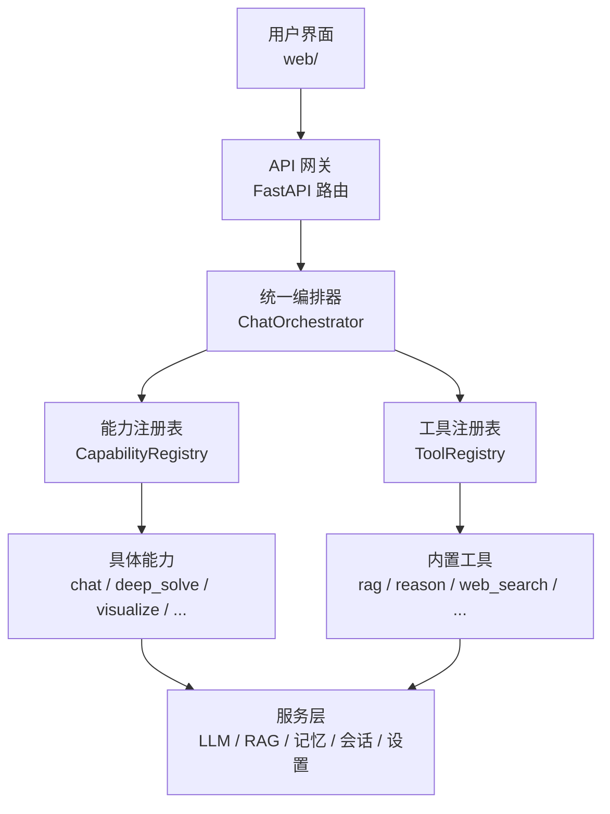
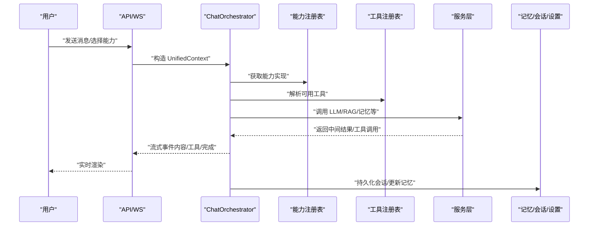
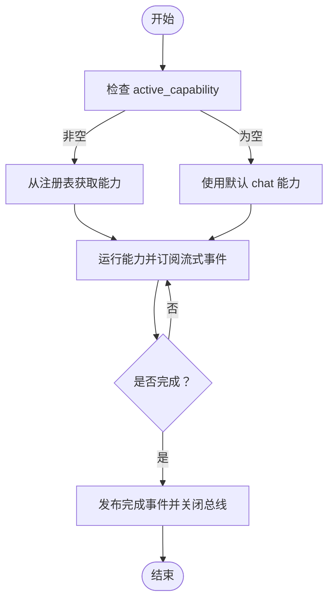
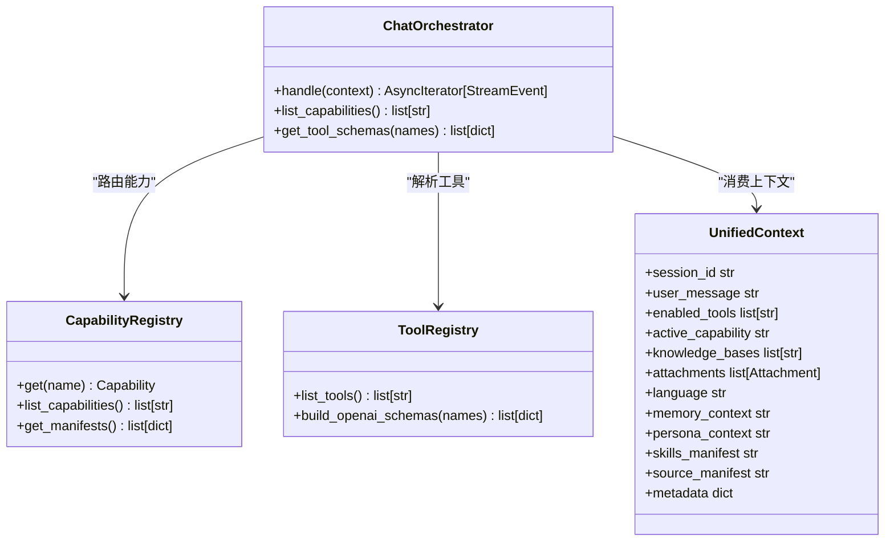
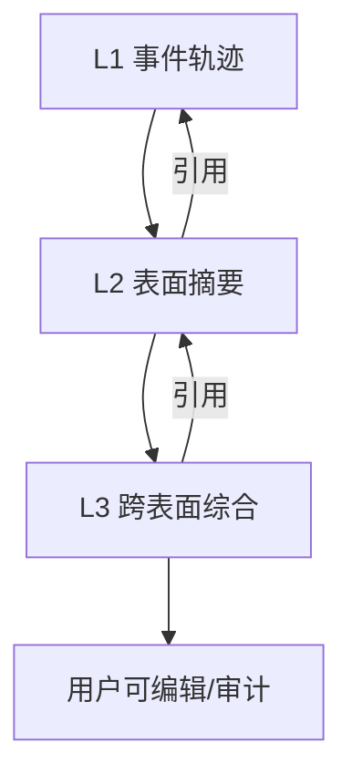
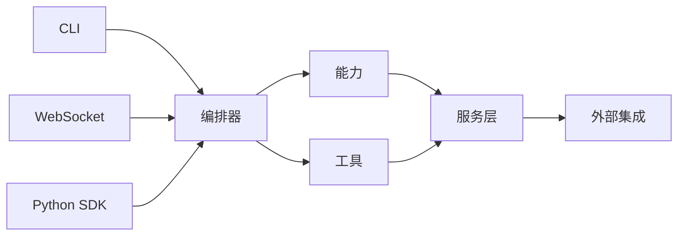

# 项目介绍与目标

<cite>
**本文引用的文件**
- [README.md](file://README.md)
- [AGENTS.md](file://AGENTS.md)
- [SKILL.md](file://SKILL.md)
- [orchestrator.py](file://deeptutor/runtime/orchestrator.py)
- [context.py](file://deeptutor/core/context.py)
- [__version__.py](file://deeptutor/__version__.py)
- [CITATION.cff](file://CITATION.cff)
</cite>

## 目录
1. [引言](#引言)
2. [项目结构](#项目结构)
3. [核心组件](#核心组件)
4. [架构总览](#架构总览)
5. [详细组件分析](#详细组件分析)
6. [依赖关系分析](#依赖关系分析)
7. [性能考量](#性能考量)
8. [故障排查指南](#故障排查指南)
9. [结论](#结论)
10. [附录](#附录)

## 引言
DeepTutor 是一个“智能体原生”的终身个性化辅导平台，旨在通过统一的智能体循环将学习、问题解决、测验生成、研究、可视化与掌握练习等能力串联起来，形成可演进、可审计、可扩展的学习工作区。其愿景是让学习者在一个连贯的上下文中持续成长：知识、记忆、技能、书籍、笔记与问答库在每次交互中都可被复用；不同模式（聊天、解题、研究、可视化、掌握路径）共享同一运行内核，切换的是目标而非引擎。

DeepTutor 的技术理念围绕三个关键概念展开：
- 插件化设计：以“工具（Level 1）+ 能力（Level 2）”的双层插件模型组织系统，支持按需挂载、上下文感知与统一编排。
- 多引擎支持：知识库检索提供多种后端（如 LlamaIndex、PageIndex、GraphRAG、LightRAG、Obsidian 链接库），文档解析引擎也可选，满足不同场景的性能与精度需求。
- 三层记忆系统：L1 事件轨迹、L2 表面摘要、L3 跨表面综合，三者相互引用，使个性化既可见又可编辑、可追溯。

项目由学术团队驱动并开源，具备活跃的社区生态与持续的版本迭代。最新版本为 v1.5.10，配套官方文档站点与多语言 README，并提供 CLI、Web 应用、Docker 部署等多种使用方式。

**章节来源**
- [README.md:1-43](file://README.md#L1-L43)
- [README.md:189-199](file://README.md#L189-L199)
- [README.md:458-486](file://README.md#L458-L486)
- [README.md:568-617](file://README.md#L568-L617)
- [__version__.py:1-12](file://deeptutor/__version__.py#L1-L12)
- [CITATION.cff:1-39](file://CITATION.cff#L1-L39)

## 项目结构
DeepTutor 采用前后端分离与模块化组织：
- 后端服务与智能体：位于 deeptutor/，包含运行时编排、能力注册、工具注册、服务层（LLM、RAG、记忆、会话、设置等）、API 路由、CLI 入口。
- Web 前端：位于 web/，基于 Next.js，提供聊天、伙伴、我的智能体、共写器、书籍、知识中心、学习空间、记忆与设置等界面。
- 文档与资源：assets/figs/ 提供架构图与界面截图；assets/README/ 提供多语言说明。
- 测试与脚本：tests/ 覆盖核心模块；scripts/ 提供启动、打包与运维脚本。

**图表来源**
- [AGENTS.md:10-30](file://AGENTS.md#L10-L30)
- [orchestrator.py:26-47](file://deeptutor/runtime/orchestrator.py#L26-L47)

**章节来源**
- [AGENTS.md:10-30](file://AGENTS.md#L10-L30)
- [README.md:458-486](file://README.md#L458-L486)

## 核心组件
- 统一编排器（ChatOrchestrator）：作为所有入口（CLI、WebSocket、SDK）的统一接入点，负责将请求路由到指定能力，管理流式总线生命周期，并在完成时发布事件。
- 统一上下文（UnifiedContext）：承载一次用户交互所需的全部信息，包括会话 ID、消息历史、启用的工具、激活的能力、知识库、附件、配置覆盖、语言、记忆注入、人格提示、技能清单与来源清单等。
- 双层插件模型：
  - Level 1 工具：单函数工具，按上下文自动挂载或用户显式启用。
  - Level 2 能力：多阶段流水线，接管一次交互回合，如聊天、深度解题、测验生成、研究、可视化、数学动画、掌握路径等。
- 服务层：LLM 调用、嵌入与搜索、RAG 检索、记忆系统、会话存储、设置管理、沙箱执行、语音/图像/视频生成等。

这些组件共同支撑 DeepTutor 的“一个运行内核，多种模式”的设计理念，确保上下文随学习者流动，能力可按需扩展。

**章节来源**
- [AGENTS.md:32-71](file://AGENTS.md#L32-L71)
- [orchestrator.py:26-47](file://deeptutor/runtime/orchestrator.py#L26-L47)
- [context.py:33-85](file://deeptutor/core/context.py#L33-L85)

## 架构总览
DeepTutor 的架构强调“智能体原生”和“统一上下文”。所有能力都通过统一编排器进入，借助工具与能力的注册表进行动态装配；流式事件总线保证实时反馈与可观测性；服务层提供可插拔的模型与检索后端。

**图表来源**
- [AGENTS.md:10-30](file://AGENTS.md#L10-L30)
- [orchestrator.py:36-114](file://deeptutor/runtime/orchestrator.py#L36-L114)
- [context.py:33-85](file://deeptutor/core/context.py#L33-L85)

## 详细组件分析

### 统一编排器（ChatOrchestrator）
- 职责：接收 UnifiedContext，选择并运行对应能力；管理 StreamBus 生命周期；捕获异常并发布完成事件。
- 行为要点：
  - 若未指定能力则默认使用 chat。
  - 为每个回合分配 session_id，必要时绑定 turn_id 到全局事件总线。
  - 能力执行期间产生流式事件，完成后统一结束并清理。
- 错误处理：未知能力会返回失败状态与可用能力列表；能力异常会被记录并通过流式总线通知。

**图表来源**
- [orchestrator.py:36-114](file://deeptutor/runtime/orchestrator.py#L36-L114)

**章节来源**
- [orchestrator.py:26-147](file://deeptutor/runtime/orchestrator.py#L26-L147)

### 统一上下文（UnifiedContext）
- 作用：贯穿编排器、能力与工具的单一数据载体，确保一次交互所需的会话、消息、工具、能力、知识库、附件、配置、语言、记忆注入、人格、技能与来源等信息完整传递。
- 关键字段：
  - session_id、user_message、conversation_history
  - enabled_tools、allowed_builtin_tools、active_capability
  - knowledge_bases、attachments、config_overrides
  - language、memory_context、persona_context
  - skills_manifest、source_manifest、metadata

该数据结构使得能力可以基于上下文条件自动挂载工具（例如存在知识库则挂载 rag），也允许用户在设置中控制工具开关。

**章节来源**
- [context.py:33-85](file://deeptutor/core/context.py#L33-L85)

### 双层插件模型（工具与能力）
- 工具（Level 1）：单函数工具，可由用户开启或根据上下文自动挂载。典型工具包括 brainstorm、web_search、paper_search、reason 以及 rag、read_source、read_memory、write_memory、exec、ask_user 等。
- 能力（Level 2）：多阶段流水线，接管一次交互回合。内置能力包括 chat、mastery_path、deep_solve、deep_question、deep_research、visualize、math_animator 等。
- 统一输出：所有能力收敛于统一的输出信封，便于前端展示与成本统计。

**图表来源**
- [AGENTS.md:32-71](file://AGENTS.md#L32-L71)
- [orchestrator.py:136-147](file://deeptutor/runtime/orchestrator.py#L136-L147)
- [context.py:33-85](file://deeptutor/core/context.py#L33-L85)

**章节来源**
- [AGENTS.md:32-71](file://AGENTS.md#L32-L71)
- [orchestrator.py:26-147](file://deeptutor/runtime/orchestrator.py#L26-L147)
- [context.py:33-85](file://deeptutor/core/context.py#L33-L85)

### 三层记忆系统（L1/L2/L3）
- L1：工作区镜像与追加式事件轨迹（trace/<surface>/<date>.jsonl），保留原始交互证据。
- L2：按表面（surface）整理的精炼事实（L2/<surface>.md），用于快速回顾与编辑。
- L3：跨表面的综合摘要（L3/<profile|recent|scope|preferences>.md），形成个人画像与偏好。
- 可追溯性：L2 引用 L1，L3 引用 L2，任何合成结论均可回溯到原始事件，支持审计与修正。

**图表来源**
- [README.md:603-617](file://README.md#L603-L617)

**章节来源**
- [README.md:603-617](file://README.md#L603-L617)

### 多引擎知识库（RAG）
- 支持多种检索引擎：LlamaIndex（默认本地向量+BM25）、PageIndex（托管推理检索）、GraphRAG、LightRAG、LightRAG Server、腾讯 IMA、Obsidian 链接库。
- 文档解析引擎可选：Text-only、MinerU、Docling、markitdown、PyMuPDF4LLM。
- 版本化索引：重建索引写入新版本目录，保留旧索引以保证稳定性；支持移除单个失败文档而无需全量重建。

**章节来源**
- [README.md:568-583](file://README.md#L568-L583)

### 版本与社区背景
- 版本：当前版本 v1.5.10，持续迭代，涵盖记忆、检索、模型路由、安全与稳定性增强。
- 学术支持：arXiv 预印本论文公开设计与思想，Citation 文件提供规范引用格式。
- 社区：Discord、飞书、微信等多渠道交流；贡献指南与路线图开放社区参与。

**章节来源**
- [__version__.py:1-12](file://deeptutor/__version__.py#L1-L12)
- [README.md:180-187](file://README.md#L180-L187)
- [CITATION.cff:1-39](file://CITATION.cff#L1-L39)

## 依赖关系分析
- 入口层：CLI（Typer）、WebSocket API、Python SDK。
- 编排层：ChatOrchestrator 统一调度，依赖能力与工具注册表。
- 能力与工具：按上下文自动挂载或用户显式启用，统一输出信封。
- 服务层：LLM、嵌入、搜索、RAG、记忆、会话、设置、沙箱、媒体生成等。
- 外部集成：IM 通道（Partner）、MCP 服务、技能市场（EduHub）。

**图表来源**
- [AGENTS.md:10-30](file://AGENTS.md#L10-L30)
- [AGENTS.md:119-138](file://AGENTS.md#L119-L138)

**章节来源**
- [AGENTS.md:10-30](file://AGENTS.md#L10-L30)
- [AGENTS.md:119-138](file://AGENTS.md#L119-L138)

## 性能考量
- 流式事件：通过 StreamBus 实时推送中间结果，提升交互体验与可观测性。
- 上下文裁剪：UnifiedContext 仅携带必要字段，减少不必要的数据传输。
- 工具按需挂载：避免无谓的工具调用开销，提高响应速度。
- 记忆分层：L1/L2/L3 分层存储与汇总，平衡检索效率与可解释性。
- 多引擎检索：根据场景选择合适的 RAG 后端，优化召回质量与延迟。

[本节为通用指导，不直接分析具体文件]

## 故障排查指南
- 未知能力：编排器会返回失败状态与可用能力列表，检查 active_capability 是否正确。
- 能力异常：日志记录异常堆栈，并通过流式总线发出错误事件，定位具体能力与上下文。
- 工具不可用：检查 allowed_builtin_tools 白名单与上下文条件（如是否存在知识库）。
- 记忆问题：查看 L1 轨迹与 L2/L3 文档，确认 consolidator 预算与引用关系是否正常。
- 配置问题：Settings 页面提供草稿与应用流程，避免误改导致的服务不可用。

**章节来源**
- [orchestrator.py:49-67](file://deeptutor/runtime/orchestrator.py#L49-L67)
- [orchestrator.py:83-103](file://deeptutor/runtime/orchestrator.py#L83-L103)
- [README.md:620-639](file://README.md#L620-L639)

## 结论
DeepTutor 以“智能体原生”为核心，通过统一编排、双层插件与三层记忆，将学习、解题、研究、可视化与掌握练习整合为一个可演进的工作区。其插件化与多引擎设计确保了灵活性与可扩展性；可审计的记忆系统让个性化既强大又可控。配合活跃的社区与持续的版本迭代，DeepTutor 正在重塑传统学习方式与知识获取模式，为终身学习提供强有力的技术支撑。

[本节为总结性内容，不直接分析具体文件]

## 附录
- 快速上手：提供 PyPI 安装、源码安装、Docker 与 CLI-only 四种方式，统一 workspace 布局与 settings 管理。
- 常用命令：CLI 支持 chat、run、kb、partner、skill、memory、session、notebook、book、plugin、provider、serve、start、init 等。
- 生态：EduHub 技能市场与 Agent-Skills 格式，支持搜索、安装、发布与版本管理。

**章节来源**
- [README.md:202-448](file://README.md#L202-L448)
- [SKILL.md:23-153](file://SKILL.md#L23-L153)
- [README.md:757-799](file://README.md#L757-L799)