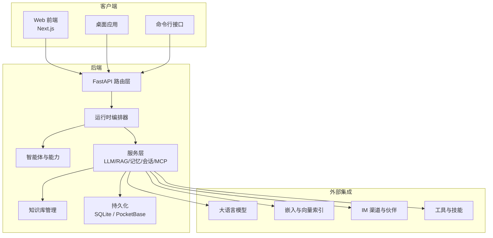
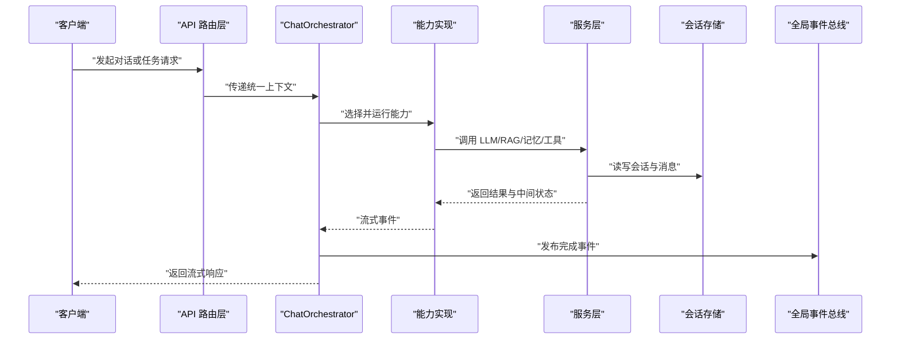
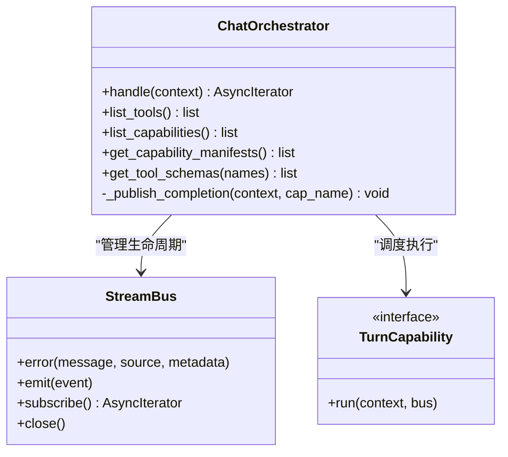
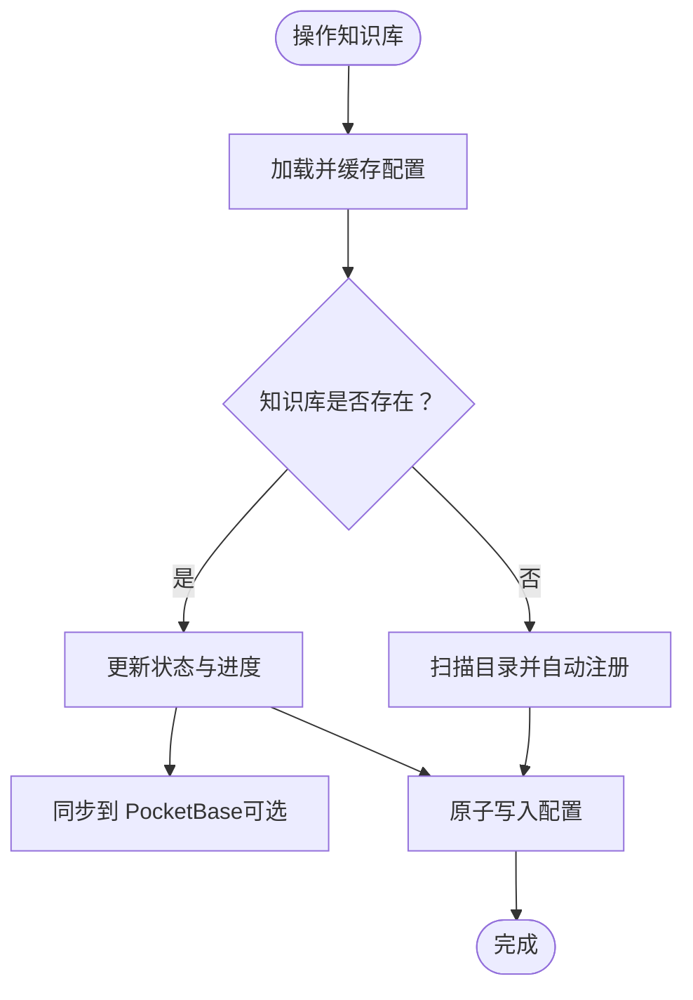
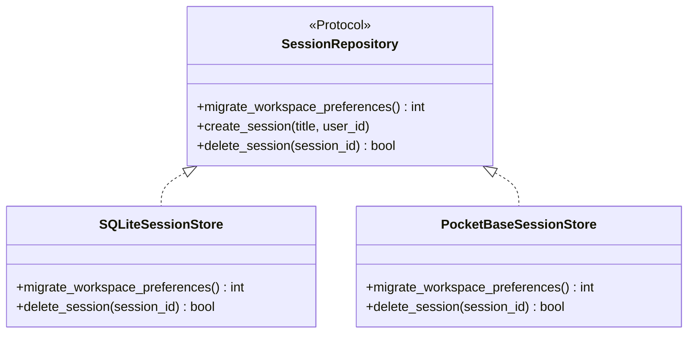
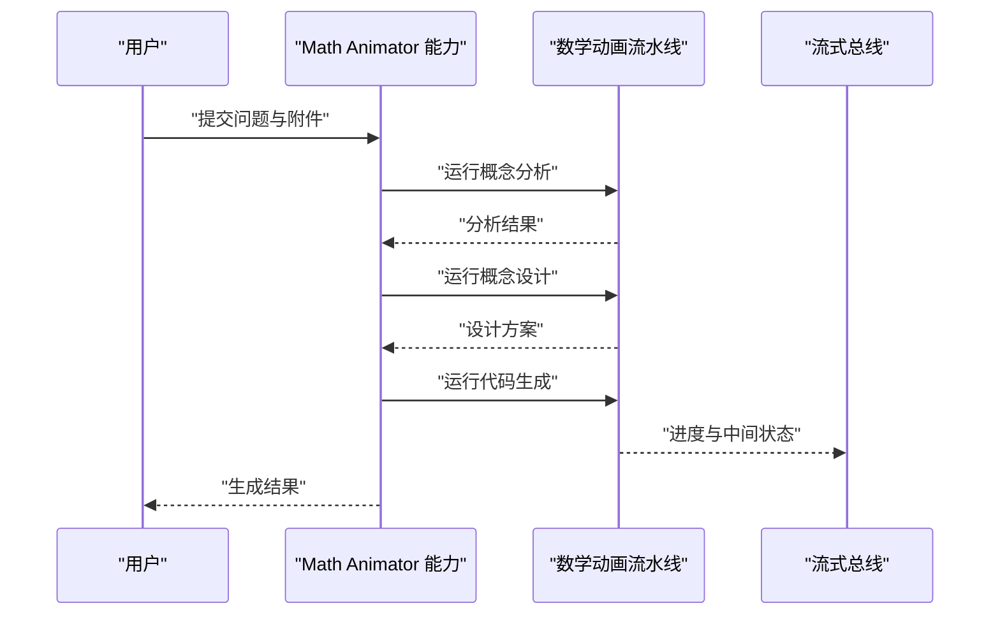
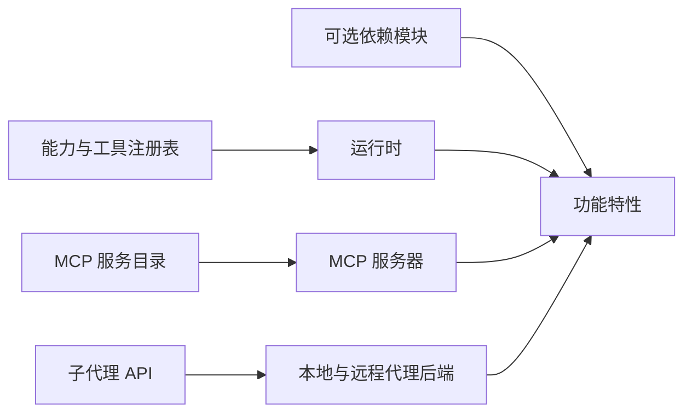
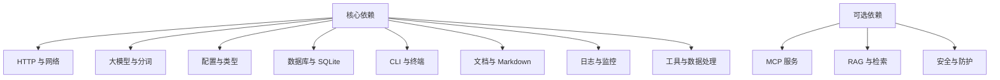

# 项目概述

<cite>
**本文引用的文件**   
- [README.md](file://README.md)
- [pyproject.toml](file://pyproject.toml)
- [requirements.txt](file://requirements.txt)
- [orchestrator.py](file://deeptutor/runtime/orchestrator.py)
- [manager.py](file://deeptutor/knowledge/manager.py)
- [protocol.py](file://deeptutor/services/session/protocol.py)
- [sqlite_store.py](file://deeptutor/services/session/sqlite_store.py)
- [pocketbase_store.py](file://deeptutor/services/session/pocketbase_store.py)
- [knowledge.py](file://deeptutor/api/routers/knowledge.py)
- [subagents.py](file://deeptutor/api/routers/subagents.py)
- [capability.py](file://deeptutor/agents/math_animator/capability.py)
- [pipeline.py](file://deeptutor/agents/research/pipeline.py)
</cite>

## 目录
1. [引言](#引言)
2. [项目结构](#项目结构)
3. [核心组件](#核心组件)
4. [架构总览](#架构总览)
5. [详细组件分析](#详细组件分析)
6. [依赖关系分析](#依赖关系分析)
7. [性能与扩展性](#性能与扩展性)
8. [快速开始指南](#快速开始指南)
9. [故障排查](#故障排查)
10. [结论](#结论)

## 引言
DeepTutor 是一个“智能体原生”的终身个性化学习助手。它把辅导、研究、创作与练习整合在一个可扩展的运行时中，通过多智能体协作、检索增强生成、会话管理和内容生成引擎，为学习者提供可审计、可编辑、可复用的学习体验。

从系统视角看，DeepTutor 采用以下设计理念：
- 以能力为中心：聊天、问答、研究、可视化、解题、掌握路径、沉浸式阅读等模式共享同一运行时和会话上下文。
- 以知识为中心：版本化知识库支持多种检索引擎，使对话、笔记、书籍生成与伙伴对话都能基于真实来源进行引用。
- 以事件驱动为核心：统一流式总线承载中间状态、工具调用、错误与完成事件，便于前端实时渲染与调试。
- 以插件化为原则：技能、MCP 服务、CLI 应用、模型提供者与外部代理均可通过注册表接入。
- 以工作区为边界：每个主题或项目拥有独立的工作区，资源、进度和学习上下文相互隔离又可在需要时关联。

## 项目结构
仓库包含后端 Python 应用、Web 前端、桌面入口、CLI 命令、文档与测试等。核心代码位于 `deeptutor` 包内，按职责划分为智能体、API、运行时、服务、知识、技能、工具、国际化、日志、多用户、合作伙伴、配置与运行时启动器等模块。

**图表来源**
- [README.md:358-365](file://README.md#L358-L365)
- [pyproject.toml:19-47](file://pyproject.toml#L19-L47)

**章节来源**
- [README.md:239-249](file://README.md#L239-L249)
- [pyproject.toml:1-10](file://pyproject.toml#L1-L10)

## 核心组件
DeepTutor 的核心由以下组件构成：
- 多智能体协作系统：统一的智能体循环将用户输入转化为工具调用、推理步骤与最终回答，并支持子代理、伙伴与外部代理参与。
- RAG 知识库管理：统一管理多个知识库、索引版本、解析引擎与检索提供者，支持本地、远程与连接型知识库。
- 会话管理：抽象会话存储协议，提供 SQLite 与 PocketBase 实现，保证并发安全、迁移兼容与跨进程一致性。
- 内容生成引擎：面向书籍、数学动画、研究、可视化等场景的流水线，结合提示词、工具链与流式输出。
- 插件化扩展机制：能力、工具、技能、MCP 服务、CLI 应用与模型提供者均通过注册表动态发现与加载。

**章节来源**
- [README.md:239-249](file://README.md#L239-L249)
- [pyproject.toml:52-94](file://pyproject.toml#L52-L94)

## 架构总览
DeepTutor 的整体架构围绕“请求进入 → 编排调度 → 能力执行 → 工具与知识检索 → 流式输出 → 事件发布”展开。

**图表来源**
- [orchestrator.py:54-277](file://deeptutor/runtime/orchestrator.py#L54-L277)
- [protocol.py:1-44](file://deeptutor/services/session/protocol.py#L1-L44)

**章节来源**
- [orchestrator.py:54-277](file://deeptutor/runtime/orchestrator.py#L54-L277)

## 详细组件分析

### 多智能体协作系统
多智能体协作以 ChatOrchestrator 为入口，根据上下文中的活跃能力或默认聊天能力选择具体实现。它负责：
- 校验知识库选择；
- 创建并管理流式总线；
- 包装能力执行生命周期；
- 统计使用量并发布完成事件；
- 处理未知能力、异常与部分完成状态。

**图表来源**
- [orchestrator.py:54-277](file://deeptutor/runtime/orchestrator.py#L54-L277)

**章节来源**
- [orchestrator.py:54-277](file://deeptutor/runtime/orchestrator.py#L54-L277)

### RAG 知识库管理
KnowledgeBaseManager 是知识库的中央协调者，负责：
- 加载与缓存 kb_config.json；
- 清理孤儿条目并自动注册有效知识库；
- 更新状态、进度与最后索引时间；
- 同步到 PocketBase（可选）；
- 删除知识库并处理连接型知识库的特殊语义；
- 与多种检索提供者（LlamaIndex、PageIndex、GraphRAG、LightRAG、WeKnora、IMA、MarginNote 4、Kiwix、Obsidian 等）协作。

**图表来源**
- [manager.py:322-625](file://deeptutor/knowledge/manager.py#L322-L625)
- [manager.py:1775-1861](file://deeptutor/knowledge/manager.py#L1775-L1861)

**章节来源**
- [manager.py:322-625](file://deeptutor/knowledge/manager.py#L322-L625)
- [manager.py:1775-1861](file://deeptutor/knowledge/manager.py#L1775-L1861)
- [knowledge.py:2324-2360](file://deeptutor/api/routers/knowledge.py#L2324-L2360)

### 会话管理与持久化
会话层通过 SessionRepository 协议屏蔽底层存储差异，SQLiteStore 与 PocketBaseStore 都遵循该协议。关键特性包括：
- 工作区偏好迁移；
- 会话创建、查询、删除；
- 并发冲突检测；
- 元数据字段扩展；
- 逻辑时间戳保持顺序稳定。

**图表来源**
- [protocol.py:1-44](file://deeptutor/services/session/protocol.py#L1-L44)
- [sqlite_store.py:456-576](file://deeptutor/services/session/sqlite_store.py#L456-L576)
- [pocketbase_store.py:203-494](file://deeptutor/services/session/pocketbase_store.py#L203-L494)

**章节来源**
- [protocol.py:1-44](file://deeptutor/services/session/protocol.py#L1-L44)
- [sqlite_store.py:456-576](file://deeptutor/services/session/sqlite_store.py#L456-L576)
- [pocketbase_store.py:203-494](file://deeptutor/services/session/pocketbase_store.py#L203-L494)

### 内容生成引擎
内容生成引擎覆盖书籍、数学动画、研究与可视化等场景。以数学动画为例，能力层将用户输入、历史上下文与附件传入分析、设计与代码生成流水线，并通过流式阶段标记进度。

**图表来源**
- [capability.py:66-97](file://deeptutor/agents/math_animator/capability.py#L66-L97)

**章节来源**
- [capability.py:66-97](file://deeptutor/agents/math_animator/capability.py#L66-L97)

### 插件化扩展机制
DeepTutor 通过能力注册表、工具注册表、MCP 服务目录与可选依赖组合实现插件化：
- 能力与工具在运行时被发现与暴露；
- MCP 服务支持目录项、凭证字段、传输方式与信任等级；
- 可选依赖允许按需安装 server、partners、rag、math-animator、web 等模块；
- 子代理连接通过 API 暴露检测、选项与连接流程。

**图表来源**
- [pyproject.toml:52-94](file://pyproject.toml#L52-L94)
- [subagents.py:55-161](file://deeptutor/api/routers/subagents.py#L55-L161)

**章节来源**
- [pyproject.toml:52-94](file://pyproject.toml#L52-L94)
- [subagents.py:55-161](file://deeptutor/api/routers/subagents.py#L55-L161)

## 依赖关系分析
DeepTutor 的核心依赖包括：
- 异步 HTTP 与网络库：aiohttp、httpx、requests；
- 大模型 SDK 与分词：openai、tiktoken；
- 配置与类型：pydantic、pydantic-settings、PyYAML；
- 数据库与异步 SQLite：aiosqlite；
- CLI 与终端交互：typer、prompt_toolkit、rich；
- 文档与 Markdown：markdown-it-py；
- 日志与监控：loguru、psutil；
- 工具与数据处理：python-docx、openpyxl；
- 可选集成：MCP、GraphRAG、LightRAG、Rerank、Guard 等。

**图表来源**
- [pyproject.toml:19-47](file://pyproject.toml#L19-L47)
- [pyproject.toml:52-94](file://pyproject.toml#L52-L94)

**章节来源**
- [pyproject.toml:19-47](file://pyproject.toml#L19-L47)
- [pyproject.toml:52-94](file://pyproject.toml#L52-L94)
- [requirements.txt:1-3](file://requirements.txt#L1-L3)

## 性能与扩展性
- 流式处理：通过 StreamBus 与阶段标记减少首字节延迟，提升用户体验。
- 并发控制：会话层对并发冲突进行检测，避免重复提交与死锁。
- 配置缓存：知识库配置读取带单飞锁与短期缓存，降低慢盘开销。
- 原子写入：配置文件使用临时文件加替换策略，避免并发写损坏。
- 可扩展性：能力、工具、技能、MCP 服务与外部代理均可通过注册表扩展，无需修改核心流程。
- 资源回收：运行时在消费者提前关闭流时会取消后台任务，防止悬空调用。

[本节为通用指导，不直接分析具体文件]

## 快速开始指南

### 环境要求
- Python 3.11–3.14；Node.js 20.9+（完整 Web 应用）或 Node.js 22 LTS（源码开发）。
- 可选：桌面应用、Docker、外部模型服务、PocketBase、MCP 服务等。

**章节来源**
- [README.md:289-326](file://README.md#L289-L326)
- [pyproject.toml:16-16](file://pyproject.toml#L16-L16)

### 安装步骤
- 桌面应用：下载对应平台的安装包并运行。
- Docker：运行容器并映射端口与数据卷。
- PyPI：安装 full 模块后初始化并启动后端与前端。
- 源码：克隆仓库、安装依赖、构建前端并启动开发模式。
- CLI：仅安装核心包，用于终端与智能体调用。

**章节来源**
- [README.md:256-342](file://README.md#L256-L342)

### 基本使用示例
- 初始化配置：设置端口、LLM 提供者与可选嵌入/搜索服务。
- 启动服务：启动后端与前端，打开浏览器访问。
- 聊天与能力：在聊天线程中使用工具、知识库、附件与子代理。
- 知识库操作：创建、连接、添加文档、搜索与评估。
- 子代理连接：检测后端、获取选项并建立连接。

**章节来源**
- [README.md:294-324](file://README.md#L294-L324)
- [subagents.py:55-161](file://deeptutor/api/routers/subagents.py#L55-L161)

## 故障排查
常见问题与定位建议：
- 能力未找到：检查能力名称是否注册，查看可用能力列表。
- 会话并发冲突：确认同一会话没有并行提交，等待前一轮结束。
- 知识库状态异常：查看状态与进度，必要时触发重建索引。
- 连接型知识库删除：注意连接型知识库只删除指针，不触碰外部资源。
- 流式响应中断：检查消费者是否正确订阅与消费事件，避免提前关闭导致后台任务悬空。

**章节来源**
- [orchestrator.py:116-134](file://deeptutor/runtime/orchestrator.py#L116-L134)
- [protocol.py:20-35](file://deeptutor/services/session/protocol.py#L20-L35)
- [manager.py:1775-1861](file://deeptutor/knowledge/manager.py#L1775-L1861)

## 结论
DeepTutor 通过多智能体协作、RAG 知识库、会话管理与内容生成引擎，构建了一个可扩展、可审计、可复用的智能学习平台。它以能力为中心、以事件驱动为核心、以插件化为原则，既适合初学者快速上手，也为有经验的开发者提供了足够的技术深度与扩展空间。随着生态与第三方集成的持续完善，DeepTutor 能够支撑从个人学习到团队协作、从本地实验到生产部署的多样化场景。