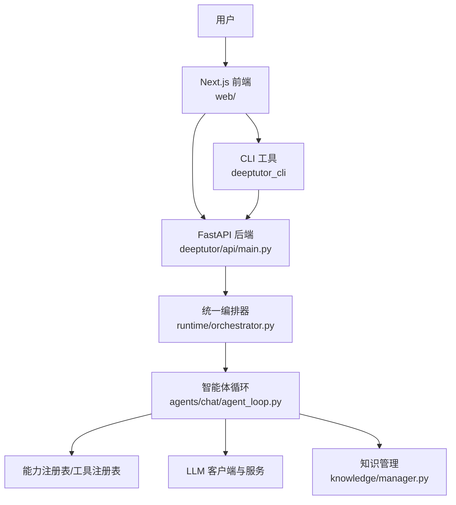
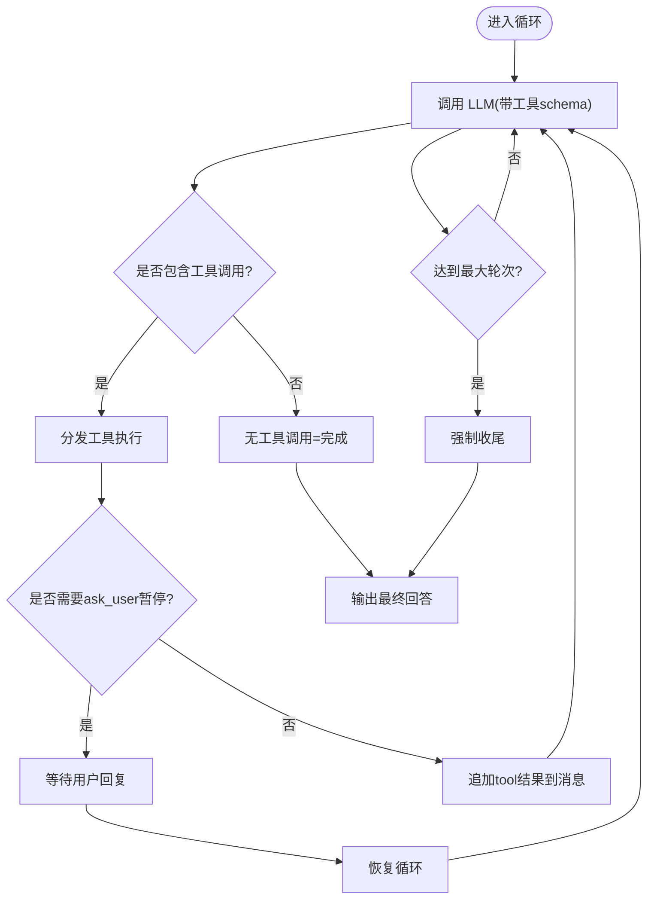
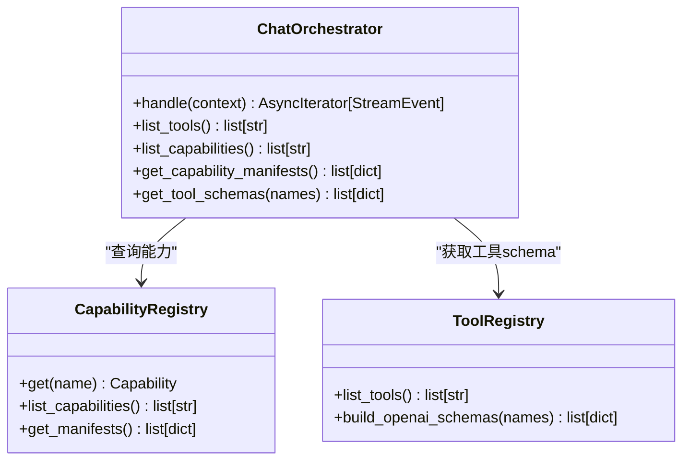
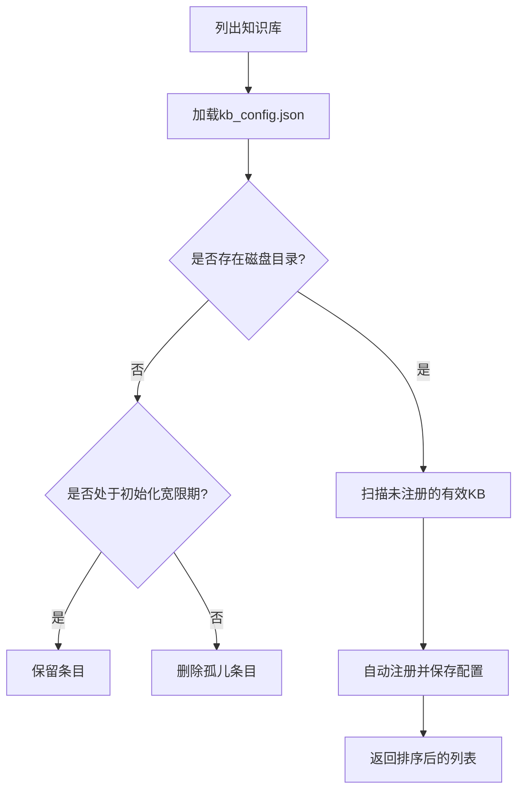
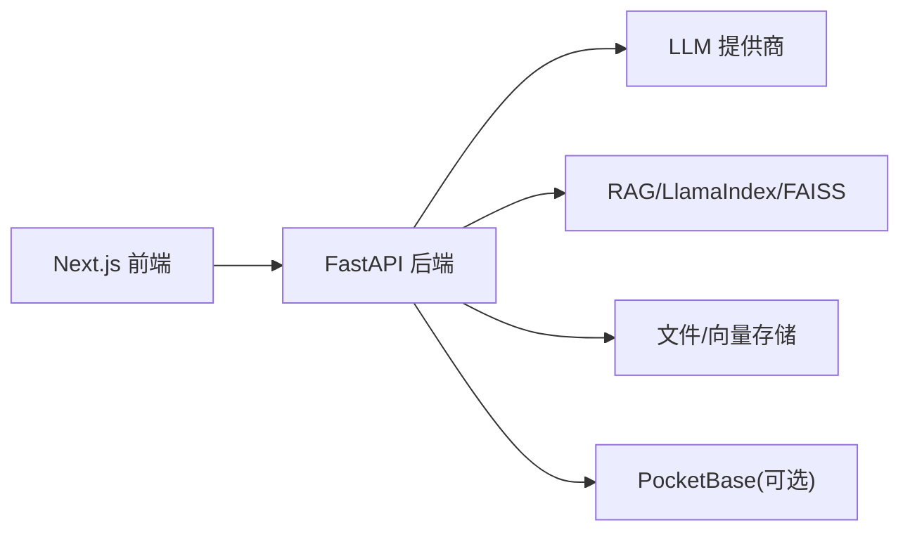

# 项目概述

<cite>
**本文引用的文件**
- [README.md](file://README.md)
- [CONTAINERIZATION.md](file://CONTAINERIZATION.md)
- [pyproject.toml](file://pyproject.toml)
- [deeptutor/__main__.py](file://deeptutor/__main__.py)
- [deeptutor_cli/__main__.py](file://deeptutor_cli/__main__.py)
- [deeptutor/api/main.py](file://deeptutor/api/main.py)
- [deeptutor/runtime/orchestrator.py](file://deeptutor/runtime/orchestrator.py)
- [deeptutor/core/agentic/__init__.py](file://deeptutor/core/agentic/__init__.py)
- [deeptutor/agents/chat/agent_loop.py](file://deeptutor/agents/chat/agent_loop.py)
- [deeptutor/knowledge/manager.py](file://deeptutor/knowledge/manager.py)
- [web/package.json](file://web/package.json)
</cite>

## 目录
1. [简介](#简介)
2. [项目结构](#项目结构)
3. [核心组件](#核心组件)
4. [架构总览](#架构总览)
5. [详细组件分析](#详细组件分析)
6. [依赖关系分析](#依赖关系分析)
7. [性能考量](#性能考量)
8. [故障排查指南](#故障排查指南)
9. [结论](#结论)
10. [附录：快速开始](#附录快速开始)

## 简介
DeepTutor 是一个“智能体原生”的终身个性化辅导平台，将对话、解题、问答生成、研究、可视化与掌握路径练习整合到统一的工作区中。其设计围绕三个核心理念展开：
- 统一智能体循环：聊天、问答、研究、可视化、解题与掌握路径等能力共享同一套智能体循环，切换目标而非引擎，上下文随学习者流动。
- 连接的学习上下文：知识库、书籍、协写草稿、笔记本、题库、人设与记忆在所有工作流中可用，避免工具孤岛。
- 多引擎知识系统：版本化检索库支持 LlamaIndex、PageIndex、GraphRAG、LightRAG、LightRAG Server、IMA 以及可链接的 Obsidian 仓库，文档解析引擎可插拔。

技术栈采用 Python FastAPI 后端、Next.js 前端与 CLI 工具；提供本地安装、源码开发、容器化与 CLI-only 多种部署方式。

**章节来源**
- [README.md:189-199](file://README.md#L189-L199)
- [README.md:202-448](file://README.md#L202-L448)

## 项目结构
仓库采用分层与按功能域组织的方式：
- deeptutor：后端核心（FastAPI、智能体、能力、工具、服务、运行时编排）
- deeptutor_cli：命令行入口与子命令
- web：Next.js 前端应用与界面逻辑
- tests：全量测试覆盖
- scripts 与 packaging：启动脚本与打包配置
- assets：文档与截图资源



**图表来源**
- [deeptutor/api/main.py:248-499](file://deeptutor/api/main.py#L248-L499)
- [deeptutor/runtime/orchestrator.py:26-147](file://deeptutor/runtime/orchestrator.py#L26-L147)
- [deeptutor/agents/chat/agent_loop.py:151-357](file://deeptutor/agents/chat/agent_loop.py#L151-L357)
- [deeptutor/knowledge/manager.py:244-600](file://deeptutor/knowledge/manager.py#L244-L600)

**章节来源**
- [pyproject.toml:8-75](file://pyproject.toml#L8-L75)
- [web/package.json:1-63](file://web/package.json#L1-L63)

## 核心组件
- 统一智能体循环：以一轮轮 LLM 调用为核心，每轮可选择调用工具并观察结果，直到无工具调用的“完成”轮输出最终答案；支持 ask_user 暂停与恢复、预算耗尽强制收尾、上下文检查点折叠等。
- 统一编排器：作为所有消费端（CLI、WebSocket、SDK）的统一入口，根据上下文路由到具体能力，管理事件总线生命周期并广播完成事件。
- 能力与工具插件体系：能力通过注册表发现，工具通过注册表暴露 schema 并被循环调度执行；支持并行工具调用与子追踪。
- 多引擎知识系统：统一管理多个知识库，支持创建、链接、重索引、状态同步、嵌入指纹校验与版本化索引目录。
- 会话与流式总线：基于 StreamBus 的事件流贯穿前后端，承载内容、思考、进度、来源与错误事件。
- 运行时与生命周期：FastAPI lifespan 负责启动时初始化 LLM、事件总线、合作伙伴、定时任务、迁移与关闭资源。

**章节来源**
- [deeptutor/core/agentic/__init__.py:1-79](file://deeptutor/core/agentic/__init__.py#L1-L79)
- [deeptutor/runtime/orchestrator.py:26-147](file://deeptutor/runtime/orchestrator.py#L26-L147)
- [deeptutor/agents/chat/agent_loop.py:151-357](file://deeptutor/agents/chat/agent_loop.py#L151-L357)
- [deeptutor/knowledge/manager.py:244-600](file://deeptutor/knowledge/manager.py#L244-L600)
- [deeptutor/api/main.py:116-246](file://deeptutor/api/main.py#L116-L246)

## 架构总览
DeepTutor 的端到端请求流程如下：浏览器访问 Next.js 前端，前端通过相对路径发起 /api/* 与 /ws/* 请求；后端 FastAPI 在启动阶段完成配置加载、日志、CORS、静态输出挂载与路由注册；编排器根据上下文选择能力并运行智能体循环；循环内调用工具、检索知识库、与 LLM 交互，并通过流式总线向前端推送事件。

```mermaid
sequenceDiagram
    participant U as "用户"
    participant FE as "Next.js 前端"
    participant API as "FastAPI 后端"
    participant ORCH as "编排器"
    participant LOOP as "智能体循环"
    participant KB as "知识管理"
    participant LLM as "LLM 服务"
    
    U->>FE: "打开页面/输入消息"
    FE->>API: "POST /api/v1/chat (或 WebSocket)"
    API->>ORCH: "handle(context)"
    ORCH->>LOOP: "capability.run(context, bus)"
    LOOP->>KB: "检索/引用知识库"
    LOOP->>LLM: "流式补全(含工具schema)"
    LLM-->>LOOP: "文本/工具调用片段"
    LOOP->>KB: "工具执行(如 rag/kb_files)"
    LOOP-->>API: "事件(content/thinking/progress/sources/done)"
    API-->>FE: "转发事件流"
    FE-->>U: "渲染回答/思考/进度"
```

**图表来源**
- [deeptutor/api/main.py:248-499](file://deeptutor/api/main.py#L248-L499)
- [deeptutor/runtime/orchestrator.py:36-114](file://deeptutor/runtime/orchestrator.py#L36-L114)
- [deeptutor/agents/chat/agent_loop.py:172-357](file://deeptutor/agents/chat/agent_loop.py#L172-L357)
- [deeptutor/knowledge/manager.py:515-600](file://deeptutor/knowledge/manager.py#L515-L600)

## 详细组件分析

### 统一智能体循环（Chat Agent Loop）
- 单轮对话即一次智能体循环：每轮 LLM 调用可能产生工具调用；有工具调用的轮为“叙述”，继续下一轮；无工具调用的轮为“完成”，其文本即最终答案。
- 关键机制：
  - 上下文窗口保护与检查点折叠，避免超长上下文。
  - 预算耗尽时的强制收尾，保证已有工作不丢失。
  - ask_user 暂停与恢复，结构化澄清问题。
  - 对不支持的工具 schema/图片输入的降级重试。
  - 流式内容拆分“思考”与“内容”，提升可读性。



**图表来源**
- [deeptutor/agents/chat/agent_loop.py:234-357](file://deeptutor/agents/chat/agent_loop.py#L234-L357)
- [deeptutor/agents/chat/agent_loop.py:438-637](file://deeptutor/agents/chat/agent_loop.py#L438-L637)

**章节来源**
- [deeptutor/agents/chat/agent_loop.py:1-23](file://deeptutor/agents/chat/agent_loop.py#L1-L23)
- [deeptutor/agents/chat/agent_loop.py:151-357](file://deeptutor/agents/chat/agent_loop.py#L151-L357)
- [deeptutor/agents/chat/agent_loop.py:438-637](file://deeptutor/agents/chat/agent_loop.py#L438-L637)

### 统一编排器（Orchestrator）
- 职责：接收 UnifiedContext，路由到对应能力（默认 chat），管理 StreamBus 生命周期，发布完成事件。
- 行为：若能力未知则返回错误事件；否则创建事件总线、异步执行能力、捕获异常、发送 DONE 事件并清理。



**图表来源**
- [deeptutor/runtime/orchestrator.py:26-147](file://deeptutor/runtime/orchestrator.py#L26-L147)

**章节来源**
- [deeptutor/runtime/orchestrator.py:26-147](file://deeptutor/runtime/orchestrator.py#L26-L147)

### 多引擎知识系统（Knowledge Base Manager）
- 职责：管理多个知识库的生命周期（创建、链接、重索引、状态更新）、配置持久化、嵌入指纹校验、版本化索引目录、孤儿条目清理与自动注册。
- 特性：
  - 支持 LlamaIndex、PageIndex、GraphRAG、LightRAG、LightRAG Server、IMA、Obsidian 等引擎。
  - 原子写入配置，并发安全。
  - 与 PocketBase 同步元数据（可选）。
  - 自动检测就绪索引与嵌入签名匹配，提示重新索引。



**图表来源**
- [deeptutor/knowledge/manager.py:515-600](file://deeptutor/knowledge/manager.py#L515-L600)

**章节来源**
- [deeptutor/knowledge/manager.py:244-600](file://deeptutor/knowledge/manager.py#L244-L600)

### 后端服务与生命周期（FastAPI）
- 启动阶段：确保运行时设置文件存在、导出环境变量、配置日志、验证工具一致性、初始化 LLM 客户端、启动事件总线、自动启动合作伙伴、启动定时任务、Ping PocketBase、迁移旧版记忆文件。
- 路由注册：按功能域挂载路由（chat、knowledge、book、memory、settings、partners 等），统一鉴权策略。
- 静态输出：仅允许白名单路径的用户输出被公开访问。

**章节来源**
- [deeptutor/api/main.py:116-246](file://deeptutor/api/main.py#L116-L246)
- [deeptutor/api/main.py:248-499](file://deeptutor/api/main.py#L248-L499)

## 依赖关系分析
- 后端依赖：FastAPI、Uvicorn、WebSockets、Pydantic、OpenAI/Anthropic/DashScope 等 LLM SDK、LlamaIndex/RAG 相关库、FAISS 向量存储、PDF/Office 解析库、PocketBase 客户端、Loguru 等。
- 前端依赖：Next.js、React、Tailwind、Mermaid、Chart.js、i18next 等。
- 构建与工具：Black、Ruff、pytest、mypy、bandit 等。



**图表来源**
- [pyproject.toml:21-71](file://pyproject.toml#L21-L71)
- [web/package.json:23-47](file://web/package.json#L23-L47)

**章节来源**
- [pyproject.toml:21-71](file://pyproject.toml#L21-L71)
- [pyproject.toml:76-235](file://pyproject.toml#L76-L235)
- [web/package.json:1-63](file://web/package.json#L1-L63)

## 性能考量
- 智能体循环：
  - 控制每轮最大 token 与轮次，避免无限探索；预算耗尽时强制收尾，保障用户体验。
  - 上下文检查点折叠减少消息长度，降低 LLM 成本与延迟。
  - 对不支持的工具 schema/图片输入进行降级重试，提高兼容性。
- 知识检索：
  - 使用 FAISS 替代暴力扫描，提升大规模知识库检索性能。
  - 版本化索引与嵌入签名匹配，避免无效重建。
- 后端：
  - 选择性访问日志减少噪音，聚焦非 200 响应。
  - 资源池化与确定性关闭（LLM 客户端、MCP、事件总线），避免资源泄漏。
- 前端：
  - 流式渲染与增量更新，提升交互流畅度。
  - 按需加载与模块化依赖，优化首屏与包体积。

[本节为通用指导，无需特定文件来源]

## 故障排查指南
- 启动失败：
  - 检查 CORS 配置与认证开关；确认前端端口与后端端口映射正确。
  - 查看 FastAPI 启动日志，关注 LLM 客户端初始化、事件总线、合作伙伴与定时任务启动情况。
- 无法连接后端：
  - 容器化部署下，浏览器仅访问前端端口；/api/* 与 /ws/* 由 Next.js 中间件转发至后端；确认 DEEPTUTOR_API_BASE_URL 设置正确。
  - 若启用认证，确保 cookie 与 CORS 源配置一致。
- 知识库问题：
  - 检查 kb_config.json 中的状态与进度；若有嵌入模型不匹配，需重新索引。
  - 对于已失败的文档，支持单独移除而无需重建整个知识库。
- 代码执行沙箱：
  - 本地与 Docker 默认启用受限子进程沙箱；如需禁用主机侧执行，设置 sandbox_allow_subprocess=false。
  - Compose 部署推荐使用独立 runner sidecar 以增强隔离。

**章节来源**
- [CONTAINERIZATION.md:171-247](file://CONTAINERIZATION.md#L171-L247)
- [CONTAINERIZATION.md:345-379](file://CONTAINERIZATION.md#L345-L379)
- [CONTAINERIZATION.md:406-468](file://CONTAINERIZATION.md#L406-L468)
- [README.md:408-448](file://README.md#L408-L448)

## 结论
DeepTutor 通过统一智能体循环、连接的学习上下文与多引擎知识系统，实现了跨能力的上下文一致性与可扩展性。后端以 FastAPI 提供稳定 API，前端以 Next.js 提供现代交互体验，CLI 提供强大的自动化与集成能力。结合容器化与可选的多用户部署，DeepTutor 既适合个人学习，也适合团队协作与企业级场景。

[本节为总结，无需特定文件来源]

## 附录：快速开始
- 环境要求：
  - Python 3.11–3.13，Node.js 20+（完整 Web 应用）或 Node.js 22 LTS（源码开发）。
  - 可选：Docker/Podman、LaTeX/ffmpeg（数学动画扩展）。
- 安装方式（任选其一）：
  - PyPI 安装：pip install -U deeptutor，然后 deeptutor init 与 deeptutor start。
  - 源码安装：克隆仓库，创建虚拟环境，安装后端与前端依赖，执行 deeptutor init 与 deeptutor start --dev。
  - Docker：docker run 镜像，绑定数据卷与端口，浏览器访问前端端口。
  - CLI-only：从源码安装 CLI-only 包，执行 deeptutor init --cli 与 deeptutor chat。
- 基本使用示例：
  - 交互式 REPL：deeptutor chat
  - 单次运行：deeptutor run chat "解释傅里叶变换" --tool rag --kb my-kb
  - 知识库操作：deeptutor kb create my-kb --doc textbook.pdf
  - 记忆查看：deeptutor memory show
  - 配置查看：deeptutor config show

**章节来源**
- [README.md:202-448](file://README.md#L202-L448)
- [README.md:680-755](file://README.md#L680-L755)
- [deeptutor/__main__.py:1-7](file://deeptutor/__main__.py#L1-L7)
- [deeptutor_cli/__main__.py:1-6](file://deeptutor_cli/__main__.py#L1-L6)