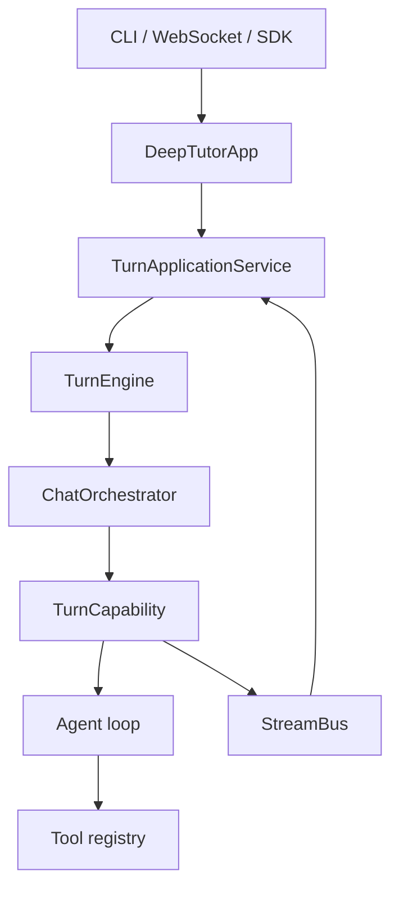
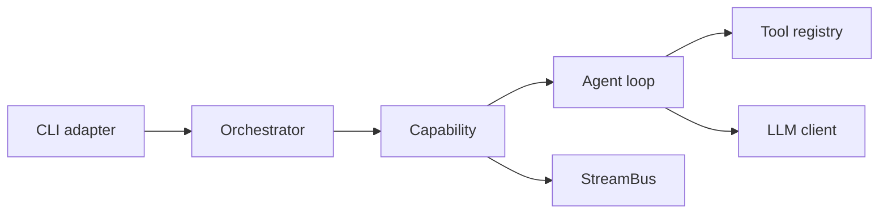

# 学习路线：从读懂 DeepTutor 到从零重建同构 Agent 项目

[进度](PROGRESS.md) · [笔记模板](notes/TEMPLATE.md) · [架构文档](../docs-for-dev/ARCHITECTURE.md) · [工具与能力契约](../docs-for-dev/TOOLS_AND_CAPABILITIES.md)

本文是学习指南，不是行为契约。内容按 1.7.0 源码树编写；当本文与代码、生成的契约或模块清单冲突时，以代码为准。

## 1. 目标与前提

**终点**：在空目录搭出同构骨架，并能不看原文件移植一个真实能力（L4）。

**前提**：能本地跑起 `deeptutor run chat "..."`；Python 环境与模型配置已就绪（见 [Agent setup](../docs-for-dev/AGENT_SETUP.md)）。

**三条纪律**：

1. 以「一次 turn」为主线，不按目录顺序通读。
2. 契约优先：先读 `deeptutor/core/` 的协议，实现用日志和断点追。
3. 每周必须产出可运行的东西；验收标准是「删掉这一层能自己补回来」。

## 2. 一次 turn 的九步链路



| 步 | 责任 | 代码位置 |
| --- | --- | --- |
| 1 | 参数解析，构造 `TurnRequest` | [`deeptutor_cli/main.py`](../deeptutor_cli/main.py)、[`core/turn_request.py`](../deeptutor/core/turn_request.py) |
| 2 | SDK 门面，解析 workspace 上下文 | [`app/facade.py`](../deeptutor/app/facade.py) |
| 3 | 准入、去重、持久化、回放 | [`app/service.py`](../deeptutor/app/service.py) |
| 4 | 下层执行入口 | [`runtime/turn_engine.py`](../deeptutor/runtime/turn_engine.py) |
| 5 | 路由与总线生命周期 | [`runtime/orchestrator.py`](../deeptutor/runtime/orchestrator.py) |
| 6 | 能力实现 | [`agents/chat/capability.py`](../deeptutor/agents/chat/capability.py)、[`capabilities/solve/capability.py`](../deeptutor/capabilities/solve/capability.py) |
| 7 | 单循环推进 | [`agents/loop/pipeline.py`](../deeptutor/agents/loop/pipeline.py) → [`agent_loop.py`](../deeptutor/agents/loop/agent_loop.py) |
| 8 | 工具发现与分发 | [`runtime/registry/tool_registry.py`](../deeptutor/runtime/registry/tool_registry.py)、[`agents/_shared/tool_composition.py`](../deeptutor/agents/_shared/tool_composition.py) |
| 9 | 事件扇出与阶段标记 | [`runtime/stream_bus.py`](../deeptutor/runtime/stream_bus.py)、[`core/stream.py`](../deeptutor/core/stream.py) |

项目有两套循环引擎，初学只吃透第一套：

- `agents/loop/`：`AgenticLoopPipeline` + `AgentLoop`，chat 及复用 chat 协议的能力（solve、ask_questions 等）走这条。
- `runtime/agentic/`：`run_agentic_loop` + `LabelProtocol`，研究、出题、PageIndex 等标签驱动管线走这条。第二遍再看，只关注标签协议这一个差异。

## 3. 能力分级

| 级别 | 能力 | 自测方式 |
| --- | --- | --- |
| L1 解释 | 说清一次 turn 的完整链路 | 白纸画出九步并标注输入输出 |
| L2 修改 | 加工具 / 加能力不破坏契约 | CLI 与 WebSocket 同时生效 |
| L3 替换 | 换掉某一层实现 | 替换 `StreamBus` 后上层不改 |
| L4 重建 | 空目录搭出同构项目 | 第 7–8 周产物跑通完整对话 |

## 4. 六周总表

| 周 | 主题 | 阅读 | 追踪 | 动手 | 验收 |
| --- | --- | --- | --- | --- | --- |
| 1 | 主干与事件流 | `core/context.py`、`core/stream.py`、`core/capability_protocol.py`、`runtime/turn_engine.py` | 一次真实对话的事件序列 | 150 行 `mini_core` | 假能力输出 `SESSION → CONTENT → DONE` |
| 2 | 工具层 | `core/tool_protocol.py`、`tools/builtin/__init__.py`、`tools/builtin_specs.py`、`agents/_shared/tool_composition.py` | schema 生成与门控 | 玩具工具 + 一致性测试 | 模型真实调用；关闭开关后 schema 消失 |
| 3 | 单循环引擎 | `agents/chat/capability.py`、`agentic_pipeline.py`、`agents/loop/agent_loop.py`、`loop_host.py` | 每轮消息增长与终止原因 | 80 行 loop（假模型） | 三条终止路径都有测试 |
| 4 | 多阶段能力 | `capabilities/solve/capability.py`、`loop.py`、`tools.py`、`agents/_shared/capability_result.py`、`runtime/request_contracts.py` | 对比 loop 型与 pipeline 型 | 三阶段 capability | 终态含 `response` 与 `cost_summary` |
| 5 | 持久化与回放 | `app/service.py`、`services/session/turn_runtime.py`、`api/routers/unified_ws.py`、`EVENTS_AND_PROGRESS.md` | 重连、重复提交、取消 | 落盘 + 重放 + 取消 | 三个不变式成立 |
| 6 | 扩展与分发 | `PLUGINS.md`、`MODULES.md`、`examples/learning_echo/` | `plugin install/show/approve/state` | 能力打成 wheel 安装 | 三态可区分；禁用不报导入错 |

## 5. 每周任务

### 第 1 周：主干与事件流

**目标**：闭卷画出九步链路，并解释 `StreamBus` 为什么存在。

读：

- [`ARCHITECTURE.md`](../docs-for-dev/ARCHITECTURE.md) 的调用链表格。
- [`core/context.py`](../deeptutor/core/context.py)：记住 `session_id`、`user_message`、`conversation_history`、`active_capability`、`enabled_tools`、`runtime`、`interaction` 的职责边界。
- [`core/stream.py`](../deeptutor/core/stream.py)：事件类型。
- [`runtime/orchestrator.py`](../deeptutor/runtime/orchestrator.py)：未知能力、能力异常、正常结束三条出口。

追：

```bash
deeptutor run chat "用一句话解释傅里叶变换"
```

在 [`deeptutor_cli/common.py`](../deeptutor_cli/common.py) 的渲染器记录事件类型序列；在 `ChatOrchestrator.handle` 记录 `cap_name`、`turn_id`、终态 `status`。

造（仓库外 `mini_core`）：

- `UnifiedContext`（6 个字段）。
- `StreamEvent(kind, source, content, metadata)`。
- `StreamBus`：`emit` 入队、`subscribe` 异步迭代、`stage` 包裹阶段。
- 假能力发三条事件；CLI 按类型打印。

验收：

- [ ] 白纸画出九步，能说出每步输入输出。
- [ ] 能解释 `emit` / `subscribe` / `stage` 各自解决的问题。
- [ ] 正常与异常都输出稳定的 `DONE`。

### 第 2 周：工具层

**目标**：理解「可用」不等于「有权使用」，以及 schema 在哪里被门控。

读：

- [`core/tool_protocol.py`](../deeptutor/core/tool_protocol.py)：`BaseTool`、`ToolDefinition`、`ToolParameter`、`ToolResult`。
- [`tools/builtin/__init__.py`](../deeptutor/tools/builtin/__init__.py) 的 `USER_TOGGLEABLE_TOOL_NAMES`。
- [`tools/builtin_specs.py`](../deeptutor/tools/builtin_specs.py)：懒加载描述符。
- [`agents/_shared/tool_composition.py`](../deeptutor/agents/_shared/tool_composition.py)：挂载规则。
- [`TOOLS_AND_CAPABILITIES.md`](../docs-for-dev/TOOLS_AND_CAPABILITIES.md)：三类工具。

追：

在 `ToolRegistry.build_openai_schemas` 打印最终 schema，记录四种情况下的增减：默认 chat、开启某工具、带知识库、切到 solve。

造：

- `echo_time` 工具：一个参数、结构化返回。
- 一致性测试：声明名集合 == 注册名集合。
- 门控测试：条件不满足时 schema 不出现。

验收：

- [ ] 模型真实调用成功一次，`ToolResult` 字段完整。
- [ ] 关闭开关后 schema 消失，而不是调用时报错。
- [ ] 能说出「为什么发现与分发两处都要校验」。

### 第 3 周：单循环引擎

**目标**：把「模型 → 工具 → 再模型」写成可测试的纯逻辑。

读（按顺序，不要跳）：

1. [`agents/chat/capability.py`](../deeptutor/agents/chat/capability.py)：18 行，说明能力只是循环的一层皮。
2. [`agents/chat/agentic_pipeline.py`](../deeptutor/agents/chat/agentic_pipeline.py)：chat 只是默认绑定。
3. [`agents/loop/agent_loop.py`](../deeptutor/agents/loop/agent_loop.py)：只读循环骨架，跳过流式解析。
4. [`loop_host.py`](../deeptutor/agents/loop/loop_host.py)：能力专属逻辑如何注入。
5. [`context_budget.py`](../deeptutor/agents/loop/context_budget.py)：上下文预算。

追：

在迭代处打印：轮次、消息条数、是否有 `tool_calls`、终止原因、是否强制收尾。

造：

80 行循环 + 假模型，覆盖：

- 直接文本 → 结束。
- 一次工具调用 → 回填 → 再请求 → 结束。
- 达到最大轮次 → 强制收尾且不吐半截 JSON。

验收：

- [ ] 三条路径各有测试，不依赖网络。
- [ ] 能解释「为什么能力层不直接调 LLM」。
- [ ] 能说出强制收尾与正常终止在事件上的差异。

### 第 4 周：多阶段能力

**目标**：分清「复用 chat 循环的能力」与「自建阶段管线的能力」。

读：

- [`capabilities/solve/capability.py`](../deeptutor/capabilities/solve/capability.py)、[`loop.py`](../deeptutor/capabilities/solve/loop.py)、[`tools.py`](../deeptutor/capabilities/solve/tools.py)、[`session.py`](../deeptutor/capabilities/solve/session.py)。
- [`capabilities/protocol.py`](../deeptutor/capabilities/protocol.py)：loop 扩展与提示词块。
- [`agents/_shared/capability_result.py`](../deeptutor/agents/_shared/capability_result.py)：统一收尾。
- [`runtime/request_contracts.py`](../deeptutor/runtime/request_contracts.py)：配置校验。
- `agents/research/pipeline.py`：不逐行读，只找阶段边界与 `run_agentic_loop` 调用点。

追：

对比 solve 与 research 的事件序列：阶段名、阶段数量、用户可见内容产生的位置。

造：

三阶段能力 `rephrase → answer → cite`：

- 每阶段用 `stream.stage(name)` 包裹。
- 终态统一走 `emit_capability_result`。
- 配置用 Pydantic 模型校验，未知字段拒绝。

验收：

- [ ] 非法 `--config` 被拒绝且错误可读。
- [ ] 终态含 `response` 与 `cost_summary`。
- [ ] 取消时不留「已完成」终态。

### 第 5 周：持久化、回放与取消

**目标**：理解「浏览器断开」不等于「turn 失败」。

读：

- [`EVENTS_AND_PROGRESS.md`](../docs-for-dev/EVENTS_AND_PROGRESS.md)：先分清四套事件系统。
- [`app/service.py`](../deeptutor/app/service.py)：准入、提交摘要、去重。
- [`services/session/turn_runtime.py`](../deeptutor/services/session/turn_runtime.py)。
- [`runtime/stream_bus.py`](../deeptutor/runtime/stream_bus.py)：读全文。
- [`api/routers/unified_ws.py`](../deeptutor/api/routers/unified_ws.py)：适配层只做重放。

追：

三个实验：断线重连、同一 `client_submission_id` 重复提交、运行中取消。

造：

给 mini 项目加事件落盘、按 `turn_id` 重放、取消令牌。

验收（三个不变式）：

- [ ] 同一 submission 只执行一次。
- [ ] 终态可重放，重连不重复执行。
- [ ] 取消后不再产生模型调用。

### 第 6 周：扩展与分发

**目标**：知道「模块」与「插件」不是一回事，并能装进干净环境。

读：

- [`PLUGINS.md`](../docs-for-dev/PLUGINS.md)、[`MODULES.md`](../docs-for-dev/MODULES.md)。
- [`examples/learning_echo/README.md`](../docs-for-dev/examples/learning_echo/README.md)。
- [`examples/learning_echo/learning_echo/worker.py`](../docs-for-dev/examples/learning_echo/learning_echo/worker.py)：工具 + 能力 + HTTP 路由的最小实现。
- [`plugins/runtime.py`](../deeptutor/plugins/runtime.py)、[`plugins/manifest.py`](../deeptutor/plugins/manifest.py)：生命周期与权限。

追：

在临时 `DEEPTUTOR_HOME` 下走完 `install → show → approve → state`，再禁用一次。

造：

把能力打成 wheel 安装；补一条禁用状态测试。

验收：

- [ ] installed / approved / enabled 三态可区分。
- [ ] 禁用后能力消失且无导入错误。
- [ ] 能说出第三方插件与官方模块的信任边界差异。

## 6. 第 7–8 周：空目录重建



目标结构（放在仓库外）：

```text
mini_agent/
  core/context.py
  core/stream.py
  core/tool.py
  core/capability.py
  runtime/bus.py
  runtime/orchestrator.py
  runtime/registry.py
  agents/loop.py
  agents/chat.py
  tools/echo_time.py
  cli.py
  store.py
  tests/
```

每层最小契约：

| 层 | 最小接口 | 明确先不做 |
| --- | --- | --- |
| context | `session_id`、`user_message`、`history`、`config`、`language` | workspace、persona、附件 |
| stream | `emit`、`subscribe`、`stage` | 序列号、持久化 |
| capability | `manifest` + `run(context, stream)` | 请求 schema、i18n |
| tool | 名称 + 描述 + 参数 + `execute` | 权限、MCP、延迟发现 |
| registry | `register` / `get` / `list` | 懒加载 |
| orchestrator | 路由 + 终态收尾 | 全局事件总线 |

实现顺序（每步可运行）：

1. 假能力 + 总线 + CLI（复用第 1 周代码）。
2. 接真实模型，仍只有一个能力。
3. 加一个工具，跑通「模型调用工具再回答」。
4. 抽出循环，能力降级为「配置 + 工具集 + 提示词」。
5. 加第二个三阶段能力，验证注册与路由。
6. 加落盘与重放，验证三个不变式。
7. 固定测试：事件顺序、工具一致性、重复提交、取消。

第 8 周收尾：从 DeepTutor 选一个真实能力（推荐 solve），**不看原文件**移植进来。

## 7. 毕业答辩

1. 一个内容事件从能力到浏览器经过哪几层？哪一层负责去重？
2. 工具 schema 为什么要在发现与分发两处校验？举一个绕过会出问题的场景。
3. 循环有哪些终止条件？强制收尾如何避免半截结构化数据？
4. 什么情况下新写阶段管线，而不是复用 chat 循环？
5. 同一提交重复到达，如何保证只执行一次？
6. 取消 turn 时，如何保证不再消耗 token？
7. 模块未安装时，为什么导入不能失败？与「能力不可用」是什么关系？
8. 删掉 `StreamBus` 后，哪些能力还能工作，哪些会坏？

## 8. 常见陷阱

- **从 `agents/loop/pipeline.py` 读起**：它是优化产物，不是设计入口。
- **过早学 RAG、记忆、多用户、前端**：纵向功能不改变骨架。
- **把「持久化 + 回放 + 多 worker」当核心**：这是产品需求，可先砍、第 5 周再加回。
- **只读不写**：唯一信号是「关掉源码还能写出来」。
- **照抄目录结构**：先问「这层解决什么问题」，再决定要不要。

## 9. 强度变体

| 每周投入 | 周期 | 调整 |
| --- | --- | --- |
| 12–15 h | 3 周 | 每周两章；追踪压缩为看日志；重建只做 chat + 一个工具 |
| 6–8 h | 6 周 | 默认节奏 |
| 3–4 h | 10 周 | 只做「读 + 造」；重建拆成四周 |

## 附录 A：分层文件地图

| 层 | 入口 | 配套 |
| --- | --- | --- |
| 协议 | `core/context.py`、`core/stream.py`、`core/tool_protocol.py`、`core/capability_protocol.py` | `core/turn_request.py` |
| 应用 | `app/facade.py`、`app/service.py` | `app/container.py`、`app/contracts.py` |
| 运行时 | `runtime/turn_engine.py`、`runtime/orchestrator.py`、`runtime/stream_bus.py` | `runtime/registry/`、`runtime/bootstrap/`、`runtime/coordination/` |
| 循环 | `agents/loop/agent_loop.py`、`agents/loop/pipeline.py` | `loop_host.py`、`context_budget.py` |
| 标签驱动 | `runtime/agentic/loop.py` | `labeled_step.py`、`labels.py`、`tool_dispatch.py` |
| 能力 | `capabilities/*/capability.py`、`agents/*/capability.py` | `capabilities/protocol.py`、`agents/_shared/` |
| 工具 | `tools/builtin/__init__.py`、`tools/builtin_specs.py` | `agents/_shared/tool_composition.py` |
| 适配 | `deeptutor_cli/main.py`、`deeptutor_cli/common.py`、`api/routers/unified_ws.py` | `web/contracts/` |
| 分发 | `modules/manifests/`、`plugins/` | `examples/learning_echo/` |

## 附录 B：术语表

| 术语 | 含义 | 易混点 |
| --- | --- | --- |
| turn | 一次用户输入到终态事件的完整执行 | 不等于一次模型调用 |
| capability | 拥有一整个 turn 的多阶段能力 | 不等于 tool |
| tool | 模型按需选择的单次操作 | 「可用」不等于「有权使用」 |
| mount | 把工具装配进本轮请求 | 用户开关只是条件之一 |
| stage | 能力内部的阶段标记 | 不是 turn 终态 |
| manifest | 静态元数据 | 不含运行时状态 |
| module | 官方分发功能包 | 与第三方插件信任模型不同 |
| replay | 按持久化事件重放 | 不等于重新执行 |
| lease | 多 worker 下的执行所有权 | 不等于会话锁 |

## 附录 C：验证命令

```bash
deeptutor run chat "用一句话解释傅里叶变换"

python -m pytest tests/runtime/test_orchestrator.py
python -m pytest tests/runtime/test_native_engine.py
python -m pytest tests/app tests/runtime/coordination
python -m pytest tests/capabilities
python -m pytest tests/plugins tests/api/test_plugins_router.py

python -m ruff check .
lint-imports
```

扩展点是否生效，以 `deeptutor module list`、`deeptutor plugin list`、`deeptutor plugin show` 的实际输出为准。
